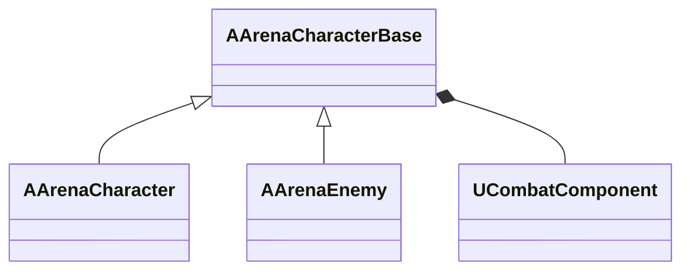

# 🎮 언리얼 엔진 5 C++ 6개월 취업 포트폴리오 커리큘럼

> C#/유니티 입문자를 위한 'AI 지름길' 과정 — 학습 과정 자체가 포트폴리오가 되도록  
> 문서 v2.9 · 최종 수정 2026-11-26 · 기준 엔진 **Unreal Engine 5.8**

**날짜별 학습 카드**(넘기면서 학습 → 기록까지)·🔔 기록 알림·GitHub Desktop 따라 하기·면접 카드는 같은 폴더의 **[인터랙티브 가이드(UnrealEngine_6Month_Study_Guide.html)](./UnrealEngine_6Month_Study_Guide.html)**에서 할 수 있습니다.

## 목차
1. [과정 개요](#1-과정-개요)
2. [6개월 로드맵](#2-6개월-로드맵)
3. [주차별 커리큘럼](#3-주차별-커리큘럼)
4. [AI 학습법](#4-ai-학습법)
5. [포트폴리오 & Git](#5-포트폴리오--git)
6. [Git 기록 가이드](#6-git-기록-가이드)
7. [평가 기준 & 관문](#7-평가-기준--관문)
8. [면접 질문 은행](#8-면접-질문-은행)
9. [템플릿](#9-템플릿)
10. [자료 & 대응표](#10-자료--대응표)

---

## 1. 과정 개요

| 항목 | 내용 |
|---|---|
| **대상** | C#(클래스·인터페이스·배열) + 유니티(프리팹·애니메이션) 경험 2개월, C/C++ 경험 없음. C# 클래스·상속을 직접 써 본 적이 없으면 시작 전에 W00 「C#·유니티 기초 진단」(15분)부터 — 7개 미만이면 보충 트랙, 4개 미만이면 선수 트랙 |
| **기간** | 24주 커리큘럼 + 버퍼 2주 = 26주(약 6개월), 시작 전 0주차 3~5일 |
| **시간** | 주 22~25시간 기준 (평일 3시간 + 토 5.5시간 + 일 2.5시간 — 코테·회상 카드·TIL 포함). 필수는 약 20시간, 나머지는 막힘·보충 여유. 시간이 적으면 2장 「시간이 모자랄 때」 순서로 줄인다 |
| **환경** | UE 5.8 · Windows 11 · Visual Studio 2026 · GitHub Desktop(LFS) |
| **최종 산출물** | 2인 협동 액션 웨이브 서바이벌 프로토타입(C++/GAS/멀티) + 시연 영상 + 기술 포트폴리오 PDF + 6개월 학습 기록 저장소 |

### 이 과정의 'AI 지름길' 전략

**건너뛰는 것**
- C++ 문법책을 처음부터 끝까지 읽기, 콘솔 프로젝트만 몇 주씩 만들기
- C 언어, 템플릿 메타프로그래밍, STL 세부 구현 같은 '언리얼 실무에 바로 안 쓰는' 깊이
- 엔진 소스를 처음부터 통독하기 — 질문이 생겼을 때 그 함수만 찾아 읽는다

**절대 건너뛰지 않는 것**
- 포인터·참조·메모리 수명 — 언리얼 크래시의 대부분이 여기서 나온다
- 상속·virtual·Super — 엔진 클래스를 상속해 쓰는 것이 언리얼 개발의 기본 동작이다
- UPROPERTY와 GC, 리플렉션 — 유니티 출신이 가장 많이 틀리는 지점
- 컴파일·링크 에러 읽기, 중단점·콜스택 디버깅 — AI에게 묻기 전에 스스로 좁혀야 한다
- 내 코드를 말로 설명하기 — 코딩테스트·기술 면접·과제 전형에는 AI가 없다

> **방법:** C++은 별도 과정으로 배우지 않는다. 매주 언리얼 기능을 만들면서 그 주에 필요한 C++만 'C++ 생존 문법'으로 익히고, 매일 코딩테스트 1문제를 C++로 풀며 문법을 손에 붙인다. AI 의존도는 L1(W01~W08) → L2(W09~W16) → L3(W17~W24)로 낮추고, 매주 월요일 백지 드릴과 단계마다 AI-Off 챌린지로 AI 없이 쓰는 힘을 확인한다.

### 기업이 보는 것 ↔ 이 과정이 남기는 증거

| 평가 포인트 | 이 과정의 증거 | 대비되는 면접 질문 |
|---|---|---|
| **C++ 기본기** | 코테 C++ 약 80문제 + 재풀이 18회 · W13 기본기 점검 · AI-Off 챌린지 5회 + 매주 월요일 백지 드릴 기록 | 포인터/참조, virtual, 메모리, 스마트 포인터 질문 |
| **엔진 이해도('왜?')** | 엔진 소스 노트 5편 + 콜스택 캡처 · ADR 5건 | UPROPERTY/GC, 액터 생명주기, CDO |
| **완성도** | 플레이 가능한 빌드 · 릴리즈 6회(v0.1 → v1.0) · 시연 영상 | 프로젝트 1분/3분 설명 |
| **문제 해결력** | 트러블슈팅(TS) 문서 6건 이상 — 증상·가설·검증·원인·해결·재발 방지 | 가장 어려웠던 버그는? |
| **네트워크 · GAS** | 2인 협동, Server RPC/OnRep, GAS 예측 전/후 반응성 비교 영상 | 리플리케이션·RPC·GAS 구성요소 |
| **최적화 감각** | Size Map·풀링·Insights 성능 리포트(전/후 ms) | 병목을 어떻게 찾나? |
| **협업 습관** | 이슈 → 브랜치 → PR(셀프 리뷰·AI 활용 내역) → 릴리즈, 커밋 규칙 | Git 충돌·바이너리 에셋 관리 |
| **성장 가능성** | 6개월 매일 TIL + 월간 회고 + 관문 점검 기록 + '같은 기능의 진화' 표 | 어떻게 공부하나? AI는 어떻게 쓰나? |

### 만들 게임 — 범위를 먼저 고정한다

| 항목 | 내용 |
|---|---|
| **가칭** | ActionArena — 3인칭 근접 액션 웨이브 서바이벌 (2인 협동) |
| **핵심 루프** | 메뉴 → 웨이브 전투(콤보·대시) → 휴식 → 다음 웨이브 → 게임오버 → 최고 기록 저장 |
| **범위 제한** | 맵 1개 · 플레이어 무기 2종 · 적 2종(근접/원거리) · 어빌리티 3~4개 · 2인 Listen Server |
| **만들지 않는 것** | 오픈월드, 인벤토리·퀘스트, 스토리, 커스텀 캐릭터 아트 — 범위가 포트폴리오를 죽인다 |

### 수료 평가 — 무엇을 어떻게 보나

과정이 끝나면 아래 네 부분으로 본다. 범위는 이 문서의 **[필수]** 전부(심화 제외)이고, 모두 AI·인터넷·지난 내 코드·이 문서(10장 에러·모듈 표 포함) 없이 본다. 쓸 수 있는 것은 Visual Studio 자동 완성과 엔진 헤더(`F12`) 확인뿐이다. 그래서 매주의 드릴·챌린지·자가 점검도 같은 조건으로 한다.

| 부분 | 형식 | 이 과정에서 연습하는 곳 |
|---|---|---|
| **필기** | 개념을 내 말로 쓰는 서술 + 코드 읽기(이 코드가 하는 일 · 문제가 될 줄) | 자가 점검(말하고 적기) · 회상 카드 · 관문 채점 · W13 C++ 필기 · 일요일 「지난 질문」 첫 1개 종이 답 · 일요일 「내 코드 3줄」(빠지거나 틀리면 생길 문제까지 · 1줄은 처음 보는 코드) |
| **C++ 코딩테스트** | 시간 제한 안에 알고리즘 문제를 C++로 | 매일 코테 · 재풀이 날 · M6 모의 시험 |
| **라이브 실기** | 빈 프로젝트에서 언리얼 C++ 기능을 시간 안에 직접 구현 — 후보: 입력 바인딩 · 인터페이스 · 델리게이트 컴포넌트 · BTTask · 복제 변수 + Server RPC · GA(7장 「수료 대비 주」 수요일과 같다) | 월요일 백지 드릴 · 일요일 되감기 드릴 · AI-Off 챌린지 ①~⑤ |
| **포트폴리오 심사 + 구술** | 6개월 저장소·영상·문서를 보고, 내 코드에서 고른 줄을 묻는다 | PR·TS·ADR · 일요일 「내 코드 3줄」 · W22~W23 |

> 모의 평가는 모두 W23 AI-Off ⑤(모의 코테 2회 · 핵심 30문항 녹음 채점 · UE 백지 60분)로 한 번 치른다. 버퍼가 남았다면 W24 뒤 한 주는 7장 「수료 대비 주」로 네 부분(필기·코테·라이브 실기·구술)을 같은 조건으로 한 번 더 치르고 틀린 곳만 메운다. 버퍼를 다 썼다면 W24 토요일 보충 칸 앞 45분에 압축판(필기 모의 30분 + 새 Blank 프로젝트에 모듈·플러그인을 표 없이 넣고 빌드 15분)을 하고, ⑤에서 미달한 부품이 있으면 이어서 그 프로젝트에서 그 부품만 다시 쓴다(7장).

### 현실 체크
- **일정은 도전적이다.** 주 22~25시간 기준이다. 시간이 부족하면 2장 「시간이 모자랄 때」 순서로 줄이고, 관문을 크게 못 넘으면 버퍼 1주를 바로 쓴다. 그래도 밀리면 2장 「핵심 경로」로 진행하고, W13의 v0.3.0(싱글 MVP)을 1차 포트폴리오로 지원을 시작해도 된다.
- **AI 지름길의 한계를 인정한다.** 코딩테스트·기술 면접·과제 전형에는 AI가 없다. 그래서 매주 C++ 생존 문법, 매일 코테, 매주 월요일 백지 드릴과 단계마다 AI-Off 챌린지를 둔다.
- **Windows + Visual Studio는 업계 표준 환경과 같다.** 과제 전형·입사 후 환경과 거의 같고, 패키징한 Windows 빌드를 평가자가 바로 실행해 볼 수 있다. 그래도 **영상이 1순위 전달 수단**이다.
- **PC 사양을 먼저 확인한다.** 공식 권장은 RAM 32GB · 그래픽 메모리 8GB 이상이다. 그보다 낮으면 Scalable 설정·불필요한 앱 종료·짧은 PIE 세션으로 버티고, 무거운 에셋(메가스캔·고해상도 환경)은 쓰지 않는다.
- **버전 정보는 바뀐다.** Visual Studio·MSVC 버전 호환성, 플러그인 상태 같은 사실은 설치·사용 직전에 공식 문서로 재확인한다(이 문서 작성일: 2026-11-25).

### 학원·스터디에서 이 문서를 쓰는 법
- **주 1회 1:1 리뷰(30분)** — 그 주 PR에서 멘토가 고른 3줄을 「왜 필요한지 · 빠지거나 틀리면 생길 문제」까지 설명하게 하고, 지난 단계 자가 점검 질문 3개를 무작위로 묻는다(답 보기 전에 말하기, 핵심어 3개 중 2개를 말하고 그중 1개가 함수·태그 같은 근거 이름이면 통과). 설명 못 한 줄은 다음 주 월요일 백지 드릴 대상으로 정한다.
- **월 1회 데모데이** — 릴리즈 기준 5분 시연 + 3분 질의. 루브릭 6항목으로 평가. 학습자 자가 평가와 1점 이상 차이 나는 항목은 근거 링크를 함께 다시 본다.
- **관문(Gate) 운영** — 단계 마지막 주 일요일 「관문 점검」 카드로 확인한다. 가벼운 미달은 다음 단계 첫 주에 메우고, 무거운 미달이면 다음 단계로 넘어가지 않고 버퍼 1주를 바로 쓴다(최대 2회, 7장 「관문 운영」).
- **진척도 공유** — HTML 가이드에서 진척도를 JSON으로 내보내 멘토에게 전달(가져오기로 복원).
- **강사 체크 포인트** — UPROPERTY 누락 · 생성자 로직 · 무분별한 Tick · 하드 레퍼런스 · 권한 분기 누락 — 유니티 출신이 반복하는 5대 실수.

---

## 2. 6개월 로드맵

### 단계 요약

| 단계 | 주차 | 주제 | 릴리즈 | 이 단계가 증명하는 것 | AI 레벨 |
|---|---|---|---|---|---|
| 0 | W00 | 사전 준비 | — | 개발·기록 환경 | — |
| M1 | W01~W04 | 언리얼 C++ 첫걸음 | v0.1.0 움직이는 캐릭터 | C++을 몰라도 언리얼 C++로 시작할 수 있고, 내가 쓴 코드를 설명할 수 있다. | L1 — AI가 쓰고 내가 한 줄씩 해설 |
| M2 | W05~W08 | 상호작용 & 전투 | v0.2.0 콤보 전투 + 데이터 주도 무기 | 결합도 낮은 설계(인터페이스·델리게이트)와 데이터 주도 설계를 할 줄 안다. | L1 — 새 개념은 AI 초안 + 내 해설, [L2] 표시 과제와 한 번 써 본 패턴은 내가 먼저 작성 |
| M3 | W09~W12 | UI · AI · 게임 루프 | (v0.3.0 준비) | 메모리를 의식하고(소프트 레퍼런스), 디버깅 도구로 근거를 제시하며, 한 판짜리 게임을 완성한다. | L2 — 내가 먼저 작성하고 AI가 리뷰 |
| M4 | W13~W16 | 기본기 점검 & 멀티플레이 & GAS 입문 | v0.3.0 싱글플레이 MVP | AI 없이도 기본을 구현하고, 싱글 게임을 멀티로 전환하며 생긴 문제를 해결할 수 있다. | L2 — 내가 먼저 작성하고 AI가 리뷰 (W13은 AI-Off 점검 주간) |
| M5 | W17~W20 | GAS 완성 · 최적화 · 품질 | v0.4.0 2인 협동 → v0.5.0 RC | 실무 프레임워크(GAS)와 측정 기반 최적화, 테스트로 품질을 관리한다. | L3 — AI 없이 작성, AI는 힌트 1개·검증만 (처음 보는 기술의 첫 이틀은 L2) |
| M6 | W21~W24 | 차별화 & 취업 패키지 | v1.0.0 최종 | 깊게 판 한 가지와, 그것을 설명하는 문서·영상·말하기 능력. | L3 — AI 없이 작성, AI로 검증 / 면접·코테는 AI-Off |
| 버퍼 | +2주 | 관문 미달 보충 | — | 관문을 크게 못 넘으면 그 자리에서 1주씩(최대 2회, 7장 관문 운영). 다 통과했으면 W24 뒤 수료 대비 주(7장). | — |

### 주차 한눈에 보기

| 주차 | 언리얼 주제 | C++ 생존 문법 | 릴리즈 |
|---|---|---|---|
| [W00](#w00) | 개발 환경 & 포트폴리오 저장소 세팅 | — |  |
| [W01](#w01) | 첫 C++ 액터 만들기 | .h/.cpp · 포인터 첫 만남 |  |
| [W02](#w02) | 리플렉션 · UObject · GC | 포인터·참조·메모리 |  |
| [W03](#w03) | 액터·컴포넌트 생명주기 & 게임플레이 프레임워크 | 상속 · virtual · Super |  |
| [W04](#w04) | 캐릭터 · Enhanced Input · 3D 수학 | 템플릿 읽기 · const& | v0.1.0 · 움직이는 캐릭터 |
| [W05](#w05) | 인터페이스 · 델리게이트 · 타이머 — 상호작용 시스템 | 추상 클래스 · 람다 |  |
| [W06](#w06) | 애니메이션 C++ — AnimInstance & 로코모션 | const 함수 · 스레드 기초 |  |
| [W07](#w07) | 콤보 공격 — 몽타주 · 노티파이 · 히트 판정 | 컨테이너 · 해시 |  |
| [W08](#w08) | 데미지 파이프라인 & 데이터 주도 설계 | struct · enum · 전달 비용 | v0.2.0 · 콤보 전투 + 데이터 주도 무기 |
| [W09](#w09) | UI(UMG) & 비동기 로딩 | 스마트 포인터 · 콜백 수명 |  |
| [W10](#w10) | AI ① — AIController · Behavior Tree | 리팩터링 · 상속 설계 |  |
| [W11](#w11) | AI ② — Perception · 원거리 적 · 디버깅 도구 | 디버깅 습관 · 코드 리뷰 |  |
| [W12](#w12) | 게임 루프 — 웨이브 · Subsystem · 오브젝트 풀 · 세이브 | Subsystem · 리셋 설계 |  |
| [W13](#w13) | C++ 기본기 점검 & 싱글플레이 MVP | 총정리: 이동 · Rule of 3/5 | v0.3.0 · 싱글플레이 MVP (1차 지원 가능 시점) |
| [W14](#w14) | 네트워크 ① — 리플리케이션 · RPC · 권한 | 권한 분기 · 매크로 읽기 |  |
| [W15](#w15) | 네트워크 ② — 싱글 → 2인 협동 전환 | (실전 적용) |  |
| [W16](#w16) | GAS ① — ASC · AttributeSet · GameplayEffect · Tags · 첫 Ability | 매크로 보일러플레이트 · 모듈 |  |
| [W17](#w17) | GAS ② — 전투 이전 + 2인 협동 완성 | 비동기 흐름(AbilityTask) | v0.4.0 · 2인 협동 |
| [W18](#w18) | 프로파일링 & 최적화 | 측정 매크로 · 복사 제거 |  |
| [W19](#w19) | 품질 — 자동화 테스트 · 치트 · 버그 제로 | 테스트 가능한 설계 |  |
| [W20](#w20) | 폴리시 & 게임필 | — | v0.5.0 · 릴리즈 후보(RC) |
| [W21](#w21) | 차별화 딥다이브 (택1) | — |  |
| [W22](#w22) | 포트폴리오 패키지 — 영상 · README · PDF | — |  |
| [W23](#w23) | 면접 대비 — 질문 은행 · 코드 설명 · 모의 코테 | — |  |
| [W24](#w24) | 지원 · v1.0.0 · 6개월 회고 | — | v1.0.0 · 최종 |

### 같은 기능의 진화 — 포트폴리오 스토리라인

면접에서 '이 기능은 처음엔 이렇게 만들었고, 이런 문제 때문에 이렇게 바꿨습니다'라고 말할 수 있게 일부러 같은 기능을 여러 번 발전시킨다. 바뀌어 지금 코드에 없는 구판(예: W17에서 지운 `UHealthComponent`)은 그 버전의 릴리즈 태그에 남는다 — GitHub 웹 저장소에서 `main` ▾ → `Tags` → `v0.3.0`을 고르면 그때 파일을 볼 수 있다. 구판의 핵심(델리게이트 컴포넌트 · 체력바 구독)은 W19 일요일 되감기 드릴에서 AI 없이 한 번 더 써 본다(4장 「되감기 표」). 면접 전에는 태그로 열어 '처음엔 이렇게'를 비교만 한다.

| 기능 | 진화 과정 |
|---|---|
| **체력 · 데미지** | W5 델리게이트 컴포넌트 → W8 데이터·데미지 파이프라인 → W15 네트워크 복제 → W17 GAS AttributeSet |
| **공격** | W7 몽타주 콤보 + Sweep 판정 → W10 적 AI가 재사용 → W15 Server RPC → W17 GAS 어빌리티 + 예측 |
| **이동** | W4 Enhanced Input · 스프린트 → W8 스탯 데이터화(심화) → W15 러버밴딩 TS → W16 GAS 대시 → W21-C CMC 예측 |
| **무기** | W8 DataAsset → W9 소프트 레퍼런스 비동기 로딩 → W20 타격감 데이터 |
| **방향 판정(수학)** | W4 내적·외적 손 계산(디버그 액터는 심화) → W6 각도 함수 · CalculateDirection 비교 → W11 피격 방향 리액션(심화) |
| **UI** | W9 이벤트 기반 HUD → W12 메뉴·게임오버 → W15 복제 값 반영 → W17 속성 변경 델리게이트 |
| **AI** | W10 Behavior Tree → W11 Perception · Visual Logger → W15 서버 전용 → W17 GE 데미지(심화: GAS 공격) → W21-B StateTree |

### 주간 리듬 (주 22~25시간)

| 요일 | 시간 | 할 일 |
|---|---|---|
| 월~토 시작 | 10분 | 🔁 회상 카드 3문항(어제·지난주·지난 단계) — 소리 내어 답하고 핵심어 3개(1개는 함수·매크로·태그 같은 영문 이름)를 적은 뒤 답 확인 · 「지난 단계」는 지금 단계 앞의 모든 주차에서, M6(W21~)에는 「지난주」 칸도 질문 은행 전체에서 오래 안 본 것부터 나온다 · ✓ 표시한 질문도 3주가 지나면 다시 나온다(M4부터 수요일 「지난 단계」는 C++ 기본기 문항 — W17·W19·W21은 말한 뒤 콘솔 앱에 5줄 안팎으로 써서 실행) · 일요일은 복습 카드의 질문이 회상 카드를 대신한다 |
| 월 | 3h | 백지 드릴 15~20분(지난주 핵심 코드, AI 없이) → 이번 주 개념 + 엔진 소스 .h, 이번 주 이슈 확인 |
| 화~목 | 각 3h | 구현: 이슈 → 브랜치 → 작은 커밋 → PR |
| 금 | 3h | 버그 · 리팩터링 · 셀프 리뷰 코멘트(한 주에 PR 1개) · AI 리뷰(4장 「코드 리뷰」 기준 — 과외 세션이면 `W12 질문: 리뷰 — [PR 링크]`) (W05~W16 코테는 재풀이) |
| 토 | 5.5h | 구현 마무리 + 문서(TS · ADR · 엔진 노트 — PR 없이 main에) + 영상·GIF (AI-Off 챌린지는 다른 과제와 섞지 않고 한 블록) |
| 일 | 2.5h | 주간 복습(이번 주 질문 + 지난 질문 5개 — W05부터는 이번 주 질문 3개 · 지난 질문 첫 1개는 종이에 3~4문장으로 써서 답한다) · 되감기 드릴 15분(W05부터, 단계 마지막 주 제외 — 2주 이상 지난 코드 1개를 AI 없이 다시, 4장 「되감기 표」) · 내 코드 3줄 설명(단계 마지막 주가 아니면 1줄 대신 과외 세션이 낸 처음 보는 코드 5~8줄에서 문제가 될 줄 찾기) · 다음 주 이슈. 단계 마지막 주는 관문 점검 + 릴리즈·월간 회고(25분) — 2주 묶음 Devlog는 선택 |
| 월~토 | 35분 | 코딩테스트 1문제(C++) 30분 + TIL 5분(칸마다 한두 줄) — **30분에 못 풀면** 과외 세션 `코테 백준 1000 힌트: …`로 힌트 1개를 받고 10분만 더, 그래도 안 되면 멈추고 막힌 곳 한 줄을 TIL에 적은 뒤 💡 표시(HTML 코테 카드 아래 체크 — 힌트·풀이를 보고 푼 문제도) → 3일 뒤 재풀이 날(W05~W16 금요일 · M6 월·수)에 그 문제부터 AI 없이 다시 푼다. M6는 토요일 모의 시험 + 월·수 재풀이 20분(💡 문제 → 지난주 모의 시험에서 못 푼 문제 → 없으면 M3~M5에서 한 번만 풀고 재풀이가 없던 문제: W21 2579(예외 — 가장 약했던 DP라 W17 재풀이 뒤 한 번 더)·1697 → W22 1463·13549 → W23 1149·2805 → W24 2606·1753) (위 시간에 포함) |

필수 분량은 약 20시간이다. 남는 2~5시간은 처음 하는 설정·디버깅과 보충(C) 칸에 쓴다.

> **🎓 과외 세션:** 질문은 학습 로그 저장소 폴더에서 연 Claude Code 세션(규칙: `CLAUDE.md`, 진도: `tutor/progress.md`)에 짧은 명령으로 한다 — `W12 생존 문법 시작` · `W12 핵심 개념 시작` · `W12 큰 그림` · `W12 질문: …` · `W12 과제3 막힘: …` · `코테 백준 1000 힌트: …` · `오늘 학습 끝`. 카드의 긴 프롬프트는 과외 세션 없이 다른 AI에 물을 때만 쓴다. 막힘 질문은 네 칸(에러 원문·멈춘 단계·확인한 것·내 가설)을 채워서 하고, 4장 AI 레벨 표보다 많은 코드는 달라고 하지 않는다. 일요일 복습 카드의 `주간 점검` 명령으로 내 코드 3줄 설명을 점검받는다.
>
> **월요일 개념 카드 쓰는 법:** 🧩 C++ 생존 문법·📘 핵심 개념은 그 주 과제에 나올 것의 **예고 목록**이다. 외우지 않는다. HTML 카드의 '공부 프롬프트'로 항목마다 설명을 한 번 듣고, 과제를 하다가 다시 만날 때 익힌다.

### 시간이 모자랄 때 · 쉬었다 돌아왔을 때

- **주 18시간이 안 되면** 이 순서로 줄인다: ① 심화 전부 ② 엔진 소스 읽기는 표의 첫 줄만 ③ 문서는 그 주 1개만 — 관문 산출물에 이름이 나온 문서(TS·ADR·엔진 노트)부터 하고, 그 1개도 시간이 없으면 **최소판**으로 낸다(TS: 증상·원인·재발 방지 3칸 / ADR: 선택지 2개 표 + 고른 이유 한 줄 / 엔진 노트: 콜스택·화면 캡처 1장 + 내 말 3줄 — 관문 개수에도 센다). 나머지는 TIL 「막힌 점 → 해결」 칸에 증상·원인 두 줄로 남긴다(단계 마지막 주에 몰아서 옮기지 않는다) ④ 월간 회고는 숫자·관문 결과·KPT(각 한 줄)만 쓰고, 루브릭은 점수만 적는다(이유 줄은 건너뛴다 — 대표 기록 링크 3개는 남긴다) ⑤ 그래도 넘치면 구현은 **다음 주가 쓰는 것부터** — 다음 주 과제 글에 이름이 나오는 클래스·함수를 먼저 완료 기준(DoD) 첫 줄까지 만들고, 나머지 구현은 `deferred` 라벨 이슈(만드는 법은 7장)로 남겨 토요일 보충(C) 칸에서 아래 「핵심 경로」의 ⓐ에 드는 것부터 한다 — ⓑ는 필기만 대비해도 된다(관문 점검 날까지 남은 것은 7장 「미뤄도 되는 것」과 같이 다룬다).
- **줄이지 않는 것:** 회상 카드 · 자가 점검(말하고 적기) · 코테와 재풀이 · 월요일 백지 드릴 · 일요일 되감기 드릴 · 다음 주가 쓰는 구현이 「동작」하는 것. 시험과 다음 주 과제가 여기에 기대고 있다.
- **AI로 메우지 않는다:** 시간이 없다고 본문 코드를 받아 '동작'만 맞추면 그 주는 남는 것이 없다(설명 못 하는 코드는 시험·면접에서 0점). 그 주 AI 레벨대로 쓰고, 못 한 만큼은 ⑤처럼 미룬다.
- **주 10시간 미만이 2주 이어지면 '쉼'으로 본다.** 쉬는 동안은 회상 카드 · 코테 재풀이 날 문제 · 진행 중이던 과제 1개만 한다. 쉬는 사이에 관문 점검 일요일이 오면 복귀한 주 일요일로 미룬다.
- **2주 이상 쉬었다면(위의 '쉼' 포함):** 돌아온 첫 주에는 새 주차를 시작하지 않는다. 놓친 단계 관문의 「먼저」 목록부터 하고, 그 단계 마지막 주 일요일 관문 점검 카드에서 🧰 보충 주를 쓴다(7장 관문 운영의 무거운 미달 규칙).
- **버퍼 2주를 다 쓰고도 밀리면 — 핵심 경로:** 남은 단계는 위 ①~⑤를 처음부터 적용한다. 엔진 소스·문서·영상은 최소로, 구현은 다음 주가 쓰는 것부터, 「줄이지 않는 것」은 그대로. 미룬 것은 `deferred` 이슈로 남기되 둘로 나눈다. ⓐ 1장 「수료 평가」의 라이브 실기 후보(입력 바인딩 · 인터페이스 · 델리게이트 컴포넌트 · BTTask · 복제 변수 + Server RPC · GA)이거나 다음 주 과제가 쓰는 것은 토요일 보충(C) 칸에서 오래된 것부터 만든다. ⓑ 나머지 [필수]는 만들지 않고 **필기만 대비**한다 — 그 주차 자가 점검 질문에 ↺(다시 볼 것)를 눌러 두면 회상 카드·관문 점검에 먼저 나온다. 이슈에는 '필기만 — ↺ 표시함' 한 줄을 적고 닫는다. 핵심 경로에서는 ③의 문서를 2주에 1개(최소판)로 줄이고, 문서가 없는 주의 그 1시간은 **기초 칸**으로 쓴다 — C++ 콘솔 앱(W00 `CodingTest` 프로젝트)에서 그 주 과제가 기대는 문법 1개(포인터 null 검사 · 참조 출력 매개변수 · virtual/override · static · const&)를 5~10줄로 직접 쓰고 실행한 뒤, 그 주 과제 코드의 같은 줄 옆에 내 말 주석을 한 줄 단다(C++ 기본기 결손은 미뤄 둘수록 GAS·필기 코드 읽기에서 커진다).
- **하나를 완벽히 하려다 밀리면:** 과제는 완료 기준(DoD)을 넘으면 멈춘다. 심화와 엔진 소스 추가 읽기는 그 주 필수와 일요일 복습을 끝낸 뒤에만, 주 2시간까지.

### 기능 1개를 배우는 5단계 루프

- **1. 질문** — 무엇을 만들고, 왜 필요한가? 이슈 1개로 적는다.
- **2. 설계** — AI 힌트 모드로 단계·클래스·주의점부터. 엔진 헤더로 API 확인.
- **3. 구현** — 그 주차의 AI 레벨(4장 표)대로 작성. 작게 커밋.
- **4. 증명** — 중단점·로그·디버그 드로잉·GIF로 '동작한다'를 보인다.
- **5. 기록** — TIL / TS / ADR / 엔진 노트 중 맞는 것 + PR 셀프 리뷰.

---

## 3. 주차별 커리큘럼

> 과제 표기: **[필수]** 시간이 부족해도 반드시 / **[심화]** 그 주 필수와 일요일 복습을 끝낸 뒤에만(주 2시간까지). 모든 주차(W01~)에는 공통 과제 2개(코테, 기록)가 추가된다. 자가 점검은 답을 펼치기 전에 소리 내어 답하고 핵심어 3개를 적는다 — 그중 1개는 영문 이름(함수·매크로·클래스·태그·수치)으로 적는다(수료 구술과 W21 30문항의 2점 기준이 '핵심어 2개 + 근거 이름'이다). HTML은 적어야 답이 열린다.  
> 엔진 소스 경로 안내: 경로는 UE 5.8 기준 안내다. 버전에 따라 위치가 바뀔 수 있으니 Visual Studio의 `Ctrl+T`(모두 이동)에 파일명만 넣어 찾는다. 읽는 순서: ① 헤더(.h)의 주석과 선언만 → ② 궁금한 함수 하나만 .cpp에서 → ③ 중단점으로 실제 호출 확인. 주차마다 필수는 검색어·답할 질문이 있는 1~2개, `심화` 표시는 여유 있을 때. 주석은 번역기에 넣기 전에 아는 단어로 먼저 뜻을 한 줄 적은 뒤 10장 「자주 나오는 영어」 표로 맞춰 본다(시험에는 표도 번역기도 없다 — 먼저 적는 것이 연습이다).

### 0주차 · 사전 준비

<a id="w00"></a>

#### W00 · 개발 환경 & 포트폴리오 저장소 세팅 (3~5일 · W1 시작 전)

> 🎯 **목표:** Windows PC에서 UE 5.8 C++ 프로젝트를 빌드·디버깅할 수 있고, 학습 기록이 GitHub에 쌓이기 시작한 상태를 만든다.

**핵심 개념**
- **버전 고정:** UE 5.8(2026-06 정식 출시, 작성 시점 최신 정식)의 최신 핫픽스를 설치하고 6개월간 바꾸지 않는다. 5.9는 Preview(2026-11)라 포트폴리오에 쓰지 않는다. UE6 소식이 나와도 흔들리지 않는다.
- **Windows 공식 요구사항(UE 5.8):** Windows 10 22H2 이상(권장 Windows 11). 개발 도구는 **Visual Studio 2026(18.0 이상)** 권장, VS 2022(17.14 이상)도 지원. 권장 사양은 쿼드코어 2.5GHz · **RAM 32GB** · 그래픽 메모리 8GB 이상 — 사양이 낮으면 가벼운 설정이 필수다. 숫자는 외우지 않는다(설치 전에 내 PC와 한 번 비교하면 된다).
- **Windows 빌드 루프:** `.cpp` 함수 안쪽만 고쳤다면 에디터를 켠 채 **Live Coding**(`Ctrl+Alt+F11` 또는 에디터 오른쪽 아래 Compile 버튼). 헤더(.h)·`UPROPERTY`·생성자를 바꿨다면 **에디터 종료 → Visual Studio에서 F5**로 다시 실행한다.
- **엔진 소스는 이미 내 컴퓨터에 있다:** 런처로 설치한 엔진에도 `Engine/Source`가 포함돼 Visual Studio에서 **F12(정의로 이동)**·**Ctrl+T(파일·심볼 검색)**로 바로 읽힌다. GitHub `EpicGames/UnrealEngine` 접근은 웹 검색·blame용 선택 사항.
- **경로 규칙:** 프로젝트는 `C:\Projects`처럼 **짧은 영문 경로**에 둔다. 한글이 들어간 경로와 OneDrive가 동기화하는 바탕화면·문서 폴더는 빌드 에러와 동기화 충돌의 흔한 원인이다.

**유니티/C#에서 건너오기**
- 유니티 허브 + Visual Studio ↔ Epic Games Launcher + Visual Studio (유니티 때와 같은 VS에 C++ 게임 개발 워크로드만 추가)
- 유니티에서 `Library/`·`Temp/`를 커밋하지 않듯, 언리얼은 `Binaries/`·`Intermediate/`·`Saved/`·`DerivedDataCache/`를 커밋하지 않는다.

**✅ 과제**
- [ ] `환경` **[필수]** **UE 5.8** 설치 (Epic Games Launcher)
    - 👣 **따라 하기: UE 5.8 설치 (Epic Games Launcher)**
        1. **런처 설치** — store.epicgames.com에서 **Epic Games Launcher**를 내려받아 설치 → 실행 → Epic 계정으로 로그인 (없으면 새로 만들기)
        2. **언리얼 화면으로** — 런처 왼쪽 메뉴 `Unreal Engine` → 위쪽 `Library`(라이브러리) 탭
        3. **버전 추가** — `ENGINE VERSIONS` 옆 노란 `+` 버튼 → 새로 생긴 칸의 버전 숫자 ▾ → **5.8.x 중 가장 높은 번호** 선택 → `Install`
        4. **위치·옵션** — 설치 위치는 기본값 그대로 → `Options`에 'Editor symbols for debugging'(디버깅용 기호)이 보이면 체크. 용량이 커지지만 엔진 내부까지 콜스택을 볼 수 있다
        5. **기다리는 동안** — 수십 GB라 **몇 시간** 걸릴 수 있다. 전원을 연결하고, 받는 동안 다음 과제(Visual Studio 설치)를 같이 진행. 디스크 여유는 100GB 이상(SSD 권장)
        6. **확인** — `Library`의 5.8 칸에 `Launch` 버튼이 보이면 완료 (지금 실행하지 않아도 된다)
- [ ] `환경` **[필수]** **Visual Studio 2026** 설치 (C++ 게임 개발 워크로드)
    - 👣 **따라 하기: Visual Studio 2026 설치 (C++ 게임 개발)**
        1. **왜 하나요?** — 언리얼 C++ 코드를 컴파일·디버깅하는 도구. UE 5.8 공식 문서는 일반 개발에 **Visual Studio 2026(18.0 이상)**을 권장한다(VS 2022 17.14 이상도 지원). 무료인 **Community** 버전이면 된다
        2. **내려받기** — visualstudio.microsoft.com → `Community` 다운로드 → 받은 설치 파일 실행 → **Visual Studio Installer**가 열린다
        3. **워크로드 고르기** — `워크로드`(Workloads) 탭에서 체크: **C++를 사용한 게임 개발**(Game development with C++) · **C++를 사용한 데스크톱 개발**(Desktop development with C++) · **.NET 데스크톱 개발**(.NET desktop development)
        4. **구성 요소 확인** — 오른쪽 `설치 세부 정보`의 게임 개발 항목 아래 **C++ profiling tools**, **C++ AddressSanitizer**, **Windows 11 SDK(10.0.26100 이상)**, **Unreal Engine 관련 도구**(IDE support · Test Adapter)가 체크돼 있는지 확인. 'Unreal Engine installer'는 런처를 이미 깔았으면 꺼도 된다
        5. **설치** — `설치` → 용량이 커서 30분~1시간 걸린다 → 끝나면 재부팅
        6. **기억해 둘 것** — UE 5.8 공식 권장 컴파일러는 **MSVC 14.50**이다. 나중에 빌드가 MSVC 버전 경고·에러로 실패하면 Installer → `수정` → `개별 구성 요소`에서 'MSVC v14.50' 빌드 도구를 추가로 설치
- [ ] `환경` **[필수]** Visual Studio를 언리얼용으로 설정하기 (메뉴 위치는 외우지 않는다 — 따라 하기를 보며 한 번 켜 두면 된다)
    - 👣 **따라 하기: Visual Studio를 언리얼용으로 설정**
        1. **처음 실행** — Visual Studio 실행 → Microsoft 계정 로그인은 선택(`나중에`) → 개발 설정은 `Visual C++`, 테마는 원하는 것
        2. **오류 목록 자동 표시 끄기** — 메뉴 `도구`(Tools) → `옵션`(Options) → `프로젝트 및 솔루션` → '빌드가 오류와 함께 끝나면 항상 오류 목록 표시' **체크 해제** — 언리얼의 진짜 에러는 `출력`(Output) 창에 나온다
        3. **IntelliSense 설정** — 같은 `옵션` → `텍스트 편집기` → `C/C++` → `고급`(Advanced)에서 '외부 종속성 폴더 사용 안 함'을 True, `IntelliSense`에서 '64비트 IntelliSense 사용' 켜기
        4. **툴바 넓히기(선택)** — 위쪽 `Development Editor`가 보이는 칸이 좁으면 툴바 끝 ▾ → `단추 추가 또는 제거`에서 솔루션 구성 칸 너비를 넓히기
        5. **다음 단계** — 언리얼 프로젝트와 연결은 다음 과제 '연습 프로젝트 Sandbox'에서 한다
- [ ] `환경` **[필수]** 에디터를 가볍게 설정하기 (PC 사양이 낮을 때 특히 — 메뉴 위치는 외우지 않는다. 느려지면 그때 다시 따라 하기를 본다)
    - 👣 **따라 하기: 에디터를 가볍게 만들기 (PC 사양이 낮을 때 특히)**
        1. **프로젝트 만들 때** — 프로젝트 브라우저 `Games` → `Blank` → 오른쪽 옵션: `C++` · Target Platform `Desktop` · Quality Preset `Scalable` · `Starter Content` 체크 해제
        2. **화질 낮추기** — 에디터 뷰포트 위쪽 툴바의 **계기판(속도계) 아이콘** → Scalability 항목에서 `Medium`(느리면 `Low`). UE 5.5 이전은 오른쪽 위 `Settings` 메뉴에 있다
        3. **뒤에 있을 때 CPU 줄이기** — 에디터 창 왼쪽 위 메뉴 `Edit` → `Editor Preferences` → 위쪽 검색창에 `Use Less CPU` → `Use Less CPU when in Background` 체크
        4. **작업 습관** — 에디터를 쓸 땐 브라우저 탭·다른 앱을 줄이고, ▶ Play는 짧게 확인하고 ■ Stop
- [ ] `환경` **[필수]** 연습 프로젝트 `Sandbox`로 '빌드 → 중단점 → Live Coding' 해 보기 (커밋 안 함)
    - 에디터가 처음 열리면(아래 ①단계 뒤) 먼저 1분: `Edit` → `Editor Preferences` → 위쪽 검색창에 `Language` → `Editor Language`를 `English`로(한국어 화면이면 `편집` → `에디터 개인설정` — 확인 필요, 바로 안 바뀌면 에디터를 껐다 켠다). 이 커리큘럼·엔진 문서·에러 검색이 모두 영어 메뉴 이름을 쓰므로 에디터도 영어로 맞춰 둔다
    - 👣 **따라 하기: 연습 프로젝트로 '빌드 → 중단점 → Live Coding' 해 보기**
        1. **프로젝트 만들기** — 런처 `Unreal Engine` → `Library` → 5.8 `Launch` → 프로젝트 브라우저 `Games` → `Blank` → `C++`·`Desktop`·`Scalable`·Starter Content 해제 → 위치 `C:\Projects` · 이름 `Sandbox` → `Create` → 잠시 뒤 **Visual Studio가 자동으로 열린다** (첫 컴파일에 몇 분)
        2. **C++ 클래스 만들기** — 에디터 메뉴 `Tools` → `New C++ Class…` → `Actor` → 이름 `MyActor` → `Create Class` → 컴파일이 끝나면 Visual Studio에 `MyActor.h/.cpp`가 생긴다 → **에디터를 닫는다**
        3. **구성 확인** — Visual Studio 위쪽 칸이 `Development Editor` · `Win64`인지, 오른쪽 `솔루션 탐색기`에서 `Games` 아래 `Sandbox`가 **굵게**(시작 프로젝트) 보이는지 확인. 아니면 `Sandbox` 우클릭 → `시작 프로젝트로 설정`. 맨 위에 구성 요소가 부족하다는 노란 알림이 뜨면 `설치`
        4. **코드 한 줄** — `Ctrl+T` → `MyActor.cpp` 입력해 열기 → `BeginPlay()` 안 `Super::BeginPlay();` 바로 아랫줄에 아래 코드 붙여넣기 → `Ctrl+S`  `UE_LOG(LogTemp, Warning, TEXT("Hello Unreal from C++!"));`
        5. **중단점 찍기** — 방금 붙인 줄을 클릭하고 **F9** (또는 줄 번호 왼쪽 회색 여백 클릭) → 빨간 점이 생기면 중단점('이 줄에서 멈춰라')
        6. **디버그 실행** — **F5** (위쪽 ▶ `로컬 Windows 디버거`) → 빌드가 끝나면 언리얼 에디터가 뜬다 (처음엔 몇 분)
        7. **멈추는지 확인** — 콘텐츠 브라우저 `C++ Classes` → `Sandbox`의 `MyActor`를 레벨로 끌어다 놓기 → ▶ `Play` → Visual Studio가 앞으로 나오며 그 줄에서 멈추고, 아래 `호출 스택`(Call Stack) 창에 호출 순서가 보이면 성공 → **F5**로 계속
        8. **Live Coding 해 보기** — 에디터를 켠 채 Visual Studio에서 로그 문구만 바꾸고 `Ctrl+S` → 에디터로 돌아가 `Ctrl+Alt+F11`(또는 오른쪽 아래 Compile 버튼) → 다시 Play하면 바뀐 문구가 `Window` → `Output Log`에 보인다
        9. **빌드 규칙 기억하기** — `.cpp` 함수 안만 고쳤으면 **Live Coding**. 헤더(.h)·`UPROPERTY`·생성자를 고쳤으면 **에디터 종료 → Visual Studio에서 F5**. 헷갈리면 언제나 뒤쪽이 안전
        10. **시간 기록** — Visual Studio 아래 `출력`(Output) 창에 나온 빌드 시간을 TIL에 적어 두기 (나중에 비교 기준)
        11. **폴더 구경하기 (원본 vs 생성물)** — 파일 탐색기로 `C:\Projects\Sandbox`를 연다 → **내가 만든 원본**: `Source`(C++ 코드) · `Config`(설정) · `Content`(에셋) · `Sandbox.uproject` / **엔진·Visual Studio가 만든 생성물**: `Binaries`(빌드 결과) · `Intermediate`(중간 파일) · `Saved`(로그·자동 저장) · `.vs` 폴더와 `Sandbox.sln` (`DerivedDataCache`는 설정에 따라 안 보일 수 있다). 유니티의 `Assets`·`ProjectSettings`(원본)와 `Library`·`Temp`(생성물) 관계와 같다. 생성물은 지워도 다시 빌드하면 생기므로 **Git에 올리지 않는다** — 내일 Git 과제로 이어진다
- [ ] `Git` **[필수]** **GitHub Desktop** 설치·로그인 → 이름·이메일 확인 → Git LFS 무료 한도 확인 (카드의 따라 하기 순서대로)
    - 👣 **따라 하기: GitHub Desktop 설치 · 로그인**
        1. **설치** — desktop.github.com에서 GitHub Desktop을 내려받아 설치 파일 실행 (자동으로 설치되고 바로 실행된다)
        2. **로그인** — `Sign in to GitHub.com` → 브라우저에서 `Authorize desktop` 승인 → Desktop으로 돌아오기
        3. **계정 확인** — 메뉴 `File` → `Options…` → `Accounts`에 내 GitHub 계정이 보이면 OK
        4. **이름·이메일** — 같은 창의 `Git` 탭에서 Name·Email이 GitHub 계정과 같은지 확인 → `Save`
        5. **작업 폴더** — 파일 탐색기(`Win+E`) → `내 PC` → `로컬 디스크 (C:)`에 `Projects` 폴더 만들기 → 앞으로 모든 저장소를 `C:\Projects`에 둔다 (한글·공백 없는 짧은 경로, OneDrive 폴더는 피하기)
        6. **무료 한도 확인** — GitHub 웹 Settings의 결제(Billing) 메뉴에서 Git LFS 무료 한도 확인(저장 10GiB · 월 10GiB). 결제수단이 없으면 초과 시 업로드가 막힐 뿐 요금은 나가지 않는다
        7. **LFS가 뭔가요? (1분 읽기)** — Git은 **텍스트 파일의 바뀐 줄**을 기록하는 도구다. 언리얼의 `.uasset`·`.umap`은 사람이 읽을 수 없는 **바이너리**라서 바뀔 때마다 통째로 새로 저장되고, 두 사람이 같은 파일을 고치면 합칠(merge) 수 없다. **Git LFS**는 저장소에는 '포인터(파일 주소표)'만 두고 실제 큰 파일은 따로 보관해 Clone과 히스토리를 가볍게 유지한다. 팀에서는 **lock(잠금)**으로 '지금 내가 이 에셋을 고치는 중'을 표시해 충돌을 막는다 (게임 회사에서 많이 쓰는 Perforce의 체크아웃과 같은 개념). 실제 LFS 설정은 W1에 게임 저장소를 만들 때 한다
- [ ] `Git` **[필수]** 학습 로그 저장소 `unreal-study-log`를 Windows PC로 가져오기 (Clone → `C:\Projects`)
    - 처음 한 번 — 내 계정에 저장소 만들기: 과정에서 받은 학습 로그 템플릿 저장소 링크를 브라우저로 연다 → 초록 `Use this template` → `Create a new repository` → Owner = 내 계정 · 이름 `unreal-study-log` · `Public` → `Create repository` (템플릿 버튼이 없으면 `Fork` → `Create fork`). 이미 내 계정에 있으면 건너뛴다
    - 그다음 아래 따라 하기 ①부터 — Clone 목록에 방금 만든 저장소가 안 보이면 GitHub Desktop을 껐다 켠다
    - 👣 **따라 하기: 학습 로그 저장소를 Windows PC로 가져오기 (Clone)**
        1. **Clone 열기** — GitHub Desktop 메뉴 `File` → `Clone repository…` → `GitHub.com` 탭
        2. **저장소 고르기** — 목록에서 `unreal-study-log` 선택 → 아래 `Local path`를 `C:\Projects\unreal-study-log`로 → `Clone`
        3. **확인** — 메뉴 `Repository` → `Show in Explorer` → `curriculum`·`ue5-til`·`cpp-basics`·`coding-test` 폴더가 보이면 성공
        4. **커리큘럼 열기** — `curriculum` 폴더의 `UnrealEngine_6Month_Study_Guide.html`을 **Chrome 또는 Edge**로 열고 즐겨찾기에 추가 — 앞으로 매일 여기서 시작
        5. **다른 브라우저·PC에서 체크한 게 있다면** — 그 브라우저에서 ⚙ → `진척도 내보내기` → 받은 파일을 이 PC로 옮겨 ⚙ → `진척도 가져오기` (없으면 건너뛰기)
- [ ] `Git` **[필수]** GitHub 프로필 정리(사진·한 줄 소개) + 브라우저에서 학습 로그 저장소의 README가 보이는지 확인
- [ ] `AI` **[필수]** AI 도구 2개 준비 + AI 학습 원칙 읽기 — 읽는 범위는 `AI 학습법` 탭의 5원칙과 레벨 표의 L1 행만(M1에 쓰는 규칙). 다른 레벨과 조정 규칙은 그 레벨을 쓰는 단계가 시작될 때 읽는다
    - 과외 세션 열기(20분 — 아래 순서대로): ① **계정** — Claude Code는 Claude 유료 요금제(Pro 이상) 또는 Anthropic Console 계정으로 쓴다(정확한 조건은 공식 설치 안내에서 확인 필요) ② **설치** — 공식 Claude Code 설치 안내의 **Windows(PowerShell)** 한 줄 명령을 복사 → 시작 메뉴에서 `PowerShell` 실행 → 붙여 넣고 Enter(Git이 필요하다는 안내가 나오면 그 안내대로 Git for Windows를 먼저 설치 — 확인 필요) ③ **설치 확인** — PowerShell 창을 닫고 새로 연 뒤 `claude --version` → 버전 숫자가 나오면 끝 ④ **폴더에서 열기** — 파일 탐색기에서 `C:\Projects\unreal-study-log` 폴더를 열고 주소창에 `powershell` 입력 → Enter(데스크톱 앱이면 작업 폴더로 이 폴더를 고른다) ⑤ **로그인** — 열린 창에서 `claude` → 처음 한 번 나오는 로그인 안내대로 브라우저에서 로그인 ⑥ **동작 확인** — `W00 질문: 테스트`를 보내 답이 오면 성공. 이 폴더의 `CLAUDE.md`(과외 세션 규칙)와 `tutor/progress.md`(진도)를 자동으로 읽는다 — 게임 저장소에 넣는 `CLAUDE.md`(코딩 규칙)와는 다른 파일이다. 안 될 때 볼 3가지: 'claude'를 찾을 수 없다는 빨간 글자 → 새 PowerShell 창에서 다시(설치 직후엔 아직 못 찾을 때가 있다), 그래도 안 되면 ②부터 / 로그인이 안 된다 → ①의 요금제·계정 / 답이 과외 규칙과 다르다 → 주소창 경로가 `C:\Projects\unreal-study-log`인지(다른 폴더에서 열면 이 규칙 파일을 못 읽는다)
    - Claude Code를 쓰지 않으면: 쓰는 채팅 AI의 첫 메시지에 학습 로그 저장소의 `CLAUDE.md` 내용을 붙여 넣고 시작한다 — 그 뒤로는 카드의 `W05 질문: …` 같은 명령을 그대로 쓴다
    - 👣 **따라 하기: AI 도구 준비**
        1. **채팅형 AI 1개** — Claude·ChatGPT·Gemini 중 하나 — 개념 질문과 설명용
        2. **코드를 읽는 AI 1개** — GitHub Copilot(Visual Studio 내장), Claude Code, Cursor 중 하나 — 내 프로젝트 파일을 보며 답하게 할 때
        3. **규칙 파일** — `CLAUDE.md`는 W1 첫날 카드의 '파일 받기'로 게임 저장소에 넣는다. 'UE 5.8 · Epic 코딩 표준 · 힌트 먼저 · 모든 줄 해설' 규칙이 들어 있다
        4. **원칙 읽기** — 📚 전체 커리큘럼 → `AI 학습법` 탭의 5원칙과 AI 레벨(L1→L3)을 한 번 읽기
- [ ] `소스` [심화] (선택) Epic Games 계정 ↔ GitHub 연동 → EpicGames 조직 초대 수락 → 웹에서 `EpicGames/UnrealEngine` 열람 확인
- [ ] `학습` **[필수]** **C#·유니티 기초 진단(월요일 설치를 기다리는 동안 15분 + 채점 5분, AI·검색 없이):** 아래 10문항을 소리 내어 답한 뒤 맨 아래 「채점 기준」과 맞춰 **맞은 개수**를 TIL에(학습 로그 저장소는 화요일 과제7에서 가져오니 오늘은 메모장에 적어 두고 화요일 첫 TIL로 옮긴다 · 설명 문항은 채점 기준의 핵심어를 2개 이상 말했으면, 출력 문항 ③⑤⑥은 값이 맞으면 맞음 — '자신 있다'로 세지 않는다) — **7개 미만이면** 화~금 남는 시간(W00은 하루 1~2시간이 남는다)에 보충 트랙을 하고 W01을 시작한다(3·5·6번은 W01~W03의 바탕이라 틀렸으면 꼭) · **4개 미만이면** 선수 트랙(아래)을 먼저
    - ① 클래스와 객체(인스턴스)의 차이는?
    - ② 생성자는 언제 불리고 무엇을 하나?
    - ③ 출력은? `class A { public virtual string Name() => "A"; }` · `class B : A { public override string Name() => "B"; }` → `A x = new B(); Console.Write(x.Name());` — `virtual`·`override`를 둘 다 빼면? `base.Name()`은 무엇을 부르나?
    - ④ `interface`는 왜 쓰나?
    - ⑤ 출력은? `void Set(int v) { v = 5; }` · `void SetP(Point p) { p.X = 5; }`(`Point`는 `class`) → `int a = 1; Set(a);` `var p = new Point(); SetP(p);` 뒤 `a`와 `p.X`는? `Point`가 `struct`면?
    - ⑥ 출력은? `void Inc(ref int v) { v++; }` → `int a = 1; Inc(ref a); Console.Write(a);` — `ref`를 빼면?
    - ⑦ 배열과 `List<int>`의 차이는? `List`에 값을 넣고 `foreach`로 도는 코드를 손으로 써 보기
    - ⑧ 람다 `x => x * 2`와 `Action`은 무엇인가?
    - ⑨ 유니티 `Awake`·`Start`·`Update`는 각각 언제 불리나?
    - ⑩ 유니티 프리팹과 프리팹 변형은 무엇인가?
    - 보충 트랙(7개 미만): 틀린 번호마다 과외 세션에 `W00 질문: C# <주제>를 예제 1개로`(과외 세션은 화요일 과제9에서 연다 — 월요일에는 쓰는 채팅 AI에 같은 문장으로) → 예제를 손으로 따라 쳐서 실행(주제당 30분 — ③ virtual·⑤ 값/참조는 W01~W03이 바로 쓰니 예제 2개로 1시간) → 다음 날 확인은 같은 문항을 다시 답하지 않고, 과외 세션에 `W00 질문: 진단 다시 — <번호>를 같은 개념의 다른 코드로`를 보내 받은 새 코드의 출력을 먼저 말한 뒤 실행해 맞는지 본다(답 외우기 방지)
    - 선수 트랙(4개 미만): W01을 1주 늦춘다 — 2장의 버퍼 1주를 여기서 쓴다(HTML 시작일을 1주 뒤로) → C# 클래스·생성자·상속·`virtual`·값/참조 타입 예제를 하루 2개씩 따라 치고 실행(과외 세션 `W00 질문: C# <주제>를 예제 1개로`) → 주 끝에 10문항을 다시 — 같은 문항이 아니라 과외 세션에 `W00 질문: 진단 다시 — 10문항 새로(같은 개념, 다른 코드)`로 받은 새 문항으로(채점 기준은 같다): **7개 이상**이면 W01 시작 · 7개 미만이면 틀린 주제만 1주 더(버퍼 2주째) 하고, 과외 세션에 `W00 질문: 진단 미달 — 틀린 번호 …`로 무엇을 먼저 볼지 묻는다. 이 바탕 없이 시작하면 W01~W03에서 C++ 문법과 언리얼을 한꺼번에 막힌다
    - ⑪ 벡터 확인(점수에 넣지 않음, 1분): 화살표 (3, 4)의 길이는? 같은 방향 두 화살표와 반대 방향 두 화살표는 무엇이 다른가? — 모르면 W04 월요일에 핵심 개념의 '3D 수학 공식'부터 읽는다
    - 채점 기준(10문항을 다 답한 뒤에 읽는다): ① 클래스 = 설계도(타입), 객체 = 그 설계도로 만든 실체 ② `new`로 만들 때 한 번 불려 필드 초기값을 정한다 ③ `B` / 둘 다 빼면 `A`(부모 타입 변수로 불러도 자식 것이 불리게 하는 것이 virtual·override) / `base.`는 부모 것을 부른다 ④ 서로 다른 클래스를 같은 약속(함수 목록)으로 다루려고 ⑤ `a` = 1, `p.X` = 5, struct면 0(값 타입은 복사본이, class는 같은 객체를 가리키는 참조가 넘어간다) ⑥ 2, `ref`를 빼면 1 ⑦ 배열은 크기 고정, List는 `Add`로 늘어난다 ⑧ 람다 = 이름 없는 함수, `Action` = 반환값 없는 함수를 담는 변수(델리게이트) ⑨ Awake = 만들어질 때 1번 → Start = 첫 Update 직전 1번 → Update = 매 프레임 ⑩ 프리팹 = 다시 쓰는 템플릿, 변형 = 프리팹을 바탕으로 일부 값만 바꾼 것
- [ ] `환경` **[필수]** **코테 준비(30분):** 백준 가입 + Visual Studio `콘솔 앱` 프로젝트 `CodingTest` 만들기 — W01 월요일 첫 문제를 바로 풀 수 있게
    - 백준: acmicpc.net 오른쪽 위 `회원가입` → 로그인 (제출할 때 언어는 `C++17`)
    - Visual Studio → `새 프로젝트 만들기` → `콘솔 앱`(C++) → 이름 `CodingTest` · 위치 `C:\Projects` → `만들기`
    - `main` 안의 출력 문구를 `cout << "Hello";`로 바꾸고 `Ctrl+F5` → 검은 창에 Hello가 보이면 끝. W01부터는 문제마다 이 파일 내용을 바꿔 쓰고, 맞은 코드는 카드의 '저장 파일' 이름으로 학습 로그 저장소에 저장한다

**📦 산출물:** 학습 로그 저장소 첫 커밋 · 빌드 시간 기록(이후 비교 기준) · 과외 세션 첫 질문(W00 질문: 테스트)

**🏁 완료 기준(DoD)**
- 빈 C++ 프로젝트에서 중단점이 걸리고 콜스택이 보인다.
- `.cpp`를 고친 뒤 Live Coding(`Ctrl+Alt+F11`)으로 에디터를 끄지 않고 반영되는 것을 확인했다.
- GitHub에 학습 로그 저장소가 보이고, GitHub Desktop에서 그 저장소가 열린다.

**🎤 자가 점검 · 면접 질문** (먼저 소리 내어 답하고 핵심어 3개를 적은 뒤 펼치기)

<details><summary>[협업·Git] 언리얼 프로젝트에서 Git에 올리지 않는 폴더와 그 이유는?</summary>

`Binaries`·`Intermediate`·`Saved`·`DerivedDataCache`는 빌드 산출물·캐시·로그라 언제든 재생성된다. 올리면 용량 폭증·충돌만 생긴다. 원본은 `Source`·`Config`·`Content`·`.uproject`.
</details>

<details><summary>[협업·Git] .uasset을 Git LFS로 관리하는 이유는?</summary>

바이너리라 diff·merge가 불가능하고 크다. LFS는 저장소엔 포인터만 두고 실제 파일은 별도 저장소에 둬서 클론·히스토리를 가볍게 유지한다. 팀에선 파일 잠금(lock)으로 동시 수정 충돌을 예방한다(회사에서 많이 쓰는 Perforce의 체크아웃과 같은 개념).
</details>

<details><summary>[UE 코어] .cpp만 고쳤을 때와 헤더(.h)·UPROPERTY·생성자를 고쳤을 때, 변경을 반영하는 방법은 어떻게 다른가?</summary>

`.cpp` 함수 안쪽만 바꿨다면 에디터를 켠 채 **Live Coding**(`Ctrl+Alt+F11`)으로 바로 반영한다. 헤더·`UPROPERTY`·생성자처럼 **클래스의 모양**(멤버 구성·리플렉션 정보·기본값)이 바뀌면 Live Coding으로는 안전하게 반영되지 않으므로 에디터를 끄고 Visual Studio에서 다시 빌드(`F5`)한다. 헷갈리면 재시작 쪽이 안전하다.
</details>

<details><summary>[품질] 중단점에서 멈췄을 때 호출 스택(Call Stack) 창으로 무엇을 알 수 있나?</summary>

지금 이 줄에 오기까지 **어떤 함수가 어떤 순서로 불렸는지**(누가 나를 불렀는지)를 보여준다. 예: 엔진의 액터 시작 처리 → `AMyActor::BeginPlay()`. 버그가 났을 때 '이 함수를 누가, 언제 불렀나'를 거꾸로 따라가 원인을 좁히고, 아래 `자동`·`지역` 창에서 그 순간의 변수 값도 함께 확인한다.
</details>

<details><summary>[품질] 새 PC에 UE 5.8 C++ 개발 환경을 다시 만든다면 무엇을 어떤 순서로 확인하나?</summary>

① 요구사항: Windows 10 22H2 이상(권장 11), RAM 32GB 권장, 디스크 100GB 이상(SSD) ② Visual Studio 2026(18.0 이상, VS 2022 17.14도 지원) + 워크로드 3개(C++ 게임 개발·C++ 데스크톱 개발·.NET 데스크톱 개발) ③ 런처에서 5.8 최신 핫픽스 + 'Editor symbols for debugging'(엔진 안까지 콜스택을 보려고) ④ 빌드가 MSVC 버전 에러로 실패하면 Installer → `수정` → `개별 구성 요소`에서 MSVC v14.50 추가 ⑤ VS는 오류 목록 대신 출력(Output) 창에서 첫 error를 읽는다(자동 표시 끄기) ⑥ 마지막 확인: 빈 C++ 프로젝트에서 중단점이 걸리고 Live Coding이 반영되면 끝. IntelliSense·에디터 성능 옵션의 메뉴 위치와 Git LFS 한도 숫자는 외우지 않는다 — 그때 따라 하기를 본다.
</details>

**🤖 AI 프롬프트**
```text
나는 Windows PC에서 UE 5.8 C++ 개발 환경을 만들고 있어. Visual Studio 버전·워크로드 선택, 언리얼용 VS 옵션, 프로젝트 경로 규칙, 에디터 성능 설정을 체크리스트로 정리해줘. 각 항목마다 '제대로 됐는지 확인하는 방법'을 붙이고, 확실하지 않은 버전 정보는 '공식 문서 확인 필요'라고 표시해줘.
```

**📅 요일별 계획** (날짜는 HTML의 '오늘 학습'에서 시작일을 정하면 계산됩니다)
- Day 1 (월, 약 3시간): 이번 주 개념 읽기 (설치 기다리는 동안) · 과제1 UE 5.8 설치 (Epic Games Launcher) · 과제2 Visual Studio 2026 설치 (C++ 게임 개발 워크로드) · 과제11 C#·유니티 기초 진단 10문항 · TIL
- Day 2 (화, 약 3시간): 과제6 GitHub Desktop 설치·로그인 → 이름·이메일 확인 → Git L… · 과제7 학습 로그 저장소 unreal-study-log를 Windows PC로 가… · 과제9 AI 도구 2개 준비 + AI 학습 원칙 읽기 · 과제3 Visual Studio를 언리얼용으로 설정하기
- Day 3 (수, 약 3시간): 과제5 연습 프로젝트 Sandbox로 '빌드 → 중단점 → Live Coding'… · 과제4 에디터를 가볍게 설정하기 (PC 사양이 낮을 때 특히) · 자가 점검
- Day 4 (목, 약 3시간): 과제8 GitHub 프로필 정리(사진·한 줄 소개) + 브라우저에서 학습 로그 저… · 과제12 코테 준비: 백준 가입·CodingTest 콘솔 앱 · 자가 점검
- Day 5 (금, 약 3시간): 과제10 (선택) Epic Games 계정 ↔ GitHub 연동 → EpicGame…(심화) · 자가 점검 · TIL
- Day 6 (토, 약 5.5시간): 휴식
- Day 7 (일, 약 2.5시간): 휴식

**📒 이번 주 Git 기록**
- 남길 기록: 학습 로그 저장소 Clone → `C:\Projects\unreal-study-log` (게임 저장소는 W1)

**➕ 심화(선택):** `.editorconfig` 추가로 들여쓰기·줄바꿈 규칙 통일 / Visual Studio 단축키 손에 익히기: F12 정의 이동 · Shift+F12 참조 찾기 · Ctrl+T 검색 · F9 중단점 · F5 디버그 실행 · Ctrl+Shift+B 빌드

---

### M1 · 언리얼 C++ 첫걸음 (W01~W04)

> **이 단계가 증명하는 것:** C++을 몰라도 언리얼 C++로 시작할 수 있고, 내가 쓴 코드를 설명할 수 있다.  
> **릴리즈:** v0.1.0 움직이는 캐릭터 · **AI 레벨:** L1 — AI가 쓰고 내가 한 줄씩 해설  
> **코딩테스트(C++):** 백준 단계별 문법 1~5(입출력·조건문·반복문·1차원 배열·문자열) — C++ 문법 체득용, 주 5문제

<a id="w01"></a>

#### W01 · 첫 C++ 액터 만들기

> 🎯 **목표:** AI와 함께 첫 C++ 액터를 만들고, 그 코드의 **모든 줄을 내 말로 설명**할 수 있게 된다.

**🧩 C++ 생존 문법:** 헤더(.h)=선언 / 소스(.cpp)=정의, `#include`와 `#pragma once`, 클래스 선언 문법(`public:`, 끝의 `;`), 범위 지정 `::`, 포인터 첫 만남 — 이번 주는 **읽기만**: `UStaticMeshComponent* Mesh`는 '메시 컴포넌트의 주소를 담는 변수', `->`는 '그 주소에 있는 객체의 멤버', `nullptr`는 '아무것도 안 가리킴'. 직접 써 보는 것은 W2 실험 · 꺾쇠 미리보기(읽기만): `<T>`는 '타입을 끼워 넣는 칸'이다 — `TObjectPtr<UStaticMeshComponent> Mesh`는 `UStaticMeshComponent*`에 엔진의 추적 기능을 붙인 포인터(W2에서 자세히), `CreateDefaultSubobject<UStaticMeshComponent>(TEXT("Mesh"))`는 '이 타입의 컴포넌트를 Mesh라는 이름으로 만들어 줘'(W4 템플릿 읽는 법) · 과제4 해설에서 만날 줄(읽기만 — 자세히는 W03): `class ACTIONARENA_API AFloatingItem : public AActor`에서 `: public AActor`는 C# `: MonoBehaviour`처럼 '이 부모를 물려받는다', `ACTIONARENA_API`는 '이 클래스를 모듈 밖에서도 쓸 수 있게 공개한다'는 표시(엔진이 넣어 준 것 — 지우지 않는다) · `virtual … override`는 C#과 같은 키워드(부모 함수를 내 것으로 바꿔 쓴다) · `Super::BeginPlay()`는 C# `base.BeginPlay()` · `PrimaryActorTick.bCanEverTick = true`는 '이 액터는 Tick을 쓴다' 스위치

**핵심 개념**
- UE 프로젝트 구조: `Source/`(코드) · `Content/`(에셋) · `Config/`(설정 ini) · `.uproject` · `*.Build.cs`(모듈 의존성) — `Binaries/`·`Intermediate/`는 생성물
- 접두사 규칙: `A`(Actor) · `U`(UObject) · `F`(구조체·일반) · `T`(템플릿) · `E`(열거형) · `I`(인터페이스) · `b`(bool)
- `UCLASS()`·`GENERATED_BODY()` 첫 인사, `UE_LOG`로 출력, `FVector`/`FRotator`, `Tick(float DeltaTime)`
- **사인파 이동(과제2):** 매 Tick `RunningTime += DeltaTime` → 높이 = `FMath::Sin(RunningTime × 속도) × 진폭` → Sin 값은 −1~1을 오가므로 위아래를 반복한다. 위치 = 처음 위치 + (0, 0, 높이). 회전은 매 Tick `AddActorLocalRotation(FRotator(0, 회전 속도 × DeltaTime, 0))`
- C++ 부모 클래스 → 에디터에서 블루프린트 자식 클래스 만들기 (값만 다른 변형 = 유니티 프리팹 변형)

**유니티/C#에서 건너오기**
- MonoBehaviour 스크립트 1개(.cs) ↔ `.h` + `.cpp` 한 쌍
- `Update()` + `Time.deltaTime` ↔ `Tick(float DeltaTime)`
- 프리팹·프리팹 변형 ↔ C++ 부모 + 블루프린트(BP) 자식 클래스 (프리팹을 안 써 봤다면: '같은 설계도로 찍은, 값만 다른 사본')

**🔍 엔진 소스 읽기**

| 파일 | 찾아볼 것 |
|---|---|
| `Engine/Source/Runtime/Engine/Classes/GameFramework/Actor.h` | `Ctrl+F` `AActor : public UObject` → 그 아래에서 `BeginPlay`·`Tick` 선언 찾기. 답할 질문: `Tick`의 매개변수 타입은? |
| `Engine/Source/Runtime/Core/Public/Logging/LogMacros.h` | `Ctrl+F` `define UE_LOG` → 답할 질문: `UE_LOG`는 함수인가, 매크로인가? |

**✅ 과제**
- [ ] `구현` **[필수]** UE 프로젝트 `ActionArena` 만들고 GitHub Desktop으로 게임 저장소 올리기
    - ⑦단계(웹 정리 도구)는 월요일 3시간을 넘길 것 같으면 금요일 과제6 첫 20분으로 미룬다 — 마일스톤은 과제6에서 처음 쓴다. 꼭 만들 것은 `Milestones` M1~M6, Labels·Projects Board는 여유 있을 때
    - `.gitattributes` 읽기(2분): 따라 하기 ②단계에서 넣은 파일을 메모장으로 열어 두 줄만 읽는다 — `* text=auto` = 텍스트 파일의 줄바꿈을 저장소 안에서 한 가지(LF)로 맞춘다 · `*.uasset filter=lfs diff=lfs merge=lfs -text` = 이 확장자는 LFS로 보내고(`filter`·`diff`·`merge=lfs`), 글자 파일처럼 줄 단위로 비교·합치거나 줄바꿈을 바꾸지 않는다(`-text`) → TIL 1줄
    - 👣 **따라 하기: 게임 저장소 만들기 (UE 프로젝트 연결)**
        1. **프로젝트 만들기** — 언리얼 에디터: Games → Blank → C++ · Desktop · Scalable · Starter Content 끔 · 위치 `C:\Projects` · 이름 `ActionArena` → Create → Visual Studio와 에디터가 열리면 에디터는 한 번 닫기
        2. **LFS 설정 파일 넣기** — 아래 '파일 받기'로 `gitattributes.txt`를 받기 → 파일 탐색기 위쪽 `보기` → `표시` → `파일 확장명` 켜기 → 파일을 `C:\Projects\ActionArena`로 옮기고 이름을 `.gitattributes.`(**끝에 점 하나 더**)로 바꾸면 끝의 점이 사라지며 `.gitattributes`가 된다. `CLAUDE.md`도 같은 폴더에 넣기 이름 바꾸기가 잘 안 되면: 파일을 메모장으로 열기 → `다른 이름으로 저장` → 파일 형식 `모든 파일` → 이름 `.gitattributes`
        3. **저장소로 만들기** — GitHub Desktop `File` → `Add Local Repository…` → `Choose…`로 `ActionArena` 폴더 선택 → 안내 문구의 `create a repository` 클릭
        4. **만들기 창** — Name은 **그대로**(`ActionArena`) · Git Ignore는 `UnrealEngine` 선택 · README 체크 안 함 → `Create Repository` → Git LFS를 묻는 창이 뜨면 `Initialize Git LFS`
        5. **빠진 파일 확인** — 왼쪽 `Changes` 탭에 `Binaries`·`Intermediate`·`Saved`·`DerivedDataCache`가 **보이면 안 됨**(보이면 멈추고 질문). `Thumbs.db`·`desktop.ini` 같은 윈도우 파일이 보이면 우클릭 → `Ignore file`. 남은 파일이 있으면 Summary에 `chore: UE 5.8 프로젝트 생성` → `Commit to main`
        6. **GitHub에 올리기** — 위쪽 `Publish repository` → Name을 `UE5-ActionArena`로 바꾸고 `Keep this code private` 체크 해제 → `Publish Repository`
        7. **웹에서 정리 도구 켜기** — 브라우저에서 저장소 열기 → `Issues` → `Labels`(feat·bug·docs·perf), `Milestones`(M1~M6, 마감일 = 각 단계 마지막 주 일요일) → `Projects` → `New project` → Board
- [ ] `구현` **[필수]** `AFloatingItem` 액터: StaticMesh 컴포넌트 + Tick에서 사인파 상하 이동·회전. 속도·높이는 `UPROPERTY(EditAnywhere)`로 노출
    - AI에게 과제 전체 코드를 받는 것은 이 과제 하나뿐이다(처음 보는 파일 모양이라 — W02부터 L1 과제는 처음 보는 줄과 막힌 줄만 받는다). 코드를 받을 때는 이 문장을 그대로 붙인다: `해설 주석 없이 코드만 줘. 설명은 내가 내 해설을 커밋한 뒤에 따로 물을게(CLAUDE.md의 '모든 줄 해설'은 이번 과제만 미뤄 줘)` — 수요일 과제4에서 내가 먼저 해설하기 위해서다. 그래도 주석이 달려 왔으면 그 답은 읽지 않고 접어 두고(과제4에서 비교할 'AI 설명'이 그것이다) '주석 없이 다시'를 한 번 더 요청한다
    - AI가 쓴 헤더에는 `UPROPERTY(VisibleAnywhere) TObjectPtr<UStaticMeshComponent> Mesh;`, 생성자에는 `CreateDefaultSubobject<UStaticMeshComponent>(TEXT("Mesh"))`가 나온다 — 생존 문법의 '꺾쇠 미리보기'로 읽는다
    - `RunningTime`은 멤버 변수로 둔다 — 함수 안 지역 변수면 Tick마다 0부터 다시 시작해서 움직이지 않는다
    - 메시는 코드가 아니라 에디터에서 고른다: 레벨에 놓은 액터(또는 과제3의 BP 자식)의 Details에서 `Mesh` → `Static Mesh` 칸 ▾ → 목록이 비어 있으면(Starter Content를 껐기 때문) 목록의 ⚙ 설정에서 `Show Engine Content` 체크(⚙ 위치는 버전마다 조금 다르다 — 확인 필요) → `Cube` 또는 `Sphere` 검색해 선택
    - AI가 생성자에 `ConstructorHelpers::FObjectFinder`로 메시 경로를 적어 주면 쓰지 않는다 — 경로가 바뀌면 깨지고 '늘 함께 로드되는' 하드 레퍼런스가 된다(W9에서 자세히). '메시는 에디터에서 지정할게'라고 고쳐 달라고 한다
    - 👣 **따라 하기: 첫 PR 해 보기**
        1. **오늘이 첫 PR** — 이 과제를 끝내면 오늘 카드의 **기록 ① Push → ② PR** 순서로 생애 첫 PR을 만든다
        2. **이슈 먼저** — 브라우저에서 `UE5-ActionArena` → `Issues` → `New issue` → 제목 `AFloatingItem 액터 만들기` → `Submit new issue` → 번호(예: #1)를 PR 카드의 '이슈 번호'에 넣으면 합칠 때 이슈가 자동으로 닫힌다
        3. **이후 규칙** — 앞으로 코드 과제를 끝낸 날마다 같은 순서로 PR을 남긴다(문서 과제는 PR 없이 main에 — 6장 「문서 올리기」). 올릴 변경이 없는 날은 카드의 '건너뛰기'
- [ ] `구현` **[필수]** BP 자식 `BP_FloatingItem` 3개를 서로 다른 값으로 레벨에 배치 (프리팹 변형과 비교해 TIL에 기록) + 하나를 열어 `Event Graph`의 `Event BeginPlay`에서 끌어 `Print String`을 연결해 보기(5분, W3 'Super 실험'에서 다시 쓴다)
- [ ] `AI` **[필수]** AI가 만든 코드에 **내 말로 먼저** 한 줄도 빠짐없이 해설 주석을 단다 → 그다음 AI 설명과 비교해 내가 틀렸던 줄에 `// [고침]` 표시 → 학습 로그 저장소에 올리기 (레벨 L1, 고친 줄 수를 TIL에) — **커밋 2개로 남긴다**: ① AI 설명을 보기 전 `docs: FloatingItem 내 해설` ② 비교한 뒤 `docs: FloatingItem 해설 고침`. 모르는 줄은 비우지 말고 `// ? 추측: …`으로 적는다(첫 커밋 시각이 '내가 먼저 썼다'는 증거)
- [ ] `학습` **[필수]** 컴파일·링크 에러 4종을 일부러 내고 읽기 → 에러 원문 + 내 해석을 TIL에 기록 (하나씩 내고, 읽고, 되돌린다)
    - 세미콜론 누락: `FloatingItem.cpp` 아무 줄 끝의 `;`를 지운다 → 보통 `C2143 … missing ';'`
    - 시그니처 불일치: .cpp의 `AFloatingItem::Tick(float DeltaTime)`을 `Tick(int32 DeltaTime)`으로 바꾼다 → `C2511 … overloaded member function not found`(헤더 선언과 다르다)
    - #include 누락: `FloatingItem.cpp` 맨 위의 `#include "FloatingItem.h"` 줄을 지우고 빌드 → `C2653 'AFloatingItem': is not a class or namespace name`(모르는 이름) → 줄을 되돌려 해결 (엔진 헤더는 미리 묶어 둔 헤더(PCH) 덕에 빠져도 에러가 안 날 때가 있어 내 헤더로 실험한다)
    - 링크 에러: .h에 `void Hover();`만 선언하고 .cpp에는 본문 없이 `BeginPlay`에서 `Hover();` 호출 → `LNK2019 unresolved external symbol`(선언은 있는데 정의가 없다). 에러 코드가 `C`로 시작하면 컴파일 단계, `LNK`면 링크 단계
    - 읽는 순서: `출력`(Output) 창 맨 위의 첫 `error` 줄 → 파일 이름·줄 번호·에러 코드 → 핵심 영어 단어를 뜻과 함께 TIL에(expected=있어야 할 것이 없다, undeclared=선언 안 됨, not found=못 찾음, is not a class or namespace=모르는 이름, unresolved external=정의를 못 찾음). 번역기는 그다음에 (10장 「자주 보는 에러」 표). Visual Studio 메시지가 한국어로 나오면(예: '확인할 수 없는 외부 기호' = unresolved external symbol) **에러 코드**(`C2143`·`LNK2019`)로 표를 찾는다 — 코드는 언어와 상관없이 같다
    - 에러 실험은 에디터를 끈 채 Visual Studio 빌드(`Ctrl+Shift+B`)로만 한다 — 4종 모두 Play가 필요 없어 에디터를 다시 켜는 시간을 아낀다. 에디터가 켜져 있으면 `LNK1104`·'Live Coding is active'가 먼저 나와 진짜 에러를 가린다
- [ ] `Git` **[필수]** PR 흐름 점검: 이번 주 PR마다 ① 이슈 연결(`Closes #번호`) ② 마일스톤 M1이 있는지, ③ 이번 주 PR 1개(동작이 가장 잘 보이는 것)의 Files changed 탭에 셀프 코멘트가 1개 이상 있는지 GitHub 웹에서 확인하고 빠진 것 채우기 (이후 모든 기능을 이 흐름으로 — 셀프 코멘트는 한 주에 PR 1개) — 과제1 ⑦단계(Milestones)를 미뤘다면 그것부터 20분
- [ ] `코테` **[필수]** 5문제(C++) 풀이·커밋
- [ ] `기록` **[필수]** 매일 TIL(칸마다 한두 줄) + 일요일 복습 카드(지난 질문 · 내 코드 3줄 · 다음 주 이슈)

**📦 산출물:** `FloatingItem.h/.cpp` · 해설 주석 버전 코드(학습 로그) · 첫 PR

**🏁 완료 기준(DoD)**
- AI 없이 `FloatingItem.h`의 각 줄이 무엇인지 말로 설명할 수 있다(`TObjectPtr<…>`·`CreateDefaultSubobject<…>` 같은 꺾쇠 줄은 '무엇을 하는 줄인지' 한 줄 요약이면 된다).
- 디테일 패널에서 값을 바꾸면 BP마다 다르게 움직인다.

**🎤 자가 점검 · 면접 질문** (먼저 소리 내어 답하고 핵심어 3개를 적은 뒤 펼치기)

<details><summary>[C++] .h와 .cpp를 나누는 이유는?</summary>

선언(무엇이 있는지)과 정의(어떻게 동작하는지)를 분리. 다른 파일은 헤더만 `#include`해서 사용하므로 구현이 바뀌어도 재컴파일 범위가 줄어든다. C#은 컴파일러가 프로젝트 전체를 한 번에 보므로 분리가 필요 없다.
</details>

<details><summary>[UE 코어] AFloatingItem의 A, UStaticMeshComponent의 U는 무슨 의미인가?</summary>

A=AActor 파생(레벨에 배치 가능), U=UObject 파생. 그 밖에 F(구조체·일반 클래스), T(템플릿), E(열거형), I(인터페이스), b(bool). 엔진 빌드 도구가 접두사를 검사한다.
</details>

<details><summary>[C++] Mesh-&gt;SetRelativeLocation()에서 -&gt;와 .의 차이는?</summary>

`->`는 포인터가 가리키는 객체의 멤버에 접근(`(*Mesh).`와 같음), `.`은 객체(또는 참조) 자신의 멤버에 접근. C#은 참조 타입도 `.`만 쓴다.
</details>

<details><summary>[UE 코어] GENERATED_BODY()와 *.generated.h는 무엇인가?</summary>

UHT(Unreal Header Tool)가 리플렉션용 코드를 자동 생성하고, 그 코드를 클래스 안에 끼워 넣는 자리가 `GENERATED_BODY()`. `.generated.h` include는 항상 헤더의 마지막 include여야 한다.
</details>

**⌨️ 이번 주 코딩테스트** (HTML '오늘 학습' 카드에도 나옵니다)
> 처음 푸는 날: W00 과제12에서 만든 `CodingTest` 콘솔 앱에 풀이를 쓰고(아직 없으면 그 과제부터 10분) → Ctrl+F5로 예제 입력 확인 → 백준 제출 언어 **C++17** → 맞은 코드는 카드의 '저장 파일' 이름으로 학습 로그 저장소에 저장

- Day 1 (월): [백준 2557 · Hello World](https://www.acmicpc.net/problem/2557) — `#include <iostream>`, `int main()`, `cout << "...";` — C# `Console.WriteLine`과 비교
- Day 2 (화): [백준 1000 · A+B](https://www.acmicpc.net/problem/1000) — `cin >> a >> b;`로 입력 받기, `int` 변수 선언
- Day 3 (수): [백준 1008 · A/B](https://www.acmicpc.net/problem/1008) — 정수 나눗셈과 실수 나눗셈(`double`)의 차이, 소수점 자릿수 출력 `cout << fixed; cout.precision(9);`
- Day 4 (목): [백준 10869 · 사칙연산](https://www.acmicpc.net/problem/10869) — `/`(몫)와 `%`(나머지), 줄바꿈 `'\n'`
- Day 5 (금): [백준 2588 · 곱셈](https://www.acmicpc.net/problem/2588) — `%`와 `/`로 자릿수 꺼내기 (385 → 5, 8, 3)

**🤖 AI 프롬프트**
```text
나는 C#/유니티 2개월 차이고 C++은 처음이야. 아래 언리얼 C++ 코드(.h/.cpp)를 한 줄씩 C#과 비교해서 설명해줘. 특히 *, ->, ::, #include, UCLASS/UPROPERTY/GENERATED_BODY의 의미를 짚어주고, 마지막에 내가 이해했는지 확인할 질문 3개를 내줘. 정답은 내가 답한 뒤에 알려줘.
```

**📅 요일별 계획** (날짜는 HTML의 '오늘 학습'에서 시작일을 정하면 계산됩니다)
- Day 1 (월, 약 3시간): 이번 주 개념·엔진 소스 공부 · 과제1 UE 프로젝트 ActionArena 만들고 GitHub Desktop으로… · 코테 · TIL
- Day 2 (화, 약 3시간): 과제2 AFloatingItem 액터 · 코테 · 자가 점검 · 커밋·Push · PR · TIL
- Day 3 (수, 약 3시간): 과제3 BP 자식 BP_FloatingItem 3개를 서로 다른 값으로 레벨에 배… · 과제4 내 말로 먼저 해설 주석 → AI 설명과 비교 · 코테 · 자가 점검 · 커밋·Push · PR · TIL
- Day 4 (목, 약 3시간): 과제5 컴파일·링크 에러 4종 읽기 · 코테 · 자가 점검 · TIL
- Day 5 (금, 약 3시간): 과제6 PR 흐름 점검 · 코테 · TIL
- Day 6 (토, 약 5.5시간): 보충 · 이번 주 문서 다듬기 · TIL
- Day 7 (일, 약 2.5시간): 주간 복습(이번 주 + 지난 질문 5개) · 내 코드 3줄 · 다음 주 이슈

**📒 이번 주 Git 기록**
- 브랜치: `feat/floating-item`
- 남길 기록: 게임 저장소 `UE5-ActionArena` 만들기 + 첫 PR
- 남길 기록: 학습 로그: 해설 주석 버전 코드

**➕ 심화(선택):** 같은 움직임을 Tick 대신 Timeline 컴포넌트로 구현해 보고 차이 기록

---

<a id="w02"></a>

#### W02 · 리플렉션 · UObject · GC

> 🎯 **목표:** 'C#에선 GC가 알아서 해줬는데, 언리얼에선 왜 `UPROPERTY()`를 빼먹으면 크래시가 나는가'를 **실험으로 증명**하고 첫 트러블슈팅 문서를 쓴다.

**🧩 C++ 생존 문법:** 스택 vs 힙, 포인터 vs 참조(`&`), `new`/`delete`와 메모리 누수, 댕글링 포인터, 'C# 참조 타입 = 자동 관리되는 포인터'라는 관점, `nullptr` 체크 습관 · 로그 서식 읽기(과제2): `UE_LOG(…, TEXT("%s %d %f"), …)`의 `%s`는 글자, `%d`는 정수, `%f`는 실수 자리다. FString을 `%s`에 넣을 때 앞에 붙이는 `*`(`*Msg`)는 역참조가 아니라 'FString이 들고 있는 글자 배열을 꺼내 달라'는 뜻 — 빼면 빌드 에러나 깨진 글자가 난다

**핵심 개념**
- UHT 리플렉션: `UCLASS` · `UPROPERTY` · `UFUNCTION` · `USTRUCT` · `UENUM`이 엔진(에디터·블루프린트·GC·직렬화·네트워크)에 정보를 알려주는 방식
- `UPROPERTY` 지정자: `EditAnywhere` · `VisibleAnywhere` · `BlueprintReadWrite` · `Category` · `meta=(ClampMin=...)`
- UObject 생성 3종 구분: `NewObject`(일반 UObject) · `CreateDefaultSubobject`(생성자 안 컴포넌트) · `SpawnActor`(월드에 액터)
- GC 원리: 루트에서 **도달 가능한** UObject만 살아남고, `UPROPERTY`로 등록된 포인터가 그 '연결선'이다. `TObjectPtr`, `TWeakObjectPtr`, `IsValid()`
- `TObjectPtr<T>`(UE5): UObject를 가리키는 **멤버** 포인터에 쓰는 포장 — 에디터에서는 접근 추적·지연 로딩을 돕고, 출시(패키지) 빌드에서는 원시 포인터 `T*`와 똑같다. 그래서 멤버는 `UPROPERTY() TObjectPtr<T>`, 함수 안 지역 변수·매개변수는 그냥 `T*`
- 문자열 3종 `FString`/`FName`/`FText`, 컨테이너 첫 만남 `TArray`

**유니티/C#에서 건너오기**
- C# 값 타입/참조 타입 → C++은 '전부 기본이 값 타입', 참조가 필요하면 포인터(`*`)·참조(`&`)로 **명시**한다.
- C# `ref` 매개변수 ↔ C++ 참조 매개변수(`int& Value`)
- C#의 `List<T>` ↔ `TArray<T>`, `string` ↔ `FString`

**🔍 엔진 소스 읽기**

| 파일 | 찾아볼 것 |
|---|---|
| `Engine/Source/Runtime/CoreUObject/Public/UObject/ObjectMacros.h` | 과제6: `Ctrl+F`로 `EditAnywhere,`처럼 이름 뒤 쉼표까지 검색 → `namespace UP` 안에서 그 줄 바로 위 `///` 주석이 설명이다 |
| `Engine/Source/Runtime/CoreUObject/Public/UObject/ObjectPtr.h` | (심화) `Ctrl+F` `TObjectPtr` → 위쪽 주석을 아는 단어부터 추측해 읽기. 답할 질문: 원시 포인터(`UObject*`) 대신 쓰라는 이유를 하나 찾아 내 말로 — 필수인 이유는 핵심 개념의 `TObjectPtr` 줄로 충분하다 |
| `Engine/Source/Runtime/Core/Public/Containers/Array.h` | (심화) `Add` · `Emplace` · `Reserve` · `Num` — 용량(Slack)이 늘어나는 방식 |
| `Engine/Source/Runtime/Core/Public/UObject/NameTypes.h` | (심화) `FName`이 문자열 대신 무엇을 저장하는지(이름 테이블 인덱스) |

**✅ 과제**
- [ ] `학습` **[필수]** 순수 C++ 포인터·메모리 실험(Visual Studio `콘솔 앱`): 값·포인터·참조 전달 + 누수·댕글링을 직접 보기
    - 값 전달 / 포인터 전달 / 참조 전달로 함수 안에서 값 바꾸기 + 주소(`&변수`) 출력 → Ctrl+F5
    - 누수: `int* P = new int(5);`를 `delete` 없이 두고 `#include <crtdbg.h>` 후 `main` 끝에 `_CrtDumpMemoryLeaks();` → **F5**(디버그 실행) → `출력` 창에 'Detected memory leaks!'가 보이면 성공 → `delete P;`를 넣고 다시 확인
    - 댕글링: `delete P;` 뒤에 `cout << *P;` → **F5**(디버그 실행) → 5가 아닌 이상한 값(예: −572662307 = 16진수 DDDDDDDD, 디버그 모드가 지운 칸에 채우는 표시)이 보이면 '이미 돌려준 메모리를 읽었다'는 뜻. 5가 그대로 나와도 안전한 게 아니다 — 언제든 다른 값으로 바뀔 남의 칸이다 → `delete P; P = nullptr;` 뒤 `if (P)`로 막는 것까지 해 본다 (AddressSanitizer로 정확히 잡는 실험은 심화)
    - TIL: C# `ref`와 같은 점·다른 점 2줄, 스택과 힙의 차이 2줄, `&`가 '주소 꺼내기'와 '참조 선언' 두 뜻이라는 것
- [ ] `구현` **[필수]** `AGCLabActor`로 'UPROPERTY가 없으면 GC가 지운다' 실험하기 — 필요한 줄과 그 모양은 아래 단계에 있다. 내가 옮겨 쓰고 막힌 줄만 AI에게 묻는다(전체 코드를 받지 않는다)
    - 빈 UObject 클래스: `Tools` → `New C++ Class…` → `All Classes`에서 부모 `Object` → 이름 `GCLabObject`(내용은 비워도 된다)
    - `AGCLabActor.h`: `UPROPERTY() TObjectPtr<UGCLabObject> Kept;`와 `UGCLabObject* NotKept;`(UPROPERTY 없음) + 관찰용 `TWeakObjectPtr<UGCLabObject> WeakKept, WeakNotKept;`
    - `BeginPlay`: `NewObject<UGCLabObject>(this, TEXT("Kept"))`처럼 2개를 만들어 각각 넣고 Weak에도 넣기(두 번째 인자 `TEXT("…")`가 FName 이름이다)
    - 문자열·배열 10분(같은 `BeginPlay`): `TArray<FName> Names;` → `Names.Add(TEXT("Kept"));` `Names.Add(TEXT("NotKept"));` → `for (const FName& N : Names)`로 `UE_LOG(…, TEXT("%s"), *N.ToString())` · `FString Msg = FString::Printf(TEXT("Count %d"), Names.Num());` → `*Msg`로 로그 · `FText Title = FText::FromString(TEXT("GC Lab"));` → `*Title.ToString()`로 로그 → TIL 1줄: FName = 비교가 빠른 이름표, FString = 고치고 붙이는 글, FText = 화면에 보일 글(번역 대상)
    - 관찰: 생성자에 이미 있는 `PrimaryActorTick.bCanEverTick = true;` 아래에 `PrimaryActorTick.TickInterval = 1.0f;` → `Tick`에서 1초마다 `WeakKept.IsValid()`·`WeakNotKept.IsValid()`를 로그로(Tick은 W3에서 자세히) — 생성자를 고쳤으니 Live Coding이 아니라 에디터를 끄고 F5(W00 빌드 규칙 — Live Coding으로는 생성자 변경이 반영되지 않아 로그가 안 나올 수 있다)
    - ▶ Play → 레벨에 `AGCLabActor` 1개 → 콘솔(Play 중 뷰포트를 클릭하고 숫자 1 왼쪽 키(~ 표시). 안 열리면 `Window` → `Output Log` 아래 `Cmd` 칸)에 `obj gc` → **그다음 1초 로그**에서 NotKept 쪽만 false가 되는지 확인. 둘 다 살아 있으면 다른 곳(블루프린트 변수 등)이 NotKept를 붙잡고 있지 않은지 본다
    - TIL에 '수거된 객체를 원시 포인터 `NotKept`로 건드리면 크래시나 메모리 오염이 생긴다'까지 기록 — 실제로 건드려 보지는 않는다
- [ ] `문서` **[필수]** **TS-001** 작성(1시간 안에): 'UPROPERTY 누락 시 GC 수거' — 증상·재현·원인(도달성)·해결·재발 방지 (부록 템플릿) — 답을 아는 실험이라 '가설과 검증' 칸은 이렇게 쓴다: 가설 A 'Outer(`this`)로 만들었으니 액터가 붙잡아 준다' → `obj gc` 뒤 `WeakNotKept`가 false라 기각 / 가설 B 'GC는 `UPROPERTY` 연결선만 따라간다' → `Kept`만 살아 채택. 근거는 그 로그가 보이는 Output Log 캡처 1장이면 된다
- [ ] `구현` **[필수]** `UPROPERTY` 지정자 놀이터: 지정자 7개(`EditAnywhere`·`EditDefaultsOnly`·`EditInstanceOnly`·`VisibleAnywhere`·`BlueprintReadWrite`·`BlueprintReadOnly`·`Category`) + `meta=(ClampMin, ClampMax)`를 붙여 디테일 패널(레벨에 놓은 인스턴스 vs BP 기본값)·블루프린트에서 차이 확인 → 표로 정리 (`VisibleDefaultsOnly`·`meta=(EditCondition)`은 심화)
    - 변수는 헤더의 `public:` 아래에 둔다 — `BlueprintReadWrite`·`BlueprintReadOnly`를 `private:` 멤버에 붙이면 UHT가 빌드를 멈춘다(에러 원문에 private이 보이면 이것)
    - 빌드는 한 번만: 지정자를 붙인 변수 7개(`int32`·`float`면 된다)와 `meta` 1개를 **헤더에 한 번에 다 쓰고** 에디터를 끈 뒤 F5 한 번 — 헤더를 고칠 때마다 에디터를 껐다 켜면(회당 4~5분) 이 과제만 2시간이 넘는다
    - 인스턴스 vs 기본값 보는 법: BP 자식을 열면 보이는 값 = BP 기본값(`EditDefaultsOnly`가 보이는 곳), 레벨에 놓은 액터를 고르면 보이는 값 = 인스턴스(`EditInstanceOnly`가 보이는 곳). BP를 열었는데 내 변수가 안 보이면 위쪽 툴바의 `Class Defaults`를 누른다
    - 블루프린트 쪽: BP 자식 `Event Graph` 빈 곳 우클릭 → 변수 이름 검색 → Get·Set이 둘 다 보이면 ReadWrite, Get만 보이면 ReadOnly
- [ ] `구현` **[필수]** 프로젝트 로그 카테고리: `ActionArena.h`(모듈 헤더)에 `DECLARE_LOG_CATEGORY_EXTERN(LogArena, Log, All);` → `ActionArena.cpp`에 `DEFINE_LOG_CATEGORY(LogArena);` → 쓰는 .cpp에서 `#include "ActionArena.h"` 후 `UE_LOG(LogArena, Warning, TEXT("…"))` → 이후 모든 로그는 이 카테고리로. DEFINE을 빼먹으면 링크 에러(`LNK2001`/`LNK2019` — W1 과제5에서 본 '정의를 못 찾음')
- [ ] `소스` **[필수]** `ObjectMacros.h`에서 **과제4에서 쓴** `EditDefaultsOnly` 1개의 원문 주석 찾기(10분): `Ctrl+F`로 `EditDefaultsOnly,`(이름 뒤 쉼표까지) 검색 → `namespace UP` 안 그 줄 바로 위 `///` 주석이 설명 → 번역기 전에 아는 단어로 먼저 뜻을 추측(자주 나오는 단어: Indicates = ~임을 나타낸다 · property = 이 변수 · edited = 편집된다 · property windows = 디테일 패널 · archetypes = 원형(BP 기본값) · instances = 레벨에 놓은 것 · visible = 보인다 · cannot = 할 수 없다) → TIL에 원문 인용 + 내 말 번역
- [ ] `AI-Off` **[필수]** **백지 드릴(20분, AI·원본 없이 — 4장 드릴 규칙):** 지난주 `FloatingItem.h`와 .cpp 생성자 3줄(Tick 켜기 · `CreateDefaultSubobject`로 메시 만들기 · 루트 지정)을 빈 파일에 다시 쓴다 → 원본과 나란히 놓고 틀리거나 빠진 줄에 표시 → 틀린 줄 3개와 이유를 TIL에 (컴파일은 안 해도 된다). 맞은 줄이 절반이 안 되면 토요일 보충 칸에서 10분 한 번 더 — W04 AI-Off ①이 이 파일이다
- [ ] `코테` **[필수]** 5문제(C++) 풀이·커밋
- [ ] `기록` **[필수]** 매일 TIL(칸마다 한두 줄) + 일요일 복습 카드 (Devlog는 선택)

**📦 산출물:** TS-001 · UPROPERTY 지정자 표 · 프로젝트 로그 카테고리

**🏁 완료 기준(DoD)**
- UPROPERTY가 GC에 어떤 의미인지 그림 1장 + 3문장으로 설명할 수 있다.
- 실험 로그로 '등록 안 된 쪽만 수거됨'을 보여줄 수 있다.

**🎤 자가 점검 · 면접 질문** (먼저 소리 내어 답하고 핵심어 3개를 적은 뒤 펼치기)

<details><summary>[C++] 포인터와 참조의 차이 3가지는?</summary>

포인터: 주소를 담는 변수, 다른 대상으로 바꿀 수 있고, `nullptr` 가능, `*`로 역참조. 참조: 기존 객체의 별칭, 선언 시 반드시 초기화, 대상을 바꿀 수 없고, null이 없다.
</details>

<details><summary>[C++] 스택과 힙의 차이는?</summary>

스택: 함수 지역 변수, 함수가 끝나면 자동 해제, 빠름, 크기 제한. 힙: `new` 등으로 동적 할당, 수명을 직접(또는 GC·스마트 포인터가) 관리, 상대적으로 느림.
</details>

<details><summary>[UE 코어] UPROPERTY 없는 UObject 포인터 멤버가 위험한 이유는?</summary>

GC는 리플렉션에 등록된 참조(UPROPERTY 등)만 따라가며 도달성을 판단한다. 등록 안 된 포인터만 붙잡고 있으면 수거 대상이 되고, 수거 후 그 포인터는 해제된 메모리를 가리키는 댕글링 포인터가 된다 → 접근 시 크래시.
</details>

<details><summary>[UE 코어] NewObject, CreateDefaultSubobject, SpawnActor의 차이는?</summary>

NewObject: 런타임에 일반 UObject 생성. CreateDefaultSubobject: 생성자 안에서 컴포넌트·서브오브젝트를 기본값으로 생성. SpawnActor: 월드에 액터 생성(액터는 NewObject로 만들지 않는다).
</details>

<details><summary>[UE 코어] FName/FString/FText는 각각 언제 쓰나?</summary>

FName: 불변·대소문자 무시·인덱스 비교라 빠름(식별자, 소켓 이름, 태그). FString: 가변 문자열(조작·로그). FText: 현지화되는 UI 표시용 문자열.
</details>

<details><summary>[UE 코어] TWeakObjectPtr은 언제 쓰나?</summary>

객체를 소유(생존 연장)하지 않고 관찰만 할 때(타깃, 캐시, 콜백). 대상이 사라지면 `IsValid()`가 false가 되어 댕글링을 막는다.
</details>

**⌨️ 이번 주 코딩테스트** (HTML '오늘 학습' 카드에도 나옵니다)
- Day 1 (월): [백준 1330 · 두 수 비교하기](https://www.acmicpc.net/problem/1330) — `if` / `else if` / `else` — C#과 문법이 같다
- Day 2 (화): [백준 9498 · 시험 성적](https://www.acmicpc.net/problem/9498) — 범위 조건을 위에서부터 차례로 검사하기
- Day 3 (수): [백준 2753 · 윤년](https://www.acmicpc.net/problem/2753) — `&&`(그리고) · `||`(또는)와 괄호로 조건 묶기
- Day 4 (목): [백준 2884 · 알람 시계](https://www.acmicpc.net/problem/2884) — 시간을 '분'으로 바꿔 계산 — 제출 전에 예제 말고 **경계 입력** 2개를 내가 만들어 넣어 본다: 가장 이른 시각 `0 0`, 45분을 빼면 앞 시간으로 넘어가는 `1 10`(답을 손으로 먼저 적고 비교). '틀렸습니다'가 나와도 이렇게 끝값부터 넣어 본다
- Day 5 (금): [백준 2739 · 구구단](https://www.acmicpc.net/problem/2739) — `for (int i = 1; i <= 9; ++i)` 반복문

**🤖 AI 프롬프트**
```text
C#의 GC와 언리얼의 GC를 비교해서 설명해줘. 특히 UPROPERTY를 빼먹었을 때 객체가 수거되는 과정을 '루트 → 참조 그래프' 텍스트 그림으로 보여줘. 내가 직접 확인할 실험은 코드 말고 절차만 단계별로 알려줘.
```

**📅 요일별 계획** (날짜는 HTML의 '오늘 학습'에서 시작일을 정하면 계산됩니다)
- Day 1 (월, 약 3시간): 이번 주 개념·엔진 소스 공부 · 과제7 백지 드릴: FloatingItem.h·생성자 · 코테 · TIL
- Day 2 (화, 약 3시간): 과제1 포인터·메모리 실험(콘솔 앱) · 코테 · 자가 점검 · TIL
- Day 3 (수, 약 3시간): 과제5 프로젝트 로그 카테고리 정의(DECLARE_LOG_CATEGORY_EXTE… · 과제4 UPROPERTY 지정자 놀이터 · 코테 · 커밋·Push · PR · TIL
- Day 4 (목, 약 3시간): 과제2 AGCLabActor로 'UPROPERTY가 없으면 GC가 지운다' 실험하기 · 코테 · 자가 점검 · 커밋·Push · PR · TIL
- Day 5 (금, 약 3시간): 과제6 ObjectMacros.h에서 EditDefaultsOnly 원문 주석 찾기 · 과제3 TS-001 작성 · 코테 · 자가 점검 · 커밋·Push · TIL
- Day 6 (토, 약 5.5시간): 보충 · 이번 주 문서 다듬기 · TIL
- Day 7 (일, 약 2.5시간): 주간 복습(이번 주 + 지난 질문 5개) · 내 코드 3줄 · 다음 주 이슈

**📒 이번 주 Git 기록**
- 브랜치: `feat/gc-lab` · `feat/log-category`
- 남길 기록: `docs/troubleshooting/TS-001-uproperty-gc.md`
- Devlog(선택 · 2주 묶음): `docs/devlog/W02.md` (🔔 알림 → Devlog)

**➕ 심화(선택):** `AddReferencedObjects`가 필요한 경우(UPROPERTY를 못 쓰는 컨테이너) 조사해 노트로 정리 / 댕글링을 AddressSanitizer로 정확히 잡기: 콘솔 앱 프로젝트 속성 `C/C++` → `일반` → `Address Sanitizer 사용` `예` → F5 → 'heap-use-after-free' 보고 확인(`/RTC1`·`/ZI`와 같이 쓸 수 없다는 에러가 나면 `기본 런타임 검사`를 기본값, `디버그 정보 형식`을 `/Zi`로 — 메뉴 이름은 확인 필요)

---

<a id="w03"></a>

#### W03 · 액터·컴포넌트 생명주기 & 게임플레이 프레임워크

> 🎯 **목표:** 언리얼이 내 코드를 **언제·누가·어떤 순서로** 부르는지 콜스택으로 확인하고, 프로젝트 뼈대(GameMode·Controller·Character)를 C++로 세운다.

**🧩 C++ 생존 문법:** 상속(`: public AActor`), `virtual` / `override` / `final`, `Super::BeginPlay()`(C#의 `base.`), 생성자·소멸자, 접근 지정자(`public`/`protected`/`private`), 가상 함수가 '부모 타입으로 자식 함수 호출'을 가능하게 하는 원리(vtable은 개념만)

**핵심 개념**
- 액터 생명주기: 생성자(CDO 포함) → `PostInitializeComponents` → `BeginPlay` → `Tick` → `EndPlay` → (GC)
- 생성자에서는 컴포넌트 생성·기본값만. 월드·다른 액터 접근은 `BeginPlay`부터
- 컴포넌트 3층: `UActorComponent`(로직) · `USceneComponent`(위치·부착) · `UPrimitiveComponent`(렌더·충돌), `RootComponent`
- Tick 관리: `PrimaryActorTick.bCanEverTick`, `TickInterval`, `SetActorTickEnabled`
- 게임플레이 프레임워크 6개와 '어느 컴퓨터에 있나'(멀티플레이 미리 보기, M4에서 자세히): **GameMode** 규칙 판정 — 서버에만(다른 사람 컴퓨터에는 없다) · **GameState** 모두가 알아야 할 게임 상태(남은 시간·점수) — 서버에 있고 모두에게 복사된다(이것을 '복제'라 한다) · **PlayerState** 한 플레이어의 공개 정보(이름·점수) — 모두에게 복사 · **PlayerController** 한 플레이어의 입력·카메라 — 서버와 그 플레이어 컴퓨터에만 · **Pawn/Character** 화면 속 몸 — 모두에게 · **HUD** 내 화면 표시 — 내 컴퓨터에만. 혼자 하는 게임에서는 내 컴퓨터가 서버라 6개가 모두 한 곳에 있다

**유니티/C#에서 건너오기**
- `Awake`/`Start`/`Update`/`OnDestroy` ↔ 생성자·`PostInitializeComponents`/`BeginPlay`/`Tick`/`EndPlay` (1:1이 아닌 부분이 CDO)
- GameObject + 여러 MonoBehaviour ↔ Actor + 여러 Component
- 유니티의 직접 만든 GameManager ↔ 엔진이 역할을 나눠 둔 GameMode/GameState

**🔍 엔진 소스 읽기**

| 파일 | 찾아볼 것 |
|---|---|
| `Engine/Source/Runtime/Engine/Classes/GameFramework/Actor.h` | `Ctrl+F` `virtual void BeginPlay` → 바로 위 주석 1줄을 아는 단어부터 추측해 번역. 같은 방법으로 `PostInitializeComponents`·`EndPlay`. 답할 질문: BeginPlay는 언제 불린다고 적혀 있나? |
| `Engine/Source/Runtime/Engine/Private/Actor.cpp` | (심화) `AActor::DispatchBeginPlay`와 `AActor::BeginPlay` — 컴포넌트 BeginPlay와 블루프린트 BeginPlay가 어디서 호출되나 |
| `Engine/Source/Runtime/Engine/Classes/Components/SceneComponent.h` | (심화) `AttachToComponent`, 상대/월드 Transform |
| `Engine/Source/Runtime/Engine/Classes/GameFramework/GameModeBase.h` | 과제2 마지막 단계에서 읽는다: `Ctrl+F` `DefaultPawnClass` → 답할 질문: 과제2에서 Maps & Modes에 지정한 두 값은 이 파일의 어느 변수인가? |

**✅ 과제**
- [ ] `구현` **[필수]** `ALifecycleProbe`: 생성자 · `PostInitializeComponents()` · `BeginPlay()` · `Tick(float)`(첫 1회만 로그) · `EndPlay(const EEndPlayReason::Type EndPlayReason)` 5개를 override해 `UE_LOG` → 실제 출력 순서 표 작성 + `BeginPlay` 중단점 콜스택 캡처
    - ⚠ 생성자 로그는 에디터를 켤 때·컴파일할 때·레벨에 놓을 때도 찍힌다 — 엔진이 클래스마다 기본값 객체(CDO)를 먼저 만들기 때문(자가 점검 2번). 순서표는 `Output Log`를 `Clear`한 뒤 ▶ Play부터 ■ Stop까지만 본다 — `EndPlay`는 ■ Stop을 누를 때 찍힌다
    - (심화 — 필수를 끝낸 뒤) SpawnActor도 같이: `UPROPERTY(EditInstanceOnly) bool bSpawnOther`를 두고 레벨에 놓은 Probe에서 켜면 `BeginPlay`에서 `GetWorld()->SpawnActor<ALifecycleProbe>(ALifecycleProbe::StaticClass(), GetActorLocation() + FVector(200, 0, 0), FRotator::ZeroRotator)`로 하나 더 만들고 그 액터에 `SetLifeSpan(3.f)` → 3초 뒤 `EndPlay`의 이유 값까지 표에(로그는 `*UEnum::GetValueAsString(EndPlayReason)`을 `%s`로 — 숫자 대신 `Destroyed` 같은 이름이 찍힌다. 빌드가 안 되면 `(int32)EndPlayReason`을 `%d`로 찍고 `EEndPlayReason`에 F12로 순서를 본다)
    - `BeginPlay` 줄에 F9 → F5 → Play → `호출 스택` 창 캡처(엔진 노트 01에 쓴다)
- [ ] `구현` **[필수]** 프로젝트 뼈대: `AArenaGameMode`, `AArenaPlayerController`, `AArenaCharacter`(빈 껍데기) C++ → 각각 BP 자식 → `Edit` → `Project Settings` → `Project` → `Maps & Modes` → `Default GameMode`에 BP GameMode, 그 아래 `Selected GameMode`를 펼쳐 `Default Pawn Class`·`Player Controller Class`에 BP 지정
    - Play 중 확인(10분): `AArenaPlayerController`에 `BeginPlay` override → `UE_LOG(LogArena, Warning, TEXT("GameState: %s"), *GetNameSafe(GetWorld()->GetGameState()));`처럼 `PlayerState`·`GetHUD()`도 1줄씩 → 직접 만들지 않은 GameState·PlayerState·HUD도 엔진 기본 클래스로 이미 있다는 것을 로그로 본다(None이면 아직 안 만들어진 것). 빌드가 `C2664`(변환할 수 없음)로 멈추면 .cpp 위에 `#include "GameFramework/GameStateBase.h"`·`#include "GameFramework/PlayerState.h"`·`#include "GameFramework/HUD.h"`를 넣는다 — 이름만 알려 둔 클래스라 컴파일러가 UObject의 자식인지 모를 때 난다
    - Maps & Modes 두 칸이 코드의 어디인지(5분, 엔진 소스 표 4행): `Ctrl+T` `GameModeBase.h` → `Ctrl+F` `DefaultPawnClass` → 근처에 같은 모양(`TSubclassOf<…>`)으로 모여 있는 `PlayerControllerClass`·`PlayerStateClass`·`HUDClass`까지 본다 — 내가 고른 BP가 GameMode의 이 변수들에 들어가고, 플레이어가 들어오면 GameMode가 이 클래스로 Controller와 Pawn을 만든다(W12 메뉴용 Controller·W16 PlayerState도 이 변수로 바꾼다)
- [ ] `구현` **[필수]** W1의 둥둥 떠다니는 로직을 재사용 컴포넌트 `UFloatMotionComponent`로 분리 리팩터링 (어떤 액터에 붙여도 동작, Tick은 필요할 때만) [L2: 본문은 내가 먼저 쓰고 AI는 리뷰 — 처음 쓰는 틀은 아래 단계대로 받아 쓴다]
    - 부모 `ActorComponent`로 만들기(`Tools` → `New C++ Class…` → `Actor Component`) — 오너 액터를 움직이므로 자기 위치가 필요 없다. 만들면 생성자·`BeginPlay`·`TickComponent` 선언이 이미 들어 있다 — 이 틀(특히 `TickComponent`의 매개변수 3개)은 고치지 않는다
    - **내가 먼저 쓸 곳(L2):** 헤더의 `UPROPERTY(EditAnywhere)` 값들(높이·속도 등, `bAutoStart`)과 시작 위치 변수 → `BeginPlay`·`TickComponent`·`StartFloat`·`StopFloat` 본문 4개. 모두 W01 `AFloatingItem`에 있던 줄이고, W02·W03 월요일 드릴에서 원본 없이 다시 써 본 것(UPROPERTY·사인파 식)이다 — 드릴에서 틀린 줄을 먼저 다시 보고, 그래도 막히면 그 줄만 AI 힌트로, PR AI 칸에 '내가 먼저 쓴 본문 / AI가 고친 줄'을 적는다
    - 생성자: `PrimaryComponentTick.bCanEverTick = true;` `PrimaryComponentTick.bStartWithTickEnabled = false;` — 액터는 `PrimaryActorTick`, 컴포넌트는 `PrimaryComponentTick` · 두 줄의 뜻: 'Tick을 쓸 수는 있게(can) 해 두고, 처음엔 꺼 둔다(start false)' → 켜는 것은 아래 `BeginPlay`의 `SetComponentTickEnabled(true)`
    - `BeginPlay`: 틀에 있는 `Super::BeginPlay();` 바로 다음 줄에 `AActor* Owner = GetOwner(); if (!Owner) return;`(W2 nullptr 습관 — `Super` 줄보다 위에서 return하면 부모의 BeginPlay를 건너뛴다) → 오너의 시작 위치를 멤버 변수에 저장(Tick마다 '처음 위치 + 높이'를 쓰려고 — W01 사인파 식) → `bAutoStart`(UPROPERTY)가 true면 `SetComponentTickEnabled(true)`
    - `TickComponent`: W1 사인파 식으로 `GetOwner()->SetActorLocation(시작 위치 + 높이)` + 회전
    - `StartFloat()`·`StopFloat()`(`UFUNCTION(BlueprintCallable)`)로 켜고 끄기 → `AFloatingItem`의 Tick 코드를 지우고 컴포넌트만 붙여 같은 움직임 확인 (W01 Tick 버전은 그 커밋에 그대로 남는다 — W04 AI-Off ①의 기준)
    - 엔진 노트 01 끝에 'Tick 비용 줄이는 방법' 3줄: 내가 쓴 것(기본은 꺼 두고 필요할 때만 켬) · `TickInterval`로 주기 낮추기 · 타이머·이벤트로 대체(W5)
- [ ] `문서` **[필수]** 엔진 노트 `01-actor-lifecycle.md`(45분 안에): 콜스택 캡처 + 유니티 대응표 + 'Super를 빼먹으면?' 실험 결과
    - Super 실험: `ALifecycleProbe`의 BP 자식 → `Event Graph` → `Event BeginPlay`에 `Print String`(BP BeginPlay) 연결(W1 과제3에서 해 본 것) → C++ `Super::BeginPlay();` 줄을 `//`로 막고 에디터 끄고 F5 → Play → 화면 글자·로그가 어떻게 달라졌는지 그대로 기록 → 원래대로 되돌리기
    - 콜스택 캡처(과제1) 1장 + 유니티 대응표 1개 + 실험 결과 3줄이면 충분하다
- [ ] `AI` [심화] (심화) AI '면접관 모드'로 생명주기 꼬리 질문 3개를 받고 내 답과 채점 결과를 기록 — 꼬리 질문에 바로 답하는 연습은 일요일 복습과 관문 점검의 '소리 내어 답하기'가 맡는다
- [ ] `AI-Off` **[필수]** **백지 드릴(20분 + 빌드 10분, AI·원본 없이 — 4장 드릴 규칙):** 지난주 `AGCLabActor.h`(UPROPERTY 멤버·TWeakObjectPtr 멤버)와 로그 카테고리 `DECLARE`·`DEFINE` 두 줄을 빈 파일에 다시 쓴다 → 원본과 비교 → 틀린 줄 3개를 TIL에 + 10분 더: W00 `Sandbox`의 `MyActor`를 Visual Studio로 열어 W01 `FloatingItem`의 멤버(`Mesh`·`RunningTime`)와 생성자 3줄(Tick 켜기·`CreateDefaultSubobject`로 메시 만들기·루트 지정), Tick의 사인파 2줄을 원본 없이 쓰고 에디터를 끈 채 빌드(`Ctrl+Shift+B`)까지 — 10분이 지나면 멈추고 첫 `error` 줄을 TIL에(W04 AI-Off ①과 같은 순서를 미리). 에러가 남았으면 쓴 줄을 지워(`Ctrl+Z`) 빌드되는 상태로 되돌린다 — W04 리허설·AI-Off ①도 이 `Sandbox`에서 새 클래스를 만든다
- [ ] `학습` **[필수]** `virtual` 실험(W2 콘솔 앱, 15줄): `Animal`에 일반 함수 `Hello()`와 `virtual void Speak()`·`virtual ~Animal()`, 자식 `Dog`에서 둘 다 재정의 → `Animal* A = new Dog();`로 `A->Hello()`·`A->Speak()` 결과 비교 → `delete A;`로 소멸자 출력 순서 확인 → `Speak`를 `Speek() override`로 오타 내 컴파일 에러 확인 → TIL: virtual이 없으면 부모 함수(정적 바인딩), 있으면 실제 객체(자식) 함수 — 객체가 가진 숨은 함수 표(vtable)를 보고 찾아가기 때문 + 그림 1개: 객체 → 숨은 포인터 → 함수 표(vtable) → `Dog::Speak` (자가 점검 3번) · W00 진단 ③(virtual·override)을 틀렸다면 그 C# 코드의 출력과 이 실험의 출력을 TIL에 나란히 적는다 — 같은 원리다
- [ ] `코테` **[필수]** 5문제(C++) 풀이·커밋
- [ ] `기록` **[필수]** 매일 TIL(칸마다 한두 줄) + 일요일 복습 카드(지난 질문 · 내 코드 3줄 · 다음 주 이슈)

**📦 산출물:** 엔진 노트 01 · GameMode/Controller/Character 뼈대 · 재사용 컴포넌트

**🏁 완료 기준(DoD)**
- BeginPlay 콜스택을 보며 '월드 → … → AActor::BeginPlay' 흐름을 설명할 수 있다.
- GameMode 등 6개 클래스의 역할을 한 줄씩 말할 수 있다.

**🎤 자가 점검 · 면접 질문** (먼저 소리 내어 답하고 핵심어 3개를 적은 뒤 펼치기)

<details><summary>[UE 코어] 생성자에서 GetWorld()나 다른 액터를 찾으면 안 되는 이유는?</summary>

생성자는 CDO(클래스 기본 객체)를 만들 때도 실행되고 월드에 배치되기 전이라 월드가 없을 수 있다. 생성자에선 컴포넌트 생성·기본값 설정만, 게임 로직은 BeginPlay에서.
</details>

<details><summary>[UE 코어] CDO란 무엇인가?</summary>

Class Default Object. 클래스마다 엔진이 만들어 두는 기본값 템플릿 객체. 새 인스턴스는 CDO 값을 복사해서 시작하고, BP 기본값 편집은 CDO를 수정하는 것이다.
</details>

<details><summary>[C++] virtual이 없으면 어떻게 되나? 있으면 부모 포인터로 어떻게 자식 함수를 찾아가나? override는 왜 붙이나?</summary>

부모 타입 포인터로 호출하면 부모 함수가 불린다(정적 바인딩 — 컴파일할 때 포인터 타입만 보고 정한다). `virtual`이 있으면 그 클래스의 객체마다 숨은 포인터가 생겨 클래스별 함수 표(vtable)를 가리키고, 호출할 때 그 표에서 실제 객체(자식)의 함수를 찾아 부른다(동적 바인딩). `override`는 '재정의 의도'를 컴파일러에 알려 시그니처 오타를 컴파일 에러로 잡아준다.
</details>

<details><summary>[UE 코어] Super::BeginPlay()를 빼먹으면?</summary>

부모의 처리(컴포넌트 BeginPlay 호출, 블루프린트 BeginPlay 이벤트 등)가 실행되지 않아 '블루프린트 이벤트가 안 불린다' 같은 미묘한 버그가 생긴다.
</details>

<details><summary>[UE 코어] ActorComponent와 SceneComponent의 차이는?</summary>

ActorComponent: 위치 없는 로직(체력, 인벤토리). SceneComponent: Transform이 있어 부착·계층 가능(카메라 붐, 기준점). PrimitiveComponent: 렌더·충돌 가능(메시, 콜리전).
</details>

<details><summary>[게임플레이] GameMode와 GameState의 차이는?</summary>

GameMode는 규칙을 담당하고 서버에만 존재. GameState는 모두가 알아야 하는 게임 상태를 담고 모든 클라이언트로 복제된다.
</details>

<details><summary>[최적화] Tick 비용을 줄이는 방법 3가지는?</summary>

기본은 `bCanEverTick=false`, 필요할 때만 `SetActorTickEnabled`, `TickInterval`로 주기 낮추기, 타이머·델리게이트 이벤트로 대체.
</details>

**⌨️ 이번 주 코딩테스트** (HTML '오늘 학습' 카드에도 나옵니다)
- Day 1 (월): [백준 10950 · A+B - 3](https://www.acmicpc.net/problem/10950) — 테스트 케이스 개수 T를 먼저 받고 T번 반복하기
- Day 2 (화): [백준 15552 · 빠른 A+B](https://www.acmicpc.net/problem/15552) — `ios::sync_with_stdio(false); cin.tie(nullptr);`, `endl` 대신 `'\n'` — 입출력이 많을 때의 속도
- Day 3 (수): [백준 2438 · 별 찍기 - 1](https://www.acmicpc.net/problem/2438) — 이중 `for` (바깥 = 줄 번호, 안쪽 = 별 개수)
- Day 4 (목): [백준 10807 · 개수 세기](https://www.acmicpc.net/problem/10807) — `vector<int>`에 입력 저장하기 — C# `List<int>` ↔ `vector<int>`
- Day 5 (금): [백준 10818 · 최소, 최대](https://www.acmicpc.net/problem/10818) — 최솟값·최댓값 변수의 시작값 정하기, `min()` / `max()` — 제출 전에 경계 입력을 내가 만든다: N이 1일 때, 모든 수가 음수일 때(`3` / `-5 -1 -9`)도 맞나?

**🤖 AI 프롬프트**
```text
AActor의 생명주기를 Unity MonoBehaviour와 표로 비교해줘. 1:1로 대응되지 않는 부분(CDO, PostInitializeComponents)은 왜 대응이 안 되는지 따로 설명하고, 엔진 소스에서 내가 직접 확인할 함수 이름 3개를 파일 경로와 함께 알려줘.
```

**📅 요일별 계획** (날짜는 HTML의 '오늘 학습'에서 시작일을 정하면 계산됩니다)
- Day 1 (월, 약 3시간): 이번 주 개념·엔진 소스 공부 · 과제6 백지 드릴: GCLabActor.h·로그 카테고리 · 코테 · TIL
- Day 2 (화, 약 3시간): 과제7 virtual 실험(콘솔 앱) · 과제1 ALifecycleProbe · 코테 · 자가 점검 · 커밋·Push · PR · TIL
- Day 3 (수, 약 3시간): 과제2 프로젝트 뼈대 · 코테 · 자가 점검 · 커밋·Push · PR · TIL
- Day 4 (목, 약 3시간): 과제3 W1의 둥둥 떠다니는 로직을 재사용 컴포넌트 UFloatMotionComp… · 코테 · 자가 점검 · 커밋·Push · PR · TIL
- Day 5 (금, 약 3시간): 과제4 엔진 노트 01-actor-lifecycle.md · 코테 · 자가 점검 · 커밋·Push · TIL
- Day 6 (토, 약 5.5시간): 보충 · 이번 주 문서 다듬기 · 과제5 (심화) AI '면접관 모드' 꼬리 질문 3개(심화) · TIL
- Day 7 (일, 약 2.5시간): 주간 복습(이번 주 + 지난 질문 5개) · 내 코드 3줄 · 다음 주 이슈

**📒 이번 주 Git 기록**
- 브랜치: `feat/game-framework` · `refactor/float-motion-component` · `feat/lifecycle-probe`
- 남길 기록: `docs/engine-notes/01-actor-lifecycle.md`

**➕ 심화(선택):** `EndPlay`의 `EEndPlayReason` 값별로 언제 호출되는지 실험(레벨 전환, Destroy, PIE 종료)

---

<a id="w04"></a>

#### W04 · 캐릭터 · Enhanced Input · 3D 수학

🏁 **릴리즈:** v0.1.0 · 움직이는 캐릭터

> 🎯 **목표:** C++로 3인칭 캐릭터 조작(이동·시점·점프·달리기)을 완성하고, 내적·외적으로 **방향 판정**(앞/뒤·좌/우)을 손으로 계산해 원리를 잡는다(코드는 W06 각도 함수에서).

**🧩 C++ 생존 문법:** 템플릿 '읽는 법'(`TArray<int32>`, `Cast<AArenaCharacter>(Actor)`, `CreateDefaultSubobject<UCameraComponent>(TEXT("Camera"))`), const 참조 매개변수(`const FInputActionValue& Value`), `auto`, `TEXT()` 매크로, 멤버 함수 포인터 `&AArenaCharacter::Move`(함수를 지금 부르지 않고 '나중에 이 함수를 불러 줘'라고 주소를 넘긴다 — 과제1 바인딩)

**핵심 개념**
- `ACharacter` = Capsule + SkeletalMesh + CharacterMovementComponent(CMC), SpringArm + Camera
- 컨트롤러 회전 vs 캐릭터 회전: `bUseControllerRotationYaw`, `bOrientRotationToMovement`
- Enhanced Input: InputAction(IA) · InputMappingContext(IMC) · Trigger/Modifier · `ETriggerEvent` · 로컬 플레이어 서브시스템에 IMC 추가
- **`Move` 두 줄 읽는 법(엔진 노트 02에서 해설할 줄):** `FRotationMatrix(YawRot).GetUnitAxis(EAxis::X)` = 'Yaw만 남긴 회전이 바라보는 앞 화살표(길이 1)', `EAxis::Y` = 그 오른쪽 화살표 — 행렬 계산은 몰라도 된다. `AddMovementInput(앞, 값.Y)` = '이 방향으로 이만큼 가고 싶다'를 CMC에 넘긴다
- 3D 수학 공식(과제3 손 계산에 쓴다): 길이 |v| = √(x² + y² + z²) · 정규화 = v ÷ |v|(길이를 1로 만들고 방향만 남긴다) · **내적** A·B = AxBx + AyBy + AzBz = |A||B|cosθ — 같은 쪽이면 +, 직각이면 0, 반대면 −(앞/뒤·시야각) · **외적**의 Z = AxBy − AyBx — UE는 Y가 오른쪽이라 Forward × ToTarget의 Z > 0이면 오른쪽(좌/우) · 사이각 θ = acos(정규화한 두 벡터의 내적)
- **내적 = '얼마나 같은 쪽을 보나':** 둘 다 길이 1로 정규화하면 내적이 곧 cosθ다 — 1 = 0°(같은 방향) · 약 0.7 = 45° · 0 = 90°(직각) · −1 = 180°(반대). 정규화를 안 하면 길이가 곱해져 값만 보고 각도를 알 수 없다(그래서 비교 전에 `GetSafeNormal`)
- UE 좌표계(왼손·Z-up·X-forward·Y-right). (심화) 로컬↔월드 좌표 변환(`InverseTransformPosition()`)과 `FRotator`(편집용 각도) vs `FQuat`(쿼터니언)는 이번 주 필수가 아니다

**유니티/C#에서 건너오기**
- Input System의 Action / Action Map ↔ InputAction / InputMappingContext (구 Input Manager의 `Input.GetAxis("Horizontal")`만 써 봤다면: 그때는 코드가 이름으로 키를 물었다면, 언리얼은 '무슨 행동'(IA)과 '어떤 키가 그 행동인지'(IMC)를 에셋으로 나눠 둔다)
- CharacterController ↔ CharacterMovementComponent
- `Vector3.Dot` / `Vector3.Cross` ↔ `FVector::DotProduct` / `FVector::CrossProduct` (유니티 Y-up, 언리얼 Z-up)

**🔍 엔진 소스 읽기**

| 파일 | 찾아볼 것 |
|---|---|
| `Engine/Plugins/EnhancedInput/Source/EnhancedInput/Public/EnhancedInputComponent.h` | (심화) `BindAction` 오버로드들 — 어떤 함수 형태를 바인딩할 수 있나 — W5 델리게이트를 배운 뒤 읽으면 쉽다 |
| `Engine/Plugins/EnhancedInput/Source/EnhancedInput/Public/EnhancedInputSubsystemInterface.h` | 과제1 ⑦단계(입력 에셋 칸·IMC 등록)에서 `AddMappingContext`에 F12 → 답할 질문: `Priority` 숫자가 크면 어떻게 되나? |
| `Engine/Source/Runtime/Engine/Classes/GameFramework/Character.h` | `Ctrl+F` `virtual void Jump`·`GetCharacterMovement` → 답할 질문: `ACharacter`가 멤버로 가진 컴포넌트 3개는? |
| `Engine/Source/Runtime/Core/Public/Math/Vector.h` | (심화) `DotProduct`, `CrossProduct`, `operator\|`, `operator^` |

**✅ 과제**
- [ ] `구현` **[필수]** `AArenaCharacter` 만들기: 카메라 + 마네킹 + 이동·시점·점프
    - `SpringArm`(카메라 붐) + `Camera`를 생성자에서 `CreateDefaultSubobject`로 추가하고 SpringArm의 `bUsePawnControlRotation = true` — [L2: W01·W03에서 써 본 `CreateDefaultSubobject` 모양이라 내가 먼저 쓴다] 헤더 `UPROPERTY(VisibleAnywhere) TObjectPtr<USpringArmComponent> SpringArm;`(Camera도 같은 모양) · 생성자에서 만든 뒤 `SpringArm->SetupAttachment(RootComponent);` `Camera->SetupAttachment(SpringArm);` · .cpp 위에 `#include "GameFramework/SpringArmComponent.h"`·`#include "Camera/CameraComponent.h"`(헤더에서 '모르는 타입' 에러가 나면 `UCLASS()` 위에 `class USpringArmComponent;`처럼 이름만 먼저 알리는 줄 — 전방 선언) · **헤더는 한 번에:** 이 줄들과 아래 입력 에셋 칸 5개·과제2의 속도 칸 2개·함수 선언(`Move`·`Look`은 매개변수가 `const FInputActionValue& Value`라 헤더 위 `#include` 줄들에 `#include "InputActionValue.h"`도 이때 넣는다 — `.generated.h` 줄보다 위 · `StartSprint`·`StopSprint`는 매개변수 없이 — .cpp에는 빈 본문 `{ }`부터 둔다. 정의가 없으면 `LNK2019`, W01 과제5)을 지금 다 쓰고, 아래 '모듈 확인'까지 한 뒤 에디터를 끄고 F5 한 번 — 헤더를 고칠 때마다 껐다 켜면(회당 4~5분) 과제1이 하루 넘게 밀린다(W02 놀이터와 같은 요령)
    - 마네킹 확보: 콘텐츠 브라우저 `+ Add` → `Add Feature or Content Pack…` → `Third Person` → `Add to Project`
    - 마네킹 붙이기: 캐릭터 BP 자식(W3 과제2) 열기 → `Components`에서 `Mesh` 선택 → Details `Skeletal Mesh Asset` ▾에서 `SKM_` 검색 → `SKM_Manny`(또는 `SKM_Quinn` — 이름 끝에 `_Simple`이 붙어 있을 수 있다) → `Location` Z 약 −90 · `Rotation` Z(Yaw) −90 → 발이 캡슐 바닥에 닿고 얼굴이 화살표(앞) 쪽을 보면 OK. 애니메이션은 W06에 붙이므로 그때까지 T자 자세로 미끄러지는 것이 정상이다
    - **모듈 확인(먼저!):** `Ctrl+T` → `ActionArena.Build.cs` → `PublicDependencyModuleNames` 줄에 `"EnhancedInput"`이 있는지 본다. 없으면 `"InputCore"` 뒤에 `, "EnhancedInput"`을 넣고 에디터를 끈 뒤 F5. 빠뜨리면 빌드 끝에 `LNK2019 unresolved external symbol` 링크 에러가 난다(W1 과제5에서 본 '정의를 못 찾음') — 모듈 이름 표는 10장 「Build.cs 모듈」
    - 입력 에셋: 콘텐츠 브라우저에 `Arena/Input` 폴더를 만들고 그 안 빈 곳 우클릭 → `Input` → `Input Action` 4개 — `IA_Move`·`IA_Look`은 Value Type을 `Axis2D (Vector2D)`로, `IA_Jump`·`IA_Sprint`는 `Digital (bool)` 그대로 + `Input Mapping Context` 1개(`IMC_Arena`)
    - 키 연결(`IMC_Arena` → Mappings `+`): IA_Move에 W·A·S·D를 넣고 W=`Swizzle Input Axis Values`, S=`Swizzle Input Axis Values`+`Negate`, A=`Negate`, D=없음 / IA_Look=`Mouse XY 2D-Axis`(위아래가 반대면 `Negate`에서 Y만 체크) / IA_Jump=`Space Bar` / IA_Sprint=`Left Shift`. Play에서 W가 뒤로 가면 W·S의 `Negate` 위치를, A·D가 반대면 A의 `Negate`를 본다. 헷갈리면 Third Person 팩이 넣어 준 IMC(콘텐츠 브라우저 검색 `IMC_`)를 열어 내 설정과 비교한다
    - 입력 에셋 칸 5개 [L2 — W05 이후 키도 같은 모양]: 헤더 `UPROPERTY(EditAnywhere, Category = "Input") TObjectPtr<UInputMappingContext> MappingContext;`와, 그 아래 `UPROPERTY(EditAnywhere, Category = "Input") TObjectPtr<UInputAction> MoveAction;`(`LookAction`·`JumpAction`·`SprintAction`도 같은 모양 — `UPROPERTY`는 바로 아래 한 줄에만 붙으니 칸마다 하나씩 쓴다. 값은 마지막 단계에서 BP 자식이 넣는다. 헤더에서 모르는 타입이면 첫 단계처럼 `class UInputMappingContext;`·`class UInputAction;`) → IMC 등록은 `BeginPlay`에서: 컨트롤러를 `APlayerController`로 Cast → `ULocalPlayer::GetSubsystem<UEnhancedInputLocalPlayerSubsystem>(PC->GetLocalPlayer())`(읽는 법: '이 플레이어(`PC->GetLocalPlayer()`)가 가진 관리자 중 꺾쇠 안 종류 — Enhanced Input 관리자 — 를 꺼내 줘'. 엔진 노트 02에서 내 말로 해설할 줄이다) → `AddMappingContext(MappingContext, 0)`(BP에서 이 칸에 `IMC_Arena`를 넣는다) (`.cpp` 위에 `#include "EnhancedInputSubsystems.h"`). `AddMappingContext`에 F12를 눌러 두 번째 매개변수 `Priority` 주석을 읽고 '숫자가 크면 먼저 처리된다'를 TIL에
    - 바인딩은 `SetupPlayerInputComponent`에서: `PlayerInputComponent`를 `CastChecked<UEnhancedInputComponent>`(`#include "EnhancedInputComponent.h"`) → `BindAction(MoveAction, ETriggerEvent::Triggered, this, &AArenaCharacter::Move)`(첫 인자는 에셋 이름 `IA_Move`가 아니라 ⑦단계에서 만든 헤더 칸 이름 — Look은 `LookAction`, Jump는 `JumpAction`). `&AArenaCharacter::Move`는 'Move 함수의 주소'(멤버 함수 포인터) — 입력이 오면 엔진이 대신 불러 준다. Jump는 `Started`→`Jump`, `Completed`→`StopJumping`. AI·검색 결과에 `BindAxis`나 `BindAction("Jump", IE_Pressed, …)`처럼 이름 문자열을 쓰는 코드가 나오면 UE4 옛 방식이니 섞지 않는다
    - `Move(const FInputActionValue& Value)`(헤더에 `#include "InputActionValue.h"`): `Value.Get<FVector2D>()`의 Y가 앞뒤, X가 좌우다(W·S에 Swizzle을 넣었기 때문) → 컨트롤러 회전에서 Yaw만 남겨(`const FRotator YawRot(0, GetControlRotation().Yaw, 0);`) 앞 `FRotationMatrix(YawRot).GetUnitAxis(EAxis::X)`·오른쪽 `FRotationMatrix(YawRot).GetUnitAxis(EAxis::Y)` 방향을 구하고 `AddMovementInput(앞, 값.Y)`·`AddMovementInput(오른쪽, 값.X)` — Pitch를 버려야 카메라가 아래를 볼 때도 앞으로 가는 속도가 줄지 않는다. Look은 `AddControllerYawInput(X)`·`AddControllerPitchInput(Y)` · 처음 한 번만 확인(2분, `.cpp` 위에 `#include "ActionArena.h"` — W02 로그 카테고리): `Move` 첫 줄에 `UE_LOG(LogArena, Log, TEXT("Move %s"), *Value.Get<FVector2D>().ToString());` → Play에서 W·S·A·D가 `Y=1`·`Y=-1`·`X=-1`·`X=1`로 찍히면 키 연결이 맞다(W가 `X`로 찍히면 W의 `Swizzle`을, 부호가 반대면 `Negate`를 본다) → 확인했으면 이 줄은 지운다
    - 회전 설정 실험(재빌드 없이): 생성자에서 `bUseControllerRotationYaw = false`, `GetCharacterMovement()->bOrientRotationToMovement = true`로 시작(헤더를 한 번에 쓸 때 같이) → 바꿔 보는 것은 코드가 아니라 BP 자식에서: `Class Defaults` → Details 검색창 `Use Controller Rotation Yaw` 체크 / `Components`에서 `Character Movement`를 골라 `Orient Rotation to Movement` 체크 해제 → 하나씩 바꿔 Play → 캐릭터가 도는 방식 차이를 1줄씩 TIL에 → 원래대로 되돌린다(생성자를 고칠 때마다 에디터를 껐다 켜지 않는다)
    - BP 자식의 `Class Defaults` → Details의 `Input` 칸 5개(`MappingContext`·`MoveAction`·`LookAction`·`JumpAction`·`SprintAction`)에 `IMC_Arena`와 IA 4개를 지정 — 팩에도 같은 이름 `IA_Move`·`IA_Jump`가 있으니 드롭다운에서 마우스를 올려 경로가 `/Game/Arena/Input/…`인지 확인(팩 것을 고르면 입력이 반응하지 않는다) → GameMode의 Default Pawn이 이 BP인지 확인(W3 과제2) → ▶ Play로 이동·시점·점프 확인
- [ ] `구현` **[필수]** Sprint: `IA_Sprint`(헤더 칸 `SprintAction`)를 `ETriggerEvent::Started`→`StartSprint`, `Completed`→`StopSprint`에 바인딩해 Shift를 누르는 동안만 `MaxWalkSpeed` 변경 — 수치는 UPROPERTY로 노출(W8 심화에서 데이터 에셋으로 옮길 수 있다) [L2: W02 놀이터의 숫자 `UPROPERTY`와 과제1 `BindAction` 모양 그대로라 내가 먼저 쓰고 AI는 리뷰]
- [ ] `학습` **[필수]** 방향 판정 손 계산(25분): 내적으로 앞/뒤, 외적으로 좌/우를 종이에 계산하고 4방향 표를 TIL에 — 이 식을 코드로 쓰는 곳은 W06 과제3 각도 함수다(W11 피격 리액션은 심화). 디버그 액터로 화면에 그리는 것은 심화
    - 먼저 종이에 손 계산 4문제(15분, 핵심 개념의 공식으로): (3,4,0)의 길이와 정규화 / (1,0,0)·(0.7,0.7,0) / (1,0,0)×(0,1,0)의 Z / (1,0,0)×(0,−1,0)의 Z — 풀이 예: (1,0,0)·(0.7,0.7,0) = 1×0.7 + 0×0.7 + 0×0 = 0.7 → 두 벡터 길이가 약 1이라 cosθ ≈ 0.7 → 사이각 약 45° — 답: 5와 (0.6,0.8,0) / 0.7 / +1 / −1 (내적이 0·−1인 직각·반대 방향은 아래 4방향 표에서 본다)
    - 외적 Z가 +면 왜 오른쪽인가(5분): Forward가 X축 (1,0,0)이면 Z = 1 × ToTarget.Y − 0 × ToTarget.X = ToTarget.Y다 — 대상이 오른쪽(+Y)이면 +, 왼쪽(−Y)이면 −. 캐릭터가 다른 쪽을 봐도 '내 앞을 X축으로 돌려 놓고 본 값'과 같다 → 이 두 줄을 내 말로 TIL에
    - 4방향 표(5분): 플레이어가 +X를 볼 때 대상이 앞(+X)·뒤(−X)·오른쪽(+Y)·왼쪽(−Y)에 있으면 내적과 외적 Z의 부호가 각각 무엇인지 4줄로 → W06 과제3의 4방향 로그를 이 표와 맞춰 본다
    - (심화 — 필수를 끝낸 뒤) 디버그 액터로 화면에 그리기: 새 액터의 `Tick`에서 `UGameplayStatics::GetPlayerPawn(this, 0)`(`#include "Kismet/GameplayStatics.h"`)으로 플레이어를 얻고 → `Forward = 플레이어->GetActorForwardVector()`, `ToTarget = (내 위치 − 플레이어 위치).GetSafeNormal2D()` → `FVector::DotProduct(Forward, ToTarget)`(양수면 앞)·`FVector::CrossProduct(Forward, ToTarget).Z`(양수면 오른쪽)를 `DrawDebugLine`(플레이어→대상)·`DrawDebugString`으로 표시(`#include "DrawDebugHelpers.h"`) → 위 4방향 표와 같은지 본다. 로컬 좌표 `플레이어->GetActorTransform().InverseTransformPosition(GetActorLocation())`(X > 0이면 앞, Y > 0이면 오른쪽)와 비교하는 것도 여기서
- [ ] `문서` **[필수]** 엔진 노트 `02-enhanced-input.md`(30분 안에): 키 → IMC → IA → Trigger → 바인딩 함수 흐름도 1장(손그림 사진도 된다) + 그 흐름을 만든 내 코드 줄(`AddMappingContext` 1줄 · `BindAction` 2줄 · `Move` 본문)을 AI 해설 주석을 지운 채 붙이고 줄마다 내 말 해설 → **그 주석을 다시 보기 전에 커밋** → 원래 AI 주석·과외 세션 설명과 비교해 틀린 줄에 `[고침]` 커밋(W01 과제4와 같은 2커밋, 모르는 줄은 `? 추측:`)
- [ ] `AI-Off` **[필수]** **월간 AI-Off 챌린지 ①:** 토요일 첫 블록에 다른 과제와 섞지 않고, 빈 액터에서 `AFloatingItem`을 AI·검색·원본 없이 30분 타이머로 다시 작성 → 컴파일·Play까지 됐는지와 막힌 줄을 회고에 기록 (못 끝내면 M1 관문의 '미달이면' 1번) — 대상은 W01 원본 커밋의 **독립 액터 버전**(메시 컴포넌트 + Tick 안의 사인파, 컴포넌트로 옮기기 전)이다 · 하는 곳: `Sandbox` 프로젝트에서 `Tools` → `New C++ Class…` → `Actor` → 이름 `FloatingItemDrill`(ActionArena 원본과 이름이 겹치지 않게) → 만들기가 끝나면 에디터를 끄고 **그때부터 30분**(클래스 생성·첫 컴파일 대기는 타이머 밖) → Visual Studio에서 헤더·생성자·Tick을 쓰고 빌드 → 에디터를 켜 레벨에 놓고 Play
- [ ] `Git` **[필수]** Milestone M1 종료 → GitHub Release **v0.1.0** + 20초 GIF(금요일) + 월간 회고 KPT(일요일 — 단계 마지막 주라 Devlog 대신 회고)
    - 월요일에 미리: GIF를 만들 ScreenToGif 설치(5분) — 영상은 Windows 캡처 도구의 녹화 버튼으로 .mp4
    - 금요일 엔진 노트 뒤(20분): 이동·시점·점프·달리기 20초 녹화 → ScreenToGif로 GIF — 캐릭터가 움직이는 날 바로 찍어 둔다
    - 토요일 AI-Off ① 뒤: Milestone M1 닫기 → `Releases` → 태그 `v0.1.0` → 릴리즈 노트에 이번 달 PR 목록 + GIF
    - 일요일: 관문 점검 카드 다음에 KPT 회고(Keep·Problem·Try 각 3줄 + AI-Off ① 결과, 9장 회고 템플릿의 루브릭 표 포함)를 `docs/retro/M1.md`로 커밋
- [ ] `AI-Off` **[필수]** **백지 드릴 → 컴파일 리허설(25분, AI·원본 없이 — 4장 드릴 규칙):** 지난주 `UFloatMotionComponent` 헤더와 `TickComponent` 본문을 빈 파일 대신 **연습 프로젝트에서 컴파일까지** 다시 쓴다 → 원본과 비교 → 틀린 줄 3개와 만난 에러 코드를 TIL에 (토요일 AI-Off ①과 같은 순서를 미리 해 본다)
    - W0 연습 프로젝트 `Sandbox`를 연다(커밋하지 않는 프로젝트) → `Tools` → `New C++ Class…` → `Actor Component` → 이름 `DrillFloatComponent` → 만들기가 끝나면(컴파일 안내 창이 떠도) 에디터를 끈다 — 25분은 이때부터 잰다(토요일 AI-Off ①과 같은 규칙)
    - Visual Studio로 `C:\Projects\Sandbox\Sandbox.sln`을 열고 헤더(UPROPERTY 3개·함수 선언)와 `BeginPlay`(`Super::BeginPlay();` 다음 줄의 오너 null 확인부터 — W03 과제3)·`TickComponent` 본문을 원본 없이 채운다 → 빌드(`Ctrl+Shift+B`) → 첫 `error` 줄부터 고친다(W01 과제5의 읽는 순서 — 10장 에러 표는 25분이 끝난 뒤 비교할 때만 연다)
    - 25분이 지나면 멈추고 남은 에러를 그대로 TIL에 — 토요일 AI-Off ① 날 무엇부터 볼지가 된다 → 그다음 에러가 난 줄은 지워 `Sandbox`가 빌드되는 상태로 둔다(남겨 두면 토요일 AI-Off ①의 새 클래스도 같이 빌드가 막힌다)
- [ ] `코테` **[필수]** 5문제(C++) 풀이·커밋
- [ ] `기록` **[필수]** 매일 TIL(칸마다 한두 줄) + 일요일 관문 점검 카드 + 월간 회고

**📦 산출물:** v0.1.0 릴리즈 · 엔진 노트 02 · 방향 판정 손 계산·4방향 표(TIL)

**🏁 완료 기준(DoD)**
- 키보드·마우스로 이동·시점·점프·달리기가 동작한다.
- 과제3 손 계산 4문제와 4방향 표를 TIL에 남겼고, 외적 Z가 +면 왜 오른쪽인지 한 줄로 말할 수 있다.
- v0.1.0 릴리즈 페이지에 GIF와 변경 내역이 있다.

**🎤 자가 점검 · 면접 질문** (먼저 소리 내어 답하고 핵심어 3개를 적은 뒤 펼치기)

<details><summary>[수학] 내적 결과가 음수라면 무슨 뜻인가?</summary>

두 벡터 사이 각이 90°보다 크다. 정규화된 Forward와 '대상 방향'의 내적이 음수면 대상이 뒤쪽. 값 자체가 cosθ라 시야각 판정에도 쓴다.
</details>

<details><summary>[수학] 외적으로 좌/우를 판정하는 방법은?</summary>

Forward × ToTarget 결과의 Z 성분 부호(UE는 Z-up)로 판단한다 — Z > 0이면 오른쪽. Forward가 X축 (1,0,0)이면 Z = ToTarget.Y라서, Y가 오른쪽인 UE에서는 +가 오른쪽이다. 좌표계 손잡이에 따라 부호 해석이 달라지므로 대상을 +Y·−Y에 둔 4방향 표(과제3)로 꼭 확인한다.
</details>

<details><summary>[수학] 방향을 비교하기 전에 왜 정규화하나? 정규화한 두 벡터의 내적이 1·0.7·0·−1이면 사이각은 각각 몇 도인가?</summary>

내적 = |A||B|cosθ라서 길이가 1이 아니면 길이가 곱해져 값만 보고 각도를 알 수 없다. 둘 다 길이 1로 만들면 내적이 cosθ 그 자체가 된다: 1 = 0°(같은 방향), 약 0.7 = 45°, 0 = 90°(직각), −1 = 180°(반대). 그래서 `GetSafeNormal()` 뒤에 `DotProduct`를 쓰고, 각도가 필요하면 `Acos`로 되돌린다(W06 과제3).
</details>

<details><summary>[게임플레이] IMC를 여러 개 두는 이유는?</summary>

상황별 입력 세트(기본/UI/탈것)를 우선순위로 추가·제거해 컨텍스트를 전환하고, 같은 키를 상황마다 다른 의미로 재사용하기 위해.
</details>

<details><summary>[C++] const FInputActionValue&amp; Value에서 const와 &amp;의 의미는?</summary>

`&`: 복사하지 않고 원본을 빌려 쓴다(값이 클수록 비용 절감). `const`: 빌린 원본을 함수 안에서 바꾸지 못하게 막는다. 합치면 '복사 없이, 읽기 전용으로 빌려 준다'. (C#을 안다면 `in` 매개변수와 같은 뜻)
</details>

**⌨️ 이번 주 코딩테스트** (HTML '오늘 학습' 카드에도 나옵니다)
- Day 1 (월): [백준 3052 · 나머지](https://www.acmicpc.net/problem/3052) — `bool` 배열로 '이 값이 나온 적 있나' 표시하기
- Day 2 (화): [백준 1546 · 평균](https://www.acmicpc.net/problem/1546) — `int`를 `double`로 바꿔 계산하기 (형 변환)
- Day 3 (수): [백준 27866 · 문자와 문자열](https://www.acmicpc.net/problem/27866) — `std::string`과 인덱스 접근 `s[i]` (0부터 시작)
- Day 4 (목): [백준 11720 · 숫자의 합](https://www.acmicpc.net/problem/11720) — 문자 `'7'`을 숫자 7로 바꾸기: `c - '0'`
- Day 5 (금): [백준 2675 · 문자열 반복](https://www.acmicpc.net/problem/2675) — 범위 기반 for `for (char c : s)`로 한 글자씩 돌기

**🤖 AI 프롬프트**
```text
Enhanced Input으로 이동/시점/점프를 C++로 바인딩하려고 해. 정답 코드는 주지 말고 ① 필요한 에셋 ② 헤더에 선언할 것 ③ cpp에서 할 일 ④ 흔한 실수를 단계별 체크리스트로만 줘. 내가 작성한 코드를 보여주면 그때 리뷰해줘.
```

**📅 요일별 계획** (날짜는 HTML의 '오늘 학습'에서 시작일을 정하면 계산됩니다)
- Day 1 (월, 약 3시간): 이번 주 개념·엔진 소스 공부 · 과제7 컴파일 리허설: FloatMotionComponent · 코테 · TIL
- Day 2 (화, 약 3시간): 과제1 AArenaCharacter 만들기 · 코테 · 자가 점검 · 커밋·Push · PR · TIL
- Day 3 (수, 약 3시간): 과제1 이어서(오늘 분량) · 과제2 Sprint(Shift 누르는 동안 MaxWalkSpeed 변경) · 코테 · 커밋·Push · PR · TIL
- Day 4 (목, 약 3시간): 과제3 방향 판정 손 계산 · 과제1 이어서(오늘 분량) · 코테 · 자가 점검 · 커밋·Push · TIL
- Day 5 (금, 약 3시간): 과제4 엔진 노트 02: 입력 흐름도 + 입력 코드 내 해설 · 과제6 M1 마무리: GIF(금)·릴리즈(토)·회고(일) · 코테 · 자가 점검 · 커밋·Push · PR · TIL
- Day 6 (토, 약 5.5시간): 과제5 월간 AI-Off 챌린지 ① · 과제6 이어서(오늘 분량) · 커밋·Push · TIL
- Day 7 (일, 약 2.5시간): 과제6 이어서(오늘 분량) · 관문 점검(단계 질문 10개 · 내 코드 3줄) · 커밋·Push
- 🔔 알림으로 하는 일: 릴리즈 · 월간 회고

**📒 이번 주 Git 기록**
- 브랜치: `feat/character-input` · `feat/sprint`
- 남길 기록: `docs/engine-notes/02-enhanced-input.md`
- 남길 기록: `docs/retro/M1.md`
- 🏷 릴리즈: `v0.1.0` (🔔 알림 → 릴리즈)

**➕ 심화(선택):** Enhanced Input의 Modifier(데드존, 감도)와 Trigger(Hold, Tap) 실험

**🚪 M1 관문 — 다음 단계로 넘어가는 조건**

- [ ] v0.1.0 릴리즈(GIF 포함)
- [ ] TS-001 작성
- [ ] 엔진 노트 2편(생명주기, Enhanced Input)
- [ ] AI-Off ① 합격 (30분 안에 컴파일 + 동작 · 미달이면 W05 월요일 드릴 칸에서 재도전)
- [ ] 코테 누적 20문제
- [ ] 설명 능력: W1~W4 질문 무작위 10개 중 7개 이상을 답 보기 전에 설명 (일요일 관문 점검 카드)
- [ ] 내 코드 설명: M1 PR에서 남이 고른 3줄을 「왜 이렇게 썼는지」 설명 (과외 세션 주간 점검 또는 1:1)

> 🩹 **미달이면 — 먼저 보충할 것과 미룰 것** 가벼운 미달(아래 1~3 중 1~2개)은 W05 첫 주에 하루 1시간 안에서 메우고 진행한다. 캐릭터가 움직이지 않거나 설명 능력이 5/10 미만이면 🧰 보충 주를 쓴다.
> 1. **AI-Off ①을 30분 안에 못 끝냈다** — W05 과제6(월요일 백지 드릴) 칸을 30분으로 늘려 `AFloatingItem` 재도전. 막힌 곳별로 먼저 볼 것: `UCLASS`·`GENERATED_BODY`·`.generated.h` 순서 → W01 자가 점검 4번 / `CreateDefaultSubobject` → W04 생존 문법의 템플릿 읽는 법 / 사인파 식 → W01 핵심 개념의 「사인파 이동」
> 2. **캐릭터가 안 움직인다(v0.1.0 미완)** — W04 과제1의 ③~⑦단계만 다시 한다. 입력은 W05~W08 모든 과제의 바탕이라 가장 먼저
> 3. **설명 능력·내 코드 설명 미달** — 관문 점검 카드에서 ↺ 표시한 질문과 설명 못 한 줄만 W05 일요일 복습 때 답을 펼치기 전에 소리 내어 다시
> 4. **미뤄도 되는 것** — 심화 전부, 엔진 소스 표의 둘째 줄부터, 모자란 코테(주 1문제씩 더)

---

### M2 · 상호작용 & 전투 (W05~W08)

> **이 단계가 증명하는 것:** 결합도 낮은 설계(인터페이스·델리게이트)와 데이터 주도 설계를 할 줄 안다.  
> **릴리즈:** v0.2.0 콤보 전투 + 데이터 주도 무기 · **AI 레벨:** L1 — 새 개념은 AI 초안 + 내 해설, [L2] 표시 과제와 한 번 써 본 패턴은 내가 먼저 작성  
> **코딩테스트(C++):** 브루트포스, 정렬, 집합과 맵(해시: unordered_set/map), 스택/큐/덱 — 주 4문제 + 금요일 재풀이 1회

<a id="w05"></a>

#### W05 · 인터페이스 · 델리게이트 · 타이머 — 상호작용 시스템

> 🎯 **목표:** 문·아이템·레버를 **같은 방식으로** 다루는 상호작용 시스템을 인터페이스와 델리게이트로 만든다 — '결합도 낮은 설계'를 코드로 증명.

**🧩 C++ 생존 문법:** 순수 가상 함수 `= 0`과 추상 클래스(C# interface와 비교), 인터페이스 용도의 다중 상속, 함수 포인터 개념과 람다 `[this](){ }` 캡처(C# 람다·Action과 비교), '캡처한 this가 먼저 사라지면?'

**핵심 개념**
- `UInterface`/`IInterface` 이중 구조, `BlueprintNativeEvent` + `Execute_` 호출, `Implements<>()`
- **인터페이스 골격**(`Tools` → `New C++ Class…` → `Unreal Interface`로 만들면 생긴다): 헤더 하나에 빈 껍데기 `UINTERFACE(MinimalAPI) class UInteractable : public UInterface { GENERATED_BODY() };`와 실제 함수 `class ACTIONARENA_API IInteractable { GENERATED_BODY() public: UFUNCTION(BlueprintNativeEvent, BlueprintCallable) void Interact(AActor* Interactor); };`. 구현하는 쪽은 `class AArenaDoor : public AActor, public IInteractable`
- **BlueprintNativeEvent 이름 3종:** 선언 `Interact`(헤더에만, 본문을 쓰지 않는다 — 엔진이 만든다) / C++ 구현 `Interact_Implementation`(구현하는 클래스가 `virtual void Interact_Implementation(AActor* Interactor) override;`로 선언하고 .cpp에 본문) / 호출 `IInteractable::Execute_Interact(대상, 나)`. `Interact`에 직접 본문을 쓰면 링크 에러(중복 정의)가 난다
- **다이나믹 델리게이트 바인딩 규칙:** `AddDynamic`으로 붙일 함수는 ① `UFUNCTION()`이 있어야 하고 ② 매개변수가 선언과 똑같아야 한다. 예: `DECLARE_DYNAMIC_MULTICAST_DELEGATE_OneParam(FOnFocusChanged, AActor*, NewFocus);` → 받는 함수 `UFUNCTION() void HandleFocusChanged(AActor* NewFocus);`. 이름 끝 `_OneParam`·`_TwoParams`가 매개변수 개수, 다이나믹은 '타입, 이름'을 쌍으로 적는다. `UFUNCTION()`이 없으면 컴파일은 되지만 실행 중에 바인딩이 안 되고 경고가 뜬다 · **선언 자리:** `DECLARE_…` 매크로 줄은 헤더의 `#include` 줄 아래·`UCLASS()` 위(클래스 밖)에 쓰고, 멤버는 클래스 안에 — 다이나믹은 `UPROPERTY(BlueprintAssignable) FOnFocusChanged OnFocusChanged;`(BP에서 이벤트로 보인다), 일반(C++ 전용)은 `UPROPERTY` 없이 `FOnLeverToggled OnToggled;`(일반 델리게이트에 `UPROPERTY`를 붙이면 UHT가 모르는 타입이라며 멈춘다)
- 델리게이트 4종(단일/멀티캐스트 × 일반/다이나믹) 중 이번 주에 직접 쓰는 것은 2가지: 다이나믹 멀티캐스트(`AddDynamic` — BP에도 보인다)와 일반 멀티캐스트(`AddUObject` · `RemoveAll` — C++ 전용). 단일 델리게이트는 문 타이머의 `FTimerDelegate`로 이름만 보고, W7 몽타주 종료에서 직접 쓴다
- `FTimerManager`(`SetTimer`/`ClearTimer`)로 Tick 대체, 트레이스(`LineTrace`/`SphereTrace`)로 포커스 대상 찾기
- 옵저버 패턴: '보내는 쪽은 받는 쪽을 모른다'

**유니티/C#에서 건너오기**
- C# `interface` ↔ `UInterface` + `IInterface`
- C# `event` / `Action` / `UnityEvent` ↔ 델리게이트
- 코루틴 / `InvokeRepeating` ↔ `FTimerManager`, `Physics.Raycast` ↔ `LineTraceSingleByChannel`

**🔍 엔진 소스 읽기**

| 파일 | 찾아볼 것 |
|---|---|
| `Engine/Source/Runtime/CoreUObject/Public/UObject/Interface.h` | `Ctrl+F` `class UInterface` → 답할 질문: `UInterface`의 부모는 무엇이고, 그래서 인터페이스에도 U 클래스가 따로 필요한 이유는? (자가 점검 1번) |
| `Engine/Source/Runtime/Core/Public/Delegates/DelegateCombinations.h` | `Ctrl+F` `DECLARE_DYNAMIC_MULTICAST_DELEGATE_TwoParams` → 답할 질문: 이 매크로에 넣는 인자는 몇 개이고 각각 무엇인가? |
| `Engine/Source/Runtime/Engine/Public/TimerManager.h` | 과제2에서 `SetTimer`에 F12 → 멤버 함수를 받는 버전의 매개변수 순서만 확인 |
| `Engine/Source/Runtime/Engine/Classes/Engine/World.h` | (심화) `LineTraceSingleByChannel`, `SweepSingleByChannel` |

**✅ 과제**
- [ ] `구현` **[필수]** `IInteractable`(`Interact`, `GetInteractionText`) — `BlueprintNativeEvent`로 C++·BP 모두 구현 가능하게
    - 먼저 5분 실험(W2 콘솔 앱): `class IShape { public: virtual float Area() const = 0; };` → `IShape S;`가 컴파일 에러(`C2259`, 추상 클래스는 만들 수 없음)인지 확인 → 자식 2개에서 `Area` 구현. 언리얼 인터페이스는 BP도 구현할 수 있게 `= 0` 대신 `BlueprintNativeEvent`를 쓴다
    - 핵심 개념의 인터페이스 골격과 엔진 `Interface.h`를 보며 `Interactable.h` 작성 (`GetInteractionText`는 `FText`를 돌려주는 const 함수로)
    - const 함수 구현 모양: 문에서 `virtual FText GetInteractionText_Implementation() const override;` — 선언과 같게 `const`까지 붙인다(빠뜨리면 `C3668 … did not override`) → 본문 `return FText::FromString(TEXT("Open door"));` → 로그에는 `*Text.ToString()`(W2 과제2에서 해 본 FText)
    - 문에서 `Interact_Implementation`·`GetInteractionText_Implementation`을 override → 부르는 쪽은 항상 `Implements<UInteractable>()` 확인 후 `IInteractable::Execute_Interact(Actor, this)`
- [ ] `구현` **[필수]** `UInteractionComponent`: 0.1초 타이머로 카메라 전방 SphereTrace → 포커스 대상이 바뀌면 `OnFocusChanged` 브로드캐스트 (Tick 사용 금지 — 계속 도는 검사를 Tick으로 하지 말라는 뜻. W7처럼 짧은 구간만 매 프레임 갱신하는 것은 괜찮다) [L1: AI 초안은 처음 보는 줄만 받는다(`SetTimer`·`GetPlayerViewPoint`·`SweepSingleByChannel`) — 캐릭터에 붙이는 `UPROPERTY`·`CreateDefaultSubobject` 줄은 W04에서 써 본 모양이라 [L2] 내가 먼저 쓴다. 델리게이트 선언·`Broadcast`·`AddDynamic` 3줄은 AI 설명을 보기 전에 내 말로 먼저 해설(코드를 받을 때 '설명은 내 해설 뒤에'라고 요청 — W01 과제2). 선언·`Broadcast`는 W06 과제4(체력 컴포넌트)에서 내가 먼저 쓴다]
    - `BeginPlay`에서 `GetWorld()->GetTimerManager().SetTimer(FocusTimer, this, &UInteractionComponent::CheckFocus, 0.1f, true)`, `EndPlay`에서 `ClearTimer` — `&UInteractionComponent::CheckFocus`는 W4 `BindAction`의 `&AArenaCharacter::Move`와 같은 '멤버 함수의 주소'(함수 포인터)다: 지금 부르지 않고 넘겨 두면 타이머가 0.1초마다 `this`로 이 함수를 부른다
    - 시점: `APawn* Pawn = Cast<APawn>(GetOwner());` → `Pawn->GetController()`(없으면 return) → 빈 변수 `FVector Loc; FRotator Rot;`를 먼저 만들고 `GetPlayerViewPoint(Loc, Rot)`에 넘기면 함수가 그 안에 값을 채운다(참조 매개변수 = C# `ref`, W2 실험) → 끝점 = `Loc + Rot.Vector() * 거리` — 시작이 캐릭터가 아니라 **카메라**라서 거리는 카메라 붐 길이(`TargetArmLength`, 기본 300) + 손이 닿는 거리(약 200)보다 길게, 예: 600. 200만 주면 캐릭터 앞 문까지 닿지 않아 포커스가 늘 비어 있다
    - `FCollisionQueryParams Params; Params.AddIgnoredActor(GetOwner());`(내 캐릭터는 검사에서 뺀다) → `GetWorld()->SweepSingleByChannel(Hit, 시작, 끝, FQuat::Identity, ECC_Visibility, FCollisionShape::MakeSphere(반지름), Params)` → 맞은 액터가 `Implements<UInteractable>()`인지 확인 — 인자 순서: 결과를 담을 `FHitResult Hit` · 시작 · 끝 · 회전(구라서 상관없어 `FQuat::Identity`) · 채널 · 모양 · 검사 옵션(뺄 액터). 맞으면 `true`를 돌려준다. 처음 한 번은 `DrawDebugSphere(GetWorld(), 끝, 반지름, 12, FColor::Green, false, 0.1f)`(`#include "DrawDebugHelpers.h"` — 중심·반지름·면 개수·색·계속 남길지·남는 시간)로 구가 문까지 닿는지 눈으로 보고 지운다
    - 지난 대상(`TWeakObjectPtr<AActor> FocusedActor`)과 이번 대상이 다를 때만 `OnFocusChanged.Broadcast(새 대상)`
    - 캐릭터에 붙이기: 헤더 `UPROPERTY(VisibleAnywhere) TObjectPtr<UInteractionComponent> Interaction;` → 생성자 `Interaction = CreateDefaultSubobject<UInteractionComponent>(TEXT("Interaction"));` → `BeginPlay`에서 `Interaction->OnFocusChanged.AddDynamic`으로 받아 `Execute_GetInteractionText` 결과를 화면 로그로 (받는 함수에 `UFUNCTION()`! — 빼면 컴파일은 되고 Play 때 연결만 안 된다. 반응이 없으면 Output Log에서 `bind`로 검색해 경고를 찾는다) · 컴포넌트에 `AActor* GetFocusedActor() const { return FocusedActor.Get(); }` 한 줄도 둔다(과제3 상호작용 키가 쓴다)
- [ ] `구현` **[필수]** 상호작용 대상 3종: 문(열림/닫힘), 아이템 픽업, 레버 → 레버는 델리게이트로 문 여러 개와 연결 (레버는 문 클래스를 몰라야 함)
    - 문: `Interact`에서 열림/닫힘 토글(문 메시 `SetRelativeRotation`) + 열리면 3초 뒤 자동으로 닫힘 — `SetTimer`에 `FTimerDelegate::CreateWeakLambda(this, [this]() { Close(); })` — `[this]`는 '람다 안에서 이 문의 멤버를 쓰겠다'는 캡처다(C# 람다가 바깥 변수를 잡는 것과 같다). 일반 람다였다면 3초 안에 문이 사라졌을 때 사라진 `this`로 `Close()`를 부른다. `CreateWeakLambda(this, …)`는 문이 살아 있을 때만 부른다(자가 점검 4번)
    - 상호작용 키 [L2 — W4 과제1 방식 그대로]: `Arena/Input`에 `IA_Interact`(Digital) → `IMC_Arena`에 `E` → 캐릭터 헤더에 `UPROPERTY(EditAnywhere) TObjectPtr<UInputAction> InteractAction;`(BP 자식에서 지정) → `SetupPlayerInputComponent`에서 `BindAction(InteractAction, ETriggerEvent::Started, this, &AArenaCharacter::TryInteract)` → `TryInteract()`: `AActor* Target = Interaction->GetFocusedActor();` → `Target && Target->Implements<UInteractable>()`면 `IInteractable::Execute_Interact(Target, this)`(.cpp 위에 `#include "Interactable.h"`) — 문 앞에서 E를 눌러 확인. W8 AI-Off ②가 이 흐름(키 → 대상 → `Execute_Interact`)을 혼자 쓰게 한다
    - 아이템 픽업은 **블루프린트로**: BP 액터 열기 → 위쪽 툴바 `Class Settings` → Details `Implemented Interfaces`의 `Add` → `Interactable` → `Event Graph` 빈 곳 우클릭 → `Event Interact`에서 `Print String` → `Destroy Actor`. BP 구현이라 C++ `Cast<IInteractable>`은 실패하고 `Execute_Interact`로만 동작한다(자가 점검 2번 확인)
    - 레버: C++ 전용 델리게이트 `DECLARE_MULTICAST_DELEGATE_OneParam(FOnLeverToggled, bool);`(레버 헤더의 `UCLASS()` 위) + 멤버 `FOnLeverToggled OnToggled;`(`UPROPERTY` 없이) → `Interact`에서 `OnToggled.Broadcast(bOn)` — 레버 코드에는 문이 한 번도 나오지 않는다
    - 연결: 문에 `UPROPERTY(EditInstanceOnly) TObjectPtr<AArenaLever> Lever;` → 레벨에서 문 2개를 각각 골라 디테일 패널 `Lever` 칸의 스포이드로 레버 지정 → 문 `BeginPlay`에서 `Lever->OnToggled.AddUObject(this, &AArenaDoor::HandleLever)`, `EndPlay`에서 `Lever->OnToggled.RemoveAll(this)`
    - TIL에 이번 주 델리게이트 표 2줄: 다이나믹 멀티캐스트(`OnFocusChanged` — `AddDynamic`, 받는 함수에 `UFUNCTION()`, BP에서도 보인다) / 멀티캐스트(`OnToggled` — `AddUObject`·`RemoveAll`, C++ 전용이라 가볍다). 받는 쪽이 하나뿐인 '단일' 델리게이트는 문 타이머에 넘긴 `FTimerDelegate`가 그 예이고, W7 `FOnMontageEnded`에서 직접 받아 쓴다 — 이 표는 W06(체력)·W07(몽타주 종료)·W08(데미지)에서 한 줄씩 더해, '어느 델리게이트에 어느 바인딩'을 한곳에 모은다
- [ ] `구현` [심화] (심화 — 필수는 W06 과제4) `UHealthComponent` 초안을 이번 주에 미리 만들어도 된다 — 단계는 W06 과제4와 같다. 델리게이트는 같은 주에 한 번 더 쓰기보다 한 주 뒤에 다시 꺼내 쓸 때 오래 남아서 필수는 W06 토요일에 둔다
- [ ] `문서` **[필수]** **ADR-0001** '상호작용 감지: Tick vs 타이머' 선택 근거 — 둘 다 써 본 방식(W3 Tick·과제2 타이머)으로 '내 초안(장단점) → AI가 보탠 것 → 최종 선택 근거' 순서로 쓴다(30분 안에: 표 2행에 장점·단점 한 줄씩 + 고른 이유 2줄 + '다른 선택지: Overlap — 유니티 `OnTriggerEnter` 같은 방식' 한 줄)
- [ ] `AI-Off` **[필수]** **백지 드릴(20분, AI·원본 없이 — 4장 드릴 규칙):** 지난주 `AArenaCharacter`의 `SetupPlayerInputComponent`와 `Move`를 빈 파일에 다시 쓴다 → 원본과 비교 → 틀린 줄 3개를 TIL에. AI-Off ①을 30분 안에 못 끝냈다면 이 시간에 `AFloatingItem` 30분 재도전을 먼저 한다(M1 관문 '미달이면' 1번 — W04 AI-Off ①과 같은 규칙으로 `Sandbox`에서, 이름은 `FloatingItemDrill2`) — 재도전한 주의 입력 바인딩 드릴은 토요일 보충 칸에서 15분. M1 관문의 다른 보충(캐릭터·설명)도 토요일 보충 칸(최대 2시간)에서 한다
- [ ] `코테` **[필수]** 4문제(C++) 풀이·커밋 + 금요일 재풀이 1회(AI 없이)
- [ ] `기록` **[필수]** 매일 TIL(칸마다 한두 줄) + 일요일 복습 카드(지난 질문 · 내 코드 3줄 · 다음 주 이슈)

**📦 산출물:** ADR-0001 · 상호작용 시스템

**🏁 완료 기준(DoD)**
- 새 상호작용 대상을 추가할 때 `UInteractionComponent` 코드 수정이 0줄이다.
- 레버 1개로 문 2개가 동작한다.

**🎤 자가 점검 · 면접 질문** (먼저 소리 내어 답하고 핵심어 3개를 적은 뒤 펼치기)

<details><summary>[UE 코어] 언리얼 인터페이스가 UInterface/IInterface 두 개인 이유는?</summary>

UInterface(U 클래스)는 리플렉션·블루프린트 등록용 빈 껍데기, IInterface는 실제 C++ 가상 함수 선언. 리플렉션 시스템이 UObject 기반이라 분리가 필요하다.
</details>

<details><summary>[UE 코어] Cast&lt;IInteractable&gt; 대신 Execute_Interact를 써야 하는 경우는?</summary>

블루프린트에서 인터페이스를 구현한 액터는 C++ Cast가 실패한다. `Implements<UInteractable>()`로 확인 후 `IInteractable::Execute_Interact(Actor, ...)`로 호출해야 C++·BP 구현 모두 동작한다.
</details>

<details><summary>[UE 코어] 다이나믹 델리게이트는 언제 쓰나?</summary>

블루프린트 노출·직렬화가 필요할 때. 리플렉션 기반이라 UFUNCTION 바인딩이 필요하고 일반 델리게이트보다 느리다. C++ 내부용이면 일반 델리게이트.
</details>

<details><summary>[C++] 람다에서 [this] 캡처가 위험한 경우는?</summary>

람다가 객체보다 오래 살 때(타이머·비동기 콜백) 이미 파괴된 this에 접근해 크래시. UE에선 `AddUObject`·`CreateWeakLambda`·`TWeakObjectPtr` 캡처로 수명 안전성을 확보한다.
</details>

<details><summary>[C++] C++ 추상 클래스와 C# 인터페이스의 차이는?</summary>

C++엔 interface 키워드가 없어 순수 가상 함수만 가진 클래스로 표현하고, 다중 상속으로 여러 개를 구현한다. 멤버 변수·구현을 가질 수도 있다.
</details>

<details><summary>[최적화] Tick 대신 타이머를 쓰는 기준은?</summary>

매 프레임 필요 없는 주기적 검사(0.1~1초)나 지연 실행은 타이머. 매 프레임 보간·물리 연동처럼 프레임 단위가 필요한 것만 Tick.
</details>

<details><summary>[설계] 레버가 문 클래스를 모르게 연결하는 방법 2~3가지와 각각의 장단점은? 이번에 고른 것과 그 이유는?</summary>

① 문이 레버의 델리게이트를 구독(이번 방식 — 문에 `Lever` 칸, `OnToggled.AddUObject`): 레버 코드는 문을 몰라 결합도가 가장 낮고 문을 몇 개든 붙일 수 있다. 대신 연결 정보가 문마다 흩어져 레벨에서 확인해야 한다. ② 레버가 대상 목록(`TArray<AActor*>`)을 들고 `IInteractable::Execute_Interact`로 직접 호출: 연결이 레버 한 곳에 모여 보기 쉽고 문 클래스는 몰라도 되지만(인터페이스만 안다), 레버가 '누구를 부를지'를 알게 된다. ③ 중간 전달자(서브시스템·이벤트 채널)에 '레버 켜짐'을 방송하고 문이 구독: 서로 전혀 모르지만 흐름을 따라가기 어렵고 이 규모엔 과하다. 이번엔 레버 1개·문 2개라 ①을 골랐다 — 레버 코드에 문이 한 번도 나오지 않는다(DoD).
</details>

**⌨️ 이번 주 코딩테스트** (HTML '오늘 학습' 카드에도 나옵니다)
- Day 1 (월): [백준 2798 · 블랙잭](https://www.acmicpc.net/problem/2798) — 3중 `for`로 모든 조합 검사 (i < j < k)
- Day 2 (화): [백준 2231 · 분해합](https://www.acmicpc.net/problem/2231) — 1부터 차례로 다 해 보기 + '자릿수 합' 함수 따로 만들기
- Day 3 (수): [백준 2839 · 설탕 배달](https://www.acmicpc.net/problem/2839) — 5kg 봉지를 가장 많이 쓴 경우부터 하나씩 줄이며, 남은 무게가 3으로 나누어떨어지는 첫 경우가 답(끝까지 없으면 -1) — 5kg만 최대로 담고 끝내면 6kg 같은 입력에서 틀린다
- Day 4 (목): [백준 1436 · 영화감독 숌](https://www.acmicpc.net/problem/1436) — `to_string(n)`과 `find("666")`로 문자열 검사
- Day 5 (금): 재풀이 — [백준 10818 · 최소, 최대](https://www.acmicpc.net/problem/10818) (W03 문제 · AI·검색 없이 30분 · 힌트를 보고 풀었던 문제가 있으면 그것부터) · (선택) [백준 19532 · 수학은 비대면강의입니다](https://www.acmicpc.net/problem/19532) — 범위가 작으면 방정식도 전부 대입해 본다

**🤖 AI 프롬프트**
```text
레버가 문 클래스를 모르게 연결하려고 해. 과제3에서 쓴 방식(문이 레버를 참조해 델리게이트에 바인딩)과 내가 떠올린 다른 방식 1개를 각각 장점·단점 1줄로 아래에 붙일게. 내 판단의 반론과 내가 빠뜨린 선택지만 알려줘. 표나 코드는 만들지 마. [방식 1: … / 장점: … / 단점: …] [방식 2: … / 장점: … / 단점: …]
```

**📅 요일별 계획** (날짜는 HTML의 '오늘 학습'에서 시작일을 정하면 계산됩니다)
- Day 1 (월, 약 3시간): 이번 주 개념·엔진 소스 공부 · 과제6 백지 드릴: 입력 바인딩 · 코테 · TIL
- Day 2 (화, 약 3시간): 과제1 IInteractable(Interact, GetInteractionTex… · 코테 · 자가 점검 · 커밋·Push · PR · TIL
- Day 3 (수, 약 3시간): 과제2 UInteractionComponent · 코테 · 커밋·Push · PR · TIL
- Day 4 (목, 약 3시간): 과제2 이어서(오늘 분량) · 과제3 상호작용 대상 3종 · 코테 · 커밋·Push · PR · TIL
- Day 5 (금, 약 3시간): 과제3 이어서(오늘 분량) · 코테 · 자가 점검 · 커밋·Push · TIL
- Day 6 (토, 약 5.5시간): 과제5 ADR-0001 '상호작용 감지: Tick vs 타이머' · 보충 · 이번 주 문서 다듬기 · 자가 점검 · 커밋·Push · TIL
- Day 7 (일, 약 2.5시간): 주간 복습(이번 주 3개 + 지난 질문 5개) · 되감기 드릴 · 내 코드 3줄 · 다음 주 이슈

**📒 이번 주 Git 기록**
- 브랜치: `feat/interaction-system`
- 남길 기록: `docs/adr/ADR-0001-interaction-detection.md`

**➕ 심화(선택):** 상호작용 대상 하이라이트(Custom Depth + 포스트 프로세스 아웃라인)

---

<a id="w06"></a>

#### W06 · 애니메이션 C++ — AnimInstance & 로코모션

> 🎯 **목표:** 게임 로직 값(속도·방향·공중 여부)이 **C++ AnimInstance를 거쳐** 애니메이션으로 흘러가는 구조를 만든다.

**🧩 C++ 생존 문법:** const 멤버 함수(`float GetSpeed() const`), 멤버 캐싱(매 프레임 Cast 대신 초기화 때 1회), 스레드 기초(게임 스레드 vs 워커 스레드, 데이터 경쟁 개념)

**핵심 개념**
- Animation Blueprint 구조: EventGraph / AnimGraph, 부모 클래스를 C++ `UAnimInstance`로 지정
- `NativeInitializeAnimation`, `NativeUpdateAnimation`, (심화) `NativeThreadSafeUpdateAnimation` + Property Access
- 블렌드스페이스(속도·방향), 상태 머신(Idle/Move ↔ Jump/Fall/Land), 루트 모션 개념
- **모듈 의존성:** 엔진 기능은 모듈로 나뉘어 있어, 다른 모듈의 함수를 쓰려면 `ActionArena.Build.cs`의 `PublicDependencyModuleNames`에 그 모듈 이름을 넣어야 링크된다 — W4 `EnhancedInput`, 이번 주 `AnimGraphRuntime`, W8 `GameplayTags`. 빠뜨리면 `LNK2019` (모듈 이름 표: 10장 「Build.cs 모듈」)

**유니티/C#에서 건너오기**
- Animator Controller(파라미터·상태·트랜지션) ↔ AnimBP(변수·상태 머신·트랜지션 룰)
- 유니티: 스크립트가 `Animator.SetFloat`로 값을 '밀어 넣음' ↔ 언리얼: AnimInstance가 매 프레임 값을 '당겨옴'

**🔍 엔진 소스 읽기**

| 파일 | 찾아볼 것 |
|---|---|
| `Engine/Source/Runtime/Engine/Classes/Animation/AnimInstance.h` | `Ctrl+F` `NativeUpdateAnimation` → 답할 질문: `NativeInitializeAnimation`과 `NativeUpdateAnimation`은 각각 언제 불리나? `TryGetPawnOwner`는 무엇을 돌려주나? |
| `Engine/Source/Runtime/AnimGraphRuntime/Public/KismetAnimationLibrary.h` | 과제3에서 `CalculateDirection`에 F12 → 이 파일이 `AnimGraphRuntime` 폴더에 있다 = Build.cs에 그 모듈이 필요하다는 뜻 |

**✅ 과제**
- [ ] `구현` **[필수]** `UArenaAnimInstance`: Speed, Direction, bIsInAir, bIsAccelerating — Character·CMC 포인터는 초기화 때 캐싱
    - 헤더 먼저: 변수 4개는 `protected:` 아래에 `UPROPERTY(BlueprintReadOnly, Category = "Locomotion") float Speed = 0.f;`처럼 하나씩 둔다(`Direction`도 `float`, `bIsInAir`·`bIsAccelerating`은 `bool` = `false`) — `BlueprintReadOnly`가 없으면 과제2 AnimBP에서 이 변수가 보이지 않고, `private:`에 두면 UHT가 빌드를 멈춘다(W02 놀이터). 포인터 캐시 2개(`Character`·`Movement`)는 BP가 쓰지 않으니 `UPROPERTY()`만
    - 캐싱: `NativeInitializeAnimation`에서 `Character = Cast<ACharacter>(TryGetPawnOwner());` → `if (Character) { Movement = Character->GetCharacterMovement(); }` — 둘 다 멤버(`UPROPERTY() TObjectPtr<…>`)에 저장하고 매 프레임 Cast하지 않는다. `if`를 빼면 폰이 없는 AnimBP 미리보기에서 null을 건드려 에디터가 꺼진다
    - `NativeUpdateAnimation` 첫 줄 `if (!Character || !Movement) return;` — AnimBP 미리보기 창에는 폰이 없어 늘 null이다(정상). Play 중 처음에 못 얻었다면 여기서 한 번 더 얻는 것까지는 괜찮다(얻은 뒤엔 다시 Cast하지 않는다)
    - Speed = `Character->GetVelocity().Size2D()`(수평 속도), bIsInAir = `Movement->IsFalling()`, bIsAccelerating = `Movement->GetCurrentAcceleration().Size() > 0.f` — 함수 이름은 F12로 확인
    - Direction은 목요일 과제3에서 `CalculateDirection`으로 채운다 — 그 전에는 0으로 둔다(필요한 모듈 추가가 과제3 첫 단계라 지금 쓰면 `LNK2019`)
- [ ] `구현` **[필수]** AnimBP(부모=`UArenaAnimInstance`) + 로코모션 블렌드스페이스 + 점프 상태 머신
    - AnimBP 만들기: 콘텐츠 브라우저 우클릭 → `Animation` → `Animation Blueprint` → 스켈레톤은 마네킹 → `Class Settings`에서 `Parent Class` = `UArenaAnimInstance`
    - 블렌드스페이스: `Blend Space` → 가로축 `Speed` 0~(스프린트 속도) → Idle·Walk·Run 애니를 축 위에 놓기
    - 변수 찾기(상태 머신 전에 1분): AnimGraph 빈 곳 우클릭 → `Get Speed` 검색 — 목록에 보이면 된다(없으면 `My Blueprint` 패널의 ⚙에서 `Show Inherited Variables` 켜기 — 확인 필요. 그래도 없으면 과제1 헤더의 `BlueprintReadOnly`와 `Parent Class`부터 본다). 다음 단계에서 `Idle/Move` 상태 안에 블렌드스페이스를 놓을 때 같은 방법으로 `Get Speed`를 꺼내 `Speed` 입력에 잇고, 전이 조건의 `bIsInAir`도 `Get bIsInAir`로 꺼낸다
    - 상태 머신(👣 이 순서대로): AnimGraph 빈 곳 우클릭 → `Add New State Machine…`(목록에서 `State Machine`) → 이름 `Locomotion` → 다음 단계의 `Slot` 노드를 거쳐 `Output Pose`에 잇는다 → 더블클릭해 안으로 → `Entry`에서 끌어 놓고 `Add State` → `Idle/Move`(안을 더블클릭해 블렌드스페이스를 놓고 `Get Speed` 연결) → 같은 방법으로 `Jump`·`Fall`·`Land` 상태 3개(안에 팩 애니를 하나씩 — 콘텐츠 브라우저 검색 `Jump`·`Fall`·`Land`, 예: `MM_Jump`·`MM_Fall_Loop`·`MM_Land`, 이름은 팩 버전마다 다를 수 있다(확인 필요). `Fall` 애니 노드는 Details의 `Loop Animation` 체크) → 상태 테두리에서 다른 상태로 끌면 전이 화살표가 생긴다 → 화살표의 동그란 아이콘을 더블클릭하면 전이 규칙 그래프(`Result`의 `Can Enter Transition`에 bool을 잇는다): `Idle/Move → Jump` = `Get bIsInAir` · `Jump → Fall` = Jump 애니가 거의 끝났을 때 · `Fall → Land` = `bIsInAir`가 false(`NOT Boolean`) · `Land → Idle/Move` = Land 애니가 거의 끝났을 때 — '거의 끝났을 때'는 규칙 그래프 우클릭 → `Time Remaining (ratio)` 중 그 상태가 재생하는 애니 이름이 붙은 노드 → `< 0.1`. `bIsInAir` 하나로만 묶으면 깜빡인다
    - **꼭:** AnimGraph의 `Output Pose` 바로 앞에 `Slot 'DefaultSlot'` 노드를 끼운다 — W7 공격 몽타주는 이 슬롯이 있어야 화면에 나온다
    - 캐릭터 BP 자식의 Mesh → `Anim Class`에 이 AnimBP 지정 → ▶ Play로 걷기·달리기·점프·착지 확인
- [ ] `학습` **[필수]** `CalculateDirection` 결과를 내가 만든 부호 있는 각도와 비교 — W4 과제3의 내적·외적으로 **두 방향 벡터를 받는** 각도 함수를 만들고, 같은 값이 나오는지 로그로 확인
    - 모듈 추가 3단계: `Ctrl+T`(모두 이동)에 `KismetAnimationLibrary.h`를 넣어 연다(②단계 `#include` 전이라 F12는 아직 안 된다) → 파일 경로에서 `Source/Runtime/` 다음 폴더 이름이 모듈 이름(`AnimGraphRuntime`) → `ActionArena.Build.cs`의 `PublicDependencyModuleNames`에 `"AnimGraphRuntime"` 추가 → 에디터를 끄고, 끈 김에 ③단계 각도 함수 선언 한 줄 `float GetSignedAngle(const FVector& Forward, const FVector& Dir) const;`도 `ArenaAnimInstance.h`의 `private:`에 넣은 뒤 F5(헤더는 이때 한 번에 고친다). 빠뜨리면 `LNK2019 unresolved external symbol … CalculateDirection`(W1 과제5의 링크 에러)
    - `#include "KismetAnimationLibrary.h"` → `UKismetAnimationLibrary::CalculateDirection(속도, 액터 회전)` — 결과는 −180~180, 오른쪽이 +
    - 각도 함수(3단계 — 단계마다 값을 로그로 확인): 자리는 `UArenaAnimInstance`의 멤버 함수 — 헤더 `private:`에 `float GetSignedAngle(const FVector& Forward, const FVector& Dir) const;`(객체 값을 바꾸지 않으니 const — 생존 문법. ①단계에서 에디터를 끈 김에 넣어 둔 줄이다) — 지금은 .cpp에 본문만 쓴다(본문만 고치면 Live Coding으로 된다, W00). 다른 클래스 헤더를 `#include`할 일이 없다 ① 내적: 두 벡터를 `GetSafeNormal2D()`로 정규화해 `FVector::DotProduct` — (1,0,0)과 (0,1,0)이면 0 ② 각도: `FMath::Clamp(내적, -1.f, 1.f)` → `FMath::Acos`(결과는 라디안 — 180° = 약 3.14) → `FMath::RadiansToDegrees` — 위 두 벡터면 90(Clamp는 내적이 1을 살짝 넘어 Acos가 NaN이 되는 것을 막는다) ③ 부호: `FVector::CrossProduct(Forward, Dir).Z` ≥ 0이면 그대로(+, 오른쪽), 아니면 −각도 — W4의 'Y가 오른쪽이라 Z > 0이면 오른쪽' 그대로다. (0,1,0)이면 +90, (0,−1,0)이면 −90
    - 비교(로그 자리는 `UArenaAnimInstance::NativeUpdateAnimation`의 Direction 줄 바로 아래, `Speed > 10.f`일 때만): 캐릭터 Forward와 속도(`GetVelocity()`)를 이 함수에, 같은 속도와 액터 회전을 `CalculateDirection`에 넣어 두 값을 나란히 로그 → 앞·뒤·왼쪽·오른쪽으로 걸어 본 4방향 결과 표를 TIL에(뒤로 걸으면 둘 다 약 ±180). 서 있을 때는 속도가 0이라 내 함수는 약 90, `CalculateDirection`은 0이 나온다 — 걸을 때만 비교한다
- [ ] `구현` **[필수]** `UHealthComponent` 초안(토요일 — W05 델리게이트를 한 주 뒤에 다시 꺼내 쓴다): Health/MaxHealth, `OnHealthChanged`·`OnDeath` 다이나믹 멀티캐스트 델리게이트 + `ApplyHealthChange(float Delta)`(Clamp 후 브로드캐스트, 0이 되면 `OnDeath` 한 번만) — W7 샌드백이 바로 쓰고 W8에서 데미지 파이프라인과 연결 [L2: 내가 먼저 쓰고 AI는 리뷰 — W05 과제2에서 해설하고 과제3 레버에서 써 본 델리게이트 선언·`Broadcast`를 원본을 보지 않고 내가 먼저 쓴다]
    - 새 컴포넌트: `Tools` → `New C++ Class…` → `Actor Component` → 이름 `HealthComponent` → 헤더를 다 쓴 뒤 에디터를 끄고 F5(새 클래스·헤더 변경 — W00 빌드 규칙)
    - 델리게이트 2개: 체력 변화(새 체력·변화량 → 이름 끝 `_TwoParams`)와 사망(매개변수 없음 → `DECLARE_DYNAMIC_MULTICAST_DELEGATE(FOnDeath);`) — W05 핵심 개념의 '바인딩 규칙'과 `DelegateCombinations.h`로 확인 · 멤버는 `UPROPERTY(BlueprintAssignable) FOnDeath OnDeath;`처럼(W05 핵심 개념의 '선언 자리' — W08 샌드백(`BP_Sandbag`) 사망이 BP에서 이 이벤트를 쓴다)
    - '한 번만' 지키기: `bool bIsDead` 멤버 → `ApplyHealthChange` 첫 줄 `if (bIsDead) return;` → `Health = FMath::Clamp(Health + Delta, 0.f, MaxHealth);` → `OnHealthChanged.Broadcast(…)` → `Health <= 0`이면 `bIsDead = true;` 뒤 `OnDeath.Broadcast();` — 나중에 적 수를 세는 코드가 '사망 방송은 한 번'에 기댄다
    - TIL 델리게이트 표(W05 과제3)의 다이나믹 멀티캐스트 줄에 `OnHealthChanged`·`OnDeath`를 더한다 — 받는 쪽(W7 샌드백 BP·W8 캐릭터)은 `AddDynamic`이나 BP 이벤트로 붙는다
- [ ] `구현` [심화] (심화) `NativeThreadSafeUpdateAnimation`으로 옮기고 Unreal Insights에서 게임 스레드 시간 비교
- [ ] `AI-Off` **[필수]** **백지 드릴(20분, AI·원본 없이 — 4장 드릴 규칙):** 지난주 `IInteractable` 헤더(`UINTERFACE`·`GENERATED_BODY`·`BlueprintNativeEvent` 선언)와 레버 연결 4줄(레버 헤더의 `DECLARE_MULTICAST_DELEGATE_OneParam` 줄·`OnToggled` 멤버, 문 `BeginPlay`의 `AddUObject`·`EndPlay`의 `RemoveAll`)을 빈 파일에 다시 쓴다 → 원본과 비교 → 틀린 줄 3개를 TIL에 (W8 AI-Off ② 준비 — 문 `Interact_Implementation`은 W8 리허설·AI-Off ②에서 다시 쓴다)
- [ ] `구현` **[필수]** **전투 에셋 준비(W7 콤보용, 2시간 안에):** 무기 메시·소켓·공격 몽타주를 미리 만든다 — 다음 주에 배우는 것은 애니 품질이 아니라 섹션·노티파이·판정이다
    - 무기 메시: 콘텐츠 브라우저 `Settings` → `Show Engine Content` 켜고 `Cylinder` 검색 → 내 폴더(`Content/Arena/Weapons`)로 복제해 `SM_Sword`(길이는 메시를 고치지 않고 W7에서 캐릭터 `WeaponMesh` 컴포넌트의 Scale을 (0.1, 0.1, 1)처럼 바꾼다 — 소켓 위치도 같이 늘어난다). 다른 도형으로 `SM_Club`도 하나 더(W8 '코드 0줄 무기 추가'에 쓴다)
    - 무기 소켓: `SM_Sword`·`SM_Club` 열기 → `Window` → `Socket Manager` → `WeaponStart`(손잡이 쪽)·`WeaponEnd`(끝) 소켓 2개 — W7 Sweep이 이 두 점을 쓴다
    - 손 소켓: 마네킹 스켈레톤 열기 → 뼈 `hand_r` 우클릭 → `Add Socket` → 이름 `WeaponSocket` → 미리보기에 무기를 붙여 각도 맞추기
    - 공격 애니(기본 경로, 20분): 팩에는 공격 애니가 없다 — 팩의 마네킹 애니 중 짧은 것 하나를 쓴다(동작이 어색해도 된다. 배우는 것은 섹션·노티파이·판정이다). Fab·Mixamo에서 받아 `Retarget Animations`로 옮기는 것은 심화(1시간을 넘으면 멈춘다)
    - 몽타주: 그 애니 우클릭 → `Create` → `Create AnimMontage` → `AM_Attack` → `Asset Browser` 창에서 같은 애니를 슬롯 트랙의 끝에 2번 더 끌어다 놓아 3칸으로 → 위쪽 섹션 줄에서 2·3번째 칸이 시작하는 위치에 우클릭 → `New Montage Section` → `Attack2`·`Attack3` (맨 앞 `Default` 섹션은 이름을 `Attack1`로 — 섹션을 클릭하면 Details 패널에 이름 칸이 보인다(확인 필요). 10분 안에 못 찾으면 `Default` 그대로 두고 W7 `ComboSections` 첫 칸에 `Default`를 넣는다) → `Montage Sections` 패널에서 섹션끼리 자동 연결은 `Clear`로 끊는다(안 끊으면 한 번만 눌러도 3타까지 이어져 W7 콤보 검증에서 원인을 찾기 어렵다) → 슬롯이 `DefaultGroup.DefaultSlot`인지 확인
    - 외부 에셋을 받았다면 `Content/ThirdParty/`에 두고 `.gitignore` + README에 받는 곳·라이선스 한 줄(5장 '용량·라이선스')
- [ ] `학습` **[필수]** **데이터 경쟁 실험(15분, W2 콘솔 앱):** 두 스레드가 같은 `int`를 동시에 바꾸면 값이 깨지는 것을 눈으로 본다 — 자가 점검 5번의 바탕
    - `#include <thread>`·`#include <atomic>` → `int Count = 0;` → `std::thread A([&]() { for (int i = 0; i < 100000; ++i) ++Count; });`와 똑같은 `B` → `A.join(); B.join();` → `Count` 출력 (람다 `[&]`는 W5에서 본 캡처 — 바깥 변수를 참조로 잡는다)
    - 디버그(F5)로 3번 실행 → 200000이 아니고 실행마다 다르면 데이터 경쟁: `++Count`는 '읽기 → 1 더하기 → 쓰기' 3단계라 두 스레드가 중간에 끼어든다. 3번 다 200000이면 겹치기 전에 끝난 것이니 반복 횟수를 `1000000`으로 늘려 다시(기대값 2000000)
    - `std::atomic<int> Count{0};`으로 바꾸면 늘 기대값 그대로(200000 또는 2000000) → TIL 2줄: 데이터 경쟁이란 / 워커 스레드에서 도는 `NativeThreadSafeUpdateAnimation`이 게임 스레드 객체를 바꾸지 않고 복사해 둔 값만 읽는 이유
- [ ] `코테` **[필수]** 4문제(C++) 풀이·커밋 + 금요일 재풀이 1회(AI 없이)
- [ ] `기록` **[필수]** 매일 TIL(칸마다 한두 줄) + 일요일 복습 카드 (Devlog는 선택)

**📦 산출물:** 로코모션 AnimBP · HealthComponent 초안

**🏁 완료 기준(DoD)**
- 걷기·달리기·점프·착지 전환이 자연스럽고, AnimBP 이벤트 그래프에 매 프레임 Cast가 없다.

**🎤 자가 점검 · 면접 질문** (먼저 소리 내어 답하고 핵심어 3개를 적은 뒤 펼치기)

<details><summary>[애니메이션] AnimInstance에서 매 프레임 Cast하면 안 되는 이유는?</summary>

Cast는 비용이 있고 결과가 매 프레임 같다. 초기화 때 캐싱하고 유효성만 확인한다.
</details>

<details><summary>[애니메이션] 유니티는 스크립트가 Animator.SetFloat로 값을 넣어 주는데, 언리얼 AnimInstance는 값을 어떻게 얻나? 이번 과제에서 그 일을 하는 함수와 캐싱한 포인터는?</summary>

유니티는 게임 스크립트가 Animator에 값을 '밀어 넣는다'(`SetFloat`). 언리얼은 AnimInstance가 매 프레임 스스로 값을 '당겨온다' — `NativeInitializeAnimation`에서 `TryGetPawnOwner()`로 캐릭터와 CMC 포인터를 한 번 캐싱하고, `NativeUpdateAnimation`에서 그 포인터로 Speed·bIsInAir·bIsAccelerating·Direction을 읽어 변수에 넣는다. BP였다면 EventGraph가 하던 이 '값 갱신'을 C++가 맡고, AnimGraph는 그 변수로 포즈를 고른다(블렌드스페이스·상태 머신). 그래서 캐릭터 코드는 애니메이션을 몰라도 된다. 당겨오는 구조라 엔진이 애니 업데이트를 워커 스레드로 옮기기도 쉽다(심화 `NativeThreadSafeUpdateAnimation`).
</details>

<details><summary>[C++] const 멤버 함수의 의미는?</summary>

그 함수가 객체 상태를 바꾸지 않는다는 약속. const 객체·const 참조에서도 호출할 수 있고, 실수로 값을 바꾸면 컴파일 에러가 난다.
</details>

<details><summary>[애니메이션] 루트 모션이란? 언제 쓰나?</summary>

애니메이션의 루트 뼈 이동을 캐릭터 실제 이동으로 쓰는 방식. 공격 돌진·회피처럼 애니와 이동 거리가 딱 맞아야 할 때 쓴다(발이 미끄러지지 않는다). 대신 이동이 애니에 묶여 코드로 속도를 바꾸기 어렵다. 이번 로코모션은 루트 모션 없이 CMC가 캐릭터를 움직이고, AnimBP는 그 속도를 읽어 애니만 고른다. 멀티플레이에서 주의할 점은 W14~W15에서 본다.
</details>

<details><summary>[C++] 데이터 경쟁(data race)이란? 워커 스레드에서 도는 애니메이션 업데이트가 조심해야 하는 이유는?</summary>

두 스레드가 같은 값을 동시에 읽고 쓰는데 순서를 정해 주는 장치(잠금 등)가 없으면, 실행할 때마다 결과가 달라지거나 값이 깨진다. 게임 스레드는 게임 로직을, 워커 스레드는 나눠 받은 일을 동시에 처리한다. 그래서 워커 스레드에서 도는 `NativeThreadSafeUpdateAnimation`은 게임 스레드 객체를 바꾸지 않고, 미리 복사해 둔 값만 읽는다.
</details>

**⌨️ 이번 주 코딩테스트** (HTML '오늘 학습' 카드에도 나옵니다)
- Day 1 (월): [백준 2750 · 수 정렬하기](https://www.acmicpc.net/problem/2750) — `#include <algorithm>`의 `sort(v.begin(), v.end())`
- Day 2 (화): [백준 1427 · 소트인사이드](https://www.acmicpc.net/problem/1427) — `string`도 정렬된다, 내림차순은 `greater<char>()`
- Day 3 (수): [백준 11650 · 좌표 정렬하기](https://www.acmicpc.net/problem/11650) — `pair<int, int>`를 담은 `vector` 정렬 (첫 값 → 둘째 값 순)
- Day 4 (목): [백준 1181 · 단어 정렬](https://www.acmicpc.net/problem/1181) — 정렬 기준을 **람다**로 직접 정하기 (W5 람다 복습) + 중복 제거 `v.erase(unique(v.begin(), v.end()), v.end())` — `unique`는 겹치지 않는 값을 앞으로 모으고 새 끝 위치만 돌려준다. 실제로 지우는 것은 `erase`
- Day 5 (금): 재풀이 — [백준 2231 · 분해합](https://www.acmicpc.net/problem/2231) (W05 문제 · AI·검색 없이 30분 · 힌트를 보고 풀었던 문제가 있으면 그것부터) · (선택) [백준 2587 · 대표값2](https://www.acmicpc.net/problem/2587) — 정렬한 뒤 가운데 값 = 중앙값

**🤖 AI 프롬프트**
```text
유니티 Animator.SetFloat 방식(값을 밀어 넣기)과 내 UArenaAnimInstance(NativeUpdateAnimation에서 값을 당겨오기)를 비교한 내 설명 3줄을 아래에 붙일게. 틀린 곳과 빠진 장단점만 짚어 줘. 새 설명이나 표는 만들지 마. [내 설명: …]
```

**📅 요일별 계획** (날짜는 HTML의 '오늘 학습'에서 시작일을 정하면 계산됩니다)
- Day 1 (월, 약 3시간): 이번 주 개념·엔진 소스 공부 · 과제6 백지 드릴: IInteractable · 코테 · TIL
- Day 2 (화, 약 3시간): 과제8 데이터 경쟁 실험(콘솔 앱, 15분) · 과제1 UArenaAnimInstance · 코테 · 자가 점검 · 커밋·Push · PR · TIL
- Day 3 (수, 약 3시간): 과제2 AnimBP(부모=UArenaAnimInstance) + 로코모션 블렌드스… · 코테 · 자가 점검 · 커밋·Push · PR · TIL
- Day 4 (목, 약 3시간): 과제2 이어서(오늘 분량) · 과제3 CalculateDirection과 내 각도 비교 · 코테 · 커밋·Push · TIL
- Day 5 (금, 약 3시간): 과제7 전투 에셋 준비(W7용) · 코테 · 커밋·Push · PR · TIL
- Day 6 (토, 약 5.5시간): 과제4 UHealthComponent 초안 · 보충 · 이번 주 문서 다듬기 · 과제5 (심화) NativeThreadSafeUpdateAnimation으로 옮기…(심화) · 커밋·Push · PR · TIL
- Day 7 (일, 약 2.5시간): 주간 복습(이번 주 3개 + 지난 질문 5개) · 되감기 드릴 · 내 코드 3줄 · 다음 주 이슈

**📒 이번 주 Git 기록**
- 브랜치: `feat/anim-instance` · `feat/combat-assets` · `feat/health-component`
- Devlog(선택 · 2주 묶음): `docs/devlog/W06.md` (🔔 알림 → Devlog)

**➕ 심화(선택):** Motion Matching 샘플 구경만 하기 (구현은 W21 후보) / Anim Layer 인터페이스로 무기별 애니메이션 레이어 분리 / 엔진 노트 `03-anim-update.md`: 유니티 '밀어 넣기' vs 언리얼 '당겨오기' 그림 1장 + 내 말 3줄(30분)

---

<a id="w07"></a>

#### W07 · 콤보 공격 — 몽타주 · 노티파이 · 히트 판정

> 🎯 **목표:** 입력 버퍼가 있는 3단 콤보와, **프레임이 떨어져도 새지 않는** 무기 히트 판정을 구현한다.

**🧩 C++ 생존 문법:** `TArray`/`TSet`/`TMap`(C# `List`/`HashSet`/`Dictionary`), 범위 기반 for(`for (AActor* Hit : HitActors)`), 해시 기반 중복 검사, 포인터를 키로 쓴다는 의미

**핵심 개념**
- AnimMontage: Section · Slot · `Montage_Play` · `Montage_JumpToSection` · `Montage_SetNextSection` · `OnMontageEnded`/`OnMontageBlendingOut`
- **몽타주가 안 보이면 3가지:** ① AnimBP의 AnimGraph에 `Slot 'DefaultSlot'` 노드가 있나(W6 과제2 ④단계) ② 몽타주의 슬롯이 `DefaultGroup.DefaultSlot`인가 ③ `Montage_Play`가 0보다 큰 값을 돌려주나(0이면 재생 실패) — 셋 다 맞으면 블렌드 인 시간을 본다
- AnimNotify(한 시점) vs AnimNotifyState(구간: Begin → Tick → End)
- 콤보 입력 윈도우(입력 버퍼링), 판정 방식 비교(콜리전 Overlap vs 소켓 기반 Sweep 트레이스)
- 커스텀 콜리전 채널·프리셋(`DefaultEngine.ini`에 저장), 스윙당 중복 타격 방지(`TSet`), `DrawDebug` 시각화
- 전투 로직은 캐릭터가 아니라 `UCombatComponent`로 분리(책임 분리)

**유니티/C#에서 건너오기**
- Animation Event ↔ AnimNotify (구간이 있는 AnimNotifyState는 Begin·End 두 이벤트가 짝으로 온다)
- Layer Collision Matrix ↔ 콜리전 채널 + Block/Overlap/Ignore 응답

**🔍 엔진 소스 읽기**

| 파일 | 찾아볼 것 |
|---|---|
| `Engine/Source/Runtime/Engine/Classes/Animation/AnimMontage.h` | (심화) `Ctrl+F` `CompositeSections` → 답할 질문: 섹션 하나에는 어떤 정보(이름·다음 섹션)가 들어 있나? |
| `Engine/Source/Runtime/Engine/Classes/Animation/AnimNotifies/AnimNotifyState.h` | 과제2에서 `NotifyBegin`·`NotifyTick`·`NotifyEnd` 선언을 여기서 그대로 복사(끝에 `const FAnimNotifyEventReference&`가 있는 것이 UE5 버전) |
| `Engine/Source/Runtime/Engine/Classes/Animation/AnimInstance.h` | 과제1에서 `Montage_Play`·`Montage_SetNextSection`·`Montage_SetEndDelegate`에 F12 → 매개변수만 확인 |
| `Engine/Source/Runtime/Engine/Classes/Engine/HitResult.h` | 과제3에서 `FHitResult`에 F12 → `ImpactPoint`·`ImpactNormal`·`BoneName` 3개만 확인 |

**✅ 과제**
- [ ] `구현` **[필수]** `UCombatComponent`: 공격 입력 → 몽타주 섹션 기반 3단 콤보 (입력 윈도우 안의 입력만 다음 섹션 예약)
    - 몽타주는 W6 과제7의 `AM_Attack`(섹션 `Attack1~3`) — `UCombatComponent`에 `UPROPERTY(EditDefaultsOnly)`로 받는다. 먼저 `AM_Attack`을 열어 `Montage Sections` 패널에서 섹션끼리 이어져 있으면 `Clear`(W6 과제7) — 이어져 있으면 한 번만 눌러도 3타까지 재생돼 콤보 코드가 맞는지 확인할 수 없다 · 같은 5분에 W6 과제7 결과를 점검: 섹션 이름 3개(못 바꿨으면 첫 칸 `Default`) · `SM_Sword`의 소켓 `WeaponStart`·`WeaponEnd` · 마네킹 `hand_r`의 `WeaponSocket` — 빠진 것은 W6 과제7의 그 단계만 먼저(과제3 Sweep이 소켓을 쓴다)
    - 상태 멤버 3개부터 정한다(헤더): `bool bIsAttacking`(공격 몽타주가 도는 중) · `bool bComboWindowOpen`(다음 타 입력을 받는 구간) · `int32 ComboIndex`(지금 몇 번째 타, 0부터). 바꾸는 곳은 네 함수뿐이다: `Attack()` — 공격 중이 아니면 1타 재생 + `bIsAttacking = true` / 공격 중이고 윈도우가 열려 있으면 다음 타 예약 + `ComboIndex++` + `bComboWindowOpen = false` / 둘 다 아니면 무시 로그 · `OpenComboWindow()`·`CloseComboWindow()` — `bComboWindowOpen`을 켜고 끈다 · `OnAttackEnded()` — 셋 다 처음으로(`false`·`false`·`0`)
    - 캐릭터에 붙이고 입력 넘기기: 헤더 `UPROPERTY(VisibleAnywhere) TObjectPtr<UCombatComponent> Combat;` → 생성자 `Combat = CreateDefaultSubobject<UCombatComponent>(TEXT("Combat"));` → 공격 입력 `IA_Attack`(W4 과제1 방식으로 IMC에 마우스 왼쪽 추가)의 `Started`를 캐릭터 함수에 바인딩하고, 그 함수는 `Combat->Attack();` 한 줄 → 컴포넌트의 `Attack()`에서 공격 중이 아니면(`!bIsAttacking`) `Montage_Play` 후 `Montage_JumpToSection(ComboSections[0])`(= `Attack1`)
    - AnimInstance 얻기: `ACharacter* Char = Cast<ACharacter>(GetOwner());` → `Char->GetMesh()->GetAnimInstance()`(null이면 return). 지금 섹션 이름은 `AnimInstance->Montage_GetCurrentSection(AttackMontage)` — `Montage_SetNextSection`의 첫 인자로 쓴다
    - 콤보 윈도우가 열려 있을 때(`bComboWindowOpen`) 들어온 입력만 `Montage_SetNextSection(현재 섹션, 다음 섹션)`으로 예약 — 윈도우 밖 입력은 무시하고 `Attack input ignored` 로그. 다음 섹션 이름은 컴포넌트에 둔 `UPROPERTY(EditDefaultsOnly) TArray<FName> ComboSections`(생성자에서 `ComboSections = { TEXT("Attack1"), TEXT("Attack2"), TEXT("Attack3") };` — W6에서 첫 섹션 이름을 못 바꿨다면 첫 칸은 `TEXT("Default")`. 비워 두면 `ComboSections[0]`에서 크래시)와 지금 몇 번째 타인지 세는 `int32 ComboIndex`로 고른다: `ComboIndex + 1 < ComboSections.Num()`이면 `ComboSections[ComboIndex + 1]`을 예약하고 `ComboIndex++` 한 뒤 콤보 윈도우를 바로 닫는다(`bComboWindowOpen = false` — 안 닫으면 한 윈도우 안에서 두 번 누를 때 2타를 건너뛰고 3타가 예약된다). 마지막 타 뒤에는 예약하지 않는다
    - 끝·중단 정리: `Montage_Play` 바로 다음 줄에 `FOnMontageEnded EndDelegate;` → `EndDelegate.BindUObject(this, &UCombatComponent::OnAttackEnded);` → `AnimInstance->Montage_SetEndDelegate(EndDelegate, AttackMontage);`(지금 재생 중인 몽타주에 붙으므로 재생할 때마다 다시 넘긴다). 받는 함수는 헤더에 `void OnAttackEnded(UAnimMontage* Montage, bool bInterrupted);` — 매개변수 2개가 `FOnMontageEnded` 모양과 같아야 하고, 다이나믹 델리게이트가 아니라 `UFUNCTION()`은 필요 없다 → 본문에서 상태 3개를 처음으로 되돌린다. 판정(HitWindow)을 끄는 한 줄(`EndHitWindow();`)은 과제3에서 그 함수를 만든 뒤 여기에 더한다(노티파이에만 기대지 않는 안전장치, 자가 점검 2번) · TIL 델리게이트 표(W05)에 셋째 줄: 단일 델리게이트 `FOnMontageEnded` — `BindUObject`, `UFUNCTION()` 필요 없음, 받는 함수 `(UAnimMontage*, bool)`
    - 검증은 수요일 과제2에서 노티파이를 배치한 뒤에 한다 — 화요일에는 1타 재생과 `Attack input ignored` 로그까지 보면 된다
- [ ] `구현` **[필수]** `UAnimNotifyState_ComboWindow`, `UAnimNotifyState_HitWindow` C++ 작성
    - 새 C++ 클래스 2개(부모 `AnimNotifyState`)는 새 클래스라 에디터를 끄고 F5로 빌드해야 몽타주의 `Add Notify State` 목록에 보인다(W0 빌드 규칙) — 수요일 첫 30분에 두 클래스를 만들고 아래 선언까지 쓴 뒤 F5 한 번(과제1 헤더를 더 고칠 것이 있으면 같이), 그다음 배치하고 콤보를 검증한다
    - `NotifyBegin`·`NotifyEnd`(HitWindow는 `NotifyTick`도) 선언은 엔진 `AnimNotifyState.h`에서 그대로 복사 — 끝에 `const FAnimNotifyEventReference& EventReference`가 있는 것이 UE5 버전
    - 컴포넌트 찾기: `MeshComp->GetOwner()` → `FindComponentByClass<UCombatComponent>()` → null이면 그냥 return (몽타주 에디터 미리보기에서도 노티파이가 불리는데, 그때 오너에는 컴포넌트가 없다)
    - 노티파이는 신호만 보낸다: ComboWindow는 `OpenComboWindow()`/`CloseComboWindow()`, HitWindow는 `BeginHitWindow()`/`TickHitWindow()`/`EndHitWindow()` — 판정 로직은 컴포넌트에
    - `AM_Attack`의 섹션마다 두 구간을 배치(Notifies 트랙 빈 곳 우클릭 → `Add Notify State…` → 내 클래스): `HitWindow`는 칼이 앞으로 나가는 부분, `ComboWindow`는 휘두른 뒤부터 그 섹션이 끝나기 조금 전까지(다음 섹션에 걸치지 않게). 프레임을 정확히 맞출 필요는 없다 — 대충 놓고 Play로 보며 옮긴다
    - 검증(과제1): 1타 시작 직후(윈도우 밖)에 연타하면 2타로 넘어가지 않고, 윈도우 안에서 한 번 누르면 2타 — 두 경우 로그를 TIL에
- [ ] `구현` **[필수]** 무기 소켓 2개(시작/끝) 기반 Sweep: 이전 프레임 위치 → 현재 위치를 이어서 판정(프레임 드랍 대응) + `TSet`으로 스윙당 1회 타격 + DrawDebug + `t.MaxFPS 30` 검증(스크린샷·로그)
    - W5의 'Tick 금지'는 계속 도는 검사 이야기다. 판정은 HitWindow 구간 동안만 `NotifyTick`에서 매 프레임 갱신한다
    - 캐릭터에 `WeaponMesh`(StaticMesh 컴포넌트)를 `SetupAttachment(GetMesh(), TEXT("WeaponSocket"))`로 붙이고 BP에서 `SM_Sword` 지정(길이는 W6 과제7대로 이 컴포넌트의 Scale을 (0.1, 0.1, 1)처럼) → 컴포넌트에 넘기기: `UCombatComponent`에 `UPROPERTY() TObjectPtr<UStaticMeshComponent> WeaponMesh;`와 `void SetWeaponMesh(UStaticMeshComponent* InMesh)`를 두고, 캐릭터 `BeginPlay`에서 `Combat->SetWeaponMesh(WeaponMesh);` 한 줄 — 컴포넌트는 오너의 다른 컴포넌트를 스스로 찾지 않고 받아서 쓴다
    - 왜 '이전 → 현재'인가: 30FPS에서 칼끝이 한 프레임 사이에 샌드백 오른쪽 50cm → 왼쪽 50cm로 넘어가면 두 순간 모두 칼끝은 샌드백 밖이라, 지금 위치만 보는 판정은 놓친다. 두 위치를 잇는 선을 구로 쓸면(Sweep) 그 사이의 샌드백이 걸린다 → 먼저 순서를 주석 3줄로 쓰고 커밋(10분, 내 말로): ① Begin — 소켓 두 점을 '이전 위치'로 저장, 맞은 목록 비우기 ② Tick — 이전 → 현재로 Sweep, 처음 맞은 액터만 타격 ③ Tick 끝 — 이전 = 현재. 그다음 주석 아래를 채운다(막힌 줄만 AI 힌트)
    - `BeginHitWindow`: `WeaponMesh->GetSocketLocation("WeaponStart")`·`("WeaponEnd")`를 멤버 `FVector PrevStart, PrevEnd`('이전 위치')에 저장 + 맞은 액터 `TSet` 비우기
    - `TickHitWindow`: 소켓마다 같은 일을 하니 `void SweepSegment(const FVector& From, const FVector& To)` 함수 하나를 만들어(헤더에 선언, .cpp에 본문) `SweepSegment(PrevStart, 현재 시작)`·`SweepSegment(PrevEnd, 현재 끝)`으로 두 번 부른다 → 그 안에서 `SweepMultiByChannel` — W05의 `SweepSingleByChannel`은 처음 **막힌(Block)** 것 하나만 돌려줘서, Weapon 채널에 **Overlap**으로 응답하는 샌드백은 결과에 없다(아무것도 안 맞는다). Multi는 지나간 길의 Overlap을 모두 돌려준다: `TArray<FHitResult> Hits;` → `GetWorld()->SweepMultiByChannel(Hits, From, To, FQuat::Identity, ECC_GameTraceChannel1, FCollisionShape::MakeSphere(판정 반경), Params)`(W05 Single과 같은 순서에 첫 인자만 배열 — `ECC_GameTraceChannel1`은 과제4 ini에서 본 Weapon, `Params`에는 `AddIgnoredActor(오너)`) → `for (const FHitResult& H : Hits)` 안에서 `AActor* A = H.GetActor();` → `TSet`에 없는 액터만 추가하고 타격(같은 액터는 주소가 같아 한 번만 들어간다 — 자가 점검 6번. 한 액터의 컴포넌트 여러 개가 따로 들어와도 한 번만 친다 = 과제5 샌드백의 체력 깎기) → 판정을 끄는 `EndHitWindow()`를 만들었으면 과제1 `OnAttackEnded`에도 한 줄로 부른다 → 끝나면 이전 위치 = 현재 위치
    - `DrawDebugLine`(이전→현재)·`DrawDebugSphere`(`Hit.ImpactPoint`)로 궤적 표시 — `FHitResult`의 `ImpactPoint`·`BoneName`은 F12로 확인
    - 검증(과제3 끝, 15분): 콘솔 `t.MaxFPS 30` → 샌드백을 빠르게 3번 휘둘러 맞힌다 → DrawDebug 궤적이 보이는 스크린샷 1장 + 스윙마다 맞은 로그가 1번씩 찍힌 Output Log 부분을 PR에 붙인다. 영상은 W08 릴리즈 영상에서 한 번만 찍는다
- [ ] `구현` **[필수]** 커스텀 콜리전 채널 'Weapon': `Edit` → `Project Settings` → `Engine` → `Collision` → `New Trace Channel…` → 이름 `Weapon`, 기본 응답 `Ignore` → 샌드백·적의 콜리전 프리셋을 `Custom`으로 바꿔 Weapon만 `Overlap` → PR에서 `Config/DefaultEngine.ini` diff로 확인(그 줄의 `ECC_GameTraceChannel1`이 코드에서 쓸 채널 이름). 샌드백 메시의 `Object Type`은 '나는 무엇인가'(Object Channel), Weapon은 '무엇을 찾는 질문인가'(Trace Channel)다. `Overlap` 응답은 **Multi** Sweep 결과에 들어오지만 막지는 않는다(`bBlockingHit` = false — Single은 Block만 돌려준다, 과제3) — 칼에 콜리전을 붙여 Overlap 이벤트만 기다리면 빠른 칼이 한 프레임 사이에 과녁을 건너뛸 수 있어서 이번엔 Sweep으로 판정한다(자가 점검 3·5번)
- [ ] `구현` **[필수]** 테스트 더미(샌드백) + HealthComponent 연결: 샌드백은 C++ 클래스 없이 BP 액터로 만들고, Sweep이 맞힌 액터에서 `FindComponentByClass<UHealthComponent>()`로 체력을 직접 깎는 줄은 [L2: 내가 먼저 쓰고 AI는 리뷰] (W8에서 `ApplyPointDamage`로 바꾼다)
    - 목요일(과제4 뒤, 20분): 콘텐츠 브라우저 우클릭 → `Blueprint Class` → `Actor` → 이름 `BP_Sandbag` → 열어서 `Components`의 `+ Add` → `Cylinder`(메시 — 목록에 없으면 `Static Mesh`를 추가하고 Details의 `Static Mesh` 칸에서 `Cylinder`, W01 과제2처럼 `Show Engine Content`)와 `Health`(검색 `Health` — W06 `UHealthComponent`. New C++ Class의 Actor Component 틀에 `meta=(BlueprintSpawnableComponent)`가 들어 있어 이 목록에 보인다) → `Cylinder`의 콜리전 프리셋을 `Custom`으로, Weapon만 `Overlap`(과제4) → 레벨에 2개 놓기 → 같은 날 시작하는 과제3 Sweep의 과녁이 된다
    - W06 과제4의 `UHealthComponent`가 없으면 지금 초안부터(30분): Health·MaxHealth·`OnDeath` + '0이 되면 한 번만'(W06 과제4 단계)
    - 체력 깎기는 과제3 Sweep이 된 뒤: 맞은 액터의 `FindComponentByClass<UHealthComponent>()`가 null이면 넘어가고, 있으면 `ApplyHealthChange(-10.f)` → 로그
- [ ] `문서` **[필수]** TS 1건(30분 안에 — 칸마다 한두 줄): 콤보·판정 구현 중 버그(노티파이 누락, 중복 타격, 몽타주가 안 보임 등) — 증상·재현·원인·해결 4칸 + 면접 30초 버전. 버그가 없었다면 이번 주 가장 오래 막힌 것(예: 노티파이 목록에 안 보임)을 쓴다
- [ ] `AI-Off` **[필수]** **백지 드릴(20분, AI·원본 없이 — 4장 드릴 규칙):** 지난주 `UArenaAnimInstance` 헤더와 `NativeUpdateAnimation` 본문을 빈 파일에 다시 쓴다 → 원본과 비교 → 틀린 줄 3개를 TIL에
- [ ] `코테` **[필수]** 4문제(C++) 풀이·커밋 + 금요일 재풀이 1회(AI 없이)
- [ ] `기록` **[필수]** 매일 TIL(칸마다 한두 줄) + 일요일 복습 카드(지난 질문 · 내 코드 3줄 · 다음 주 이슈)

**📦 산출물:** 콤보·판정 시스템 · TS 1건 · 30FPS 판정 스크린샷·로그

**🏁 완료 기준(DoD)**
- `t.MaxFPS 30`에서도 판정 누락이 없음을 DrawDebug 스크린샷과 로그로 증명한다.
- 콤보 입력 윈도우 밖의 입력은 무시된다.

**🎤 자가 점검 · 면접 질문** (먼저 소리 내어 답하고 핵심어 3개를 적은 뒤 펼치기)

<details><summary>[애니메이션] AnimNotify와 AnimNotifyState의 차이는?</summary>

Notify는 한 시점 이벤트(발소리, 이펙트), NotifyState는 Begin~End 구간이라 판정 활성 구간·콤보 입력 구간에 적합하다.
</details>

<details><summary>[애니메이션] 판정을 노티파이에만 의존하면 생길 수 있는 문제는?</summary>

몽타주 중단·블렌드아웃 경계, 메시가 화면 밖이라 애니메이션 틱이 생략되는 설정, 극단적 저프레임에서 시작/종료 처리가 꼬일 수 있다. 몽타주 종료 콜백에서도 판정 상태를 정리하는 안전장치를 둔다.
</details>

<details><summary>[게임플레이] Overlap 판정과 Trace(Sweep) 판정의 장단점은?</summary>

Overlap: 설정이 간단하고 이벤트 기반이지만 빠른 무기는 프레임 사이를 통과(터널링)할 수 있다. Sweep: 구간을 연속으로 검사해 정확하지만 직접 호출하고 관리해야 한다.
</details>

<details><summary>[C++] 중복 검사에 TArray::Contains와 TSet 중 무엇이 나은가?</summary>

TArray.Contains는 선형 탐색 O(n), TSet은 해시 기반 평균 O(1). 요소가 많거나 검사가 잦으면 TSet.
</details>

<details><summary>[게임플레이] Object Channel과 Trace Channel의 차이는?</summary>

Object Channel은 액터(컴포넌트) 자신의 '종류', Trace Channel은 트레이스 쿼리에 쓰는 채널. 각 컴포넌트가 채널마다 Block/Overlap/Ignore 응답을 가진다.
</details>

<details><summary>[C++] TSet&lt;AActor*&gt;는 무엇을 기준으로 같은 원소로 보나?</summary>

포인터 값(주소)을 해시해 비교한다. 같은 액터는 주소가 같으니 한 번만 들어간다 — 그래서 '스윙당 1회 타격'에 쓴다. 액터가 파괴되면 주소만 남아 댕글링이 될 수 있으니 스윙이 끝날 때 비우고, 오래 들고 있어야 하면 `TWeakObjectPtr`를 쓴다.
</details>

<details><summary>[게임플레이] 콤보가 피격·다른 몽타주로 끊기거나, 윈도우 밖에서 연타하거나, 마지막 타 뒤에 또 누르면 각각 어떻게 되어야 하나? 어디서 처리하나?</summary>

끊기면 `Montage_SetEndDelegate`로 받은 `OnAttackEnded(Montage, bInterrupted = true)`에서 `ComboIndex`·콤보 윈도우·판정(HitWindow) 상태를 처음으로 되돌린다 — 끊기면 노티파이의 `NotifyEnd`가 오지 않을 수 있어서 종료 콜백이 안전장치다. 윈도우 밖 연타는 콤보 윈도우가 닫혀 있으니 예약하지 않고 `Attack input ignored` 로그만 남긴다. 마지막 타 뒤에는 다음 섹션이 없어 예약하지 않고, 몽타주가 끝나 `OnAttackEnded`에서 `ComboIndex`가 0이 된 뒤 누르면 1타부터 다시 시작한다.
</details>

**⌨️ 이번 주 코딩테스트** (HTML '오늘 학습' 카드에도 나옵니다)
- Day 1 (월): [백준 10815 · 숫자 카드](https://www.acmicpc.net/problem/10815) — `unordered_set`의 `count()`로 '있나?' 빠르게 확인 — 언리얼 `TSet`과 같은 역할
- Day 2 (화): [백준 10816 · 숫자 카드 2](https://www.acmicpc.net/problem/10816) — `map`으로 개수 세기 `cnt[x]++` — 없는 키를 `[]`로 읽으면 0으로 새로 생긴다(C# `Dictionary`는 예외가 난다). 카드가 50만 장이라 빠른 입출력
- Day 3 (수): [백준 7785 · 회사에 있는 사람](https://www.acmicpc.net/problem/7785) — `set`은 자동 정렬된다 + `erase`, 역순으로 출력하기
- Day 4 (목): [백준 1620 · 나는야 포켓몬 마스터 이다솜](https://www.acmicpc.net/problem/1620) — `unordered_map<string, int>` + `vector<string>`로 양방향 찾기 — 질문의 첫 글자가 숫자(`isdigit(s[0])`)면 번호→이름, 아니면 이름→번호. C# `Dictionary`, 언리얼 `TMap`
- Day 5 (금): 재풀이 — [백준 1181 · 단어 정렬](https://www.acmicpc.net/problem/1181) (W06 문제 · AI·검색 없이 30분 · 힌트를 보고 풀었던 문제가 있으면 그것부터) · (선택) [백준 14425 · 문자열 집합](https://www.acmicpc.net/problem/14425) — `unordered_set<string>` — 해시 기반이라 평균 O(1) 검색

**🤖 AI 프롬프트**
```text
3단 콤보를 노티파이 윈도우 방식으로 만들었어. 내가 떠올린 엣지 케이스(공격 중 피격, 몽타주 중단, 윈도우 밖 연타, 마지막 타 뒤 입력)와 각각을 처리하는 내 코드 위치를 아래에 붙일게. 빠진 경우와 처리 위치가 틀린 곳만 짚어 줘. 코드는 주지 마. [엣지 케이스 → 처리 위치: …]
```

**📅 요일별 계획** (날짜는 HTML의 '오늘 학습'에서 시작일을 정하면 계산됩니다)
- Day 1 (월, 약 3시간): 이번 주 개념·엔진 소스 공부 · 과제7 백지 드릴: ArenaAnimInstance · 코테 · TIL
- Day 2 (화, 약 3시간): 과제1 UCombatComponent · 코테 · 커밋·Push · PR · TIL
- Day 3 (수, 약 3시간): 과제1 이어서(오늘 분량) · 과제2 UAnimNotifyState_ComboWindow, UAnimNotify… · 코테 · 자가 점검 · 커밋·Push · PR · TIL
- Day 4 (목, 약 3시간): 과제4 커스텀 콜리전 채널 'Weapon' · 과제5 테스트 더미(샌드백) BP + HealthComponent 연결 · 과제3 무기 소켓 2개(시작/끝) 기반 Sweep · 코테 · 자가 점검 · 커밋·Push · PR · TIL
- Day 5 (금, 약 3시간): 과제3 이어서(오늘 분량) · 코테 · 자가 점검 · 커밋·Push · TIL
- Day 6 (토, 약 5.5시간): 과제3 이어서(오늘 분량) · 과제6 TS 1건 · 커밋·Push · TIL
- Day 7 (일, 약 2.5시간): 주간 복습(이번 주 3개 + 지난 질문 5개) · 되감기 드릴 · 내 코드 3줄 · 다음 주 이슈

**📒 이번 주 Git 기록**
- 브랜치: `feat/combo-system` · `feat/weapon-sweep`
- 남길 기록: `docs/troubleshooting/TS-002-<증상>.md`

**➕ 심화(선택):** 히트 시 짧은 히트스톱(W20에서 본격) 프로토타입

---

<a id="w08"></a>

#### W08 · 데미지 파이프라인 & 데이터 주도 설계

🏁 **릴리즈:** v0.2.0 · 콤보 전투 + 데이터 주도 무기

> 🎯 **목표:** 수치를 코드에서 몰아내고(DataAsset/DataTable), **'코드 수정 0줄로 무기 추가'**가 가능한 구조를 만든다.

**🧩 C++ 생존 문법:** struct vs class(기본 접근 지정자 차이), `enum class`/`UENUM`(과제2 `EWeaponType`), 큰 구조체를 값으로 넘길 때의 복사 비용 → `const&` 전달(`const FHitResult&`처럼). `USTRUCT(BlueprintType)`는 W11 과제2 적 스탯 DataTable 행 구조체에서 처음 쓴다

**핵심 개념**
- `UGameplayStatics::ApplyPointDamage` → `AActor::TakeDamage` → `OnTakeAnyDamage`/`OnTakePointDamage`, `UDamageType`
- HealthComponent가 소유 액터의 데미지 이벤트를 구독하는 구조
- `UPrimaryDataAsset`(무기 데이터 — 무기 1개 = 에셋 1개). 같은 모양의 행이 많은 데이터(적 스탯)는 `UDataTable` + `FTableRowBase`(CSV 임포트 — 기획 협업)가 맞다 — 이번 주는 ADR-0002에서 고르는 기준까지, 만드는 것은 W11 과제2(원거리 적)
- 매직 넘버 제거, 사망 처리(래그돌/몽타주 + 타이머 Destroy), GameplayTags 첫 도입(`State.Dead` — GAS 대비)

**유니티/C#에서 건너오기**
- ScriptableObject ↔ `UDataAsset`/`UPrimaryDataAsset`
- CSV·JSON 테이블 직접 파싱 ↔ DataTable(에디터 임포트 내장 — 만드는 것은 W11)
- `SendMessage("TakeDamage")` ↔ `ApplyDamage` / `TakeDamage`

**🔍 엔진 소스 읽기**

| 파일 | 찾아볼 것 |
|---|---|
| `Engine/Source/Runtime/Engine/Classes/Kismet/GameplayStatics.h` | `Ctrl+F` `ApplyPointDamage` → 답할 질문: `ApplyDamage`에는 없는 매개변수 2개(`HitFromDirection`·`HitInfo`)는 왜 필요한가? (자가 점검 6번) |
| `Engine/Source/Runtime/Engine/Private/Actor.cpp` | 과제3 ①단계에서 읽는다: `Ctrl+F` `OnTakeAnyDamage.Broadcast` → 답할 질문: 이 줄은 어느 함수 안에 있나? (자가 점검 2번의 근거) |
| `Engine/Source/Runtime/Engine/Classes/Engine/DataAsset.h` | (심화) `UPrimaryDataAsset::GetPrimaryAssetId` |
| `Engine/Source/Runtime/Engine/Classes/Engine/DataTable.h` | (심화) 과제4(심화, 필수는 W11)에서 `FindRow`에 F12 → 두 번째 인자 `ContextString`은 행을 못 찾았을 때 로그에 찍히는 설명 |

**✅ 과제**
- [ ] `구현` [심화] (심화) `UCharacterStatData`(PrimaryDataAsset): MaxHealth, WalkSpeed, SprintSpeed, JumpZVelocity → 캐릭터 `BeginPlay`에서 CMC·HealthComponent에 적용(W4 Sprint 수치를 옮긴다) — 과제2 `UWeaponData`와 같은 방법(PrimaryDataAsset 상속 → 데이터 에셋 → `BeginPlay`에서 적용)이라 필수와 일요일 복습을 끝낸 뒤에 한다
- [ ] `구현` **[필수]** `UWeaponData`: 데미지 배율·콤보 몽타주·소켓 이름·판정 반경·메시 + 무기 종류 `UENUM(BlueprintType) enum class EWeaponType : uint8` → **무기 2종을 데이터만으로 추가** — 두 번째 무기는 W6에서 만든 `SM_Club` + 같은 `AM_Attack`, 수치만 다르게. 새 브랜치 `feat/second-weapon-data-only`의 PR diff에 .h/.cpp가 없어야 한다 [L1: AI 힌트는 처음 보는 `UPrimaryDataAsset` 상속·`UENUM` 줄만 — `UPROPERTY` 칸과 캐릭터의 `StartingWeapon` 칸은 W02·W04에서 써 본 모양이라 [L2] 내가 먼저 쓴다]
    - 먼저 목록(15분): W07 코드에서 숫자·이름을 직접 쓴 곳(소켓 이름 `"WeaponStart"`·`"WeaponEnd"`, 판정 반경, 몽타주, 무기 메시, 데미지)을 TIL에 적고 각각 ① DataAsset(무기 1개 = 에셋 1개) ② DataTable(같은 모양의 행이 많다) ③ 코드에 남긴다 중 하나로 표시 → 잘못 들어온 값은 어디서 막을지도 한 줄(예: `StartingWeapon`이 비었으면 `BeginPlay`에서 경고 로그 후 return, 반경은 `meta=(ClampMin="1")`)
    - `UWeaponData`(부모 `PrimaryDataAsset`): `TObjectPtr<UStaticMesh> Mesh` · `TObjectPtr<UAnimMontage> AttackMontage` · `FName StartSocket, EndSocket` · `float TraceRadius, DamageMultiplier` · `EWeaponType WeaponType` — 모두 `UPROPERTY(EditAnywhere, BlueprintReadOnly)` · `EWeaponType`은 같은 헤더의 `#include` 줄 아래·`UCLASS()` 위에 선언한다(쓰는 클래스보다 아래에 두면 모르는 타입이라 빌드가 멈춘다) · 숫자 칸은 헤더에서 기본값을 준다(예: `float TraceRadius = 20.f;`처럼 W07에서 쓰던 값 — 새 데이터 에셋은 이 값으로 시작한다. 기본값이 없으면 0이라 반경 0으로 아무것도 안 맞는다)
    - **코드 PR**(`feat/data-assets`): 캐릭터에 `UPROPERTY(EditAnywhere) TObjectPtr<UWeaponData> StartingWeapon;` → `BeginPlay`에서 `WeaponMesh->SetStaticMesh(StartingWeapon->Mesh)` + `UCombatComponent`에 몽타주·소켓 이름·반경·배율을 넘기는 함수 1개(예: `SetWeaponData(StartingWeapon)`) → W07의 하드코딩 줄을 그 값으로 바꾼다 → `DA_Sword`(메시 `SM_Sword`·`AM_Attack`·W07에서 쓰던 값, 만드는 법은 다음 단계)를 캐릭터 BP 자식의 `StartingWeapon`에 넣고 W07과 똑같이 동작하는지 확인 — W07 Sweep이 아직 미완이면 이 PR은 메시·몽타주만 데이터로 옮기고, 소켓 이름·반경은 Sweep이 된 뒤 같은 함수에 더한다
    - **데이터만 PR**(`feat/second-weapon-data-only`): 콘텐츠 브라우저 우클릭 → `Miscellaneous` → `Data Asset` → `WeaponData` 고르기 → `DA_Club`(메시 `SM_Club`, 같은 `AM_Attack`, 수치만 다르게) → 캐릭터 BP 자식의 `StartingWeapon`만 `DA_Club`으로 → PR diff에 `.uasset`만 있으면 성공(.h/.cpp 0줄)
- [ ] `구현` **[필수]** 데미지 파이프라인: 판정 → `ApplyPointDamage` → HealthComponent → 사망(태그 `State.Dead`, 입력 차단, 래그돌, 5초 뒤 Destroy) [L1: AI 힌트는 처음 보는 `ApplyPointDamage` 인자·태그 등록만 — `AddDynamic` 바인딩 줄과 `HandleDeath` 선언은 W05·W06에서 써 본 모양이라 [L2] 내가 먼저 쓴다]
    - `UHealthComponent::BeginPlay`에서 `GetOwner()->OnTakeAnyDamage.AddDynamic(this, &UHealthComponent::HandleTakeAnyDamage)` — 이때 엔진 소스 표 2행을 읽는다: `Actor.cpp`의 `OnTakeAnyDamage.Broadcast`가 `TakeDamage` 안에 있다. 그래서 나중에 `TakeDamage`를 override하면 `Super::TakeDamage`를 꼭 불러야 이 구독이 산다(자가 점검 2번)
    - 받는 함수는 매개변수 5개가 선언과 똑같아야 하고 `UFUNCTION()` 필수: `void HandleTakeAnyDamage(AActor* DamagedActor, float Damage, const UDamageType* DamageType, AController* InstigatedBy, AActor* DamageCauser);` — 원본은 `Actor.h`에서 `FTakeAnyDamageSignature`로 검색: `DECLARE_DYNAMIC_MULTICAST_SPARSE_DELEGATE_FiveParams(FTakeAnyDamageSignature, AActor, OnTakeAnyDamage, AActor*, DamagedActor, float, Damage, …)` 모양이다. W05 규칙('이름 → 타입, 이름 쌍')에 '가진 클래스(`AActor`)·멤버 이름(`OnTakeAnyDamage`)' 두 칸이 더 붙었을 뿐이라, 뒤의 다섯 쌍을 그대로 매개변수로 옮긴다 · TIL 델리게이트 표에 넷째 줄: `OnTakeAnyDamage` — 다이나믹 멀티캐스트(SPARSE), `AddDynamic`, `UFUNCTION()` 필수, 매개변수 5개
    - W07 Sweep이 아직 안 맞으면 이 줄은 Sweep이 된 뒤로 미루고, 맨 아래 '사망 시험(K 키)'부터 만들어 HealthComponent → 사망이 되는지 먼저 확인한다(받는 쪽은 `ApplyDamage`로도 똑같이 시험된다) · 판정(W7 `TickHitWindow`)에서 맞으면 `UGameplayStatics::ApplyPointDamage(맞은 액터, 데미지 × 무기 배율, 공격 방향, Hit, 컨트롤러, 오너, UDamageType::StaticClass())` — 공격 방향은 끝 소켓의 `(현재 위치 − 이전 위치).GetSafeNormal()`(칼이 움직인 방향). W7의 직접 체력 깎기를 이것으로 바꾼다
    - 사망 처리는 캐릭터 함수 하나에 모은다: 플레이어에 체력 컴포넌트가 아직 없으면 먼저 붙인다(헤더 `UPROPERTY(VisibleAnywhere) TObjectPtr<UHealthComponent> Health;` → 생성자 `Health = CreateDefaultSubobject<UHealthComponent>(TEXT("Health"));` — W9 체력 바도 이것을 찾는다) → 캐릭터 `BeginPlay`에서 `Health->OnDeath.AddDynamic(this, &AArenaCharacter::HandleDeath);` → 헤더에 `UFUNCTION() void HandleDeath();`(`OnDeath`에 매개변수가 없으니 받는 함수도 매개변수가 없다) → 그 안에 아래 순서(태그 → 입력 차단 → 래그돌 → 5초 뒤 제거)대로 쓴다 — W10에서 이 함수를 부모 클래스로 옮긴다
    - `State.Dead` 태그: `Build.cs`에 `"GameplayTags"` 추가(W6 과제3의 모듈 추가 3단계, 10장 Build.cs 표) → 태그 등록은 메뉴 대신 ini 한 줄로 한다(메뉴 이름이 버전마다 달라서): 에디터를 끈 채 `Config/DefaultGameplayTags.ini`를 메모장으로 연다(없으면 새로 만들고 첫 줄에 `[/Script/GameplayTags.GameplayTagsSettings]`) → 그 줄 아래에 `+GameplayTagList=(Tag="State.Dead",DevComment="")` 한 줄 → 저장 후 F5 → `Edit` → `Project Settings` → 검색창 `Gameplay Tags`의 태그 목록에 `State.Dead`가 보이면 등록된 것이다(메뉴로 추가해도 같은 파일에 저장된다 — 화면 모양은 확인 필요) → 캐릭터 헤더의 `#include` 줄들 사이(`.generated.h` 줄보다 위 — `.generated.h`는 늘 마지막, W01 자가 점검 4번)에 `#include "GameplayTagContainer.h"` + `UPROPERTY(VisibleAnywhere) FGameplayTagContainer StateTags;` → 사망 시 `StateTags.AddTag(FGameplayTag::RequestGameplayTag(TEXT("State.Dead")))`
    - 입력 차단: 플레이어면 `DisableInput(Cast<APlayerController>(GetController()))` (샌드백·적은 입력이 없어 생략)
    - 래그돌 3단계(순서대로): `GetMesh()->SetCollisionProfileName(TEXT("Ragdoll"))` → `GetMesh()->SetSimulatePhysics(true)` → 캡슐 콜리전 끄기 `GetCapsuleComponent()->SetCollisionEnabled(ECollisionEnabled::NoCollision)` + `GetCharacterMovement()->DisableMovement()`. 이 세 단계면 끝이다 — 쓰러진 뒤 카메라·시체 모양을 다듬는 것은 심화(W15에서 이 세 단계를 그대로 2인용 Multicast로 옮긴다). 시간이 없으면 래그돌 대신 쓰러지는 몽타주도 된다
    - 5초 뒤 제거: `SetTimer`로 `Destroy` 또는 `SetLifeSpan(5.f)`
    - 사망 시험(개발용 키): `IA_DebugDie`(Digital)를 `IMC_Arena`에 `K`로 추가하고 캐릭터에서 `Started`에 바인딩(W4 과제1 방식) → `UGameplayStatics::ApplyDamage(this, 9999.f, GetController(), this, UDamageType::StaticClass())` → 내 캐릭터가 같은 파이프라인으로 사망(태그·입력 차단·래그돌·5초 뒤 제거)하는지 확인. 샌드백(`BP_Sandbag`)은 캐릭터가 아니라 래그돌이 없다 — 사망은 BP에서만: `Health` 컴포넌트를 고르고 Details 아래 `Events`의 `On Death` 옆 `+` → `Destroy Actor`(목록에 `On Death`가 없으면 W06 과제4의 `OnDeath` 멤버에 `UPROPERTY(BlueprintAssignable)`이 있는지 본다)
- [ ] `구현` [심화] (심화 — 필수는 W11 과제2에서 적 스탯에 처음 쓸 때) 적 스탯 DataTable(CSV 임포트): `FTableRowBase`를 상속한 `USTRUCT(BlueprintType) FEnemyStatRow` → 에디터를 끄고 F5(새 USTRUCT는 Live Coding만으로는 행 구조 목록에 안 보인다) → 스프레드시트에서 3행짜리 CSV 저장(첫 칸은 행 이름 `Name`) → 콘텐츠 브라우저에 끌어다 놓고 행 구조 `EnemyStatRow` 선택 → `FindRow`로 1행을 로그로 → 스프레드시트에서 값 하나를 바꿔 `Reimport`
- [ ] `문서` **[필수]** **ADR-0002** 'DataAsset vs DataTable 선택 기준' — '내 초안 → AI가 보탠 것 → 최종 선택 근거' 순서로, 내 W8 무기 데이터와 W11에서 만들 적 스탯을 예로(30분 안에: DataAsset·DataTable 표에 장점·단점 한 줄씩 + 무기는 DataAsset, 적 스탯은 DataTable로 고른 이유 2줄, 두 번째 대안은 한 줄) — ADR은 만들기 전에 쓰는 결정 기록이다. 적 스탯 DataTable은 W11 과제2에서 이 결정대로 만든다
- [ ] `AI-Off` **[필수]** **월간 AI-Off 챌린지 ②:** 토요일 첫 블록에 다른 과제와 섞지 않고, `IInteractable` + 문 상호작용을 AI·검색·원본 없이 60분 타이머로 재구현 → 컴파일·문 열림까지 됐는지와 막힌 줄을 회고에 (못 끝내면 M2 관문의 '미달이면' 1번) — **합격 범위:** 새 인터페이스(`Interact`만) + 문 액터(메시 1개, 열림 = 회전) + 캐릭터 키 1개(W4 방식) → 그 키에서 카메라 앞으로 `LineTraceSingleByChannel` 1번 → `Implements` 확인 → `Execute_Interact` → 문이 돈다. `UInteractionComponent`·타이머·레버·`GetInteractionText`는 빼도 된다
    - 하는 곳: `ActionArena`의 새 브랜치 `ai-off/2`(main에 합치지 않는다) — 캐릭터·카메라·입력이 있어야 해서 `Sandbox`는 쓰지 않는다. 원본과 같은 이름이면 UHT가 '이미 있는 타입' 에러를 내므로 새 클래스는 이름 끝에 `Drill`(`InteractableDrill`·`DoorDrill`)
    - 타이머 밖에서 먼저(10분): `Tools` → `New C++ Class…`로 `Unreal Interface` `InteractableDrill`과 `Actor` `DoorDrill`을 만들고, `Arena/Input`에 `IA_InteractDrill`(Digital) → `IMC_Arena`에 `F` → 에디터를 끈다 — **그때부터 60분**(W04 AI-Off ①과 같은 규칙)
    - 60분 안에: 인터페이스 헤더 → 문(`Interact_Implementation`에서 메시 회전) → 캐릭터에 `UPROPERTY(EditAnywhere) TObjectPtr<UInputAction> InteractDrillAction;`·`BindAction` 1줄·키 함수(시작·끝은 W05 과제2처럼 `GetController()->GetPlayerViewPoint(Loc, Rot)` → 끝 = `Loc + Rot.Vector() * 600` → `FCollisionQueryParams Params; Params.AddIgnoredActor(this);`(W05처럼 내 캐릭터는 뺀다 — 카메라에서 쏜 선이 내 몸에 먼저 맞을 수 있다) → `LineTraceSingleByChannel(Hit, Loc, 끝, ECC_Visibility, Params)` → `Implements<UInteractableDrill>()` → `IInteractableDrill::Execute_Interact(대상, this)`) → 빌드 → 에디터를 켜 캐릭터 BP 자식에 `IA_InteractDrill`을 지정하고 `DoorDrill`을 놓아 Play
    - 끝나면 결과를 그대로 이 브랜치에 커밋(채점 증거) → GitHub Desktop에서 `main`으로 돌아와 에디터를 끈 채 빌드한다
- [ ] `Git` **[필수]** Release **v0.2.0**(토요일) + 45초 영상(디버그 판정 ON, 금요일) + 월간 회고(일요일 — 단계 마지막 주라 Devlog 대신 회고)
    - 금요일 과제3 뒤(20분): 콤보·판정 디버그·사망·무기 2종이 보이는 45초를 Windows 캡처 도구로 녹화(`t.MaxFPS 30`을 켠 판정 장면 · K 키 사망 · `DA_Club`으로 바꾼 장면을 짧은 영상 2~3개로 따로 찍어 릴리즈에 함께 올려도 된다 — 하나로 합치지 않아도 된다) — 다 되는 날 바로 찍어 둔다(W04 GIF와 같다. 과제3이 밀렸으면 토요일 릴리즈 전에)
    - 토요일 AI-Off 뒤: Milestone M2 닫기 → `Releases` → 태그 `v0.2.0` → 릴리즈 노트에 이번 달 PR 목록 + 영상 링크
    - 일요일: 관문 점검 카드 다음에 KPT 회고(각 3줄 + AI-Off ② 결과, 루브릭 표 포함)를 `docs/retro/M2.md`로 커밋
- [ ] `AI-Off` **[필수]** **AI-Off ② 리허설(20분, AI·원본 없이 — 컴파일까지):** 이번 주는 월요일 백지 드릴 대신, 토요일 AI-Off ②에서 가장 오래 걸리는 인터페이스 뼈대와 부르는 줄을 `Sandbox`에서 빌드까지 해 본다 → 원본과 비교 → 틀린 줄 3개와 만난 에러 코드를 TIL에 (막힌 줄이 토요일 전에 다시 볼 곳이다)
    - `Sandbox`에서 `Tools` → `New C++ Class…` → `Unreal Interface` → 이름 `InteractableDrill` → 만들기가 끝나면 에디터를 끈다 — 20분은 이때부터(W04 리허설과 같은 규칙)
    - `InteractableDrill.h` 전체: 만들어진 틀은 지우고 백지에서 `UINTERFACE` 블록 + `IInteractableDrill` 블록(`BlueprintNativeEvent` 선언 1개)을 다시 쓴다 — 뼈대를 손에 붙이는 연습이다(토요일에는 틀을 그대로 써도 된다). `Sandbox`에서는 `ACTIONARENA_API` 대신 `SANDBOX_API`(프로젝트 이름 대문자 + `_API`) · 이어서 문 쪽 선언 2줄(W06 드릴에서 뺀 줄): `MyActor.h`의 클래스 줄 끝에 `, public IInteractableDrill`(위 `#include` 줄들에 `#include "InteractableDrill.h"` — `.generated.h` 줄보다 위) + `virtual void Interact_Implementation(AActor* Interactor) override;` → `.cpp`에는 빈 본문 `{ }`
    - 부르는 쪽 줄은 `MyActor.cpp`의 `BeginPlay` 안 `Super::BeginPlay();` 다음 줄부터(위에 `#include "InteractableDrill.h"`·`#include "GameFramework/PlayerController.h"`) — 시작·끝은 토요일과 같은 카메라 기준으로 쓴다: `APlayerController* PC = GetWorld()->GetFirstPlayerController(); if (!PC) return;`(W2 nullptr 습관 — 컨트롤러가 아직 없을 수 있다) → `FVector Loc; FRotator Rot; PC->GetPlayerViewPoint(Loc, Rot);`(빈 변수에 값을 채우는 참조 매개변수 — W05 과제2) → `FCollisionQueryParams Params; Params.AddIgnoredActor(this);` → `FHitResult Hit;` → `GetWorld()->LineTraceSingleByChannel(Hit, Loc, Loc + Rot.Vector() * 600, ECC_Visibility, Params)`(W05 Sweep의 선 버전 — 회전·모양 인자가 없다) → `AActor* A = Hit.GetActor();` → `A && A->Implements<UInteractableDrill>()` → `IInteractableDrill::Execute_Interact(A, this)` → 빌드(`Ctrl+Shift+B`)
    - 20분이 지나면 멈추고 남은 에러를 TIL에 → 에러가 난 줄은 지워 `Sandbox`가 빌드되는 상태로 둔다(W04 리허설과 같다). 델리게이트 2줄은 이번 리허설에서 빼고 W09 일요일 되감기 드릴(`UHealthComponent`)에서 다시 쓴다
- [ ] `코테` **[필수]** 4문제(C++) 풀이·커밋 + 금요일 재풀이 1회(AI 없이)
- [ ] `기록` **[필수]** 매일 TIL(칸마다 한두 줄) + 일요일 관문 점검 카드 + 월간 회고

**📦 산출물:** v0.2.0 · ADR-0002 · 데이터만 바꾼 무기 추가 PR(.h/.cpp 변경 0)

**🏁 완료 기준(DoD)**
- 무기 추가 PR의 diff에 `.h`/`.cpp` 변경이 없다 — 이 PR 링크가 포트폴리오의 근거가 된다.

**🎤 자가 점검 · 면접 질문** (먼저 소리 내어 답하고 핵심어 3개를 적은 뒤 펼치기)

<details><summary>[설계] DataAsset과 DataTable은 언제 각각 쓰나?</summary>

DataAsset: 객체 단위 데이터(무기 1개 = 에셋 1개), 다른 에셋 참조·상속·에디터 편집이 편하다. DataTable: 같은 구조의 행이 많은 데이터(적 스탯 100종), CSV·스프레드시트 연동에 강하다.
</details>

<details><summary>[UE 코어] TakeDamage를 오버라이드할 때 Super를 호출해야 하는 이유는?</summary>

부모 구현이 OnTakeAnyDamage/OnTakePointDamage 델리게이트 브로드캐스트 등 기본 처리를 한다. 빼먹으면 구독자(HealthComponent 등)에 이벤트가 가지 않는다.
</details>

<details><summary>[설계] 데이터 주도 설계의 협업상 이점은?</summary>

기획자가 빌드 없이 밸런스를 수정하고, 프로그래머는 로직에 집중하며, 변경 이력이 데이터 단위로 분리되고, 테스트용 데이터 세트 교체가 쉽다.
</details>

<details><summary>[C++] C++에서 struct와 class의 차이는?</summary>

기본 접근 지정자만 다르다(struct=public, class=private). 언리얼 관례상 USTRUCT는 가벼운 값 타입 데이터 묶음(GC 대상 아님), UCLASS는 UObject.
</details>

<details><summary>[C++] 큰 구조체를 값으로 넘기면 무엇이 문제인가?</summary>

호출마다 복사 비용. const 참조로 넘긴다. 반대로 int·float처럼 작은 값은 값 전달이 낫다.
</details>

<details><summary>[UE 코어] ApplyDamage와 ApplyPointDamage는 언제 각각 쓰나? UDamageType은 무엇을 구분하나?</summary>

`ApplyDamage`는 방향·맞은 지점이 필요 없는 데미지(독, 낙하)에, `ApplyPointDamage`는 맞은 방향과 `FHitResult`(맞은 지점·뼈)를 함께 넘겨 피격 방향 리액션·부위 판정이 필요할 때 쓴다. 둘 다 결국 `TakeDamage`를 부른다. `UDamageType`은 '불·독·베기' 같은 데미지 종류를 클래스로 구분해, 받는 쪽이 종류에 따라 다르게 처리하게 한다.
</details>

**⌨️ 이번 주 코딩테스트** (HTML '오늘 학습' 카드에도 나옵니다)
- Day 1 (월): [백준 10773 · 제로](https://www.acmicpc.net/problem/10773) — `stack<int>`의 `push` · `pop` · `top`
- Day 2 (화): [백준 9012 · 괄호](https://www.acmicpc.net/problem/9012) — 스택으로 짝 맞추기 (여는 괄호 push, 닫는 괄호 pop)
- Day 3 (수): [백준 28279 · 덱 2](https://www.acmicpc.net/problem/28279) — `deque<int>` — 앞뒤 양쪽에서 넣고 빼기(`push_front`·`push_back`·`pop_front`·`pop_back`) + 빠른 입출력(명령이 100만 개)
- Day 4 (목): [백준 2164 · 카드2](https://www.acmicpc.net/problem/2164) — 큐로 '맨 위 버리고, 다음 장은 맨 아래로' 시뮬레이션
- Day 5 (금): 재풀이 — [백준 10816 · 숫자 카드 2](https://www.acmicpc.net/problem/10816) (W07 문제 · AI·검색 없이 30분 · 힌트를 보고 풀었던 문제가 있으면 그것부터) · (선택) [백준 18258 · 큐 2](https://www.acmicpc.net/problem/18258) — `queue<int>`의 `front` · `back` · `pop` + 빠른 입출력

**🤖 AI 프롬프트**
```text
내 무기·캐릭터 코드의 하드코딩된 값 목록을 내가 먼저 (1) 데이터로 뺄 값 (2) DataAsset/DataTable 중 맞는 쪽 (3) 잘못 입력된 데이터를 막는 방어 코드 위치로 나눠 봤어. 아래 내 분류에서 틀린 곳과 이유만 알려줘. 새 표를 만들어 주지 마. [내 분류: …]
```

**📅 요일별 계획** (날짜는 HTML의 '오늘 학습'에서 시작일을 정하면 계산됩니다)
- Day 1 (월, 약 3시간): 이번 주 개념·엔진 소스 공부 · 과제8 AI-Off ② 리허설: 인터페이스 컴파일 · 코테 · TIL
- Day 2 (화, 약 3시간): 과제2 UWeaponData · 코테 · 커밋·Push · PR · TIL
- Day 3 (수, 약 3시간): 과제2 이어서(오늘 분량) · 과제5 ADR-0002 'DataAsset vs DataTable 선택 기준' · 코테 · 자가 점검 · 커밋·Push · TIL
- Day 4 (목, 약 3시간): 과제3 데미지 파이프라인 · 코테 · 자가 점검 · 커밋·Push · PR · TIL
- Day 5 (금, 약 3시간): 과제3 이어서(오늘 분량) · 과제7 Release v0.2.0 + 45초 영상(디버그 판정 ON) + 월간 회고 · 코테 · 자가 점검 · 커밋·Push · PR · TIL
- Day 6 (토, 약 5.5시간): 과제6 월간 AI-Off 챌린지 ② · 과제7 이어서(오늘 분량) · 커밋·Push · TIL
- Day 7 (일, 약 2.5시간): 과제7 이어서(오늘 분량) · 관문 점검(단계 질문 10개 · 내 코드 3줄) · 커밋·Push
- 🔔 알림으로 하는 일: 릴리즈 · 월간 회고

**📒 이번 주 Git 기록**
- 브랜치: `feat/data-assets` · `feat/damage-pipeline` · `feat/second-weapon-data-only`
- 남길 기록: `docs/adr/ADR-0002-dataasset-vs-datatable.md`
- 남길 기록: `docs/retro/M2.md`
- 🏷 릴리즈: `v0.2.0` (🔔 알림 → 릴리즈)

**➕ 심화(선택):** Primary Asset ID·Asset Manager 개념(`DataAsset.h`의 `GetPrimaryAssetId`) + Asset Manager에 PrimaryAssetType 등록 후 ID로 무기 목록 조회

**🚪 M2 관문 — 다음 단계로 넘어가는 조건**

- [ ] v0.2.0 릴리즈(45초 영상)
- [ ] 코드 변경 0줄로 무기 추가한 PR
- [ ] TS 누적 2건
- [ ] ADR 2건
- [ ] AI-Off ② 합격 (60분 안에 문 열림 · 미달이면 W09 월요일 드릴 칸에서 30분 재도전)
- [ ] 코테 누적 36문제 + 재풀이 4회
- [ ] 설명 능력: W5~W8 질문 무작위 10개 중 7개 이상
- [ ] 내 코드 설명: M2 PR에서 남이 고른 3줄

> 🩹 **미달이면 — 먼저 보충할 것과 미룰 것** 가벼운 미달은 W09 첫 주에 하루 1시간 안에서. 콤보 → 판정 → 데미지 → 사망이 한 번에 동작하지 않거나 설명 능력이 5/10 미만이면 🧰 보충 주.
> 1. **AI-Off ②를 60분 안에 못 끝냈다** — 막힌 곳별로 먼저 볼 것: `UINTERFACE` 뼈대 → W05 핵심 개념의 「인터페이스 골격」을 손으로 두 번 베껴 쓰기 / 이름 3종 → W05 핵심 개념과 자가 점검 2번 / 문 열림 → W05 과제3 ①단계. 그다음 W09 과제8(월요일 백지 드릴) 칸을 30분으로 늘려 `IInteractable` 선언 + `Execute_Interact` 호출 + 문 열림만 재도전
> 2. **데미지가 HealthComponent까지 안 간다** — W08 과제3 ①~③단계만 먼저. W09 체력 바가 이 이벤트를 쓴다
> 3. **코드 0줄 무기 추가 PR이 없다** — W06 과제7의 `SM_Club` + 같은 몽타주로 30분. 포트폴리오 근거라 먼저
> 4. **설명 능력·내 코드 설명 미달** — W5~W8 ↺ 질문과 설명 못 한 줄을 W09 일요일 복습에서 다시
> 5. **미뤄도 되는 것** — ADR-0002의 두 번째 대안, 45초 영상(릴리즈 노트·20초 GIF만 먼저), 모자란 TS(다음 버그 때 30분 기록)

---

### M3 · UI · AI · 게임 루프 (W09~W12)

> **이 단계가 증명하는 것:** 메모리를 의식하고(소프트 레퍼런스), 디버깅 도구로 근거를 제시하며, 한 판짜리 게임을 완성한다.  
> **릴리즈:** (v0.3.0 준비) · **AI 레벨:** L2 — 내가 먼저 작성하고 AI가 리뷰  
> **코딩테스트(C++):** 재귀, 백트래킹, DFS/BFS(그래프 탐색) — 주 4문제 + 금요일 재풀이 1회

<a id="w09"></a>

#### W09 · UI(UMG) & 비동기 로딩

> 🎯 **목표:** Tick 없는 **이벤트 기반 HUD**를 만들고, 무기 에셋을 '필요할 때만' 비동기로 불러와 메모리 차이를 **수치로** 보여준다.

**🧩 C++ 생존 문법:** `TSharedPtr`/`TSharedRef`/`TWeakPtr`(UObject가 아닌 객체용) vs `TObjectPtr`/`TWeakObjectPtr`(UObject용), `std::shared_ptr` 개념 대응(월요일 콘솔 실습으로 직접 확인), 비동기 콜백 시점에 객체가 이미 파괴된 경우, 람다에 약한 포인터 캡처(과제3 완료 콜백)

**핵심 개념**
- C++ 부모 `UUserWidget` + `meta=(BindWidget)`, `NativeConstruct`/`NativeDestruct`
- UI 갱신은 델리게이트로(Property Binding·Tick 지양), 위젯 소유자(PlayerController/HUD): 소유자의 `BeginPlay`에서 `CreateWidget` → `AddToViewport`, 포인터는 소유자가 보관
- 하드 vs 소프트 레퍼런스(`TSoftObjectPtr`, `TSoftClassPtr`), Reference Viewer·Size Map
- `UAssetManager::GetStreamableManager().RequestAsyncLoad` + `FStreamableHandle`, 로딩 완료 콜백

**유니티/C#에서 건너오기**
- Canvas/UGUI ↔ UMG
- `Resources.Load` ↔ 동기 로드(`LoadSynchronous`), Addressables ↔ 소프트 레퍼런스 + StreamableManager

**🔍 엔진 소스 읽기**

| 파일 | 찾아볼 것 |
|---|---|
| `Engine/Source/Runtime/UMG/Public/Blueprint/UserWidget.h` | `NativeConstruct`·`NativeDestruct` 선언과 바로 위 주석, `BindWidget`(Ctrl+F) → 확인: 주석 한 문장을 한국어로 옮겨 TIL에 |
| `Engine/Source/Runtime/Engine/Classes/Engine/StreamableManager.h` | (심화) `RequestAsyncLoad` 오버로드 중 '경로 + 완료 델리게이트'를 받는 것 1개의 매개변수, `FStreamableHandle`이 무엇을 쥐고 있는지 한 줄 |
| `Engine/Source/Runtime/Engine/Classes/Engine/AssetManager.h` | (심화) `GetStreamableManager` |
| `Engine/Source/Runtime/CoreUObject/Public/UObject/SoftObjectPtr.h` | `TSoftObjectPtr`이 실제로 저장하는 것(경로) → 확인: 과제3에서 중단점을 걸고 내 `TSoftObjectPtr` 변수를 펼치면 `/Game/…` 경로가 보인다 |

**✅ 과제**
- [ ] `구현` **[필수]** HUD 위젯 C++ 부모 `UArenaHUDWidget` + BP 레이아웃: 체력 바, 상호작용 프롬프트(W5 `OnFocusChanged` 구독) — 스태미나 바는 자리만 두고 W17에 GAS의 Stamina와 연결
    - `.Build.cs`의 `PublicDependencyModuleNames`에 `UMG` 추가 → 에디터를 닫고 VS에서 빌드 (빠지면 `LNK2019 … UUserWidget …` 링크 에러 — TS 후보) (10장 Build.cs 표)
    - `Tools` → `New C++ Class…` → `User Widget`(공통 목록에 없으면 `All Classes`에서 `UserWidget` 검색) → `ArenaHUDWidget`: `UPROPERTY(meta=(BindWidget)) TObjectPtr<UProgressBar> HealthBar;`, 같은 방식으로 `TObjectPtr<UTextBlock> PromptText;` — L2: 이 헤더는 AI 없이 먼저 쓰고 커밋한 뒤 AI에게 리뷰만
    - BP 위젯: 콘텐츠 브라우저 우클릭 → `User Interface` → `Widget Blueprint` → 부모 `ArenaHUDWidget` → Progress Bar·Text를 놓고 이름을 `HealthBar`·`PromptText`로 (C++ 변수 이름과 철자까지 같아야 한다 — 다르면 BP 컴파일 에러)
    - 화면에 붙이기: `AArenaPlayerController::BeginPlay`에서 `IsLocalController()`일 때 `CreateWidget<UArenaHUDWidget>(this, HUDWidgetClass)` → `AddToViewport()` → 포인터를 `UPROPERTY`로 보관 (`HUDWidgetClass`는 `UPROPERTY(EditDefaultsOnly) TSubclassOf<UArenaHUDWidget>`로 받아 BP 컨트롤러에서 지정)
    - 구독은 위젯 `NativeConstruct`에서: `GetOwningPlayerPawn()` → `FindComponentByClass<UHealthComponent>()` → 없으면 return → 지금 체력으로 `HealthBar->SetPercent(현재 / 최대)`를 한 번(빼먹으면 첫 피격 전까지 빈 바) → `OnHealthChanged.AddDynamic`(받는 함수에 `UFUNCTION()` — 없으면 실행 중에 바인딩되지 않는다). W5 `OnHealthChanged`에 최대 체력이 없으면 컴포넌트의 Getter로 읽는다. 프롬프트도 같은 방법으로 `UInteractionComponent`의 `OnFocusChanged`를 구독
    - 해제는 `NativeDestruct`에서 `RemoveDynamic` — 위젯이 사라진 뒤 방송이 와도 안전하다
- [ ] `구현` **[필수]** 모든 UI 갱신을 델리게이트 이벤트로 (Tick·Property Binding 0개)
- [ ] `구현` **[필수]** `UWeaponData`의 메시·몽타주를 `TSoftObjectPtr`로 전환 → 무기 교체 입력 → `RequestAsyncLoad` → 완료 콜백에서 장착 (콜백 시점에 캐릭터가 죽었으면? 약한 포인터 확인)
    - 바꾸기 전 '전' 값(캐릭터 BP 우클릭 → `Size Map…`의 메모리 수치)은 월요일 과제6에서 캡처해 둔다 — 빠뜨렸으면 지금, 바꾸기 전에 (과제4의 '전' 값)
    - W8 `UWeaponData`의 메시·몽타주를 `TSoftObjectPtr<…>`로 바꾸고 무기 데이터 에셋 2개를 다시 저장 (값은 에셋 경로로 남는다)
    - 전환하면 메시·몽타주를 바로 쓰던 줄이 컴파일 에러가 난다 — 대개 두 곳이다(VS `Ctrl+Shift+F`로 `->Mesh`·`->AttackMontage` 검색): W8 캐릭터 `BeginPlay`의 `WeaponMesh->SetStaticMesh(…->Mesh)`와 `UCombatComponent`의 `SetWeaponData` 안 몽타주 대입 줄. 두 줄은 로드가 끝난 뒤에만 돌게 장착 함수 하나 `EquipWeapon(UWeaponData* Data)`로 모으고 `.Get()`으로 꺼낸다: `WeaponMesh->SetStaticMesh(Data->Mesh.Get())` + `Combat->SetWeaponData(Data)`(그 안은 `Data->AttackMontage.Get()`). W7 콤보 코드는 컴포넌트가 넘겨받은 몽타주 변수를 쓰니 고치지 않는다
    - 교체 입력(W8에는 없다): `IA_SwapWeapon`(Q 키)을 IMC에 추가 → 캐릭터에 W8 무기 2종 배열과 현재 번호 → 누를 때 다음 무기 데이터를 고른다
    - 로드 요청은 함수 하나로 만든다 — `LoadAndEquip(UWeaponData* NewData)`: 첫 줄 `if (!NewData) return;`(무기 데이터가 비면 맨손으로 둔다 — W11 원거리 적처럼 시작 무기를 비운 캐릭터가 PIE 시작에 크래시하지 않게) → `UAssetManager::GetStreamableManager().RequestAsyncLoad(경로 배열, 완료 델리게이트)`, 경로는 `NewData->Mesh.ToSoftObjectPath()`·`NewData->AttackMontage.ToSoftObjectPath()`(W8 `UWeaponData`의 변수 이름 그대로), 돌려받은 `TSharedPtr<FStreamableHandle>`은 멤버에 보관(놓으면 다른 참조가 없는 에셋이 다시 GC될 수 있다 — include는 헤더에 `Engine/StreamableManager.h`(핸들 멤버), .cpp에 `Engine/AssetManager.h`). 교체 입력과 캐릭터 `BeginPlay`(시작 무기 = 배열 0번)가 둘 다 이 함수를 부른다 — 시작 무기를 빼먹으면 손이 비고 첫 공격의 몽타주도 비어 있다(`EquipWeapon`이 안 불려서)
    - 로딩 중에 Q를 또 누르면: 핸들이 아직 로딩 중이면(`Handle.IsValid() && !Handle->HasLoadCompleted()`) 이번 입력은 무시한다 — 중복 요청으로 장착 순서가 꼬이는 버그 예방
    - 완료 콜백: `TWeakObjectPtr<AArenaCharacter> WeakThis(this);` → `FStreamableDelegate::CreateLambda([WeakThis, NewData]() { if (!WeakThis.IsValid()) return; WeakThis->EquipWeapon(NewData); })` — 그사이 캐릭터가 파괴됐을 수 있다. 대괄호 `[WeakThis, NewData]`는 캡처 목록이다 — 두 값을 람다 안으로 복사해 넣는다(W5 `[this]`와 같은 자리). `this` 대신 약한 포인터를 넣어야 콜백 안에서 `IsValid()`로 살아 있는지 물어볼 수 있다
    - 히치 관찰(5분, 스크린샷은 없어도 된다): Play 중 콘솔 `stat unitgraph` → 무기를 5번 바꾸며 그래프에 튀는 막대가 있는지 보고 TIL에 한 줄 — 작은 메시는 동기로 불러도 평평할 수 있어 '안 튄다'는 비동기의 증거가 아니다(이번 주 수치 증거는 과제4 Size Map). Unreal Insights는 W18에서 처음 쓴다
- [ ] `문서` **[필수]** 성능 노트 `perf/01-soft-reference.md`(30분): Size Map 전/후 수치 표 + 스크린샷 2장, Reference Viewer 캡처 1장(무기 메시가 캐릭터 BP의 하드 참조에서 빠졌는지) — 참조 체인 설명 글은 쓰지 않는다
    - 전환 뒤 같은 방법으로 Size Map 수치 캡처 → 전/후 표
    - 에셋 우클릭 → `Reference Viewer…`로 무기 메시가 캐릭터 BP의 하드 참조에서 빠졌는지 캡처 — 수치가 그대로면 남은 하드 참조(예: BP 기본값에 바로 넣은 메시)를 여기서 찾는다
- [ ] `구현` [심화] (심화) 데미지 숫자 팝업 위젯
- [ ] `학습` **[필수]** M3 시작 점검 15분: M3가 다시 쓰는 W5~W8 산출물 4개를 PIE로 확인 — `OnFocusChanged` 방송, `UHealthComponent`의 `OnHealthChanged`·`OnDeath`(죽을 때 한 번만 와야 한다 — 데미지 처리 첫 줄에 '이미 죽었으면 return'), `UCombatComponent` 콤보, `UWeaponData` 2종 + 과제3 전에 캐릭터 BP 우클릭 → `Size Map…` 수치 캡처(과제4의 '전' 값, 5분). 안 되는 것은 최소 기능만 복구(문서는 다음 달로)하고 토요일 보충에서 끝낸다. 사망 처리가 없으면 W10 과제1(사망 처리를 Base로 옮긴다) 전에 `State.Dead` 태그 + 입력 차단 + `OnDeath` 한 번만 먼저 만든다(래그돌은 미룬다). 복구는 1시간까지다 — 넘거나, M2 「미달이면」 보충을 이번 주에 하는 중이면 과제2 점검, 과제3의 교체 입력(Q)·로딩 중 연타 무시, 과제9 Git 충돌 실습은 `deferred`로 미룬다(충돌 실습은 W13 토요일 보충 칸에서) — 시작 무기를 비동기로 불러 장착하는 데까지가 이번 주 필수
- [ ] `학습` **[필수]** C++ 콘솔 실습 20분(W2 콘솔 앱 재사용): `std::shared_ptr` 두 객체가 서로를 가리키게 하고 `use_count()`와 소멸자 로그 확인 → 한쪽을 `std::weak_ptr`로 바꿔 소멸자가 불리는지 확인 (언리얼 `TSharedPtr`·`TWeakPtr`도 같은 원리)
    - 문법(이 모양 그대로): `#include <memory>` → `struct FNode { std::shared_ptr<FNode> Other; std::weak_ptr<FNode> WeakOther; ~FNode() { /* 로그 한 줄 */ } };` → `auto A = std::make_shared<FNode>(); auto B = std::make_shared<FNode>();` → `A->Other = B; B->Other = A;` → `A.use_count()` 출력(2) → 끝나도 소멸자 로그가 안 찍힌다
    - 한쪽을 약한 참조로: 마지막 줄을 `B->WeakOther = A;`로 바꿔 다시 실행 → 소멸자 로그 2줄. 약한 참조는 쓸 때 `if (auto S = B->WeakOther.lock()) { … }`로 꺼낸다(살아 있을 때만 받는다)
    - 종이에 A·B 상자와 서로 가리키는 화살표를 그리고 숫자(참조 카운트)를 적어, `main`이 끝나도 카운트가 1씩 남는 이유를 TIL에 한 줄로
- [ ] `AI-Off` **[필수]** **백지 드릴(15분, AI·원본 없이 — 4장 드릴 규칙):** 지난주 `UWeaponData` 헤더(`UPrimaryDataAsset` 상속, `UENUM(BlueprintType) enum class EWeaponType : uint8`, UPROPERTY 3개)와 W8 판정의 `UGameplayStatics::ApplyPointDamage(…)` 호출 1줄(인자 순서)을 빈 파일에 다시 쓰고 컴파일로 확인 → 틀린 줄만 TIL에. 타입 이름에는 모두 `Drill`을 붙인다(`UWeaponDataDrill`·`EWeaponTypeDrill`) — 원본과 같은 이름이면 UHT가 '이미 있는 타입' 에러를 내는데, 내 실수가 아니다. AI-Off ②를 60분 안에 못 끝냈다면 이 칸을 30분으로 늘려 `IInteractable` 선언 + `Execute_Interact` 호출 + 문 열림만 먼저 재도전(M2 관문 「미달이면」 1번)
- [ ] `Git` **[필수]** Git 충돌 실습 30분 — ① `feat/conflict-a`·`feat/conflict-b` 두 브랜치에서 같은 `.cpp` 줄과 같은 `.uasset`을 각각 고쳐 커밋 ② a를 PR로 합친 뒤 b에서 `Branch` → `Update from main` → 충돌 창에서 코드 파일은 `<<<<<<<`~`>>>>>>>` 구간 정리, 에셋은 한쪽 파일 고르기(`.uasset`은 줄 단위로 합칠 수 없다 — 그래서 LFS·lock을 쓴다) → `Continue merge` (커밋 고치기·되돌리기는 6장 「망했을 때」 표에서 필요할 때)
- [ ] `코테` **[필수]** 4문제(C++) 풀이·커밋 + 금요일 재풀이 1회(AI 없이)
- [ ] `기록` **[필수]** 매일 TIL(칸마다 한두 줄) + 일요일 복습 카드(지난 질문 · 내 코드 3줄 · 다음 주 이슈)

**📦 산출물:** 이벤트 기반 HUD · Size Map 전/후 수치

**🏁 완료 기준(DoD)**
- Size Map에서 캐릭터 BP의 참조 메모리가 줄어든 수치를 전/후 표로 기록했고, 무기가 비동기 로드 완료 콜백에서 장착된다(`stat unitgraph` 히치 관찰은 TIL 한 줄).

**🎤 자가 점검 · 면접 질문** (먼저 소리 내어 답하고 핵심어 3개를 적은 뒤 펼치기)

<details><summary>[UI·에셋] UI를 Tick이나 Property Binding으로 갱신하면 문제는?</summary>

값이 안 바뀌어도 매 프레임 평가된다. 위젯이 많아지면 게임 스레드 비용이 커진다. 이벤트(델리게이트) 기반이면 바뀔 때만 갱신한다.
</details>

<details><summary>[UI·에셋] 하드 레퍼런스가 메모리를 키우는 이유는?</summary>

하드 참조된 에셋은 참조한 쪽이 로드될 때 함께 로드되고, 그 에셋이 참조하는 것도 연쇄로 로드된다(참조 체인). BP 하나가 수백 MB를 끌고 올 수 있다.
</details>

<details><summary>[UI·에셋] 비동기 로드 완료 콜백에서 주의할 점은?</summary>

요청한 객체가 그 사이 파괴됐을 수 있으니 약한 포인터로 확인한다. 핸들을 유지하지 않고 다른 참조도 없으면 로드된 에셋이 다시 GC될 수 있다. 로딩 중에 같은 요청이 또 오면(교체 키 연타) 앞 요청이 끝날 때까지 무시한다.
</details>

<details><summary>[C++] TSharedPtr과 TObjectPtr은 각각 언제 쓰나?</summary>

TSharedPtr: UObject가 아닌 일반 C++ 객체의 참조 카운팅. UObject는 GC가 관리하므로 TSharedPtr에 넣지 않고 UPROPERTY TObjectPtr/TWeakObjectPtr을 쓴다.
</details>

<details><summary>[C++] shared_ptr 순환 참조란?</summary>

두 객체가 서로를 shared로 가리키면 참조 카운트가 0이 되지 않아 누수. 한쪽을 weak으로 바꿔 끊는다.
</details>

<details><summary>[UI·에셋] HUD 위젯은 어디서 만들어 화면에 붙이고, 델리게이트 구독은 언제 해제하나?</summary>

로컬 PlayerController(또는 AHUD)의 BeginPlay에서 CreateWidget → AddToViewport 하고, 포인터를 UPROPERTY로 보관한다. 구독은 위젯의 NativeConstruct에서 하고 NativeDestruct에서 해제해, 위젯이 사라진 뒤 방송이 와도 문제가 없게 한다.
</details>

**⌨️ 이번 주 코딩테스트** (HTML '오늘 학습' 카드에도 나옵니다)
- Day 1 (월): [백준 27433 · 팩토리얼 2](https://www.acmicpc.net/problem/27433) — 자기 자신을 부르는 함수 + 종료 조건, 큰 수는 `long long`
- Day 2 (화): [백준 10870 · 피보나치 수 5](https://www.acmicpc.net/problem/10870) — 재귀 호출이 두 갈래로 나뉘는 모양을 종이에 그려 보기
- Day 3 (수): [백준 25501 · 재귀의 귀재](https://www.acmicpc.net/problem/25501) — 재귀 호출 횟수 세기 — 참조 매개변수 `int&`로 넘기기
- Day 4 (목): [백준 4779 · 칸토어 집합](https://www.acmicpc.net/problem/4779) — 문제를 '3등분 → 가운데 지우기 → 양쪽은 같은 문제'로 쪼개기
- Day 5 (금): 재풀이 — [백준 1620 · 나는야 포켓몬 마스터 이다솜](https://www.acmicpc.net/problem/1620) (W07 문제 · AI·검색 없이 30분 · 힌트를 보고 풀었던 문제가 있으면 그것부터) · (선택) [백준 11729 · 하노이 탑 이동 순서](https://www.acmicpc.net/problem/11729) — 먼저 n=1·2·3을 손으로 옮겨 본다 → 함수 모양 `hanoi(n, from, to, via)`를 정하고 '맨 아래 1개를 옮기려면 위 n-1개를 어디로?'를 말로 쓴 뒤 코드로 — 이동 횟수는 2^n - 1

**🤖 AI 프롬프트**
```text
TSoftObjectPtr과 FStreamableManager로 무기 메시를 비동기 로드하는 흐름을 '요청 → 로딩 중 → 완료 콜백 → 장착' 순서도로 설명하고, 단계별로 생길 수 있는 버그(객체 파괴, 중복 요청, 핸들 해제)를 표로 정리해줘. 코드는 내가 쓸게.
```

**📅 요일별 계획** (날짜는 HTML의 '오늘 학습'에서 시작일을 정하면 계산됩니다)
- Day 1 (월, 약 3시간): 이번 주 개념·엔진 소스 공부 · 과제8 백지 드릴: 무기 데이터 · 과제6 M3 시작 점검 15분 + Size Map '전' 캡처 · 과제7 C++ 콘솔 실습 20분(shared_ptr 순환 참조) · 코테 · 자가 점검 · TIL
- Day 2 (화, 약 3시간): 과제1 HUD 위젯 C++ 부모 UArenaHUDWidget + BP 레이아웃 · 코테 · 자가 점검 · 커밋·Push · PR · TIL
- Day 3 (수, 약 3시간): 과제1 이어서(오늘 분량) · 과제2 모든 UI 갱신을 델리게이트 이벤트로 (Tick·Property Bindi… · 코테 · 자가 점검 · 커밋·Push · PR · TIL
- Day 4 (목, 약 3시간): 과제3 UWeaponData의 메시·몽타주를 TSoftObjectPtr로 전환 →… · 코테 · 자가 점검 · 커밋·Push · PR · TIL
- Day 5 (금, 약 3시간): 과제3 이어서(오늘 분량) · 과제4 성능 노트 perf/01-soft-reference.md · 코테 · 자가 점검 · 커밋·Push · TIL
- Day 6 (토, 약 5.5시간): 과제9 Git 충돌 실습 · 과제5 (심화) 데미지 숫자 팝업 위젯(심화) · 보충 · 이번 주 문서 다듬기 · 커밋·Push · PR · TIL
- Day 7 (일, 약 2.5시간): 주간 복습(이번 주 3개 + 지난 질문 5개) · 되감기 드릴 · 내 코드 3줄 · 다음 주 이슈

**📒 이번 주 Git 기록**
- 브랜치: `feat/hud` · `perf/soft-weapon-refs`
- 남길 기록: `docs/perf/01-soft-reference.md`

**➕ 심화(선택):** UMG MVVM(Model-View-ViewModel) 플러그인으로 HUD 하나 재작성해 보고 비교

---

<a id="w10"></a>

#### W10 · AI ① — AIController · Behavior Tree

> 🎯 **목표:** 플레이어와 적이 **공통 베이스를 공유**하도록 리팩터링하고, C++ 태스크로 움직이는 근접 적 AI를 만든다.

**🧩 C++ 생존 문법:** 공통 부모 추출 리팩터링(`AArenaCharacterBase`), `protected` 활용, 가상 함수로 '다른 부분만' 재정의

**핵심 개념**
- `AAIController`, Possess, NavMesh(NavMeshBoundsVolume, 뷰포트에서 `P`로 확인), MoveTo
- Behavior Tree: Selector / Sequence, Task, Decorator, Service, Blackboard
- C++ BTTask(`ExecuteTask`, 지연 태스크 → `FinishLatentTask`, `AbortTask`), BTService(`TickNode`), Observer Aborts
- C++ BT 노드는 기본적으로 같은 BT를 쓰는 모든 AI가 노드 객체 하나를 같이 쓴다 → AI별 값을 멤버에 두는 지연 태스크는 생성자에서 `bCreateNodeInstance = true`
- 참고: StateTree — UE5에서 범용 로직용으로 확장 중인 상태 머신 도구(W21 비교 후보)

**유니티/C#에서 건너오기**
- NavMeshAgent.SetDestination ↔ AIController MoveTo
- 유니티는 BT가 기본 기능이 아님(에셋 스토어) ↔ 언리얼은 엔진 내장 + 디버거 제공

**🔍 엔진 소스 읽기**

| 파일 | 찾아볼 것 |
|---|---|
| `Engine/Source/Runtime/AIModule/Classes/AIController.h` | `MoveToActor`, `RunBehaviorTree` — 과제2에서 직접 부르는 함수에 F12 |
| `Engine/Source/Runtime/AIModule/Classes/BehaviorTree/BTTaskNode.h` | `ExecuteTask`, `AbortTask`, `EBTNodeResult` + 부모 `BTNode.h`의 `bCreateNodeInstance` 주석을 한국어 한 줄로(과제3에서 쓴다) |
| `Engine/Source/Runtime/AIModule/Classes/BehaviorTree/BTService.h` | (심화) `TickNode`, `Interval` — 과제4 생성자에서 바꾸는 값 |
| `Engine/Source/Runtime/AIModule/Classes/BehaviorTree/BlackboardComponent.h` | (심화) `SetValueAsObject`, `GetValueAsVector` — 과제2·4에서 쓴 함수에 F12 |

**✅ 과제**
- [ ] `구현` **[필수]** 리팩터링: `AArenaCharacterBase`(Health·Combat 컴포넌트, 사망 처리, 무기 — 한 PR 안에서 커밋 두 번: 체력·사망 → 무기) ← 플레이어 `AArenaCharacter`(이름 유지), 새로 만드는 `AArenaEnemy` — PR 본문에 Before/After를 '부모 → 자식, 옮긴 멤버' 텍스트 목록 3~5줄로(그림은 그리지 않아도 된다)
    - 시작 전 되돌아갈 지점: `main`에서 태그 `pre-w10-refactor`를 만든다 (GitHub Desktop `History` → 마지막 커밋 우클릭 → `Create Tag…`)
    - `Tools` → `New C++ Class…` → `Character` → `ArenaCharacterBase`: 플레이어에 있던 Health·Combat 컴포넌트 생성 코드와 사망 처리를 옮긴다 — 자식만 쓸 멤버는 `protected`. 컴포넌트 생성 줄 `CreateDefaultSubobject<…>(TEXT("이름"))`의 이름 문자열은 바꾸지 않고 그대로 옮긴다(바뀌면 그 컴포넌트에 BP에서 바꿔 둔 값이 기본값으로 돌아간다). W8 `StateTags`도 옮기고 `bool IsDead() const`(StateTags에 `State.Dead`가 있나)를 하나 만든다 — W10~W15에서 '죽은 대상 거르기'에 쓴다
    - 사망 함수 옮기기(W8 `OnDeath`에 바인딩한 함수): Base 헤더에 `UFUNCTION() virtual void HandleDeath();`(`UFUNCTION()`은 `AddDynamic` 때문에 그대로) → `OnDeath.AddDynamic(this, &AArenaCharacterBase::HandleDeath)` 줄도 Base `BeginPlay` 한 곳으로 옮기고 플레이어 쪽 줄은 지운다(두 곳에 남으면 사망이 두 번 처리된다) → 자식이 바꿀 때는 `virtual void HandleDeath() override;`(override에는 `UFUNCTION()`을 다시 쓰지 않는다 — 쓰면 UHT 에러) + 본문 첫 줄 `Super::HandleDeath();`
    - 플레이어는 이름을 바꾸지 않고 부모만 바꾼다: `class AArenaCharacter : public AArenaCharacterBase` → BP 자식이 그대로 열린다 (클래스 이름을 바꾸면 BP의 부모가 끊겨 `DefaultEngine.ini`에 `[CoreRedirects]`를 써야 한다 — 이 과정에서는 하지 않는다)
    - `AArenaEnemy`(부모 `ArenaCharacterBase`)를 새로 만든다 → BP 자식 `BP_Enemy`(플레이어와 같은 메시·AnimBP) → W7 샌드백 자리에 배치, 체력은 지금은 `BP_Enemy` HealthComponent의 기본값 — 적 스탯 DataTable은 W11 과제2에서 원거리 적과 함께 처음 만든다. 무기는 아래 '무기도 Base로' 단계에서 같이 붙인다(공격은 과제3)
    - 맞는 판정: Base 생성자에서 캡슐이 Weapon 채널에 반응하게 `GetCapsuleComponent()->SetCollisionResponseToChannel(ECC_GameTraceChannel1, ECR_Overlap);`(W7 `DefaultEngine.ini`에서 확인한 채널 이름) — 빠지면 플레이어 칼이 적을 지나친다
    - PIE 체크: 먼저 `BP_Player`를 열어 Health·Combat 컴포넌트의 Details 값이 리팩터링 전과 같은지 본다(달라졌으면 이름 문자열이 바뀐 것 — 고치거나 `pre-w10-refactor` 태그로 되돌린다) → 플레이어 이동·콤보·피격·사망, 적 피격·사망이 리팩터링 전과 같다
    - 무기도 Base로(같은 PR의 두 번째 커밋 — 위 PIE 체크가 통과해 첫 커밋을 한 뒤, 적이 공격에 쓸 무기다): `WeaponMesh` 컴포넌트(생성 줄의 이름 문자열은 그대로)·`EquipWeapon`·W9 `LoadAndEquip`과 핸들 멤버, 시작 무기 `UPROPERTY(EditDefaultsOnly) TObjectPtr<UWeaponData> StartWeapon`(Base `BeginPlay`에서 `LoadAndEquip(StartWeapon)` — W9 플레이어 `BeginPlay`의 '배열 0번' 호출은 지우고, 플레이어 BP의 `StartWeapon`에 배열 0번과 같은 데이터를 넣는다. 두 곳에서 부르면 시작 로드가 두 번 간다) — 람다의 약한 포인터는 `TWeakObjectPtr<AArenaCharacterBase>`로, `UCombatComponent`·AnimNotify 안의 `Cast<AArenaCharacter>`도 `Cast<AArenaCharacterBase>`로(`Ctrl+Shift+F`로 `Cast<AArenaCharacter>` 찾기 — 남기면 적에서 null이라 몽타주·판정이 없다). 교체 입력과 무기 2종 배열만 플레이어에 남긴다 — 빠지면 적이 무기 없이 공격하고 몽타주가 null이다 → `BP_Enemy`의 `StartWeapon`에 무기 데이터 1개 → PIE: `BP_Player`의 `StartWeapon`이 채워졌고 플레이어 공격이 전과 같으며, 적이 무기를 든 채 서 있다(공격은 과제3)
    - '한 곳 수정' 확인: Base `HandleDeath` 본문 첫 줄에 `UE_LOG(LogTemp, Log, TEXT("[Base] HandleDeath %s"), *GetName());` → 플레이어(W8 사망 키 `K`)와 적(때려서 사망) 둘 다 이 줄이 찍히면 두 클래스가 같은 사망 처리를 탄다 → PR 본문에 한 줄 기록 (데미지 처리는 W8부터 `UHealthComponent` 한 곳이라 Base에는 고칠 데미지 함수가 없다)
- [ ] `구현` **[필수]** 근접 적 BT: 순찰(랜덤 지점) → 플레이어 추적 → 사거리 안이면 공격 → 쿨다운
    - `.Build.cs`의 `PublicDependencyModuleNames`에 `AIModule`, `GameplayTasks`, `NavigationSystem` 추가 → 에디터를 닫고 VS에서 빌드 (빠지면 `LNK2019 … UBTTaskNode …` 같은 링크 에러 — TS 후보) (10장 Build.cs 표)
    - `AArenaAIController`(적이 이 컨트롤러를 쓰게 `AArenaEnemy` 생성자에 `AIControllerClass = AArenaAIController::StaticClass();` — 빠지면 기본 `AAIController`가 붙어 내 `OnPossess`가 불리지 않는다) + NavMesh(바닥에 `Nav Mesh Bounds Volume`, 뷰포트 `P`로 초록 확인) → BT 전에 `OnPossess`에서 `MoveToActor(플레이어)` 한 줄로 적이 걸어오는지 본다 → 확인되면 적 BP에서 지정한 BT(`UPROPERTY(EditDefaultsOnly) TObjectPtr<UBehaviorTree>`)를 `RunBehaviorTree`로 실행
    - 적이 죽으면 AI도 멈춘다: `AArenaEnemy`에서 `HandleDeath` override → `Super::HandleDeath()` 뒤 AI 컨트롤러의 `GetBrainComponent()`가 있으면 `StopLogic(TEXT("Dead"))` → `DetachFromControllerPendingDestroy()` — 빠지면 래그돌이 된 적의 BT가 계속 돈다
    - 에셋 2개: 콘텐츠 브라우저 우클릭 → `Artificial Intelligence` → `Blackboard`(`BB_Enemy`)·`Behavior Tree`(`BT_Enemy`) → `BB_Enemy`를 열어 `New Key`로 키 3개: `TargetActor`(Key Type `Object`, Base Class `Actor`), `PatrolLocation`(`Vector`), `TargetDistance`(`Float`) — C++에서 쓰는 키 이름과 철자까지 같게 → `BT_Enemy`를 열고 `Root` 노드를 선택한 상태에서 `Details`의 `Blackboard Asset`에 `BB_Enemy` 지정(빠지면 키가 모두 None)
    - 순찰용 기본 노드는 없다 → 즉시 끝나는 첫 C++ 태스크 `UBTTask_FindPatrolPoint`: `OwnerComp.GetAIOwner()->GetPawn()` 위치 기준으로 `UNavigationSystemV1::GetCurrent<UNavigationSystemV1>(GetWorld())`의 `GetRandomReachablePointInRadius(위치, 반경, Result)`(결과는 출력 매개변수 `FNavLocation Result;`에 담기고 위치는 `Result.Location` — 못 찾으면 false라 `EBTNodeResult::Failed`) → `GetBlackboardComponent()->SetValueAsVector` → `EBTNodeResult::Succeeded` 반환
    - BT 에디터 조작: `Root` 아래로 끌어 놓으면 `Selector`·`Sequence`(Composites), 그 아래로 끌면 `Move To`·`Wait`·내 C++ 태스크(Tasks)가 나온다. 데코레이터는 노드 우클릭 → `Add Decorator…` → `Blackboard`, 서비스는 `Add Service…` → 데코레이터를 누르면 `Details`에 `Key Query`(`Is Set` 등)·`Blackboard Key`·`Observer Aborts`가 있다. 내 C++ 노드가 목록에 없으면 에디터를 닫고 VS에서 빌드한 뒤 다시 연다. `Observer Aborts` 뜻: `Self` = 조건이 깨지면 지금 하던 이 브랜치를 멈춘다 · `Lower Priority` = 조건이 맞게 되면 오른쪽(우선순위가 낮은) 브랜치를 멈추고 이쪽을 실행한다 · `Both` = 둘 다
    - 트리: Root → Selector ┬ 전투(데코레이터 `Blackboard`: TargetActor `Is Set`, `Observer Aborts` = `Lower Priority`(낮은 우선순위 중단) — 발견하면 순찰을 바로 멈춘다) └ 순찰 Sequence(FindPatrolPoint → MoveTo PatrolLocation → Wait 2초)
    - 전투 안: Selector ┬ 공격 Sequence(데코레이터 TargetDistance `Is Less Than Or Equal To` 200, `Observer Aborts` = `Self` → MeleeAttack → Wait 1.5초 = 쿨다운) └ MoveTo TargetActor
- [ ] `구현` **[필수]** `UBTTask_MeleeAttack`(C++ 지연 태스크): CombatComponent 재사용(무기는 과제1에서 Base로 옮겼다), 몽타주가 끝나면 `FinishLatentTask` — 적 2마리로 테스트
    - 같은 편 거르기: 적 생성자에 `Tags.Add(TEXT("Enemy"));`(W7 `BP_Sandbag`을 레벨에 남겨 두면 그 BP를 열어 `Class Defaults` → Details 검색창에 `Tags` → `+`로 `Enemy` 추가 — 없으면 플레이어와 '같은 편'으로 보여 맞지 않는다) → W7 `TickHitWindow`(노티파이가 매 프레임 부르는 판정 함수)에서 Sweep이 맞힌 액터를 `TSet`에 넣기 전에: 그 액터와 내 Owner의 `ActorHasTag(TEXT("Enemy"))` 값이 같으면(같은 편) `continue` — 빠지면 적 공격이 플레이어에 안 맞거나 적끼리 때린다
    - 생성자: `NodeName` 지정, `bCreateNodeInstance = true;` — BT 노드는 기본적으로 같은 BT를 쓰는 모든 AI가 객체 하나를 같이 쓴다. AI마다 값(OwnerComp)을 멤버에 두려면 적마다 인스턴스가 필요하다
    - `ExecuteTask`: Pawn의 `UCombatComponent`로 공격 시작 — 시작하지 못하면(W7 공격 함수를 `bool`로 바꿔 몽타주를 틀었을 때만 `true` — 아직 무기 장착 전이라 몽타주가 없거나 이미 공격 중이면 `false`. 입력 함수 쪽 호출은 그대로 둔다, 반환값은 안 써도 된다) 바인딩하지 말고 바로 `EBTNodeResult::Failed` 반환(InProgress로 두면 BT가 이 노드에 갇힌다) → 몽타주 종료 알림(`UAnimInstance::OnMontageEnded`, 핸들러 `UFUNCTION() void HandleMontageEnded(UAnimMontage* Montage, bool bInterrupted)`)에 `AddDynamic` → `OwnerComp`를 `TWeakObjectPtr`로 보관 → `EBTNodeResult::InProgress` 반환 — 적이 공격 없이 Failed만 되풀이하면 시작 무기가 아직 안 붙은 것: `BP_Enemy`의 `StartWeapon`이 비었는지, W9 로드 완료 로그가 찍혔는지 본다
    - 핸들러: 이 알림은 모든 몽타주가 끝날 때 온다(W7 `FOnMontageEnded`는 한 몽타주 전용 — 이름만 비슷하다) → 받은 `Montage`가 공격 몽타주가 아니면 return → `RemoveDynamic` → 보관한 OwnerComp로 `FinishLatentTask(…, EBTNodeResult::Succeeded)` — 이 호출이 없으면 BT가 이 노드에서 멈춘 채 다음으로 가지 않는다
    - `AbortTask` override: 바인딩 해제 + `Montage_Stop(0.2f)` → `EBTNodeResult::Aborted`. 확인(토요일): 공격 중 플레이어가 스프린트(W4 `Shift`)로 사거리 200 밖으로 벗어나면(공격 데코레이터 `Observer Aborts` = `Self`) Abort 로그가 찍힌다
    - 적 2마리를 배치해 동시에 공격해도 서로 멈추지 않는지 확인
    - PR 본문에 BT 스크린샷 1장 + 'C++로 만든 노드 3개(FindPatrolPoint·MeleeAttack·UpdateTargetDistance) — 기본 노드로는 왜 안 되나' 한 줄씩 (AI 리뷰 전에 내가 먼저 쓴다 — 엔진 노트로 옮기는 것은 과제5·심화)
- [ ] `구현` **[필수]** `UBTService_UpdateTargetDistance`(C++): 플레이어와의 거리를 `TargetDistance`에 쓰고, 1500 안이면 `TargetActor` 설정·밖이거나 타깃이 죽었으면(`IsDead()`) 비운다 (W11부터는 Perception이 TargetActor를 맡고 서비스는 거리 쓰기와 '죽은 타깃 비우기'만 한다)
    - 생성자에서 `NodeName`, `Interval = 0.3f`(실행 주기), `RandomDeviation = 0.05f` — 서비스가 붙은 브랜치가 켜져 있는 동안 이 주기로 `TickNode`가 불린다
    - `TickNode` 선언(헤더): `virtual void TickNode(UBehaviorTreeComponent& OwnerComp, uint8* NodeMemory, float DeltaSeconds) override;`(F12로 `BTService.h`의 선언과 같은지 확인) → 본문 첫 줄 `Super::TickNode(OwnerComp, NodeMemory, DeltaSeconds);` → 내 폰은 `OwnerComp.GetAIOwner()->GetPawn()`, 플레이어는 `UGameplayStatics::GetPlayerPawn(내 폰, 0)`, 키는 `OwnerComp.GetBlackboardComponent()`의 `SetValueAsFloat(TEXT("TargetDistance"), 거리)`·`SetValueAsObject`·`ClearValue`
    - Root 아래 첫 Selector에 서비스를 붙이고, Play 중 Gameplay Debugger(`'`)의 BehaviorTree 카테고리에서 `TargetDistance`·`TargetActor` 값이 바뀌는지 본다
- [ ] `문서` [심화] (심화) 엔진 노트 `04-behavior-tree.md` — 과제3 PR 본문의 BT 스크린샷·노드 3개 표를 옮겨 '노드별 역할'까지 정리
- [ ] `AI-Off` **[필수]** **백지 드릴(15분, AI·원본 없이 — 4장 드릴 규칙):** 지난주 `UArenaHUDWidget` 헤더(`meta=(BindWidget)` 2개)와 `NativeConstruct`의 `OnHealthChanged.AddDynamic`·`NativeDestruct`의 `RemoveDynamic`, 비동기 로드 완료 콜백의 약한 포인터 람다 1줄을 빈 파일에 다시 쓰고 컴파일로 확인 → 틀린 줄만 TIL에
- [ ] `코테` **[필수]** 4문제(C++) 풀이·커밋 + 금요일 재풀이 1회(AI 없이)
- [ ] `기록` **[필수]** 매일 TIL(칸마다 한두 줄) + 일요일 복습 카드 (Devlog는 선택)

**📦 산출물:** 공통 베이스 리팩터링 PR · 근접 적 AI(PR에 BT 스크린샷·노드 표)

**🏁 완료 기준(DoD)**
- 플레이어·적이 같은 Base 사망 처리를 쓰고(Base `HandleDeath` 로그가 플레이어 `K` 사망과 적 사망에서 둘 다 찍힌다 — PR에 한 줄), 근접 적 2마리가 동시에 순찰·추적·공격해도 멈추지 않는다.

**🎤 자가 점검 · 면접 질문** (먼저 소리 내어 답하고 핵심어 3개를 적은 뒤 펼치기)

<details><summary>[AI] Selector와 Sequence의 차이는?</summary>

Selector: 자식 중 하나라도 성공하면 성공(우선순위 선택). Sequence: 자식이 모두 순서대로 성공해야 성공(하나 실패 시 중단).
</details>

<details><summary>[AI] Latent(지연) Task는 어떻게 동작하나?</summary>

ExecuteTask에서 InProgress를 반환하고, 몽타주 등 작업이 끝나면 FinishLatentTask로 결과를 통보한다. 중단될 때를 위해 AbortTask도 처리해야 한다.
</details>

<details><summary>[AI] Observer Aborts는 무엇인가?</summary>

데코레이터 조건이 바뀌면 실행 중인 브랜치를 중단시키는 설정(Self / Lower Priority / Both). 예: 플레이어를 발견하면 순찰을 즉시 중단.
</details>

<details><summary>[설계] 공통 베이스 클래스로 리팩터링한 이유는?</summary>

체력·전투·사망 로직 중복 제거, 플레이어와 적이 같은 데미지 파이프라인을 써서 버그 수정이 한 곳에서 끝난다. 차이는 가상 함수로만 재정의.
</details>

<details><summary>[AI] Behavior Tree와 StateTree의 차이는?</summary>

BT: 조건 평가·우선순위 기반 의사결정 트리, 기존 프로젝트에 많다. StateTree: 상태 머신과 셀렉터를 합친 구조로 UE5에서 범용 로직용으로 확장 중. 실무에선 둘 다 만날 수 있다.
</details>

<details><summary>[AI] C++ 지연 태스크에서 OwnerComp를 멤버 변수에 보관하면 적이 2마리일 때 왜 문제가 되나?</summary>

BT 노드는 기본적으로 같은 BT를 쓰는 모든 AI가 노드 객체 하나를 같이 쓴다. 한 적이 저장한 값을 다른 적이 덮어써 엉뚱한 AI의 태스크를 끝내거나 멈추게 한다. 생성자에서 bCreateNodeInstance = true로 AI마다 인스턴스를 만들거나, AI별 값은 노드 메모리(NodeMemory)에 둔다.
</details>

**⌨️ 이번 주 코딩테스트** (HTML '오늘 학습' 카드에도 나옵니다)
- Day 1 (월): [백준 15649 · N과 M (1)](https://www.acmicpc.net/problem/15649) — 백트래킹 첫 문제는 틀을 보고 따라 쓴다: `void dfs(int depth) { if (depth == M) { 출력; return; } for (int i = 1; i <= N; i++) { if (visited[i]) continue; visited[i] = true; pick[depth] = i; dfs(depth + 1); visited[i] = false; } }` → N=3, M=2의 호출 트리를 종이에 그리고 마지막 줄(되돌리기)이 왜 필요한지 한 줄로 (이번 주 Behavior Tree처럼 트리를 탐색)
- Day 2 (화): [백준 15650 · N과 M (2)](https://www.acmicpc.net/problem/15650) — 시작 번호를 매개변수로 넘겨 오름차순만 만들기
- Day 3 (수): [백준 15651 · N과 M (3)](https://www.acmicpc.net/problem/15651) — 중복을 허용하면 `visited`가 필요 없다
- Day 4 (목): [백준 15652 · N과 M (4)](https://www.acmicpc.net/problem/15652) — 비내림차순 — (2)와 (3)의 조합
- Day 5 (금): 재풀이 — [백준 2164 · 카드2](https://www.acmicpc.net/problem/2164) (W08 문제 · AI·검색 없이 30분 · 힌트를 보고 풀었던 문제가 있으면 그것부터) · (선택) [백준 14888 · 연산자 끼워넣기](https://www.acmicpc.net/problem/14888) — 남은 연산자 개수를 '상태'로 들고 다니는 백트래킹 — 연산자 하나를 쓰면 개수를 줄이고 재귀, 돌아오면 다시 늘린다(15649의 '고르고 → 되돌리기'와 같은 틀). 최댓값·최솟값 초기값은 ±10억 바깥으로

**🤖 AI 프롬프트**
```text
내 적 AI의 Behavior Tree 설계를 리뷰해줘. 아래는 내가 먼저 쓴 노드 트리(텍스트)와 '기본 노드 / C++ 노드로 만든 것과 이유' 표야. 요구사항(순찰/추적/공격/쿨다운)을 못 채우는 곳, Observer Aborts가 잘못 걸린 곳, C++로 만들 필요가 없는 노드만 짚어줘. 새 설계안이나 코드는 쓰지 마. [내 트리·표 붙여넣기]
```

**📅 요일별 계획** (날짜는 HTML의 '오늘 학습'에서 시작일을 정하면 계산됩니다)
- Day 1 (월, 약 3시간): 이번 주 개념·엔진 소스 공부 · 과제6 백지 드릴: HUD 구독 · 코테 · TIL
- Day 2 (화, 약 3시간): 과제1 리팩터링(체력·사망 → 무기) · 코테 · 자가 점검 · 커밋·Push · PR · TIL
- Day 3 (수, 약 3시간): 과제1 이어서(오늘 분량) · 과제2 근접 적 BT · 코테 · 자가 점검 · 커밋·Push · PR · TIL
- Day 4 (목, 약 3시간): 과제2 이어서(오늘 분량) · 과제4 UBTService_UpdateTargetDistance(C++) · 코테 · 자가 점검 · 커밋·Push · PR · TIL
- Day 5 (금, 약 3시간): 과제3 UBTTask_MeleeAttack(C++ 지연 태스크) · 코테 · 자가 점검 · 커밋·Push · PR · TIL
- Day 6 (토, 약 5.5시간): 과제3 이어서(오늘 분량) · 보충 · 이번 주 문서 다듬기 · 자가 점검 · 커밋·Push · TIL
- Day 7 (일, 약 2.5시간): 주간 복습(이번 주 3개 + 지난 질문 5개) · 되감기 드릴 · 내 코드 3줄 · 다음 주 이슈

**📒 이번 주 Git 기록**
- 브랜치: `refactor/character-base` · `feat/melee-enemy-ai`
- Devlog(선택 · 2주 묶음): `docs/devlog/W10.md` (🔔 알림 → Devlog)

**➕ 심화(선택):** 같은 적을 StateTree로도 만들어 구조 비교 (W21-B로 확장 가능) / `OnMoveCompleted` override로 이동이 끝난 순간을 로그로 (`AIController.h`에서 시그니처 확인)

---

<a id="w11"></a>

#### W11 · AI ② — Perception · 원거리 적 · 디버깅 도구

> 🎯 **목표:** 보고·반응하는 적 2종을 만들고, '왜 AI가 이렇게 행동했는지'를 **디버깅 도구로 증명**한다.

**🧩 C++ 생존 문법:** 새 문법 없음 — 포인터 유효성 검사 습관(핸들러 첫 줄의 `Cast` 결과 확인, 투사체 `OnHit`의 `OtherActor` 확인) (이름 짓기·함수 나누기는 W13 셀프 리뷰에서 Epic 코딩 표준으로 본다)

**핵심 개념**
- `UAIPerceptionComponent`(Sight — Damage·Hearing은 심화), `OnTargetPerceptionUpdated`, 팀 구분(`IGenericTeamAgentInterface` — 이번 주는 팀 없이 '모두 중립'으로 감지, 정식 팀 나누기는 심화)
- 원거리 적 + `UProjectileMovementComponent`
- (심화) 피격 반응: 경직·넉백·앞/뒤 히트 리액션 — W4 내적 재사용 (넉백 = `LaunchCharacter`, 경직 = 짧은 이동 잠금 타이머) — 과제3
- Gameplay Debugger(`'` 키 — 한글 입력 상태면 안 켜진다), Visual Logger(`UE_VLOG`), (심화) EQS로 공격 위치 선정

**유니티/C#에서 건너오기**
- `Physics.OverlapSphere` + Raycast로 직접 만들던 시야 체크 ↔ AI Perception 내장

**🔍 엔진 소스 읽기**

| 파일 | 찾아볼 것 |
|---|---|
| `Engine/Source/Runtime/AIModule/Classes/Perception/AIPerceptionComponent.h` | `OnTargetPerceptionUpdated`, 감각 설정 |
| `Engine/Source/Runtime/AIModule/Classes/GenericTeamAgentInterface.h` | (심화) `GetGenericTeamId`, 팀 태도(Attitude) — `ETeamAttitude`의 값 3개(Friendly·Neutral·Hostile), 팀 인터페이스가 없는 플레이어가 어느 쪽으로 보이는지 |
| `Engine/Source/Runtime/Engine/Classes/GameFramework/ProjectileMovementComponent.h` | `InitialSpeed`, `bRotationFollowsVelocity` (원거리 적 과제에서 쓰는 속성), 바운스·호밍 (이런 옵션이 내장돼 있다는 것만 확인) |

**✅ 과제**
- [ ] `구현` **[필수]** 근접 적에 Perception(시야 — 피격 감지·소리는 심화) → 감지/상실 시 Blackboard 갱신 (W10 서비스의 '거리로 TargetActor 설정' 제거 — 서비스는 이제 `TargetActor`와의 거리만 쓴다)
    - AIController 생성자(멤버 `UPROPERTY() TObjectPtr<UAIPerceptionComponent> Perception`·`TObjectPtr<UAISenseConfig_Sight> SightConfig`): `Perception = CreateDefaultSubobject<UAIPerceptionComponent>(TEXT("Perception"));` → `SetPerceptionComponent(*Perception);`(참조를 받는 함수라 포인터 앞에 `*`) → `SightConfig = CreateDefaultSubobject<UAISenseConfig_Sight>(TEXT("Sight"));`(SightRadius 1500, LoseSightRadius 1800, 시야각 PeripheralVisionAngleDegrees 60) → `Perception->ConfigureSense(*SightConfig);` — include는 `Perception/AIPerceptionComponent.h`·`Perception/AISenseConfig_Sight.h`
    - 팀: 팀 인터페이스(`IGenericTeamAgentInterface`)가 없으면 플레이어도 적도 모두 '중립'이다 → `Detection by Affiliation`(소속별 감지)에서 Enemies·Neutrals·Friendlies를 모두 켠다(C++: `SightConfig->DetectionByAffiliation.bDetectNeutrals = true;`처럼 세 칸) — 이걸 빼먹으면 '감지가 안 된다'. 대신 적도 적을 보게 되니 핸들러에서 플레이어만 받는다(다음 단계, 팀을 정식으로 나누는 법은 심화)
    - 바인딩: `OnTargetPerceptionUpdated.AddDynamic(this, &AArenaAIController::HandlePerception)`, 핸들러는 `UFUNCTION() void HandlePerception(AActor* Actor, FAIStimulus Stimulus);` — 핸들러 첫 줄에서 플레이어만 받는다: `APawn* P = Cast<APawn>(Actor); if (!P || !P->IsPlayerControlled()) return;`(빠지면 적이 적을 쫓는다) → `Stimulus.WasSuccessfullySensed()`면 `TargetActor` 설정, 아니면 비운다
    - 확인: Play 중 `'`(한글 입력 상태면 안 켜진다 — 한/영 전환) → 숫자 키로 Perception 카테고리 → 시야 원뿔·감지 표시
- [ ] `구현` **[필수]** 원거리 적: 다가가서 사거리 안이면 투사체 발사 (EQS·후퇴 없이 W10 거리 서비스 재사용) + 적 스탯 DataTable(여기서 처음 만든다 — 목요일 블록)
    - `AArenaProjectile`(W12 투사체 풀이 이 클래스를 그대로 쓴다 — 원거리 적을 미뤄도 이 클래스는 먼저 만든다): 루트는 충돌 구 — `UPROPERTY(VisibleAnywhere) TObjectPtr<USphereComponent> Collision;`(`#include "Components/SphereComponent.h"`) → 생성자에서 `CreateDefaultSubobject` → `SetRootComponent(Collision)` → `Collision->InitSphereRadius(15.f);` → `Collision->SetCollisionProfileName(TEXT("BlockAllDynamic"));`(캐릭터 캡슐에 막혀야 Hit이 온다 — `Weapon` 채널은 칼 판정 전용이라 여기서 쓰지 않는다) + `UProjectileMovementComponent`(`InitialSpeed`, `bRotationFollowsVelocity = true` — 루트를 움직인다) + 생성자에 `InitialLifeSpan = 3.f;`(3초 뒤 스스로 사라진다 — W12 풀에서 이 줄을 타이머로 바꾼다)
    - 충돌 처리: `BeginPlay`에서 `Collision->OnComponentHit.AddDynamic(this, &AArenaProjectile::OnHit)` → 헤더에 `UFUNCTION() void OnHit(UPrimitiveComponent* HitComp, AActor* OtherActor, UPrimitiveComponent* OtherComp, FVector NormalImpulse, const FHitResult& Hit);`(매개변수는 F12로 `PrimitiveComponent.h`의 `FComponentHitSignature`와 같은지 확인) → 본문: `OtherActor`가 있고 같은 편(태그 `Enemy`)이 아니면 `ApplyPointDamage`(W8 파이프라인 — 데미지 숫자는 투사체의 `UPROPERTY(EditDefaultsOnly) float Damage = 10.f;`) → 어느 쪽이든 `Destroy()`(바닥·벽에 맞아도 사라진다)
    - 발사(`UBTTask_FireProjectile`이 하는 일): 쏠 클래스는 적의 `UPROPERTY(EditDefaultsOnly) TSubclassOf<AArenaProjectile> ProjectileClass`(`BP_EnemyRanged`에서 지정 — 태스크는 `Cast<AArenaEnemy>(OwnerComp.GetAIOwner()->GetPawn())`로 적을 얻는다), 위치는 적 위치 + 앞 방향 × 100(`GetActorLocation() + GetActorForwardVector() * 100.f`), 회전은 적 회전 → `FActorSpawnParameters`의 `Owner`·`Instigator`에 쏜 적을 넣고 `SpawnActor` → 투사체 `BeginPlay`에서 `Collision->IgnoreActorWhenMoving(GetInstigator(), true)` — 빠지면 발사 직후 쏜 적의 캡슐에 맞는다
    - BT_Ranged는 새로 짜지 않고 복제한다: 콘텐츠 브라우저에서 `BT_Enemy` 우클릭 → `Duplicate` → `BT_Ranged` → 공격 Sequence의 거리 조건 200 → 1200, MeleeAttack 자리에 `Rotate to face BB entry`(Blackboard Key = `TargetActor`) → `UBTTask_FireProjectile`(즉시 끝나는 태스크 — W10 FindPatrolPoint와 같은 모양) → Wait 1.5초, 추적 MoveTo는 `Acceptable Radius` 800(이 거리에서 멈춰 쏜다) → `BP_EnemyRanged`(부모 `AArenaEnemy`)에 BT_Ranged와 `ProjectileClass` 지정 — `StartWeapon`은 비워 둔다(맨손). W9 `LoadAndEquip` 첫 줄 null 확인이 없으면 PIE를 켜자마자 크래시하니, 콜스택 첫 줄이 `LoadAndEquip`이면 그 줄부터. 적이 서서 돌지 않아 `Rotate to face BB entry`에서 멈춰 있으면 `BP_EnemyRanged`의 `Character Movement`에서 `Orient Rotation to Movement`를 끄고 `Use Controller Desired Rotation`을 켠다(확인 필요 — 움직이는 방향으로만 도는 설정이면 서 있을 때는 돌지 않는다). 너무 가까울 때 물러나는 후퇴 태스크는 심화
    - 적 스탯 DataTable(목요일 첫 블록, 1시간 안에 — W8에서 옮겨 왔다): `USTRUCT(BlueprintType) struct FEnemyStatRow : public FTableRowBase`(`GENERATED_BODY()` + `UPROPERTY(EditAnywhere) float MaxHealth = 100.f;` 한 줄 — 이번 주에 쓰는 값은 체력뿐이다: 데미지는 W8 무기 데이터, 사거리는 BT 거리 조건에 있다. 칸을 더 넣는 것은 심화) → 새 USTRUCT는 Live Coding만으로는 행 구조 목록에 안 보이니 에디터를 닫고 VS에서 빌드 → 스프레드시트에서 2행짜리 CSV 저장(첫 칸은 행 이름 `Name` — `Melee`·`Ranged`) → 콘텐츠 브라우저에 끌어다 놓고 행 구조 `EnemyStatRow` 선택 → `AArenaEnemy`에 `UPROPERTY(EditDefaultsOnly) TObjectPtr<UDataTable> StatTable`·`FName StatRow` → `BeginPlay`에서 `StatTable->FindRow<FEnemyStatRow>(StatRow, TEXT("EnemyStat"))`(`#include "Engine/DataTable.h"`, 못 찾으면 null)로 체력을 HealthComponent에(최대·현재 체력을 함께 넣는 함수 하나 — `Super::BeginPlay()` 안에서 컴포넌트 `BeginPlay`가 먼저 돌았으니 최대값만 바꾸면 현재 체력은 옛 값 그대로다) → `BP_Enemy`는 `Melee`, `BP_EnemyRanged`는 `Ranged`만 고른다
- [ ] `구현` [심화] (심화) 피격 리액션: W4 내적으로 앞/뒤 판정 → 히트 몽타주 섹션 2개 + 넉백·경직 (W10 Base에 두면 플레이어·적 공용 — 좌/우까지 4방향도 심화)
    - 앞/뒤는 내적 하나로: 때린 쪽 방향 `ToCauser` = `DamageCauser` 위치 − 내 위치(Z는 0으로 두고 정규화 — W8 `OnTakeAnyDamage`에는 방향이 없다. `DamageCauser`는 Base `BeginPlay`에서 자기 `OnTakeAnyDamage`를 한 번 더 구독해 받는다 — HealthComponent 구독은 그대로) → `FVector::DotProduct(GetActorForwardVector(), ToCauser) >= 0.f`면 앞(때린 쪽이 내 앞), 아니면 뒤 → 결과를 `DrawDebugString`으로 먼저 확인
    - 몽타주: 피격 애니메이션 1개로 섹션 2개(`Front`·`Back`)를 만들어도 된다 — `PlayAnimMontage(HitMontage, 1.f, 섹션 이름)`
    - 넉백: `LaunchCharacter(때린 쪽 반대 방향 × 400, true, false)`, 경직: 0.3초 `GetCharacterMovement()->DisableMovement()` → 타이머로 `SetMovementMode(MOVE_Walking)` — 타이머 함수 첫 줄에 `if (IsDead()) return;`(빠지면 경직 중에 죽은 시체가 다시 걷는다)
- [ ] `문서` **[필수]** Visual Logger로 AI 의사결정을 녹화 → 버그 1건을 찾아 TS 문서(녹화 화면 근거) — 실제 버그가 없으면 아래 '심어 둔 버그' 중 하나를 넣고 찾는다
    - 로그 남기기: .cpp 위에 `DEFINE_LOG_CATEGORY_STATIC(LogArenaAI, Log, All);`, `#include "VisualLogger/VisualLogger.h"` → 판단하는 곳(Perception 핸들러가 대상을 넣고 뺄 때, 서비스 `TickNode`가 거리를 쓸 때)에 `UE_VLOG(GetPawn(), LogArenaAI, Log, TEXT("Target=%s Dist=%.0f"), *GetNameSafe(Target), Dist);`, 이동 목표엔 `UE_VLOG_LOCATION(GetPawn(), LogArenaAI, Log, Loc, 30.f, FColor::Red, TEXT("MoveTo"));`
    - 심어 둔 버그(브랜치에서 1개만): C++ 키 이름 오타(`TargetActr`) / 추적 데코레이터의 Observer Aborts를 `None`으로 / 원거리 적 앞에 시야를 막는 콜리전 벽 / Perception 핸들러의 '플레이어만' 줄 지우기(적이 적을 쫓는다)
    - 녹화: `Tools` → `Debug` → `Visual Logger` → 녹화(●) → Play로 재현 → 정지 → 왼쪽 목록에서 그 적 → 타임라인을 잘못된 판단 직전 프레임으로 끌어 로그 글과 뷰포트의 빨간 원을 함께 본다
    - TS: 증상 → 녹화 캡처 2장(정상·버그 프레임) → 원인 → 해결 (심은 버그면 TS 제목에 '재현 실험'이라고 적는다)
- [ ] `문서` [심화] (심화) 디버깅 도구 비교(TS-003 끝 4줄이나 표 1개): Gameplay Debugger vs Visual Logger vs DrawDebug vs 중단점 — 언제 쓰나 한 줄 + 이번 주 실제로 쓴 장면 + 장점·단점
- [ ] `AI-Off` **[필수]** **백지 드릴(15분, AI·원본 없이 — 4장 드릴 규칙):** 지난주 `UBTTask_MeleeAttack` 헤더(생성자의 `bCreateNodeInstance = true`, `ExecuteTask`·`AbortTask` override 선언, 몽타주 종료 핸들러 `UFUNCTION`)를 빈 파일에 다시 쓰고 컴파일로 확인 → 틀린 줄만 TIL에
- [ ] `코테` **[필수]** 4문제(C++) 풀이·커밋 + 금요일 재풀이 1회(AI 없이)
- [ ] `기록` **[필수]** 매일 TIL(칸마다 한두 줄) + 일요일 복습 카드(지난 질문 · 내 코드 3줄 · 다음 주 이슈)

**📦 산출물:** 적 2종 · Visual Logger 근거 TS

**🏁 완료 기준(DoD)**
- AI 의사결정 버그 1건을 Visual Logger 화면을 근거로 설명한 TS 문서가 있다.

**🎤 자가 점검 · 면접 질문** (먼저 소리 내어 답하고 핵심어 3개를 적은 뒤 펼치기)

<details><summary>[AI] AI 시야 감지가 안 될 때 확인 순서는?</summary>

Gameplay Debugger로 Perception 표시 → 시야 반경·각도 → 소속 감지 설정(팀 인터페이스가 없으면 모두 '중립'이라 중립 감지를 켜야 함) → 자극 소스 등록 → 시야 트레이스를 막는 콜리전.
</details>

<details><summary>[AI] Gameplay Debugger와 Visual Logger의 차이는?</summary>

Gameplay Debugger: 지금 이 순간 상태를 화면에 오버레이. Visual Logger: 시간축으로 녹화해 과거 프레임의 판단·위치를 되감아 분석.
</details>

<details><summary>[게임플레이] 투사체를 Tick 이동 대신 ProjectileMovementComponent로 만드는 이유는?</summary>

속도·중력·바운스·호밍이 내장돼 있고 충돌을 고려한 이동을 하며, 네트워크 보간 기능도 제공한다. 직접 구현할 버그를 줄인다.
</details>

<details><summary>[AI] Visual Logger로 AI 판단 버그를 찾는 순서는?</summary>

코드에 UE_VLOG(액터, 로그 카테고리, Log, …)와 UE_VLOG_LOCATION으로 판단 근거(타깃·거리·선택한 행동)를 남긴다 → Tools > Debug > Visual Logger에서 녹화를 켜고 버그를 재현 → 정지 → 타임라인에서 그 적의 줄을 골라 잘못된 판단 직전 프레임으로 이동 → 로그 글과 뷰포트의 위치 표시를 함께 읽는다.
</details>

**⌨️ 이번 주 코딩테스트** (HTML '오늘 학습' 카드에도 나옵니다)
- Day 1 (월): [백준 24479 · 알고리즘 수업 - 깊이 우선 탐색 1](https://www.acmicpc.net/problem/24479) — 인접 리스트 `vector<int> adj[N]`(간선마다 양쪽에 `push_back`, 작은 번호부터 가려면 `sort`) + 재귀 DFS 틀: `void dfs(int v) { visited[v] = true; order[v] = ++cnt; for (int nx : adj[v]) if (!visited[nx]) dfs(nx); }` — 틀을 보고 쓴 뒤 작은 그래프로 방문 순서를 손으로 따라가 본다
- Day 2 (화): [백준 24444 · 알고리즘 수업 - 너비 우선 탐색 1](https://www.acmicpc.net/problem/24444) — `queue`로 BFS 틀: 시작점을 넣고 표시 → 큐가 빌 때까지 앞에서 꺼내고 → 안 간 이웃을 표시하고 넣는다 — '넣을 때 표시'해야 같은 정점이 두 번 들어가지 않는다. 가까운 곳부터 방문
- Day 3 (수): [백준 2606 · 바이러스](https://www.acmicpc.net/problem/2606) — DFS/BFS로 '연결된 정점 수' 세기
- Day 4 (목): [백준 1260 · DFS와 BFS](https://www.acmicpc.net/problem/1260) — 같은 그래프를 두 방식으로 — 방문 순서 차이 비교
- Day 5 (금): 재풀이 — [백준 15649 · N과 M (1)](https://www.acmicpc.net/problem/15649) (W10 문제 · AI·검색 없이 30분 · 힌트를 보고 풀었던 문제가 있으면 그것부터) · (선택) [백준 2667 · 단지번호붙이기](https://www.acmicpc.net/problem/2667) — 2차원 격자도 그래프다: `dx[4]`·`dy[4]` + 2차원 `visited` — 아직 안 간 1을 만날 때마다 DFS/BFS 한 번 = 단지 1개, 방문한 칸 수 = 단지 크기 (24479 DFS와 같은 틀)

**🤖 AI 프롬프트**
```text
AI Perception으로 시야 감지가 안 되는 문제를 디버깅하고 있어. 가능한 원인을 확률 높은 순으로 5개, 각각 에디터/콘솔에서 확인하는 방법을 알려줘. 해결 코드는 확인한 뒤에 물어볼게.
```

**📅 요일별 계획** (날짜는 HTML의 '오늘 학습'에서 시작일을 정하면 계산됩니다)
- Day 1 (월, 약 3시간): 이번 주 개념·엔진 소스 공부 · 과제6 백지 드릴: BTTask 헤더 · 코테 · TIL
- Day 2 (화, 약 3시간): 과제1 근접 적에 Perception(시야) · 코테 · 자가 점검 · 커밋·Push · PR · TIL
- Day 3 (수, 약 3시간): 과제1 이어서(오늘 분량) · 과제2 원거리 적 + 적 스탯 DataTable(목) · 코테 · 자가 점검 · 커밋·Push · PR · TIL
- Day 4 (목, 약 3시간): 과제2 이어서(오늘 분량) · 코테 · 커밋·Push · TIL
- Day 5 (금, 약 3시간): 과제4 Visual Logger로 AI 의사결정을 녹화 → 버그 1건을 찾아 TS… · 코테 · 자가 점검 · 커밋·Push · TIL
- Day 6 (토, 약 5.5시간): 과제4 이어서(오늘 분량) · 보충 · 이번 주 문서 다듬기 · 자가 점검 · 커밋·Push · TIL
- Day 7 (일, 약 2.5시간): 주간 복습(이번 주 3개 + 지난 질문 5개) · 되감기 드릴 · 내 코드 3줄 · 다음 주 이슈

**📒 이번 주 Git 기록**
- 브랜치: `feat/ai-perception` · `feat/ranged-enemy` · `feat/hit-reaction`
- 남길 기록: `docs/troubleshooting/TS-003-<증상>.md`

**➕ 심화(선택):** EQS로 '플레이어가 보이면서 거리 유지되는 지점' 찾기 / 팀 인터페이스로 정식 팀 나누기: AIController 생성자에서 `SetGenericTeamId(FGenericTeamId(1))` → 플레이어 캐릭터에 `IGenericTeamAgentInterface`를 구현해 `GetGenericTeamId()`가 `FGenericTeamId(0)`을 돌려주게 → `Detection by Affiliation`은 Enemies만 켠다(적 폰이 컨트롤러의 팀으로 잡히는지는 확인 필요) / 원거리 적 후퇴: TargetDistance < 400이면 `UBTTask_FindRetreatPoint`(W10 FindPatrolPoint를 복사해 '플레이어 반대 방향 500' 지점을 `ProjectPointToNavigation`으로 NavMesh 위에 — 못 찾으면 `EBTNodeResult::Failed`) → MoveTo / 소리 감지: `UAISenseConfig_Hearing`(HearingRange 1200, `DetectionByAffiliation` 세 칸도 켠다) + 플레이어 공격 때 `UAISense_Hearing::ReportNoiseEvent(GetWorld(), 위치, 1.f, this)` 한 줄 → 등 뒤에서 공격해도 돌아본다 / 피격 리액션 좌/우: W6 각도 함수(외적 Z 부호)로 4방향 — 몽타주 섹션 `Left`·`Right` 추가 / 피격 감지(Damage 감각 — 필수는 시야만): `UAISenseConfig_Damage` 추가 + W8 데미지 처리(맞은 쪽)에 `UAISense_Damage::ReportDamageEvent(GetWorld(), 맞은 액터, 때린 액터, Damage, 때린 액터->GetActorLocation(), 맞은 액터->GetActorLocation())` 한 줄 — 이 줄이 없으면 Damage 감각은 반응하지 않는다 (include: 설정 쪽 `Perception/AISenseConfig_Damage.h`, 보고 쪽 `Perception/AISense_Damage.h` — 빠지면 C2653)

---

<a id="w12"></a>

#### W12 · 게임 루프 — 웨이브 · Subsystem · 오브젝트 풀 · 세이브

> 🎯 **목표:** '시작 → 웨이브 → 휴식 → 게임오버 → 기록 저장'이 도는 **한 판짜리 게임 루프**를 완성한다.

**🧩 C++ 생존 문법:** 싱글턴 대신 수명이 명확한 Subsystem, 재사용 객체의 '상태 리셋 함수' 설계

**핵심 개념**
- GameMode(규칙) / GameState(공유 상태) 분리 — 웨이브 번호·남은 적 수는 GameState에 (M4 멀티 대비)
- 웨이브 구성 DataTable, 스포너, 게임 상태 `enum class EArenaPhase`
- Subsystem 수명: Engine / Editor / GameInstance / World / LocalPlayer
- 오브젝트 풀(WorldSubsystem으로 투사체 풀) — **측정 후 결정** 원칙: 재 보고 차이가 작으면 쓰지 않는 것도 결정이다
- `USaveGame`(최고 기록·설정), `AsyncSaveGameToSlot`, 메인 메뉴 UI·게임오버 표시, `OpenLevel` — 메뉴 흐름 체크: 레벨마다 입력 모드(`FInputModeUIOnly`/`GameOnly`)·마우스 커서, 메뉴 맵은 World Settings의 `GameMode Override`로 게임용 GameMode가 돌지 않게, 레벨이 바뀌면 위젯·World Subsystem은 사라지고 GameInstance Subsystem은 남는다

**유니티/C#에서 건너오기**
- 싱글턴 GameManager + DontDestroyOnLoad ↔ GameInstance Subsystem
- PlayerPrefs ↔ USaveGame, `UnityEngine.Pool` ↔ 직접 구현한 풀 Subsystem

**🔍 엔진 소스 읽기**

| 파일 | 찾아볼 것 |
|---|---|
| `Engine/Source/Runtime/Engine/Classes/GameFramework/SaveGame.h` | `USaveGame` — 무엇이 저장되나(UPROPERTY 직렬화) |
| `Engine/Source/Runtime/Engine/Classes/Kismet/GameplayStatics.h` | (과제4 하는 날 F12로) `SaveGameToSlot`, `AsyncSaveGameToSlot`, `LoadGameFromSlot` |
| `Subsystems/WorldSubsystem.h (Engine 모듈 — Visual Studio Ctrl+T로 파일명 검색)` | (심화) `ShouldCreateSubsystem`(이 월드에 만들지 말지), `Initialize`/`Deinitialize` — 중단점 확인은 과제3에서 |

**✅ 과제**
- [ ] `구현` **[필수]** 게임 흐름 `EArenaPhase`(Waiting/InWave/Break/GameOver) — GameMode가 전환하고 GameState가 보관
    - `UENUM(BlueprintType) enum class EArenaPhase : uint8 { Waiting, InWave, Break, GameOver };`
    - GameState: `Tools` → `New C++ Class…` → `Game State Base` → `ArenaGameState`(내 GameMode가 `GameModeBase` 자식이면 이 짝) → BP GameMode의 `Game State Class`(또는 GameMode 생성자 `GameStateClass = AArenaGameState::StaticClass();`)에 지정 — 빠지면 `GetGameState<AArenaGameState>()`가 null(크래시). 변수는 `CurrentPhase`·`CurrentWave`·`RemainingEnemies` + `OnPhaseChanged` 델리게이트(헤더 위, enum 선언 아래에 `DECLARE_DYNAMIC_MULTICAST_DELEGATE_OneParam(FOnPhaseChanged, EArenaPhase, NewPhase);` — 타입과 이름을 쉼표로 짝지어 쓴다. 멤버는 `UPROPERTY(BlueprintAssignable) FOnPhaseChanged OnPhaseChanged;`) — 모든 플레이어가 볼 값이라 GameState에 둔다(W15에서 복제)
    - GameMode: 단계는 `SetPhase()` 한 곳에서만 바꾸고 GameState에 기록 → 방송. Break는 5초 타이머 뒤 다음 웨이브 · 첫 웨이브: GameMode `BeginPlay`에서 `SetPhase(EArenaPhase::Waiting)` → 3초 타이머 뒤 `SetPhase(EArenaPhase::InWave)` — 웨이브 시작(스포너 시작)은 `SetPhase` 안 `InWave` 분기 한 곳에서
    - GameOver로 바꾸는 곳 두 개: ① 플레이어 사망 — 플레이어 `HandleDeath` override에서 `GetWorld()->GetAuthGameMode<AArenaGameMode>()`의 `OnPlayerDied()` → `SetPhase(GameOver)` (W15에서 '살아 있는 플레이어 0명일 때'로 바꾼다) ② 마지막 행 웨이브까지 끝남 — 다음 행이 없으면 Break 대신 GameOver
- [ ] `구현` **[필수]** 웨이브 구성 DataTable(웨이브별 적 종류·수·간격) + 스포너 — 적 종류는 `TSoftClassPtr`(W9 복습)
    - 행 구조체 `FArenaWaveRow : public FTableRowBase` — `TSoftClassPtr<AArenaEnemy> EnemyClass`, `int32 Count`, `float SpawnInterval`(각각 `UPROPERTY(EditAnywhere)` 한 줄씩 — W11 `FEnemyStatRow`와 같은 모양) → 에디터를 닫고 VS에서 빌드(새 USTRUCT) → 콘텐츠 브라우저 우클릭 → `Miscellaneous` → `Data Table` → 행 구조 `ArenaWaveRow` → 표 창의 `Add`로 웨이브 3행(CSV 없이 바로 입력, `EnemyClass`는 드롭다운에서 `BP_Enemy`)
    - 스포너: 웨이브 시작 때 `EnemyClass.LoadSynchronous()`(동기 로드 — 유니티 `Resources.Load`)로 클래스를 얻고, 타이머로 간격마다 `SpawnActor` — 스폰 위치는 레벨에 놓은 `Target Point` 2~3개: GameMode `BeginPlay`에서 `UGameplayStatics::GetAllActorsOfClass(this, ATargetPoint::StaticClass(), SpawnPoints)`(멤버 `TArray<AActor*> SpawnPoints`, `#include "Engine/TargetPoint.h"`)로 모아 스폰할 때마다 번갈아 쓴다
    - 스폰한 적이 서 있기만 하면 AI 컨트롤러가 없는 것: `AArenaEnemy` 생성자에 `AutoPossessAI = EAutoPossessAI::PlacedInWorldOrSpawned;`(기본값은 레벨에 놓은 적만 AI를 받는다 — BP의 `Auto Possess AI`와 같은 값)
    - 적 `OnDeath`(W8) 구독(스폰한 적의 체력 컴포넌트는 `Enemy->FindComponentByClass<UHealthComponent>()`로 꺼낸다 — W9 HUD와 같은 방법) → `RemainingEnemies` 감소 → 0이면 GameMode가 Break로 — 한 마리에 두 번 줄면(웨이브가 일찍 끝남) W8 `OnDeath`가 두 번 방송되는 것: HealthComponent 데미지 처리 첫 줄에 '이미 죽었으면 return'
- [ ] `구현` **[필수]** `UProjectilePoolSubsystem`(WorldSubsystem): 투사체 재사용 + 반환 시 상태 리셋 → '스폰 vs 풀' 1회 평균 비용을 로그 시간으로 재서 기록 (Unreal Insights로 재는 법은 W18에서 — 이번 주는 심화)
    - 투사체는 W11 과제2의 `AArenaProjectile`을 그대로 쓴다 — 원거리 적을 미뤘다면 그 첫 단계(투사체 클래스)만 30분으로 만들고 아래 디버그 키로 플레이어 앞에서 쏜다. 풀에 넣으려면 투사체 두 곳을 바꾼다: 충돌 때 `Destroy()` 대신 `GetWorld()->GetSubsystem<UProjectilePoolSubsystem>()->Release(this)`, W11의 `InitialLifeSpan`(끝나면 Destroy)은 지우고 3초 타이머가 끝나면 `Release(this)` (풀을 끈 측정에서는 `Release`가 `Destroy()`만 한다)
    - Subsystem: `AArenaProjectile* Acquire(TSubclassOf<AArenaProjectile> Class, const FTransform& SpawnTM, AActor* Shooter)`(쉬는 투사체가 없으면 Spawn — 위치·발사자는 부르는 쪽이 넘긴다. 디버그 키와 W11 `UBTTask_FireProjectile`이 둘 다 `SpawnActor` 대신 이것을 부른다) / `void Release(AArenaProjectile* P)`(숨기고 목록에 반환) → `Initialize`·`Deinitialize`에 중단점을 걸어 레벨을 열 때·닫을 때 불리는지 본다(World Subsystem의 수명)
    - 리셋 체크리스트(꺼낼 때 `BeginPlay`는 다시 안 불린다 — `BeginPlay`에서 하던 일을 꺼낼 때마다 다시 한다): 숨김·충돌·Tick 켜기/끄기, 위치·회전(`SetActorTransform(SpawnTM)`), 발사자 바꾸기(`SetOwner(Shooter)` · `SetInstigator(Cast<APawn>(Shooter))` → `Collision->ClearMoveIgnoreActors()` → `Collision->IgnoreActorWhenMoving(Shooter, true)` — 빠지면 지난번 발사자를 계속 무시하고 새 발사자의 캡슐에 맞는다), 수명 타이머 다시 시작, `ProjectileMovement`는 멈추면 대상 컴포넌트가 비워질 수 있으니 `SetUpdatedComponent(GetRootComponent())` → `Velocity` 다시 설정(`SpawnTM.GetRotation().Vector() * ProjectileMovement->InitialSpeed`) → `Activate(true)`
    - 측정 코드: 스폰 줄과 `Acquire()` 줄 앞뒤로 `const double T0 = FPlatformTime::Seconds();` … `TotalMs += (FPlatformTime::Seconds() - T0) * 1000.0; ++Num;` → 스트레스가 끝나면 `UE_LOG`로 `TotalMs / Num`(1회 평균 ms)과 발수
    - 스트레스: 디버그 키(W8 `IA_DebugDie`와 같은 방법 — 새 `IA_DebugStress`, 예: `L` 키)를 누르면 0.01초 반복 타이머로 10초(1000발) 플레이어 앞에서 발사 — `bUsePool` 값을 바꿔 풀 끄기 한 번·켜기 한 번
    - 기록: 풀 끄기·켜기를 각 1번 재서 표(평균 ms·발수) → 과제5 ADR-0003의 근거. 차이가 아주 작으면 그 숫자를 그대로 적는다 — '차이가 작다'도 측정 결과다
- [ ] `구현` **[필수]** 메인 메뉴 + 게임오버 표시 + 최고 웨이브 기록 SaveGame (버튼이 있는 게임오버 화면·일시정지 메뉴는 심화)
    - 메뉴 레벨 `L_MainMenu`: 새 레벨 → 그 레벨의 `World Settings` → `GameMode Override` = 엔진 기본 `GameModeBase`(내 게임 GameMode를 쓰면 메뉴에서도 HUD·웨이브가 시작된다) — 메뉴 전용 C++ GameMode·PlayerController는 만들지 않는다(심화)
    - 메뉴 위젯 `WBP_MainMenu`(시작 버튼 1개 — C++ 부모 없이 BP만) → `L_MainMenu`의 레벨 블루프린트(툴바 `Blueprints` → `Open Level Blueprint`)에서 `Event BeginPlay` → `Create Widget`(`WBP_MainMenu`) → `Add to Viewport` → `Get Player Controller` → `Set Input Mode UI Only` + `Set Show Mouse Cursor`(체크)
    - 시작 버튼: WBP 그래프의 `On Clicked` → `Open Level (by Name)`(게임 레벨 이름) → 게임 레벨은 게임용 PlayerController `BeginPlay`에서 `SetInputMode(FInputModeGameOnly())` + `bShowMouseCursor = false` — 빠지면 메뉴에서 넘어온 뒤 조작이 안 된다 (레벨이 바뀌면 위젯·World Subsystem은 사라진다)
    - GameOver 단계(새 위젯 없이): 게임용 PC가 HUD를 만든 곳에서 GameState `OnPhaseChanged`를 구독 → GameOver면 W9 HUD 위젯의 `PromptText`에 도달 웨이브(위젯에 `ShowMessage(const FText& Msg)` 함수 하나 — `PromptText->SetText(Msg)`, 글은 `FText::FromString(FString::Printf(TEXT("GAME OVER - Wave %d"), Wave))`) → 3초 타이머 뒤 `UGameplayStatics::OpenLevel(this, TEXT("L_MainMenu"))` — 메뉴 레벨 블루프린트가 UI 입력 모드·커서를 다시 켜니 게임 레벨에서는 입력 모드를 바꾸지 않는다
    - 저장: `UArenaSaveGame`(`UPROPERTY() int32 BestWave`) 읽기·쓰기는 `UArenaSaveSubsystem`(GameInstanceSubsystem — 레벨이 바뀌어도 살아 있다)에: 시작 때 `LoadGameFromSlot`(파일이 없으면 null → `CreateSaveGameObject`로 새로), 기록 갱신 때 `UGameplayStatics::AsyncSaveGameToSlot(SaveObj, TEXT("Best"), 0);` — 완료 알림이 필요 없으면 마지막 델리게이트 인자는 생략한다(F12로 기본값 확인). 동기 `SaveGameToSlot`은 파일을 쓰는 동안 게임이 멈칫할 수 있다
- [ ] `문서` **[필수]** **ADR-0003** '투사체 풀 적용 여부 결정' 최소판(15분 — 2장 ③ 최소판도 관문 ADR 개수에 센다): 선택지 2개(스폰 / 풀) 표에 과제3 측정 숫자를 넣고 결정과 이유 한 줄 — 차이가 작으면 '적용하지 않는다'도 정답. 켜기 측정을 못 했으면 끄기 숫자와 '켜기는 리셋 미완으로 못 쟀다'를 그대로 적는다
- [ ] `Git` **[필수]** 월간 회고 (M3 종료) — 일요일 관문 점검 바로 뒤에: 관문 결과 + 루브릭 자가 평가(미달 항목은 관문 아래 「🩹 미달이면」 순서대로)
- [ ] `AI-Off` **[필수]** **AI-Off ③ 리허설(20분, AI·원본 없이):** 빈 파일에 `UHealthComponent` 헤더(UCLASS·GENERATED_BODY·UPROPERTY·다이나믹 델리게이트 2개)와 `OnTakeAnyDamage` 핸들러 선언(매개변수 5개, `UFUNCTION()`)을 쓰고 컴파일(타입 이름 끝에 모두 `Drill` — `UHealthComponentDrill`·`FOnHealthChangedDrill`·`FOnDeathDrill`, 원본과 같은 이름이면 UHT 중복 에러) → 막힌 줄을 다음 주 AI-Off ③ 전에 다시 본다
- [ ] `코테` **[필수]** 4문제(C++) 풀이·커밋 + 금요일 재풀이 1회(AI 없이)
- [ ] `기록` **[필수]** 매일 TIL(칸마다 한두 줄) + 일요일 관문 점검 카드 + 월간 회고

**📦 산출물:** 완성된 게임 루프 · ADR-0003 · 풀링 측정 수치

**🏁 완료 기준(DoD)**
- 메뉴 → 게임 → 게임오버 → 메뉴 루프가 3회 연속 끊김 없이 돌고, 기록이 재실행 후에도 유지된다.

**🎤 자가 점검 · 면접 질문** (먼저 소리 내어 답하고 핵심어 3개를 적은 뒤 펼치기)

<details><summary>[게임플레이] GameMode와 GameState에 둘 데이터의 구분 기준은?</summary>

규칙·서버만 알아야 하는 것(스폰 로직, 난이도 계산)은 GameMode, 모든 플레이어가 봐야 하는 상태(현재 웨이브, 남은 적, 남은 시간)는 GameState.
</details>

<details><summary>[UE 코어] Subsystem의 종류와 수명은?</summary>

Engine(엔진 전체), Editor(에디터), GameInstance(게임 실행~종료, 레벨 전환에도 유지), World(월드 단위), LocalPlayer(로컬 플레이어 단위). 싱글턴 대신 수명이 명확한 전역 서비스.
</details>

<details><summary>[최적화] 언리얼에서 오브젝트 풀링 시 주의점은?</summary>

재사용 시 BeginPlay가 다시 불리지 않으므로 명시적 Reset/Activate 함수가 필요하고, 충돌·Tick·가시성을 켜고 꺼야 한다. 측정 없이 무조건 적용하지 않는다.
</details>

<details><summary>[최적화] AsyncSaveGameToSlot을 쓰는 이유는?</summary>

직렬화와 디스크 쓰기를 게임 스레드에서 동기로 하면 멈칫(히치)이 생긴다. 비동기로 처리해 플레이를 끊지 않는다.
</details>

<details><summary>[UI·에셋] 메뉴 레벨에서 버튼이 안 눌리거나, 게임 레벨로 넘어간 뒤 조작이 안 될 때 확인할 것은?</summary>

입력 모드와 커서다. 메뉴에선 UI 전용 입력 모드(Set Input Mode UI Only)와 마우스 커서 켜기를 메뉴 레벨 블루프린트의 BeginPlay에서, 게임 레벨에선 FInputModeGameOnly와 커서 끄기를 게임 PlayerController의 BeginPlay에서 한다. 메뉴 맵은 World Settings의 GameMode Override로 게임용 GameMode가 돌지 않게 하고, OpenLevel로 레벨이 바뀌면 이전 위젯과 World Subsystem은 사라지고 GameInstance Subsystem만 남는다는 점도 확인한다.
</details>

**⌨️ 이번 주 코딩테스트** (HTML '오늘 학습' 카드에도 나옵니다)
- Day 1 (월): [백준 1012 · 유기농 배추](https://www.acmicpc.net/problem/1012) — 격자 탐색 틀(W11 (선택) 2667과 같다): `int dx[4] = {1, -1, 0, 0}, dy[4] = {0, 0, 1, -1};` → 이웃 `(x + dx[k], y + dy[k])`가 범위 안 · 배추 · 안 간 칸이면 방문 — 안 간 배추를 만날 때마다 DFS/BFS 한 번 = 덩어리 1개
- Day 2 (화): [백준 2178 · 미로 탐색](https://www.acmicpc.net/problem/2178) — BFS = 가중치 없는 최단 거리 (거리 배열 `dist`)
- Day 3 (수): [백준 1697 · 숨바꼭질](https://www.acmicpc.net/problem/1697) — 1차원 BFS: +1 / -1 / ×2 이동
- Day 4 (목): [백준 7562 · 나이트의 이동](https://www.acmicpc.net/problem/7562) — 이동 방향 8개를 배열로 두기
- Day 5 (금): 재풀이 — [백준 15652 · N과 M (4)](https://www.acmicpc.net/problem/15652) (W10 문제 · AI·검색 없이 30분 · 힌트를 보고 풀었던 문제가 있으면 그것부터) · (선택) [백준 7576 · 토마토](https://www.acmicpc.net/problem/7576) — 시작점이 여러 개인 BFS — 처음에 익은 토마토(1)를 모두 큐에 넣고 시작, `dist`(날짜) 배열로 퍼진 날을 적는다. 끝나고 0이 남으면 -1 (2178 미로 탐색과 같은 틀)

**🤖 AI 프롬프트**
```text
웨이브 서바이벌의 게임 흐름(대기/웨이브/휴식/게임오버)을 내가 GameMode와 GameState로 나눈 표를 리뷰해줘. 데이터·함수 위치가 틀린 칸과, 나중에 2인 멀티로 바꿀 때 문제가 될 칸만 이유와 함께 짚어줘. 새 표는 만들지 마. [내 표 붙여넣기]
```

**📅 요일별 계획** (날짜는 HTML의 '오늘 학습'에서 시작일을 정하면 계산됩니다)
- Day 1 (월, 약 3시간): 이번 주 개념·엔진 소스 공부 · 과제7 AI-Off ③ 리허설 20분 · 과제1 게임 흐름 EArenaPhase(Waiting/InWave/Break/Ga… · 코테 · 자가 점검 · 커밋·Push · PR · TIL
- Day 2 (화, 약 3시간): 과제1 이어서(오늘 분량) · 과제2 웨이브 구성 DataTable(웨이브별 적 종류·수·간격) + 스포너 · 코테 · 커밋·Push · PR · TIL
- Day 3 (수, 약 3시간): 과제2 이어서(오늘 분량) · 과제3 UProjectilePoolSubsystem(WorldSubsystem) · 코테 · 자가 점검 · 커밋·Push · PR · TIL
- Day 4 (목, 약 3시간): 과제3 이어서(오늘 분량) · 과제5 ADR-0003 최소판(풀 적용 여부) · 코테 · 자가 점검 · 커밋·Push · TIL
- Day 5 (금, 약 3시간): 과제4 메인 메뉴 + 게임오버 표시 + 최고 웨이브 SaveGame · 코테 · 커밋·Push · PR · TIL
- Day 6 (토, 약 5.5시간): 과제4 이어서(오늘 분량) · 보충 · 이번 주 문서 다듬기 · 자가 점검 · 커밋·Push · TIL
- Day 7 (일, 약 2.5시간): 관문 점검(단계 질문 10개 · 내 코드 3줄) · 과제6 월간 회고 (M3 종료) · 커밋·Push · PR
- 🔔 알림으로 하는 일: 월간 회고

**📒 이번 주 Git 기록**
- 브랜치: `feat/wave-system` · `perf/projectile-pool` · `feat/menu-savegame`
- 남길 기록: `docs/adr/ADR-0003-projectile-pool.md`
- 남길 기록: `docs/retro/M3.md`

**➕ 심화(선택):** 난이도 곡선을 Curve 에셋으로 데이터화 / 일시정지 메뉴: `SetGamePaused(true)` + `FInputModeGameAndUI` + 커서 켜기 — 일시정지 중에도 UI 버튼은 눌린다 / 투사체 풀 측정을 Unreal Insights로도: 스폰 함수와 `Acquire()` 첫 줄에 `TRACE_CPUPROFILER_EVENT_SCOPE(Arena_Spawn);` → 에디터 오른쪽 아래 `Trace` → `Start Trace` → 스트레스 → `Stop Trace` → `Tools` → `Run Unreal Insights` → `Timers` 표에서 `Arena_` 검색(W18 미리보기) / 메뉴를 C++로: `AArenaMenuGameMode`(기본 폰 없음) + `AArenaMenuPlayerController`의 `BeginPlay`에서 메뉴 위젯 — W9 HUD와 같은 자리 / 게임오버를 버튼 화면으로: 도달 웨이브 + '메뉴로' 버튼 위젯(WBP 그래프의 `Open Level (by Name)`) + `Set Input Mode UI Only`·커서 켜기

**🚪 M3 관문 — 다음 단계로 넘어가는 조건**

- [ ] 메뉴~게임오버 루프 완성
- [ ] 적 AI 2종
- [ ] 성능 수치 2건(Size Map, 풀링)
- [ ] TS 누적 3건
- [ ] ADR 3건
- [ ] 코테 누적 52문제 + 재풀이 8회
- [ ] 설명 능력: W9~W12 질문 무작위 10개 중 7개 이상
- [ ] 내 코드 설명: M3 PR에서 남이 고른 3줄

> 🩹 **미달이면 — 먼저 보충할 것과 미룰 것** 가벼운 미달은 W13·W14 토요일 보충(C) 칸에서. ①~③ 중 하나라도 동작하지 않으면 🧰 보충 주 — W13 패키징·AI-Off ③과 W15 2인 전환의 출발점이다.
> 1. **게임 루프** — 메뉴 → 웨이브 → 게임오버 루프가 끝까지 돈다(세이브는 최고 웨이브 값 하나)
> 2. **근접 적** — 근접 적 1종이 BT로 순찰·추적·공격(C++ BTTask 1개)
> 3. **HUD** — 체력 바가 델리게이트로 갱신
> 4. **설명 능력·내 코드 설명 미달** — W9~W12 ↺ 질문과 설명 못 한 줄을 W13 일요일 복습에서
> 5. **미뤄도 되는 것** — 원거리 적, Visual Logger TS, ADR-0003 측정, 엔진 소스 읽기·심화. TS·ADR이 모자라면 W13~W15의 버그·결정으로 채우고 코테는 토요일 보충에서 하루 1문제씩

---

### M4 · 기본기 점검 & 멀티플레이 & GAS 입문 (W13~W16)

> **이 단계가 증명하는 것:** AI 없이도 기본을 구현하고, 싱글 게임을 멀티로 전환하며 생긴 문제를 해결할 수 있다.  
> **릴리즈:** v0.3.0 싱글플레이 MVP · **AI 레벨:** L2 — 내가 먼저 작성하고 AI가 리뷰 (W13은 AI-Off 점검 주간)  
> **코딩테스트(C++):** 그리디, 이분 탐색, DP 기초 — 주 4문제 + 금요일 재풀이 1회(W13은 프로그래머스 형식, W14~W16은 앞 주차에 한 번만 푼 핵심 문제)

<a id="w13"></a>

#### W13 · C++ 기본기 점검 & 싱글플레이 MVP

🏁 **릴리즈:** v0.3.0 · 싱글플레이 MVP (1차 지원 가능 시점)

> 🎯 **목표:** 'AI 없이도 설명·구현할 수 있는가'를 점검하고, 남에게 보여줄 수 있는 **첫 플레이 가능 빌드**를 낸다.

**🧩 C++ 생존 문법:** 정리 — 메모리(스택·힙·누수·댕글링), const 정확성, 전방 선언으로 헤더 의존성 줄이기. 처음 보는 것은 수요일 콘솔 실습으로 직접 확인: 복사 vs 이동(`std::move`의 직관, UE `MoveTemp`), Rule of 3/5/0, 가상 소멸자, 스마트 포인터 3종(`std::unique_ptr`·`std::shared_ptr`·`std::weak_ptr` ↔ UE `TUniquePtr`·`TSharedPtr`·`TWeakPtr` — shared·weak은 W9 콘솔 실습 복습), TArray 재할당

**핵심 개념**
- Epic C++ 코딩 표준 셀프 리뷰(네이밍, const, include 순서, `TObjectPtr`)
- include 최소화·전방 선언(빌드 시간), `.Build.cs` 모듈 의존성 정리
- 패키징: 이번 주는 Development(로그가 남는다 — Shipping은 W20에서 처음), Maps & Modes·패키지에 넣을 맵 목록, 쿠킹 에러는 Output Log에서 `Error`로 검색, `Saved/Logs`·`Saved/Crashes`(패키지 빌드는 에디터와 위치가 다르다)
- (심화 — 필수 플레이테스트는 W20) 플레이테스트 운영: 관찰 → 피드백 → 이슈 등록 → 우선순위 라벨

**유니티/C#에서 건너오기**
- 유니티 Build Settings → Build ↔ Platforms → Windows → Package Project (쿠킹 포함)

**✅ 과제**
- [ ] `AI-Off` **[필수]** C++ 필기 점검(60분): W1~W12의 C++ 자가 점검 질문(약 15문항)을 AI 없이 종이에 답 → 틀린 것만 오답 노트 → 다음 주 일요일 복습 때 틀린 문항만 다시 답한다
    - 「최소 경로」 — W13~W16에서 분량을 줄이는 규칙은 이것 하나다(2장 핵심 경로로 온 사람도 이것을 쓴다). M3를 보충 주로 넘겼거나, 가벼운 미달이거나, 핵심 경로라면 이번 주 필수는 과제1·2·4·6(Release에 zip + README 기능 표·개발 기록 인덱스만)·7이다. 과제3과 README 다이어그램·영상은 `deferred` 이슈로 남긴다 — 토요일 보충 칸은 주마다 하나만 맡긴다: W13 토요일 = M3 가벼운 미달 보충(핵심 경로면 오래된 ⓐ부터 — 넘치면 W14 토요일 재도전 뒤) · W14 토요일 = AI-Off ③ 재도전 · W15 토요일 = 여기서 미룬 이슈(오래된 것부터) · W16 토요일 = AI-Off ③ 2차 재도전. 칸에 다 못 넣은 것은 M4 관문 「미뤄도 되는 것」(README 다듬기)으로 넘긴다
    - 끝나면 내일 AI-Off ③ 준비(타이머 밖 15~30분 — 새 프로젝트는 첫 빌드가 길다): 과제2 첫 단계
- [ ] `AI-Off` **[필수]** **월간 AI-Off 챌린지 ③(90분):** 빈 프로젝트에 'HealthComponent + 데미지 + 사망 델리게이트 + 체력바'를 AI 없이 구현 → 아래 부품별 기준으로 채점 → 막힌 지점 기록
    - 준비(전날, 타이머 밖): 새 `Blank` C++ 프로젝트 생성 → `.Build.cs`에 `UMG` 추가 → 시험 장치용 빈 C++ 액터 `AOffTarget`(부모 `Actor` — 만들기만 하고 코드는 쓰지 않는다) · 체력바용 빈 C++ 위젯 `UOffHealthBar`(`Tools` → `New C++ Class…` → `User Widget`(공통 목록에 없으면 `All Classes`에서 `UserWidget` 검색) — 만들기만) → 에디터를 닫고 VS에서 1회 빌드(빠지면 체력바에서 `LNK2019`) → 에디터를 다시 열어 `WBP_OffHealthBar`(부모 `OffHealthBar`)만 만들어 둔다 — 클래스 만들기·재빌드·WBP 부모 지정은 C++ 실력이 아니라 절차라 타이머 밖에서 끝낸다 → 당일 화면 녹화(Win+Alt+R — 게임 바는 녹화를 시작한 창 하나만 찍으니 VS 창에서 시작, 확인 필요)를 켜고 타이머 시작. 볼 수 있는 것은 엔진 헤더(`F12`)뿐(4장 규칙)
    - 시험 장치(합격 범위 — 이것만 만든다): 레벨에 놓은 `AOffTarget` 하나가 컴포넌트를 갖는다 → 데미지는 그 액터 `BeginPlay`에서 2초 반복 타이머로 자기에게 `UGameplayStatics::ApplyDamage(this, 20.f, nullptr, this, UDamageType::StaticClass())` → 체력바는 같은 `BeginPlay`에서 `CreateWidget`(소유자 `GetWorld()->GetFirstPlayerController()`, 위젯 클래스는 `UPROPERTY(EditAnywhere) TSubclassOf<…>`로 받아 레벨의 액터에서 WBP 지정 — W9와 같은 방법) → `AddToViewport` → 위젯의 내 함수(예: `BindHealth`)에 컴포넌트를 넘겨 구독. 캐릭터·입력·HUD 클래스는 만들지 않는다
    - 컴포넌트 뼈대(UCLASS·GENERATED_BODY·UPROPERTY·다이나믹 델리게이트 2개) — 25분 안에 컴파일
    - 데미지: 소유 액터의 `OnTakeAnyDamage`에 바인딩(핸들러 매개변수 5개: DamagedActor, Damage, DamageType, InstigatedBy, DamageCauser) — 20분
    - 사망: 체력 0에서 `OnDeath` 방송 → 액터가 구독해 로그 — 15분
    - 체력바 — 30분, 채점은 C++ 세 곳(위젯 헤더의 `BindWidget` ProgressBar 멤버 · `CreateWidget` → `AddToViewport` · `OnHealthChanged` 구독 함수): 준비해 둔 `UOffHealthBar`에 멤버를 쓰고 빌드 → `WBP_OffHealthBar`에 같은 이름의 Progress Bar를 놓고 컴파일 → 화면에 붙이고 구독
    - 부품이 동작할 때마다 로컬 커밋(`AI-Off3: 뼈대` 등) — 커밋 시간과 녹화가 걸린 시간의 증거다. 시간 안에 동작한 부품 = 합격. 불합격 부품은 W14 과제5(AI-Off ③ 재도전)에서 그 부품만 다시 — 부품이 시간을 넘기면 그 부품은 불합격으로 적고, 타이머를 멈춘 채 마저 만든 다음(부품마다 15분까지 — 그래도 안 되면 거기서 끝내고 남은 부품은 W14 재도전으로) 다음 부품 타이머를 켠다(뒤 부품은 앞 부품 위에서 채점한다)
- [ ] `구현` **[필수]** 전체 코드 셀프 리뷰 PR(30분 안 — W9~W12에 만든 파일 2개만: 헤더 1개 + 그 .cpp): 네이밍(Epic 코딩 표준 접두사 `U`·`A`·`F`·`E`·`b`)·함수 길이(한 함수가 한 가지 일만 — 길면 나눌 곳을 리뷰 코멘트로), const, UPROPERTY 누락, 불필요한 Tick, include → 전방 선언, `.Build.cs`에 쓰지 않는 모듈 — AI 리뷰 결과와 '내가 채택/거절한 이유'를 함께 기록
- [ ] `구현` **[필수]** Windows 패키징(Development): 패키지 → 다른 폴더에 풀어 실행 확인 → zip으로 묶어 GitHub Release에 첨부(파일당 2GiB 이하) — 평가자가 바로 실행해 볼 수 있다 (Shipping 패키지는 W20에서 처음 만든다)
    - `Project Settings` → `Maps & Modes`에서 시작 맵(L_MainMenu)·GameMode 확인 → `Packaging`의 `List of maps to include in a packaged build`에 메뉴·게임 맵 추가
    - 첫 패키징은 쿠킹·컴파일에 30분~1시간 걸린다 → 먼저 `Platforms` → `Windows` → `Binary Configuration` = `Development`로 → `Package Project` → 실패하면 `Output Log`에서 `Error`로 검색해 첫 줄부터 읽는다 (흔한 원인: 지운 에셋을 참조, 맵 누락, BP 컴파일 에러)
    - 실행 로그 위치: 패키지 폴더 안 `<프로젝트>/Saved/Logs` 또는 `%LOCALAPPDATA%\<프로젝트>\Saved\Logs` — Shipping은 기본 설정에서 로그를 남기지 않으니 문제 추적은 Development로
    - W9 무기 메시(비동기 로드)가 게임에서 안 보이면 쿠킹에서 빠진 것 — `Packaging`의 `Additional Asset Directories to Cook`에 그 폴더를 추가
    - 만든 패키지 폴더를 다른 폴더에 복사해 메뉴 → 게임 → 게임오버 확인 → zip
- [ ] `구현` [심화] (심화) 플레이테스트 1명 이상(동기·지인, 화면 공유도 된다) 15분 → 관찰 메모 → 피드백을 이슈로 등록하고 우선순위 라벨 — 필수 플레이테스트는 W20(테스터를 이미 구했으면 지금 해 봐도 된다)
    - 못 구하면 내 플레이 10분을 녹화해 보며 '처음 하는 사람이 막힐 곳'을 관찰 메모로 적는다(자가 관찰)
- [ ] `Git` **[필수]** Release **v0.3.0** '싱글플레이 MVP' + 60~90초 영상 + README 1차(9장 '게임 저장소 README 구조'를 틀로 기능 표·아키텍처 다이어그램, 1시간 안)
    - README: 9장 '게임 저장소 README 구조'를 복사 → 기능 표(기능·핵심 클래스·PR 링크) → 아키텍처 다이어그램은 클래스 4~6개를 내가 먼저 그린다(종이 그림 사진이나 '부모 → 자식' 텍스트 목록도 된다 — Mermaid는 선택) — AI에게는 리뷰만 → '개발 기록 인덱스'에 TS·ADR 링크
    - 영상: 메뉴 → 웨이브 2개 → 게임오버를 한 번에 녹화(60~90초)
    - GitHub `Releases` → 태그 `v0.3.0` → 과제4의 zip 첨부 + 영상 링크
- [ ] `학습` **[필수]** C++ 콘솔 실습 45분(수요일): 처음 보는 이동·Rule of 3/5·가상 소멸자·`unique_ptr`·재할당을 로그로 직접 확인 (W2 콘솔 앱 재사용)
    - 뼈대(선언 4개는 이대로 쓰고 본문은 로그 한 줄씩): `explicit FLoggedBuffer(int InSize);`(일반 생성자 — `explicit`은 숫자가 몰래 FLoggedBuffer로 바뀌지 않게) · `FLoggedBuffer(const FLoggedBuffer& O);`(복사 생성자) · `FLoggedBuffer(FLoggedBuffer&& O) noexcept;`(이동 생성자) · `~FLoggedBuffer();` — `&&`는 '곧 사라질 값'을 받는 참조(C# `ref`와 다르다 — `ref`는 원본을 빌려 쓰고, `&&`를 받는 이동 생성자는 원본의 내용을 가져가 원본을 빈 상태로 둔다), `noexcept`는 '예외를 던지지 않는다'는 약속이다. 복사 대입·이동 대입(`operator=`)까지 합친 5개가 C#에는 없는 '특수 멤버 함수'다(대입 2개는 이번엔 쓰지 않는다)
    - 실행 전에 두 `push_back` 줄 옆에 찍힐 로그를 주석으로 먼저 적는다(`// 복사?`) → `FLoggedBuffer`를 `std::vector`에 넣으며 `std::move`(UE는 `MoveTemp`) 유무로 어떤 로그가 찍히는지 비교(정상: `v.push_back(B)`는 복사 생성자 로그, `v.push_back(std::move(B))`는 이동 생성자 로그) — 예상과 다른 줄만 TIL에. Rule of 3/5 주석 한 줄: 버퍼 포인터를 가진 클래스에 소멸자만 직접 만들고 복사는 기본값으로 두면 두 객체가 같은 버퍼를 지운다(이중 해제) → 그래서 하나를 직접 만들면 나머지도 챙긴다. 자원을 `std::vector`·`std::unique_ptr`에 맡기면 아무것도 만들지 않아도 된다(Rule of 0)
    - 함정 실험: 이동 생성자의 `noexcept`를 떼고 다시 실행 → vector가 커질 때(재할당) 기존 요소가 '이동'이 아니라 '복사'로 옮겨진다(옮기다 예외가 나도 원본을 지키려고) — 두 번째 `push_back`부터 먼저 넣은 요소 몫의 복사 로그가 더 찍히면 정상. 붙이면 그 줄이 이동 로그로 바뀐다. 마지막으로 `reserve(10)`을 먼저 부르면 재할당 로그가 사라진다(TArray `Reserve`와 같다)
    - 가상 소멸자: 작은 부모·자식 두 개(`struct FBase { ~FBase() { 로그 } };` · `struct FChild : FBase { ~FChild() { 로그 } };`) → `FBase* P = new FChild(); delete P;` → 부모 소멸자에 `virtual`을 붙였다 뗐다 하며 비교 — `virtual`이 없으면 자식 소멸자 로그가 빠진다
    - `std::unique_ptr`는 복사하면 컴파일 에러(MSVC `C2280` — 삭제된 함수를 부르려 했다), `std::move`로만 넘어간다 — 에러 문구를 TIL에
- [ ] `코테` **[필수]** 4문제(C++) 풀이·커밋 + 금요일 재풀이 1회(AI 없이)
- [ ] `기록` **[필수]** 매일 TIL(칸마다 한두 줄) + 일요일 복습 카드(지난 질문 · 내 코드 3줄 · 다음 주 이슈)

**📦 산출물:** v0.3.0 · README 1차 · C++ 오답 노트 · AI-Off 90분 기록

**🏁 완료 기준(DoD)**
- Release의 zip만 받아 다른 폴더(가능하면 다른 PC)에 풀고 메뉴 → 게임 → 게임오버를 해 볼 수 있고, README에 기능 표·다이어그램·영상 링크와 '개발 기록 인덱스'(TS·ADR 링크)가 있다(「최소 경로」면 기능 표와 개발 기록 인덱스까지 — 다이어그램·영상은 `deferred`).

**🎤 자가 점검 · 면접 질문** (먼저 소리 내어 답하고 핵심어 3개를 적은 뒤 펼치기)

<details><summary>[C++] 가상 소멸자가 필요한 이유는?</summary>

부모 포인터로 자식 객체를 delete할 때 소멸자가 virtual이 아니면 부모 소멸자만 호출돼 자식의 자원이 새어 나간다. 상속해서 쓸 클래스는 소멸자를 virtual로.
</details>

<details><summary>[C++] 복사와 이동의 차이는?</summary>

복사는 자원을 복제, 이동은 자원의 소유권만 넘기고 원본은 빈 상태가 된다. 큰 버퍼를 싸게 전달할 수 있다. UE에서는 MoveTemp. std::vector는 이동 생성자가 noexcept일 때만 재할당 때 이동하고, 아니면 복사한다.
</details>

<details><summary>[C++] Rule of Three/Five/Zero란?</summary>

소멸자·복사 생성자·복사 대입(+이동 생성자·이동 대입) 중 하나를 직접 정의하면 나머지도 정의해야 한다(자원 관리 일관성). Zero는 자원 관리를 스마트 포인터·컨테이너에 맡겨 아무것도 정의하지 않는 것이 이상적이라는 원칙.
</details>

<details><summary>[C++] 헤더에서 include 대신 전방 선언을 쓰는 이유는?</summary>

포인터·참조로만 쓰면 타입의 정의가 필요 없다. 의존성과 재컴파일 범위, 빌드 시간이 줄어든다. 실제로 멤버를 쓰는 .cpp에서 include한다.
</details>

<details><summary>[C++] 메모리 누수와 댕글링 포인터의 차이는?</summary>

누수: 해제하지 않아 못 쓰는 메모리가 쌓임. 댕글링: 이미 해제된 메모리를 가리키는 포인터(접근 시 크래시·오염).
</details>

<details><summary>[C++] TArray에 요소를 추가한 뒤 이전에 받아둔 요소 포인터·참조가 위험한 이유는?</summary>

용량을 넘으면 더 큰 메모리로 재할당·이동하므로 이전 주소가 무효가 된다. 필요한 크기를 알면 Reserve로 예방하고, 추가 후엔 다시 얻는다.
</details>

**⌨️ 이번 주 코딩테스트** (HTML '오늘 학습' 카드에도 나옵니다)
- Day 1 (월): [백준 11047 · 동전 0](https://www.acmicpc.net/problem/11047) — 큰 동전부터 쓰는 게 왜 항상 최선인지 말로 설명해 보기
- Day 2 (화): [백준 11399 · ATM](https://www.acmicpc.net/problem/11399) — 정렬 후 누적 합 — '짧은 사람 먼저'
- Day 3 (수): [백준 1931 · 회의실 배정](https://www.acmicpc.net/problem/1931) — 끝나는 시간 기준 정렬 — 정렬 기준 선택이 핵심
- Day 4 (목): [백준 1541 · 잃어버린 괄호](https://www.acmicpc.net/problem/1541) — `-`가 나온 뒤는 전부 빼기 — 파싱: 문자를 하나씩 보며 숫자면 `num = num * 10 + (c - '0')`, 기호를 만나면 지금까지의 숫자를 더하거나 뺀다
- Day 5 (금): 재풀이(프로그래머스 형식) — [폰켓몬](https://school.programmers.co.kr/learn/courses/30/lessons/1845) (Lv.1 해시 · `solution` 함수로 · AI·검색 없이 20분)

**🤖 AI 프롬프트**
```text
너는 게임회사 UE 클라이언트 신입 면접관이야. 내 HealthComponent 코드(첨부)를 보고 C++ 기본기(포인터, const, 메모리, virtual)를 확인하는 꼬리 질문 5개를 하나씩 해줘. 내가 답하면 채점하고 부족한 부분만 짧게 보충해줘.
```

**📅 요일별 계획** (날짜는 HTML의 '오늘 학습'에서 시작일을 정하면 계산됩니다)
- Day 1 (월, 약 3시간): 이번 주 개념 공부 · 과제1 C++ 필기 점검 · 코테 · 자가 점검 · TIL
- Day 2 (화, 약 3시간): 과제2 월간 AI-Off 챌린지 ③(90분) · 코테 · TIL
- Day 3 (수, 약 3시간): 과제7 C++ 콘솔 실습 45분(이동·소멸자·unique_ptr) · 과제3 전체 코드 셀프 리뷰 PR · 코테 · 자가 점검 · 커밋·Push · PR · TIL
- Day 4 (목, 약 3시간): 과제4 Windows 패키징(Development) · 코테 · 자가 점검 · 커밋·Push · PR · TIL
- Day 5 (금, 약 3시간): 과제4 이어서(오늘 분량) · 코테 · 자가 점검 · 커밋·Push · TIL
- Day 6 (토, 약 5.5시간): 과제6 Release v0.3.0 + 영상 + README 1차 · 보충 · 이번 주 문서 다듬기 · 커밋·Push · PR · TIL
- Day 7 (일, 약 2.5시간): 주간 복습(이번 주 3개 + 지난 질문 5개) · 되감기 드릴 · 내 코드 3줄 · 다음 주 이슈
- 🔔 알림으로 하는 일: 릴리즈

**📒 이번 주 Git 기록**
- 브랜치: `refactor/self-review` · `build/win-package`
- 남길 기록: `README.md` 1차
- 남길 기록: 학습 로그: AI-Off ③ 기록
- 🏷 릴리즈: `v0.3.0` (🔔 알림 → 릴리즈)

**➕ 심화(선택):** 다른 PC(학원·지인)에서 저장소를 Clone해 처음부터 빌드되는지 확인 — 빠진 파일·설정을 찾는 좋은 테스트 / 콘솔 실습 더: `reserve` 없이 `push_back` 전후로 요소 하나의 주소(`&v[0]`)를 찍어 재할당 때 주소가 바뀌는지 보기 — 이전에 받아 둔 포인터·참조가 무효가 되는 이유(TArray도 같다)

---

<a id="w14"></a>

#### W14 · 네트워크 ① — 리플리케이션 · RPC · 권한

> 🎯 **목표:** 별도 실험 맵(NetLab)에서 **'어떤 코드가 어느 컴퓨터에서 실행되는가'**를 몸으로 익힌다.

**🧩 C++ 생존 문법:** 권한 분기 습관(`HasAuthority()`, `IsLocallyControlled()`) — `DOREPLIFETIME` 매크로 전개 읽기는 심화

**핵심 개념**
- 서버 권위 모델, Listen Server vs Dedicated Server, NetMode
- Role/RemoteRole: Authority · AutonomousProxy · SimulatedProxy
- `bReplicates`, `GetLifetimeReplicatedProps` + `DOREPLIFETIME(_CONDITION)`, `ReplicatedUsing`/`OnRep_` (C++에선 서버에서 자동 호출 안 됨)
- RPC: Server / Client / NetMulticast, Reliable / Unreliable, 오너십(소유하지 않은 액터에서는 Server RPC 불가)
- 클래스별 존재 위치: GameMode=서버만, PlayerController=서버+소유 클라, HUD=소유 클라만, Pawn·PlayerState·GameState=모두
- PIE 멀티(Play As Listen Server, 플레이어 2명), 네트워크 에뮬레이션(지연·패킷 손실)

**유니티/C#에서 건너오기**
- 유니티 멀티(Netcode for GameObjects)를 써 보지 않았어도 된다 — 뜻만: `NetworkVariable` = 서버가 값을 바꾸면 모두에게 자동으로 전해지는 변수, `ServerRpc` = 클라가 서버에게 '이것 해 줘'라고 부르는 함수, `IsOwner` = 이 오브젝트가 내 것인가
- 그래서 대응: `NetworkVariable` ↔ 복제 프로퍼티, `ServerRpc`/`ClientRpc` ↔ Server/Client/NetMulticast RPC, `IsServer`/`IsOwner` ↔ `HasAuthority`/`IsLocallyControlled`
- 싱글 유니티에 빗대면: 인스펙터 값은 내 PC 하나에만 있다. 언리얼 멀티에선 같은 액터가 서버와 각 클라 PC에 '사본'으로 하나씩 있고, 복제 프로퍼티는 서버 원본 값을 사본들에 맞춰 주는 장치다

**🔍 엔진 소스 읽기**

| 파일 | 찾아볼 것 |
|---|---|
| `Engine/Source/Runtime/Engine/Public/Net/UnrealNetwork.h` | (심화) `DOREPLIFETIME` 매크로가 실제로 하는 일 → 내 코드의 `DOREPLIFETIME`에 커서를 두고 F12(또는 마우스를 올려 VS의 매크로 전개 보기) → '이 변수를 복제 목록(`OutLifetimeProps`)에 등록한다'는 뜻의 줄을 찾아 한 줄 요약 |
| `Engine/Source/Runtime/Engine/Classes/GameFramework/Actor.h` | `bReplicates`, `GetLifetimeReplicatedProps`, `HasAuthority`, `GetLocalRole` |
| `Engine/Source/Runtime/Engine/Private/ActorReplication.cpp` | (심화) `AActor::GetLifetimeReplicatedProps` 구현 한 곳만(Ctrl+F) — 액터가 기본으로 복제 등록하는 변수 3개 |

**✅ 과제**
- [ ] `구현` **[필수]** `L_NetLab` 실험 맵에서 네트워크 실험 5가지(①~⑤ — 주인에게만 복제하는 `COND_OwnerOnly`는 심화) (실험마다 서버·클라 창 로그를 나란히 캡처)
    - 실험 맵 준비(10분): `File` → `New Level` → `Basic` → `L_NetLab`으로 저장 → `Window` → `World Settings` → `GameMode Override`에 새 BP `BP_NetLabGameMode`(부모 `GameModeBase`, `Default Pawn Class` = 내 캐릭터 BP, `Player Controller Class` = 내 게임 PC, `Game State Class` = 내 `ArenaGameState`(내 PC가 W12처럼 GameState를 구독하니 빠지면 null) — 게임용 GameMode를 쓰면 웨이브가 돈다) → `Player Start`를 떨어뜨려 2개(1개면 두 번째 플레이어가 겹쳐 스폰되지 않을 수 있다) → 툴바 ▶ 옆 `⋮` → `Number of Players` = 2, `Net Mode` = `Play As Listen Server`
    - ① 복제되는 문(새로 만들지 않고 W5 문 클래스에 더한다 — 레벨에 W5 문을 놓는다): `bReplicates = true` + `UPROPERTY(ReplicatedUsing=OnRep_IsOpen) bool bIsOpen` + `GetLifetimeReplicatedProps`(`#include "Net/UnrealNetwork.h"`)에 `DOREPLIFETIME` → 서버만 값을 바꾸고 `OnRep`으로 클라 화면에 반영. 리슨 서버 호스트 화면은 C++ OnRep이 자동으로 안 불리니 서버에서 직접 호출. `BeginPlay` 로그로 두 창을 비교 — 그냥 찍으면 숫자로 나오고 두 창의 로그가 한 Output Log에 섞이니 머신 이름을 앞에 붙인다: `const TCHAR* Who = (GetNetMode() == NM_Client) ? TEXT("Client") : TEXT("Server");` → `UE_LOG(LogTemp, Log, TEXT("[%s] %s Role=%s"), Who, *GetName(), *UEnum::GetValueAsString(GetLocalRole()));` (NetMode 값 4개: Standalone·DedicatedServer·ListenServer·Client — 이번 실험의 호스트는 ListenServer) → 같은 로그 줄을 캐릭터 `BeginPlay`에도 넣어 판독: 서버 창 줄은 모두 `ROLE_Authority`, 클라 창은 내가 조종하는 캐릭터만 `ROLE_AutonomousProxy`이고 호스트 캐릭터·문은 `ROLE_SimulatedProxy` (내 캐릭터 줄이 SimulatedProxy로 찍히면 빙의보다 `BeginPlay`가 먼저 온 것일 수 있다 — 확인 필요, 상호작용 키를 눌렀을 때 한 번 더 찍어 본다)
    - ② 오너십 실패 재현: 문이 W5 `IInteractable`을 구현해 상호작용 키로 고를 수 있게 하고, 문에 `UFUNCTION(Server, Reliable) void ServerToggle();`(정의는 `ServerToggle_Implementation` — W5 `_Implementation`과 같은 규칙) → 문의 `Interact_Implementation`에서 서버가 아니면 `ServerToggle()` → 클라 창에서 그 문에 상호작용 → 출력 로그의 `No owning connection for actor … will not be processed` 경고 확인(뜻: 이 액터를 가진 클라 연결이 없어 서버로 보내지 못하고 버렸다)
    - ③ 고친 버전: 클라가 소유한 내 캐릭터에 `ServerInteract(AActor* Target)` → 상호작용 키 함수가 `Execute_Interact` 대신 `ServerInteract(지금 포커스된 액터)`를 부른다(포커스된 액터 = W5 `UInteractionComponent`가 들고 있다가 `OnFocusChanged`로 방송하던 그 값 — 새 입력·트레이스를 만들지 않는다) → 서버의 `_Implementation`에서 `IInteractable::Execute_Interact(Target, this)` → 문은 서버에서 `bIsOpen`을 바꾼다 → 복제 → OnRep. 규칙: Server RPC는 내가 소유한 액터(캐릭터·PlayerController)에서 보낸다
    - ④ Client RPC: 서버가 문을 연 사람에게만 `UFUNCTION(Client, Reliable) void ClientNotifyOpened();` — 선언은 문이 아니라 캐릭터에(③ `ServerInteract` 옆 — 문에 두면 소유 연결이 없어 서버 창에서만 돈다) → 서버에서 도는 문의 `Interact_Implementation`에서 `Interactor`를 `Cast<AArenaCharacter>`해 부른다 → 그 클라 창에만 로그
    - ⑤ NetMulticast vs 복제 변수(늦게 받은 클라): 문에 `UFUNCTION(NetMulticast, Reliable) void MulticastOpen();`(복제 변수 없이 문만 돌린다)과 `UPROPERTY(EditAnywhere) bool bTestMulticast`를 더하고 레벨에 문 2개(하나만 체크) → 서버 `BeginPlay`(`HasAuthority()`)에서 바로 연다 — 체크한 문은 `MulticastOpen()`, 다른 문은 ①처럼 `bIsOpen = true` + 서버에서 OnRep 직접 호출. 서버 `BeginPlay`는 클라가 접속해 문을 받기 전에 불리니 클라 창은 '늦게 들어온 클라'와 같다 → 클라 창에서 Multicast 문은 닫혀 있고 복제 변수 문은 열려 있으면 정답 (PIE 중 진짜로 1명 더 접속시키는 방법은 심화) — 확인: `MulticastOpen` 첫 줄에도 ①의 머신 이름 로그를 찍는다. 클라 창에 `[Client] … MulticastOpen` 줄이 보이면 `HasAuthority()` 분기가 빠진 것이다 — 클라에서 부른 Multicast는 그 클라에서만 돌아 두 문이 다 열리고 'Multicast도 늦게 온 클라에 간다'는 틀린 결론이 난다
    - 실행 위치 표시: 실험 코드의 함수마다 위에 `// [서버]`·`// [클라]`·`// [모두]` 주석 — PR 셀프 리뷰의 '서버/클라 실행 위치 확인'은 이 주석으로 채운다(W15부터 멀티 코드 전부)
- [ ] `구현` **[필수]** 실험 ③을 PIE 2인 + 네트워크 에뮬레이션(지연 150~200ms, 손실 5%)으로 다시 확인(늦게 열려도 결과가 같은지 — ③에 ①의 복제가 들어 있다) — `Edit` → `Editor Preferences` → `Level Editor` → `Play` → `Multiplayer Options` → `Enable Network Emulation` 체크 → 지연(Latency)·손실(Packet Loss) 값 입력(부록 메뉴 표와 같은 위치)
- [ ] `문서` **[필수]** 엔진 노트 `05-network-basics.md`: '어떤 클래스가 어디에 존재하나' 표 + 'Server RPC → 상태 변경 → 복제 → OnRep' 시퀀스 다이어그램(Mermaid 또는 종이 그림 사진 — 화살표 4개면 된다) — 실험 ③의 내 로그를 보며 내가 먼저 그리고, AI에게는 리뷰만
- [ ] `문서` **[필수]** TS 1건: 네트워크 실험에서 예상과 달랐던 동작 (내 로그 원문 + 한국어 해석을 근거로)
- [ ] `AI-Off` **[필수]** **AI-Off ③ 재도전(AI·원본 없이):** W13에서 불합격한 부품만 W13 AI-Off 프로젝트에서 그 부품 코드를 지우고 다시 백지 구현 — 시간은 그 부품들의 원래 시간 합(최대 90분) → 결과를 AI-Off ③ 기록에 추가 (모두 합격했다면 W13 콘솔 실습의 이동 생성자와 `unique_ptr`을 `std::move`로 넘기는 코드를 15분 백지로)
    - 월요일 15분: 불합격 부품마다 W13 기록의 막힌 줄과 그 부품의 원본(뼈대·사망 = W5 `UHealthComponent`, 데미지 = W8 `OnTakeAnyDamage` 핸들러, 체력바 = W9 `UArenaHUDWidget`과 PC의 `CreateWidget`)을 보며 1회 따라 쓴다(백지가 아니어도 된다)
    - 토요일 첫 블록: (타이머 밖 5분) W13 AI-Off 프로젝트를 다시 열어 불합격 부품의 코드만 지운다 — 합격한 부품은 그대로 두고 그 위에서 시작한다(다시 쓰지 않는다) → 불합격 부품만 백지로 — 부품마다 원래 시간(뼈대 25 · 데미지 20 · 사망 15 · 체력바 30분), 녹화와 부품별 로컬 커밋은 W13과 같게
    - 그래도 못 넘은 부품은 W16 토요일 보충 칸에서 한 번 더(M4 관문 「미달이면」 3번)
- [ ] `코테` **[필수]** 4문제(C++) 풀이·커밋 + 금요일 재풀이 1회(AI 없이)
- [ ] `기록` **[필수]** 매일 TIL(칸마다 한두 줄) + 일요일 복습 카드 (Devlog는 선택)

**📦 산출물:** NetLab 맵 · 엔진 노트 05 · TS 1건

**🏁 완료 기준(DoD)**
- 실험 5종을 보며 각 코드가 서버/클라이언트 중 어디서 실행되는지, 서버·클라 창 로그 캡처를 근거로 설명할 수 있다.

**🎤 자가 점검 · 면접 질문** (먼저 소리 내어 답하고 핵심어 3개를 적은 뒤 펼치기)

<details><summary>[네트워크] Server RPC를 호출할 수 있는 조건은?</summary>

호출하는 클라이언트가 그 액터의 소유 연결이어야 한다(Owner 체인이 그 클라의 PlayerController). 아니면 호출이 버려진다.
</details>

<details><summary>[네트워크] OnRep 함수는 서버에서도 호출되나?</summary>

C++에선 서버에서 값을 바꿔도 자동 호출되지 않는다. 서버(리슨 서버 호스트 포함)에서도 필요하면 직접 호출한다. 블루프린트 RepNotify는 서버에서도 호출된다.
</details>

<details><summary>[네트워크] Reliable RPC를 남발하면?</summary>

재전송·순서 보장 비용으로 대역폭과 버퍼가 포화되고 심하면 연결이 끊긴다. 자주 보내는 연출성 이벤트는 Unreliable.
</details>

<details><summary>[네트워크] NetMulticast와 복제 프로퍼티는 어떻게 골라 쓰나?</summary>

상태(체력, 문 열림)는 복제 프로퍼티 — 늦게 들어온 클라도 최신 상태를 받는다. 일회성 연출(이펙트, 사운드)은 Unreliable Multicast.
</details>

<details><summary>[네트워크] AutonomousProxy와 SimulatedProxy의 차이는?</summary>

AutonomousProxy: 내가 조종하는 내 폰(클라 측 사본). SimulatedProxy: 다른 플레이어·AI의 복제본으로 서버 상태를 받아 보간해 보여준다.
</details>

<details><summary>[네트워크] 'No owning connection … will not be processed' 경고가 뜨면 무엇이 문제이고 어떻게 고치나?</summary>

소유 연결이 없는 액터(레벨에 놓인 문 등)에서 Server RPC를 불러 서버로 보내지 못하고 버려졌다는 뜻이다. 클라가 소유한 액터(내 캐릭터·PlayerController)에 Server RPC를 만들고, 서버에서 그 액터가 대상(문)의 상태를 바꾸게 한다. 반대로 서버가 특정 클라에게만 알릴 때는 그 클라가 소유한 액터의 Client RPC를 쓴다.
</details>

**⌨️ 이번 주 코딩테스트** (HTML '오늘 학습' 카드에도 나옵니다)
- Day 1 (월): [백준 1920 · 수 찾기](https://www.acmicpc.net/problem/1920) — 정렬 + `binary_search`, 또는 `lo` / `hi` / `mid`로 직접 구현
- Day 2 (화): [백준 1654 · 랜선 자르기](https://www.acmicpc.net/problem/1654) — '답'을 이분 탐색하기 (매개변수 탐색), `long long`
- Day 3 (수): [백준 2805 · 나무 자르기](https://www.acmicpc.net/problem/2805) — 조건을 만족하는 최댓값 찾기 — 1654와 같은 틀
- Day 4 (목): [백준 2110 · 공유기 설치](https://www.acmicpc.net/problem/2110) — 1654·2805와 같은 틀 — ① 판정 함수 `can(d)`: 집을 정렬하고 첫 집에 설치, 직전 설치 위치와 d 이상 떨어진 집마다 설치해 C개 이상이면 참 ② `can(d)`가 참인 가장 큰 d를 이분 탐색
- Day 5 (금): 재풀이 — [백준 2178 · 미로 탐색](https://www.acmicpc.net/problem/2178) (W12 문제 · AI·검색 없이 20분 · 힌트를 보고 풀었던 문제가 있으면 그것부터 — 코드 전에 `dist` 배열이 무엇을 담는지 한 줄로 적고 시작)

**🤖 AI 프롬프트**
```text
언리얼 리플리케이션을 처음 배워. 클라이언트가 내 캐릭터의 Server RPC로 문을 열 때 각 머신(서버/클라)에서 실행되는 순서를 내가 시퀀스 다이어그램(Mermaid 또는 화살표 목록)으로 그렸어. 틀린 화살표, 빠진 HasAuthority 분기, OnRep 호출 시점이 틀린 곳만 지적해줘. 다이어그램을 새로 그려 주지는 마. [내 다이어그램 붙여넣기]
```

**📅 요일별 계획** (날짜는 HTML의 '오늘 학습'에서 시작일을 정하면 계산됩니다)
- Day 1 (월, 약 3시간): 이번 주 개념·엔진 소스 공부 · 과제5 AI-Off ③ 재도전(불합격 부품만) · 코테 · TIL
- Day 2 (화, 약 3시간): 과제1 L_NetLab 네트워크 실험 5가지 · 코테 · 자가 점검 · 커밋·Push · PR · TIL
- Day 3 (수, 약 3시간): 과제1 이어서(오늘 분량) · 코테 · 자가 점검 · 커밋·Push · TIL
- Day 4 (목, 약 3시간): 과제1 이어서(오늘 분량) · 과제2 실험 ③ 네트워크 에뮬레이션(지연 150~200ms) · 코테 · 자가 점검 · 커밋·Push · PR · TIL
- Day 5 (금, 약 3시간): 과제3 엔진 노트 05-network-basics.md · 과제4 TS 1건 · 코테 · 커밋·Push · TIL
- Day 6 (토, 약 5.5시간): 과제5 이어서(오늘 분량) · 보충 · 이번 주 문서 다듬기 · TIL
- Day 7 (일, 약 2.5시간): 주간 복습(이번 주 3개 + 지난 질문 5개) · 되감기 드릴 · 내 코드 3줄 · 다음 주 이슈

**📒 이번 주 Git 기록**
- 브랜치: `feat/netlab`
- 남길 기록: `docs/engine-notes/05-network-basics.md`
- 남길 기록: `docs/troubleshooting/TS-004-<증상>.md`
- Devlog(선택 · 2주 묶음): `docs/devlog/W14.md` (🔔 알림 → Devlog)

**➕ 심화(선택):** Dedicated Server 모드로도 PIE 실행해 차이 관찰 / 진짜 늦은 접속: `Editor Preferences` → `Level Editor` → `Play` → `Multiplayer Options` → `Allow Late Joining` → PIE 중 툴바(Play 버튼 근처)의 클라이언트 추가 버튼(`Add Another Client` — 이름·위치는 확인 필요)으로 1명 더 접속해 ⑤를 다시 / 주인에게만 복제(옛 실험 ⑥) — `COND_OwnerOnly` 변수: 캐릭터에 `UPROPERTY(ReplicatedUsing=OnRep_SecretAmmo) int32 SecretAmmo;` + 캐릭터의 `GetLifetimeReplicatedProps`(①과 같은 모양, `Super::` 먼저)에 `DOREPLIFETIME_CONDITION(AArenaCharacter, SecretAmmo, COND_OwnerOnly);` → 서버가 모든 캐릭터의 값을 7로 바꾼다(`BeginPlay`에서 `HasAuthority()`면) → `OnRep_SecretAmmo`에 ①의 머신 이름 로그(`[Client] 이름 SecretAmmo=7`) → **클라 창** 줄이 내 캐릭터 1개뿐이면 '주인에게만'(호스트 캐릭터 사본에는 오지 않는다). 호스트 창은 서버라 판단에 쓰지 않는다

---

<a id="w15"></a>

#### W15 · 네트워크 ② — 싱글 → 2인 협동 전환

> 🎯 **목표:** 싱글 MVP를 2인 협동으로 바꾸며 생기는 버그를 **기록하고 고치는 과정 자체**를 포트폴리오 소재로 만든다.

**핵심 개념**
- 입력 → Server RPC → 서버 판정 흐름(판정·데미지는 `HasAuthority()` 안에서만), 공격 몽타주 동기화(일회성 연출은 Multicast, 남아야 할 상태는 복제 변수)
- 이동은 CMC가 예측까지 처리 — 하지만 스프린트 속도를 RPC로만 바꾸면 보정(러버밴딩) 발생 → 관찰·기록
- HealthComponent 복제(`SetIsReplicatedByDefault`, OnRep → UI)
- AI·스폰·웨이브는 서버에서만, GameState 복제로 HUD 갱신(클라는 GameState가 늦게 올 수 있다 → 유효해질 때 바인딩), 사망은 서버 GameMode에 알리고 살아 있는 플레이어가 0명이면 GameOver — 관전(Client RPC + `SetViewTargetWithBlend`)·리스폰(새 폰 빙의 뒤 HUD 다시 바인딩)은 심화

**유니티/C#에서 건너오기**
- 유니티 Netcode에서도 같은 질문: '이 코드는 서버에서 도나, 오너에서 도나?'

**🔍 엔진 소스 읽기**

| 파일 | 찾아볼 것 |
|---|---|
| `Engine/Source/Runtime/Engine/Classes/GameFramework/CharacterMovementComponent.h` | (심화) `FSavedMove_Character`, `ClientAdjustPosition` 이름만 찾아두기(W21-C 예고) |
| `Engine/Source/Runtime/Engine/Classes/GameFramework/GameStateBase.h` | `PlayerArray`, 복제되는 상태 — 과제3에서 내 GameState 변수를 복제할 때, 엔진 GameState는 이미 무엇을 복제하는지 비교 |

**✅ 과제**
- [ ] `구현` **[필수]** 공격: 클라 입력 → `ServerAttack` RPC → 서버에서 콤보 판단·판정·데미지 → 공격 몽타주 Multicast(Unreliable)
    - 시작 전 10분 — 이번 주가 고치는 원본이 내 코드에 있는지 먼저 본다: W7 `TickHitWindow`·공격 함수(과제1) · W8 `HandleDeath`의 래그돌과 W9 HUD `NativeConstruct` 구독(과제2) · W12 `SetPhase`·`OnPlayerDied`(과제3·4). 빠진 것이 있으면 「최소 경로」(W13 과제1 규칙의 W15 판)다 — 이번 주 필수를 '공격 RPC → 체력 복제 → 두 창 HUD 일치'(과제1 · 과제2의 OnRep → HUD · 과제5·6·7)로 줄이고, 빠진 원본에 기대는 단계(래그돌이 없으면 `MulticastDeath`, 게임 루프가 없으면 과제3·4)는 `deferred`로 미룬다 — 빠진 원본은 AI로 급조하지 말고 그 주차 PR을 보며 30분 최소판으로(데미지가 안 들어가면 W8 `ApplyPointDamage` 한 줄부터)
    - `UFUNCTION(Server, Reliable) void ServerAttack();`, 정의는 `ServerAttack_Implementation()` (W14 실험 ③과 같은 규칙) — 입력 함수는 `ServerAttack()`만 부른다(리슨 서버 호스트도 그대로 동작)
    - 판정(Sweep)·`ApplyPointDamage`는 서버(`HasAuthority()`)에서만 — 클라에서도 부르면 '데미지 2번' 버그
    - 판정 위치: W7 `TickHitWindow`(노티파이가 매 프레임 부르는 판정 함수) 첫 줄에 `if (!GetOwner()->HasAuthority()) return;` — 몽타주를 Multicast로 모두에게 재생하면 노티파이도 클라에서 돌기 때문
    - 콤보 판단은 서버, 재생은 모두: `ServerAttack_Implementation`이 W7 공격 함수를 그대로 부른다(콤보 윈도우가 열렸나·다음 섹션은 무엇인가를 서버가 정한다) → 그 함수에서 `Montage_Play`(+ 바로 뒤 `Montage_JumpToSection`·`Montage_SetEndDelegate`)와 `Montage_SetNextSection`을 부르던 줄만 Base의 `UFUNCTION(NetMulticast, Unreliable) void MulticastAttack(FName NextSection);` 호출로 바꾼다(컴포넌트에서는 `Cast<AArenaCharacterBase>(GetOwner())`로). 옮긴 줄은 컴포넌트 멤버(`AttackMontage`·`OnAttackEnded`)를 쓰니 컴포넌트의 새 함수 `PlayAttack(FName NextSection)`에 두고, `MulticastAttack_Implementation`은 `Combat->PlayAttack(NextSection);` 한 줄 — `NextSection`이 `NAME_None`이면 처음부터 재생, 이름이 있으면 `Montage_SetNextSection(지금 섹션, NextSection)`. 입력 함수에 W7 `Combat->Attack();` 줄이 남아 있으면 지운다(남기면 클라에서 두 번 재생)
    - 일회성 연출이라 늦게 들어온 클라는 못 봐도 된다(남아야 할 상태는 복제 변수) — 이 선택 이유를 PR에 한 줄. 확인: 클라 창에서 3타 콤보가 끝까지 보이고, 적 체력은 한 대에 한 번만 준다
- [ ] `구현` **[필수]** HealthComponent 복제 + OnRep → 델리게이트 → UI (W9 구조가 그대로 재사용되는지 확인)
    - `SetIsReplicatedByDefault(true)` + `Health`를 `ReplicatedUsing=OnRep_Health`로 → OnRep에서 W5 `OnHealthChanged` 방송 → W9 HUD가 그대로 갱신되는지 확인 — 클라 창 체력바가 처음부터 안 움직이면 HUD가 만들어질 때 클라에 아직 폰이 없어 W9 `NativeConstruct`의 구독이 return으로 끝난 것: 구독 부분을 위젯 함수 `BindToPawn(APawn* Pawn)`으로 빼고, PlayerController가 `GetPawn()`이 생긴 뒤 부른다(`GetPawn()`이 null이면 0.2초 반복 타이머로 다시 시도: 헤더에 `FTimerHandle BindTimer;`·`void TryBindHUD();` → `GetWorldTimerManager().SetTimer(BindTimer, this, &AArenaPlayerController::TryBindHUD, 0.2f, true);` → `TryBindHUD`에서 `GetPawn()`이 있으면 보관해 둔 HUD 위젯의 `BindToPawn(GetPawn())` 후 `GetWorldTimerManager().ClearTimer(BindTimer);` — 과제3 GameState 바인딩도 같은 모양)
    - 서버(리슨 호스트)는 OnRep이 자동으로 안 불리니 값을 바꾼 곳에서 같은 방송을 직접 호출
    - 사망 연출 복제: 서버 `HandleDeath`에서 `UFUNCTION(NetMulticast, Reliable) void MulticastDeath();`를 부르고, 그 안에서 W8 래그돌 3단계 — `GetMesh()->SetCollisionProfileName(TEXT("Ragdoll"))` → `GetMesh()->SetSimulatePhysics(true)` → `GetCapsuleComponent()->SetCollisionEnabled(ECollisionEnabled::NoCollision)` + `GetCharacterMovement()->DisableMovement()`(캡슐 줄이 빠지면 클라 창에서 시체가 튄다) + `IsLocallyControlled()`면 `DisableInput` (꼭 보여야 하는 일회성 연출이라 Reliable). 서버만 할 일(`SetLifeSpan`·GameMode 알림)은 `HandleDeath`에 남긴다. `OnDeath`는 서버에서 한 번만 방송한다(OnRep에서는 `OnHealthChanged`만)
- [ ] `구현` **[필수]** 게임 단계(`CurrentPhase`) GameState 복제 → 클라 창에도 게임오버 표시, 적 스폰과 AI는 서버에서만 (웨이브 번호·남은 적 복제는 심화)
    - GameState: `CurrentPhase`를 `UPROPERTY(ReplicatedUsing=OnRep_CurrentPhase)`로 + GameState의 `GetLifetimeReplicatedProps`에 `DOREPLIFETIME`(W14 ①과 같은 모양, `Super::` 먼저) → `OnRep_CurrentPhase`에서 W12 `OnPhaseChanged` 방송 — 빠지면 클라 창에 게임오버 표시가 안 뜬다. 서버(리슨 호스트)는 W12 `SetPhase`의 방송이 그대로 돈다. `CurrentWave`·`RemainingEnemies` 복제는 HUD에 웨이브를 띄울 때(심화 — 그래서 클라 창 게임오버 문구의 웨이브 숫자는 0으로 보여도 정상)
    - 스폰·웨이브 진행은 서버에서만: GameMode·AIController는 원래 서버에만 있다. 적 액터에서 직접 도는 로직(타이머 등)만 앞에 `if (!HasAuthority()) return;` — W10 거리 서비스가 아직 `GetPlayerPawn(…, 0)`(플레이어 0번)이면(Perception을 미뤘다면) 적이 호스트만 쫓는다 → GameState `PlayerArray`의 각 `GetPawn()` 중 가장 가까운 폰으로 바꾼다
    - 클라 HUD 타이밍: 접속 직후 클라에는 GameState가 아직 없을 수 있다 → PlayerController `BeginPlay`에서 `GetWorld()->GetGameState<AArenaGameState>()`가 null이면 0.2초 타이머로 다시 시도해 바인딩
- [ ] `구현` **[필수]** 사망 → 게임오버(2인): 캐릭터 `HandleDeath`(서버) → `GetWorld()->GetAuthGameMode<AArenaGameMode>()`에 알림 → GameMode가 살아 있는 플레이어 수를 세어 0명이면 `SetPhase(GameOver)` — 한 명만 죽으면 웨이브는 계속 (관전 카메라·리스폰은 심화)
    - 살아 있는 수: GameState `PlayerArray`를 돌며 `GetPawn()`이 있고 `IsDead()`가 아닌 폰 수 — 집계는 서버 규칙이라 GameMode에서(W12 `OnPlayerDied()`를 이 규칙으로 바꾼다)
    - 확인: 2인 PIE에서 한 명만 죽으면 웨이브가 계속되고, 둘 다 죽으면 두 창 모두 게임오버 표시가 뜬다(3초 뒤 메뉴로 가는 W12 타이머는 창마다 따로 돈다 — 이번 주 확인은 표시까지)
- [ ] `문서` **[필수]** TS 1건: 스프린트 러버밴딩 재현 — 내가 재현한 로그·화면을 근거로(AI가 짐작한 원인은 근거가 아니다). 이번 주에 실제로 만난 버그(예: 클라에서 데미지 2번, 클라 UI만 갱신 안 됨)는 TIL 두 줄(증상·원인)로 — 30분 넘게 걸린 것만 두 번째 TS로(모자란 TS는 M4 관문 「미뤄도 되는 것」에 2건까지 들어 있다)
    - 러버밴딩 재현(20분): 흔한 첫 구현대로 스프린트 입력 때 내 `MaxWalkSpeed`를 바꾸고 `ServerSetSprint(bool)` Server RPC로 서버 값도 바꾼다 → 지연 200ms 2인 PIE의 클라 창에서 달리기 시작·멈출 때 뒤로 당겨지는지 녹화(콘솔 `p.NetShowCorrections 1` — 서버가 위치를 고친 순간 캡슐이 그려진다: 빨강 = 클라가 있던 틀린 자리, 초록 = 서버가 고친 자리) → TS에 '왜'(핵심 개념 2번)와 정석(CMC SavedMove·GAS, 심화)
- [ ] `문서` **[필수]** **ADR-0004** '공격 반응성 개선 방식' — 이번 주는 '제안(Proposed)' 상태: 문제 정의 + 지연 200ms에서 지금 RPC 공격의 반응 지연 측정(입력 → 몽타주 시작, 로그 시간 3회 중간값) + 후보(클라 예측 직접 구현 / GAS 예측) — 문단 없이 문제 한 줄 · 측정 표 · 후보 2개 한 줄씩(2장 ③ 최소판 모양, 측정은 빼지 않는다). 결정은 W18 반응성 비교(과제6) 뒤 '확정(Accepted)'으로 쓴다
    - 측정법: ① 입력 함수 첫 줄과 Multicast 몽타주 재생 직후에 로그 2줄 — `UE_LOG(LogTemp, Log, TEXT("[%s] Input %.3f"), Who, FPlatformTime::Seconds());` / 같은 모양으로 `Montage` (`Who`는 W14 실험 ①의 머신 이름 줄 — 두 함수 첫 줄에 그 한 줄을 다시 쓴다) ② 지연 200ms 2인 PIE에서 클라 창으로 3번 공격 → Output Log에서 `[Client]` 줄만 골라 Montage − Input을 ms로 ③ 3회 표와 중간값 — W18 과제6이 이 값을 그대로 가져다 쓴다(다시 재지 않는다)
    - 측정 기준을 남긴다: 잰 상태에 태그 `baseline/w15-rpc`를 붙여 둔다 (W18에서 값이 이상해 보이면 이 태그로 돌아가 코드를 볼 수 있다 — 녹화는 하지 않아도 된다)
- [ ] `AI-Off` **[필수]** **백지 드릴(15분, AI·원본 없이 — 4장 드릴 규칙):** 지난주 NetLab의 `UPROPERTY(ReplicatedUsing=OnRep_IsOpen) bool bIsOpen` + `OnRep_IsOpen` 선언, `GetLifetimeReplicatedProps`의 `DOREPLIFETIME`(`#include "Net/UnrealNetwork.h"`), 캐릭터의 `UFUNCTION(Server, Reliable) void ServerInteract(AActor* Target);`와 `_Implementation` 정의를 빈 파일에 다시 쓰고 컴파일로 확인 → 틀린 줄만 TIL에
- [ ] `학습` [심화] (심화) 싱글 가정 점검표(20분): W3~W12 코드에서 '플레이어는 1명'이라고 가정한 곳을 찾아 표(위치 · 2인에서 생기는 문제 · 고칠 과제)로 — 이번 주 버그·TS 후보 목록을 겸한다 (필수 고침은 과제2~4 단계에 들어 있다)
    - `Ctrl+Shift+F`로 `GetPlayerPawn(`·`GetPlayerController(`·`GetPlayerCharacter(` 검색 → 서버에서 0번은 호스트다. W10 거리 서비스가 아직 `GetPlayerPawn(…, 0)`(플레이어 0번)이면(Perception을 미뤘다면) 적이 호스트만 쫓는다 → GameState `PlayerArray`의 각 `GetPawn()` 중 가장 가까운 폰으로 바꾼다
    - 사망 연출: W8 래그돌·입력 차단은 데미지를 받는 서버에서만 돈다 → 클라 창에는 안 보인다 → 과제2에서 Multicast로
    - 사망 통지·게임오버: W12의 '플레이어 사망 = GameOver'는 2인에선 틀리다 → 과제4에서 '살아 있는 플레이어 0명'으로
- [ ] `코테` **[필수]** 4문제(C++) 풀이·커밋 + 금요일 재풀이 1회(AI 없이)
- [ ] `기록` **[필수]** 매일 TIL(칸마다 한두 줄) + 일요일 복습 카드(지난 질문 · 내 코드 3줄 · 다음 주 이슈)

**📦 산출물:** 2인 협동 동작 · TS 1건+ · ADR-0004

**🏁 완료 기준(DoD)**
- 지연 200ms에서도 2인 화면의 공격·체력·게임 단계가 어긋나지 않고(반응 지연은 있어도 불일치는 없음), 둘 다 죽으면 두 창 모두 게임오버 표시가 뜬다 — 영상으로 기록.

**🎤 자가 점검 · 면접 질문** (먼저 소리 내어 답하고 핵심어 3개를 적은 뒤 펼치기)

<details><summary>[네트워크] 클라이언트에서 체력을 직접 깎으면?</summary>

서버 권위 위반. 다른 머신엔 반영되지 않고 서버 복제가 다시 덮어써 불일치가 생기며, 치트에도 취약하다.
</details>

<details><summary>[네트워크] 스프린트 속도를 RPC로만 바꾸면 끊기는(러버밴딩) 이유는?</summary>

CMC는 클라가 먼저 예측 이동하고 서버가 검증한다. 클라와 서버의 속도 값이 시점상 다르면 서버가 위치를 보정한다. 정석은 CMC 커스텀(SavedMove 플래그)이나 예측 가능한 구조(GAS 등).
</details>

<details><summary>[네트워크] 늦게 접속한 플레이어가 적 상태를 올바르게 보려면?</summary>

상태는 복제 프로퍼티로 보내야 한다. Multicast로 보낸 과거 이벤트는 늦게 들어온 클라가 받지 못한다.
</details>

<details><summary>[AI] AIController는 클라이언트에 존재하나?</summary>

서버에만 존재한다. 클라는 적 Pawn의 복제본(SimulatedProxy)만 본다.
</details>

<details><summary>[네트워크] 2인 협동에서 접속 직후나 리스폰 뒤 클라 HUD가 갱신되지 않는 이유는?</summary>

HUD가 BeginPlay 때 잡은 대상을 계속 들고 있기 때문이다. 접속 직후엔 GameState가 아직 복제되지 않아 null일 수 있으니 유효해질 때 바인딩하고(예: 짧은 타이머로 재시도), 리스폰으로 새 폰을 빙의하면 폰 변경 알림(UE5 OnPossessedPawnChanged 등)에서 새 폰의 HealthComponent에 다시 바인딩한다.
</details>

**⌨️ 이번 주 코딩테스트** (HTML '오늘 학습' 카드에도 나옵니다)
- Day 1 (월): [백준 24416 · 알고리즘 수업 - 피보나치 수 1](https://www.acmicpc.net/problem/24416) — 재귀와 DP의 호출 횟수 비교 — 계산 결과를 저장해 두는 이유
- Day 2 (화): [백준 1904 · 01타일](https://www.acmicpc.net/problem/1904) — 점화식 `dp[i] = dp[i-1] + dp[i-2]`와 나머지 연산
- Day 3 (수): [백준 9461 · 파도반 수열](https://www.acmicpc.net/problem/9461) — 규칙을 찾아 점화식 세우기, `long long`
- Day 4 (목): [백준 1912 · 연속합](https://www.acmicpc.net/problem/1912) — 'i번째에서 끝나는 최댓값'으로 상태 정의 — 'i-1에서 끝난 합에 이어 붙일까, i에서 새로 시작할까' 두 갈래만 비교, 답은 전체 중 최댓값
- Day 5 (금): 재풀이 — [백준 2110 · 공유기 설치](https://www.acmicpc.net/problem/2110) (W14 문제 · AI·검색 없이 20분 · 힌트를 보고 풀었던 문제가 있으면 그것부터 — 코드 전에 판정 함수 `can(d)`가 무엇을 묻는지 한 줄로 적고 시작)

**🤖 AI 프롬프트**
```text
싱글 근접 전투를 Listen Server 2인 협동으로 바꾸는 중이야. 내가 만든 '단계별 실행 위치(서버/클라)' 표와 지금 겪는 버그의 로그를 붙일게. 표에서 틀린 칸과, 로그로 볼 때 원인 후보 3개만 확인 방법과 함께 알려줘. 고치는 코드는 쓰지 마. [내 표·로그 붙여넣기]
```

**📅 요일별 계획** (날짜는 HTML의 '오늘 학습'에서 시작일을 정하면 계산됩니다)
- Day 1 (월, 약 3시간): 이번 주 개념·엔진 소스 공부 · 과제7 백지 드릴: 복제 변수·Server RPC · 코테 · TIL
- Day 2 (화, 약 3시간): 과제1 공격(ServerAttack → 몽타주 Multicast) · 코테 · 자가 점검 · 커밋·Push · PR · TIL
- Day 3 (수, 약 3시간): 과제2 HealthComponent 복제 + OnRep → 델리게이트 → UI (… · 코테 · 커밋·Push · PR · TIL
- Day 4 (목, 약 3시간): 과제2 이어서(오늘 분량) · 과제3 게임 단계 GameState 복제 · 스폰·AI는 서버만 · 코테 · 자가 점검 · 커밋·Push · PR · TIL
- Day 5 (금, 약 3시간): 과제4 사망 → 게임오버(2인) · 코테 · 자가 점검 · 커밋·Push · PR · TIL
- Day 6 (토, 약 5.5시간): 과제6 ADR-0004 '공격 반응성 개선 방식'(제안) · 과제5 TS 1건(러버밴딩 재현) · 보충 · 이번 주 문서 다듬기 · 자가 점검 · 커밋·Push · TIL
- Day 7 (일, 약 2.5시간): 주간 복습(이번 주 3개 + 지난 질문 5개) · 되감기 드릴 · 내 코드 3줄 · 다음 주 이슈

**📒 이번 주 Git 기록**
- 브랜치: `feat/coop-combat` · `feat/replicated-health` · `feat/replicated-waves`
- 남길 기록: `docs/troubleshooting/TS-005-<증상>.md`
- 남길 기록: `docs/troubleshooting/TS-006-<증상>.md` (선택 — 30분 넘게 걸린 버그가 있을 때)
- 남길 기록: `docs/adr/ADR-0004-attack-responsiveness.md`

**➕ 심화(선택):** Network Insights(Unreal Insights)로 복제 트래픽 상위 항목 확인 / 사망 → 리스폰: 서버가 새 폰 생성·`Possess` → 클라 HUD를 새 폰에 다시 바인딩 / 사망 → 관전: 서버가 사망을 받으면 그 플레이어 PlayerController의 `UFUNCTION(Client, Reliable) void ClientStartSpectate(APawn* Target);` 호출 → 클라에서 `SetViewTargetWithBlend(Target, 0.5f)` (W14 실험 ④의 Client RPC) — 관전은 PlayerController·HUD가 그대로라 다시 묶을 필요가 없다 / 웨이브 번호·남은 적 복제: `CurrentWave`·`RemainingEnemies`도 `ReplicatedUsing` → OnRep에서 W12 델리게이트 방송 → 양쪽 HUD에 웨이브 표시

---

<a id="w16"></a>

#### W16 · GAS ① — ASC · AttributeSet · GameplayEffect · Tags · 첫 Ability

> 🎯 **목표:** GAS 핵심 5요소를 이해하고, **대시를 첫 GameplayAbility**(비용·쿨다운 포함)로 만든다.

**🧩 C++ 생존 문법:** 매크로 기반 보일러플레이트 읽기(`ATTRIBUTE_ACCESSORS` 패턴), 모듈 의존성 추가(`GameplayAbilities`, `GameplayTags`, `GameplayTasks`)

**핵심 개념**
- `UAbilitySystemComponent`(ASC), `IAbilitySystemInterface`
- `UAttributeSet`: Health·MaxHealth·Stamina + 메타 속성 IncomingDamage, `PreAttributeChange`/`PostGameplayEffectExecute`
- `UGameplayEffect`: Instant / Duration / Infinite, Periodic, Modifier, SetByCaller
- `UGameplayAbility`: `ActivateAbility` · `CommitAbility`(비용·쿨다운) · `EndAbility`, GameplayTags 계층 설계
- ASC 위치(플레이어=PlayerState, 적=Character), Replication Mode(Full/Mixed/Minimal), 초기화 타이밍(서버 `PossessedBy`, 클라 `OnRep_PlayerState`)
- 영어 칸 이름(과제 화면·헤더에 그대로 나온다): Owner(주인 — 여기선 PlayerState) / Avatar(몸 — 캐릭터) · Base / Current(영구 값 / 지금 보이는 값) · Replication Mode(GE를 누구에게 복제하나 — Full·Mixed·Minimal) · Instancing·Net Execution Policy(어빌리티 객체를 어떻게 만들고 어디서 실행하나) · Modifier Op(Add·Multiply·Override — 값에 하는 연산) · Magnitude Calculation Type(크기를 정하는 법 — Scalable Float = 고정 숫자, Set by Caller = 코드가 넘기는 숫자)
- 체력은 이번 주만 두 벌이다: HUD·사망은 W15 `UHealthComponent` 그대로이고, AttributeSet의 `Health`는 과제4 테스트 로그로만 본다(HUD에 안 보여도 버그가 아니다) — W17에 HUD·데미지·사망을 AttributeSet으로 옮긴다

**유니티/C#에서 건너오기**
- 유니티엔 대응 내장 기능이 없다 — '스킬·버프·스탯을 엔진이 제공하는 프레임워크'로 이해. 국내 UE 공고 우대사항에 자주 등장한다.

**🔍 엔진 소스 읽기**

| 파일 | 찾아볼 것 |
|---|---|
| `Engine/Plugins/Runtime/GameplayAbilities/Source/GameplayAbilities/Public/AbilitySystemComponent.h` | (심화) `GiveAbility`, `TryActivateAbility`, `ApplyGameplayEffectSpecToSelf` — 과제4·5에서 실제로 부른 함수에 F12 |
| `Engine/Plugins/Runtime/GameplayAbilities/Source/GameplayAbilities/Public/AttributeSet.h` | 속성 접근자 매크로 예시 주석(과제2에서 복사), `FGameplayAttributeData` |
| `Engine/Plugins/Runtime/GameplayAbilities/Source/GameplayAbilities/Public/Abilities/GameplayAbility.h` | `ActivateAbility`, `CommitAbility`, `EndAbility`, 인스턴싱·네트워크 실행 정책 → 확인: GA_Dash에 쓴 정책 값 2개가 어떤 뜻인지 주석 한 줄씩 |
| `Engine/Plugins/Runtime/GameplayAbilities/Source/GameplayAbilities/Public/GameplayEffect.h` | (심화) `EGameplayEffectDurationType`, Modifier 구조 (과제4의 GE 화면 칸이 이 구조다) |

**✅ 과제**
- [ ] `구현` **[필수]** 플러그인 활성화 + `.Build.cs` 의존성 (ASC는 엔진 클래스 그대로)
    - `Edit` → `Plugins` → `Gameplay Abilities` 체크 → 에디터 재시작
    - `.Build.cs`에 `GameplayAbilities`, `GameplayTags`, `GameplayTasks` 추가 → 에디터를 닫고 VS에서 빌드(W9·W10과 같은 방법) (10장 Build.cs 표)
    - ASC는 엔진의 `UAbilitySystemComponent`를 그대로 쓴다(`#include "AbilitySystemComponent.h"`) — 내 자식 클래스(`UArenaAbilitySystemComponent`)는 ASC에 내 함수를 더할 일이 생길 때 만든다(심화)
- [ ] `구현` **[필수]** `UArenaAttributeSet`: Health·MaxHealth·Stamina·MaxStamina + 메타 IncomingDamage, 범위 제한(Clamp)
    - `AttributeSet.h`를 F12로 열어 `Ctrl+F`로 `ATTRIBUTE_ACCESSORS`를 검색해 예시 주석을 찾아 내 헤더 위에 복사 — 속성마다 Get·Set·Init 함수를 만들어 주는 매크로다(버전에 따라 엔진에 비슷한 매크로가 이미 있을 수 있다)
    - 헤더 골격(선언은 이대로, 본문은 내가): `virtual void GetLifetimeReplicatedProps(TArray<FLifetimeProperty>& OutLifetimeProps) const override;` · `virtual void PreAttributeChange(const FGameplayAttribute& Attribute, float& NewValue) override;` · `virtual void PostGameplayEffectExecute(const FGameplayEffectModCallbackData& Data) override;` · 속성마다 `UFUNCTION() void OnRep_Health(const FGameplayAttributeData& OldHealth);` — .cpp에 `#include "GameplayEffectExtension.h"`(Data의 정의)와 `#include "Net/UnrealNetwork.h"`
    - 속성마다 `UPROPERTY(BlueprintReadOnly, ReplicatedUsing=OnRep_Health) FGameplayAttributeData Health;` + `ATTRIBUTE_ACCESSORS(UArenaAttributeSet, Health)` — IncomingDamage는 복제하지 않는 메타 속성. 시작 값은 AttributeSet 생성자에서 매크로가 만든 Init 함수로: `InitHealth(100.f); InitMaxHealth(100.f); InitStamina(100.f); InitMaxStamina(100.f);` — 빠지면 모두 0이라 대시 비용(Stamina −20)을 낼 수 없어 `CommitAbility`가 실패한다
    - 복제 등록(W14 `DOREPLIFETIME`의 GAS판): `GetLifetimeReplicatedProps`에 속성마다 `DOREPLIFETIME_CONDITION_NOTIFY(UArenaAttributeSet, Health, COND_None, REPNOTIFY_Always);` — 빠지면 클라 창에서 Stamina가 줄지 않는다
    - `PreAttributeChange`: 바뀌기 직전 값 Clamp(Health 0~MaxHealth) — 보이는 값 제한
    - `PostGameplayEffectExecute`: GE가 실제로 적용된 뒤 한 번 — `if (Data.EvaluatedData.Attribute == GetIncomingDamageAttribute())`(어느 속성이 바뀌었나 — `Get…Attribute()`는 접근자 매크로가 만든 함수)면 이 순서로: `const float Dmg = GetIncomingDamage();` → `SetIncomingDamage(0.f);`(비우기 — 다음 데미지와 섞이지 않게) → `SetHealth(FMath::Clamp(GetHealth() - Dmg, 0.f, GetMaxHealth()));`. Stamina도 여기서 한 번 더 Clamp(`GetStaminaAttribute()`로 같은 비교) — Periodic 회복은 Base 값을 바꿔서 `PreAttributeChange`의 Clamp만으로는 MaxStamina를 넘을 수 있다
    - OnRep 함수 안에서는 `GAMEPLAYATTRIBUTE_REPNOTIFY(UArenaAttributeSet, Health, OldHealth);`
- [ ] `구현` **[필수]** ASC 위치 결정: 플레이어 PlayerState, 적 Character — **ADR-0005**
    - `AArenaPlayerState`: ASC·AttributeSet 생성, `IAbilitySystemInterface` 구현(`class AArenaPlayerState : public APlayerState, public IAbilitySystemInterface`, `#include "AbilitySystemInterface.h"` + `virtual UAbilitySystemComponent* GetAbilitySystemComponent() const override;` — ASC 멤버를 돌려준다. 빠지면 추상 클래스 에러 C2259), `SetReplicationMode(EGameplayEffectReplicationMode::Mixed)`, 복제 빈도를 올린다(`SetNetUpdateFrequency(100.f)` — PlayerState 기본값이 낮다)
    - GameMode에 등록: GameMode 생성자 `PlayerStateClass = AArenaPlayerState::StaticClass();`(또는 BP GameMode의 `Player State Class`) — 빠지면 `GetPlayerState<AArenaPlayerState>()`가 null이라 ASC도 null(크래시)
    - 초기화 두 곳: 캐릭터 `PossessedBy`(서버 — `virtual void PossessedBy(AController* NewController) override;`, 본문 첫 줄 `Super::PossessedBy(NewController);`)와 `OnRep_PlayerState`(클라 — `virtual void OnRep_PlayerState() override;`, 첫 줄 `Super::OnRep_PlayerState();`)에서 `GetPlayerState<AArenaPlayerState>()`(null이면 return)의 ASC로 `ASC->InitAbilityActorInfo(PlayerState, this)` — 클라 쪽을 빼먹으면 클라에서 어빌리티가 발동하지 않는다
    - 적은 ADR-0005에 결정(Character + Replication Mode `Minimal`)만 적는다 — 코드(`AArenaEnemy`에 ASC·AttributeSet → `BeginPlay`에서 `InitAbilityActorInfo(this, this)`)는 W17 월요일에 넣어도 된다. 늦어도 W17 과제1의 화요일 1타 확인 전이다(그때 플레이어 공격이 적에게 처음 GE_Damage를 건다 — 적에 ASC가 없으면 오류 없이 데미지가 0). 시간이 남으면 지금
    - ADR-0005 최소판(15분 — 2장 ③): 선택지 2개(PlayerState / Character) 표 + 결정과 이유 한 줄 — 플레이어 = PlayerState(리스폰해도 속성·어빌리티 유지), 적 = Character(`Minimal`)
- [ ] `구현` **[필수]** GameplayTags 등록 → GE 4종: GE_Damage(Instant, SetByCaller), GE_StaminaRegen(Infinite·Periodic), GE_Dash_Cost, GE_Dash_Cooldown
    - 먼저 태그(GE가 태그를 쓴다): `docs/gas-tags.md`(최소판 — 문단 없이 이 목록과 과제5 끝의 그림 1장만)에 태그 목록(`State.*`, `Ability.*`, `Event.*`, `Cooldown.*`, `Data.*` — 이름·뜻 한 줄씩) → `Project Settings` → `GameplayTags`에 등록
    - GE는 BP로: 콘텐츠 브라우저 → `Blueprint Class` → 부모 `GameplayEffect`. UE 5.3 이후 GE 화면은 `Components` 방식이라 tranek 문서 그림과 다르다 — 태그 부여는 GE BP의 Details에서 `Components` 배열의 `+` → 드롭다운에서 'Grant Tags to Target Actor'(대상에게 태그 부여)를 고른다(5.8 화면 이름은 확인 필요). 화면에서 바꾸는 칸: `Duration Policy`(Instant / Has Duration / Infinite) · `Modifiers`의 `+` → `Attribute`·`Modifier Op`(더하기)·`Modifier Magnitude`의 `Magnitude Calculation Type`(Scalable Float = 고정 숫자, Set by Caller = 코드가 넘기는 숫자 → `Data Tag`) · `Period`(반복 주기)
    - GE_Dash_Cooldown: Duration 2초 + 위 컴포넌트로 `Cooldown.Dash` / GE_Dash_Cost: Instant, Stamina −20 / GE_StaminaRegen: Infinite, Period 0.5초, Stamina +2
    - GE_StaminaRegen은 한 번 적용해 두면 계속 돈다: 캐릭터에 `UPROPERTY(EditDefaultsOnly) TSubclassOf<UGameplayEffect> StaminaRegenClass` → 서버 `PossessedBy`에서 초기화 직후 `FGameplayEffectSpecHandle Spec = ASC->MakeOutgoingSpec(StaminaRegenClass, 1.f, ASC->MakeEffectContext());` → `ASC->ApplyGameplayEffectSpecToSelf(*Spec.Data.Get());` — Stamina가 MaxStamina를 넘으면 과제2 `PostGameplayEffectExecute`의 Clamp를 확인
    - GE_Damage: Instant, Modifier IncomingDamage, 크기는 Set by Caller(태그 `Data.Damage`) → 테스트는 새 키 없이: 위 `PossessedBy`의 StaminaRegen 적용 다음 줄에 같은 모양으로 `MakeOutgoingSpec` → `SpecHandle.Data->SetSetByCallerMagnitude(FGameplayTag::RequestGameplayTag(TEXT("Data.Damage")), 20.f)` → `ApplyGameplayEffectSpecToSelf` → Health 로그가 20 줄었는지 보고 그 줄은 지운다 (이 테스트까지가 이번 주 필수 — 실제 공격 연결은 W17. 이번 주 실제 체력·HUD는 HealthComponent 그대로고, AttributeSet의 Health는 이 로그로만 본다)
- [ ] `구현` **[필수]** `GA_Dash`(공격 중 사용 불가 태그 조건) — 과제4의 태그·Cost·Cooldown GE를 쓴다
    - `UGA_Dash`(부모 `GameplayAbility`) 헤더 골격(선언은 이대로, 본문은 내가): `virtual void ActivateAbility(const FGameplayAbilitySpecHandle Handle, const FGameplayAbilityActorInfo* ActorInfo, const FGameplayAbilityActivationInfo ActivationInfo, const FGameplayEventData* TriggerEventData) override;`(UE 버전마다 다를 수 있으니 F12로 `GameplayAbility.h`의 선언과 같은지 확인) → 본문 순서: `CommitAbility(Handle, ActorInfo, ActivationInfo)`가 false면 `EndAbility(Handle, ActorInfo, ActivationInfo, true, true);` 후 return → 캐릭터는 `Cast<ACharacter>(ActorInfo->AvatarActor.Get())`(Avatar = 몸) → `LaunchCharacter`(앞 방향 × 1500, true, false) → `EndAbility(Handle, ActorInfo, ActivationInfo, true, false);`(끝 두 칸 = 끝남을 복제할까 · 취소인가). BP 자식 `GA_Dash`의 Class Defaults: `Costs` → `Cost Gameplay Effect Class` = GE_Dash_Cost, `Cooldowns` → `Cooldown Gameplay Effect Class` = GE_Dash_Cooldown(빠지면 쿨다운이 안 걸린다), `Activation Blocked Tags` = `State.Attacking`
    - '공격 중' 태그: 공격은 아직 GA가 아니다(W17) → 기존 공격 시작·끝 코드에서 `ASC->AddLooseGameplayTag(State.Attacking)` / `RemoveLooseGameplayTag`로 임시 처리 — 붙이고 떼는 곳은 모든 머신에서 도는 W15 `PlayAttack`(첫 타, `NextSection`이 `NAME_None`일 때만 — 태그는 개수를 세서 콤보마다 붙이면 한 번 떼도 남는다)과 `OnAttackEnded`. ASC는 과제3처럼 오너 폰의 `GetPlayerState<AArenaPlayerState>()`에서(적은 null이니 건너뛴다). 클라 창에서 공격 직후 대시가 되돌려지면 태그가 클라에 늦게 붙은 것 — TS 후보
    - 부여·발동: 부여는 서버에서만 — 캐릭터 `PossessedBy`의 `InitAbilityActorInfo` 다음 줄에 `ASC->GiveAbility(FGameplayAbilitySpec(DashAbilityClass, 1));`(`DashAbilityClass`는 `UPROPERTY(EditDefaultsOnly) TSubclassOf<UGameplayAbility>`, BP 캐릭터에서 `GA_Dash` 지정) → `IA_Dash` 입력(W4 `IA_Sprint`와 같은 방법 — `Digital`, `IMC_Arena`에 예: `F` 키, `Started`에 바인딩)에서 `ASC->TryActivateAbilityByClass(DashAbilityClass)`
    - 정책 2개: `GA_Dash` BP의 Class Defaults에서 `Instancing Policy` = `Instanced Per Actor`, `Net Execution Policy` = `Local Predicted`(기본값 — GameplayAbility.h에서 이름 확인). 클라 창에서 대시가 살짝 끊기면(위치 보정) TS 후보로 기록, 정석(루트 모션 AbilityTask)은 심화
    - 끝나면 `docs/gas-tags.md` 맨 위에 GAS 5요소 그림 1장(완료 기준의 그림): ASC·AttributeSet·GameplayEffect·GameplayTags·GameplayAbility 상자 5개에 '무엇이 무엇을 갖고·부르고·바꾸나' 화살표 — 종이 사진이나 화살표 목록도 된다. 내가 먼저 그리고 AI에게는 리뷰만
- [ ] `학습` [심화] (심화) 커뮤니티 GAS 문서(tranek/GASDocumentation) 2개 절만: ASC · Attributes/Attribute Set — 핵심 개념의 '영어 칸 이름' 줄을 먼저 보고, 절마다 한글 확인 질문 2개에 내 말로 답 (Gameplay Tags·Gameplay Effects 절과 Lyra도 심화)
    - 확인 질문 예: 'ASC는 누가 소유하고 누가 아바타인가?', 'Replication Mode Mixed는 누구에게 무엇을 보내나?', 'Attribute의 Base 값과 Current 값은 어떻게 다른가?', 'PreAttributeChange와 PostGameplayEffectExecute는 각각 언제 불리나?' (절 번호는 문서 판에 따라 다를 수 있다)
- [ ] `Git` **[필수]** 월간 회고 (M4 종료) — 일요일 관문 점검 바로 뒤에: 관문 결과 + 루브릭 자가 평가(미달 항목은 관문 아래 「🩹 미달이면」 순서대로)
- [ ] `AI-Off` **[필수]** **백지 드릴(15분, AI·원본 없이 — 4장 드릴 규칙):** 지난주 `ServerAttack` Server RPC 선언·`_Implementation`, 판정의 `HasAuthority()` 분기, `NetMulticast, Unreliable` 연출 함수 선언, W14 실험 ④의 `ClientNotifyOpened` Client RPC 선언을 빈 파일에 다시 쓰고 컴파일로 확인 → 틀린 줄만 TIL에
- [ ] `코테` **[필수]** 4문제(C++) 풀이·커밋 + 금요일 재풀이 1회(AI 없이)
- [ ] `기록` **[필수]** 매일 TIL(칸마다 한두 줄) + 일요일 관문 점검 카드 + 월간 회고

**📦 산출물:** GA_Dash · ADR-0005 · 태그 설계 문서

**🏁 완료 기준(DoD)**
- 대시가 2인 PIE(지연 200ms)의 클라 창에서 비용·쿨다운과 함께 동작하고(스태미나 감소, 쿨다운 중 재사용 불가), GAS 구성요소 5개를 내가 그린 그림 1장으로 설명할 수 있다.

**🎤 자가 점검 · 면접 질문** (먼저 소리 내어 답하고 핵심어 3개를 적은 뒤 펼치기)

<details><summary>[GAS] ASC를 PlayerState에 둘 때와 Character에 둘 때의 차이는?</summary>

PlayerState: 폰이 죽고 리스폰돼도 속성·어빌리티가 유지된다(플레이어). Character: 폰과 수명을 같이하고 구조가 단순하다(적·소모성 유닛). PlayerState는 기본 복제 빈도가 낮아 올려야 할 수 있다.
</details>

<details><summary>[GAS] Instant와 Duration/Infinite GameplayEffect의 차이는?</summary>

Instant: Base 값을 영구 변경(데미지·회복). Duration/Infinite: 적용 중에만 Current 값을 수정(버프). Periodic이면 주기마다 실행된다.
</details>

<details><summary>[GAS] Replication Mode 3종은?</summary>

Full: 모든 GE를 모든 클라에 복제(싱글·소규모). Mixed: GE는 소유 클라에만, 태그·큐는 모두에게(플레이어용). Minimal: GE 복제 없이 태그·큐만(AI용).
</details>

<details><summary>[GAS] 메타 속성(IncomingDamage)을 쓰는 이유는?</summary>

데미지를 임시 속성으로 받은 뒤 PostGameplayEffectExecute에서 방어력·보호막을 계산해 Health에 반영 → 계산 로직이 한 곳에 모이고 서버에서만 처리된다.
</details>

<details><summary>[GAS] CommitAbility는 무엇을 하나?</summary>

비용(Cost GE)과 쿨다운(Cooldown GE)을 실제로 적용하는 '확정' 단계. 적용할 수 없으면 실패를 반환한다.
</details>

<details><summary>[GAS] ASC를 PlayerState에 두면 초기화(InitAbilityActorInfo)는 어디서 하나?</summary>

서버는 캐릭터의 PossessedBy, 클라이언트는 캐릭터의 OnRep_PlayerState에서 InitAbilityActorInfo(Owner = PlayerState, Avatar = 캐릭터)를 부른다. 클라 쪽을 빼먹으면 클라에서 어빌리티가 발동하지 않는다.
</details>

**⌨️ 이번 주 코딩테스트** (HTML '오늘 학습' 카드에도 나옵니다)
- Day 1 (월): [백준 1149 · RGB거리](https://www.acmicpc.net/problem/1149) — 2차원 DP `dp[i][색]`
- Day 2 (화): [백준 1932 · 정수 삼각형](https://www.acmicpc.net/problem/1932) — 위에서 내려오는 두 경로 중 큰 값 고르기
- Day 3 (수): [백준 2579 · 계단 오르기](https://www.acmicpc.net/problem/2579) — '연속 세 칸 금지'를 상태에 담기 — i번째 계단에 '바로 전 칸에서 왔나 / 두 칸 전에서 왔나'로 나눠 `dp[i][1]`·`dp[i][2]` 두 칸으로 생각
- Day 4 (목): [백준 1463 · 1로 만들기](https://www.acmicpc.net/problem/1463) — 작은 수부터 채워 올라가는 bottom-up DP
- Day 5 (금): 재풀이 — [백준 1912 · 연속합](https://www.acmicpc.net/problem/1912) (W15 문제 · AI·검색 없이 20분 · 힌트를 보고 풀었던 문제가 있으면 그것부터 — 코드 전에 `dp[i]`가 무엇인지 한 줄로 적고 시작)

**🤖 AI 프롬프트**
```text
GAS를 처음 써. 내가 그린 GAS 구성요소 그림과 클래스별 책임 표를 붙일게. 6개월 포트폴리오 범위(근접 콤보, 대시, 체력/스태미나, 2인 협동)에서 빠진 연결이나 틀린 책임만 짚어줘. 새 표를 만들어 주지는 마. [내 그림·표 붙여넣기]
```

**📅 요일별 계획** (날짜는 HTML의 '오늘 학습'에서 시작일을 정하면 계산됩니다)
- Day 1 (월, 약 3시간): 이번 주 개념·엔진 소스 공부 · 과제8 백지 드릴: 공격 RPC·Client RPC · 코테 · TIL
- Day 2 (화, 약 3시간): 과제1 플러그인 활성화 + .Build.cs 의존성 · 과제2 UArenaAttributeSet · 코테 · 자가 점검 · 커밋·Push · PR · TIL
- Day 3 (수, 약 3시간): 과제3 ASC 위치 결정 · 코테 · 자가 점검 · 커밋·Push · PR · TIL
- Day 4 (목, 약 3시간): 과제4 GameplayTags 등록 → GE 4종 · 코테 · 자가 점검 · 커밋·Push · PR · TIL
- Day 5 (금, 약 3시간): 과제5 GA_Dash · 코테 · 자가 점검 · 커밋·Push · PR · TIL
- Day 6 (토, 약 5.5시간): 과제5 이어서(오늘 분량) · 보충 · 이번 주 문서 다듬기 · 커밋·Push · TIL
- Day 7 (일, 약 2.5시간): 관문 점검(단계 질문 10개 · 내 코드 3줄) · 과제7 월간 회고 (M4 종료) · 커밋·Push · PR
- 🔔 알림으로 하는 일: 월간 회고

**📒 이번 주 Git 기록**
- 브랜치: `feat/gas-setup` · `feat/ga-dash`
- 남길 기록: `docs/adr/ADR-0005-asc-location.md`
- 남길 기록: `docs/gas-tags.md`
- 남길 기록: `docs/retro/M4.md`

**➕ 심화(선택):** GameplayEffectExecutionCalculation으로 방어력 공식 구현 / Lyra 샘플의 ASC 구조 훑기 — 용량이 크고 첫 컴파일이 길다(시간 여유가 있을 때만) / 대시를 루트 모션 AbilityTask(`ApplyRootMotionConstantForce`)로 바꿔 클라 위치 보정 없애기 / tranek 문서의 Gameplay Tags·Gameplay Effects 절 — 이번 주 GE 화면(Components 방식)과 다른 그림은 넘긴다

**🚪 M4 관문 — 다음 단계로 넘어가는 조건**

- [ ] v0.3.0 MVP 패키징·릴리즈
- [ ] README 1차
- [ ] AI-Off ③ 합격 (부품 4개를 각 목표 시간 안에 · 미달 부품은 W14 과제5에서 재도전)
- [ ] NetLab 노트 + TS 누적 6건
- [ ] GA_Dash 동작
- [ ] 코테 누적 68문제 + 재풀이 12회
- [ ] 설명 능력: W13~W16 질문 무작위 10개 중 7개 이상
- [ ] 내 코드 설명: M4 PR에서 남이 고른 3줄

> 🩹 **미달이면 — 먼저 보충할 것과 미룰 것** 가벼운 미달은 W17 과제7(월요일 점검)과 W17 토요일 보충 칸에서. ①②가 동작하지 않으면 🧰 보충 주 — W17 GAS 전투는 ①② 위에서 진행된다.
> 1. **ASC** — PlayerState ASC 초기화(`PossessedBy`·`OnRep_PlayerState`)와 `GA_Dash`가 2인 PIE 클라 창에서 동작
> 2. **복제** — 공격 Server RPC → 체력 복제 → OnRep → HUD가 2인에서 맞는다
> 3. **AI-Off ③ 불합격 부품** — W14 과제5에서도 못 넘었다면 그 부품만 W16 토요일 보충 칸에서 한 번 더 — 시간은 W14 과제5처럼 그 부품들의 원래 시간 합
> 4. **v0.3.0** — 실행 파일 zip이 Release에 있다
> 5. **설명 능력·내 코드 설명 미달** — W13~W16 ↺ 질문과 설명 못 한 줄
> 6. **미뤄도 되는 것** — 관전 흐름, ADR-0005 다듬기, tranek 나머지 절, README 다듬기, NetLab 노트 정리본, 모자란 TS(2건까지), 엔진 소스 읽기

---

### M5 · GAS 완성 · 최적화 · 품질 (W17~W20)

> **이 단계가 증명하는 것:** 실무 프레임워크(GAS)와 측정 기반 최적화, 테스트로 품질을 관리한다.  
> **릴리즈:** v0.4.0 2인 협동 → v0.5.0 RC · **AI 레벨:** L3 — AI 없이 작성, AI는 힌트 1개·검증만 (처음 보는 기술의 첫 이틀은 L2)  
> **코딩테스트(C++):** 우선순위 큐·최단경로, DP, 구현(시뮬레이션) — 주 4문제(그중 1~3문제는 지난 문제 재풀이)

<a id="w17"></a>

#### W17 · GAS ② — 전투 이전 + 2인 협동 완성

🏁 **릴리즈:** v0.4.0 · 2인 협동

> 🎯 **목표:** 기존 전투·체력을 GAS로 옮겨 **2인에서 콤보 → 피격 → 사망**이 끝까지 동작하게 한다(전/후 반응성 비교 영상은 W18 측정 주에).

**🧩 C++ 생존 문법:** 콜백·비동기 흐름 읽기(AbilityTask의 델리게이트 연결), 기존 코드를 안전하게 갈아엎는 마이그레이션 순서

**핵심 개념**
- 흐름 한 장: 공격 입력 → `AbilityLocalInputPressed` → GA_MeleeCombo 활성 → `PlayMontageAndWait` → HitWindow Sweep(W7 그대로) → Event.Montage.Hit → `WaitGameplayEvent` → GE_Damage → AttributeSet → UI 델리게이트 — 월요일에 종이에 그려 TIL에 붙인다
- GA_MeleeCombo: AbilityTask `PlayMontageAndWait` + `WaitGameplayEvent`
- W7 HitWindow 구간 Sweep은 그대로 — 새 대상을 맞힌 순간 `SendGameplayEventToActor`(Event.Montage.Hit, Payload.Target = 맞은 액터) → GA의 `WaitGameplayEvent`가 받아 GE_Damage(SetByCaller) 적용(서버에서만)
- 사망 = `State.Dead` 태그, 로컬 예측(LocalPredicted). GameplayCue = 이펙트·사운드 같은 연출만 맡는 GAS 신호 — 게임 로직과 분리되고, 화면(호스트·각 클라)마다 한 번씩 재생된다(피격 Cue는 W20 과제2에서 만든다 — 사망 Cue는 W20 심화)
- UI는 `GetGameplayAttributeValueChangeDelegate`로, HealthComponent → AttributeSet 마이그레이션, 적의 기존 공격도 같은 GE_Damage로 (적 GA는 심화)

**유니티/C#에서 건너오기**
- 유니티에서 직접 만들던 스킬·버프 매니저를 엔진 프레임워크로 대체하는 경험

**🔍 엔진 소스 읽기**

| 파일 | 찾아볼 것 |
|---|---|
| `Engine/Plugins/Runtime/GameplayAbilities/Source/GameplayAbilities/Public/Abilities/Tasks/AbilityTask_PlayMontageAndWait.h` | (심화) `CreatePlayMontageAndWaitProxy`의 매개변수 순서와 `OnCompleted`·`OnBlendOut`·`OnInterrupted`·`OnCancelled`의 타입(인자 없는 델리게이트) — 과제1 콜백 표를 여기서 확인. 주석 뜻: Completed = 끝까지 재생, BlendOut = 섞이며 빠지기 시작, Interrupted = 다른 몽타주가 끊음, Cancelled = 어빌리티가 취소됨 — 한 줄씩 TIL에(.cpp는 읽지 않는다) |
| `Engine/Plugins/Runtime/GameplayAbilities/Source/GameplayAbilities/Public/Abilities/Tasks/AbilityTask_WaitGameplayEvent.h` | (심화) `WaitGameplayEvent`의 매개변수(`OnlyTriggerOnce`)와 `EventReceived`의 타입(`FGameplayEventData` 1개) — 콤보에서 OnlyTriggerOnce가 false여야 하는 이유(true면 첫 이벤트 뒤로 더 받지 않아 2타부터 데미지가 없다) |
| `Engine/Plugins/Runtime/GameplayAbilities/Source/GameplayAbilities/Public/AbilitySystemBlueprintLibrary.h` | (심화) `SendGameplayEventToActor` 선언 1줄 — F12로 이동해 매개변수만 확인(5분) |

**✅ 과제**
- [ ] `구현` **[필수]** GA_MeleeCombo + 몽타주·이벤트 연동 (W7 판정 로직 재사용)
    - 시작 전 점검은 월요일 과제7(백지 드릴 + M4 관문 점검)에서 한다. GA_Dash가 클라 창에서 발동하지 않았다면 이번 주는 「최소 경로」 — 월요일에 W16 과제3(서버 `PossessedBy`·클라 `OnRep_PlayerState`에서 `InitAbilityActorInfo`)부터 고치고, 과제1(월요일 플레이어 `IAbilitySystemInterface` 단계 → 1타 → 되면 3타)·과제2 ①~④·과제4(1줄 — 과제2 ④에서 옛 `OnDeath` 바인딩을 지우면 적 공격은 이 줄로만 플레이어에게 들어온다)·과제6만 끝낸다. 토요일에 덜 끝난 것이 남으면 다음 단계의 「W17 미완 경로」가 W18~W21의 할 일을 정한다
    - 「W17 미완 경로」(W18~W21 과제 글은 이 줄만 가리킨다 — 토요일 DoD 확인에서 멈춘 곳 하나를 고른다): ⓐ 1타까지만 → W18 과제3은 ① 1건만·과제6은 1타로 잰다(2인에서 1타가 안 되면 ms 표 없이 Known Issues 1줄), W20 콤보 윈도우는 되는 타수까지 ⓑ 사망 신호(과제2 ④)가 없다 → W19 과제4에서 HealthComponent를 지우지 않고 Known Issues 1줄 ⓒ 1인은 되고 2인에서만 끊긴다 → Known Issues에 증상 1줄, W18 과제6의 같은 2인 세팅에서 다시 본다. 못 끝낸 단계는 W18 월요일 드릴 뒤 1시간과 W18 토요일 보충 칸에서 먼저 한다(그 주 성능 리포트는 최소판도 된다 — W18 과제3 마지막 단계). W19 테스트는 순수 함수라 ⓐ~ⓒ와 상관없이 그대로 한다. ⓐ·ⓑ가 W20 관문까지 남으면 W21을 F안으로
    - AI 레벨: 과제1(AbilityTask)은 처음 보는 기술이라 목요일까지 L2 — 힌트·함수 이름·내 코드 리뷰까지 받는다(본문 코드는 받지 않는다). 과제2 ②·④(속성 구독·사망 신호)는 처음 쓰는 API라 목·금 L2(과제2 첫 단계) · 나머지는 M5 기본 L3
    - 바뀌는 줄 / 그대로인 줄을 PR 본문에 먼저 쓴다 — 그대로: ComboWindow·HitWindow 노티파이, Sweep·`TSet`, 몽타주 섹션 / 바뀜: 공격 입력 처리, `ApplyPointDamage` 1줄, 데미지를 받는 곳(과제2)
    - 월요일 끝 10분(과제7 뒤) — 플레이어 캐릭터에서도 ASC를 찾을 수 있게: `AArenaCharacter`에 W16 `AArenaPlayerState`와 같은 3줄로 `IAbilitySystemInterface`를 붙인다(상속 줄 끝 `, public IAbilitySystemInterface` · `#include "AbilitySystemInterface.h"` · `virtual UAbilitySystemComponent* GetAbilitySystemComponent() const override;`) → 본문 `const AArenaPlayerState* PS = GetPlayerState<AArenaPlayerState>(); return PS ? PS->GetAbilitySystemComponent() : nullptr;` → 확인: W16 `OnRep_PlayerState` 끝에 `UE_LOG(LogTemp, Log, TEXT("[ASC] %d"), UAbilitySystemGlobals::GetAbilitySystemComponentFromActor(this) != nullptr);`(.cpp에 `#include "AbilitySystemGlobals.h"`) → 2인 PIE 클라 창 로그가 1. 이 길이 없으면 아래 데미지 함수·과제2 체력바 구독·과제4 적 공격이 오류 없이 모두 nullptr로 실패한다
    - 입력 ID 먼저(화요일 첫 15분): `ArenaCharacterBase.h`의 `UCLASS` 위에 `UENUM(BlueprintType) enum class EArenaAbilityInputID : uint8 { None, Attack, Dash };`(`GiveAbility`가 있는 `PossessedBy`와 입력 함수가 모두 플레이어 캐릭터 안이라 이미 include돼 있다. 새 헤더 파일을 따로 만들면 `.generated.h` include와 `Source` 폴더 위치까지 챙겨야 한다) → 서버에서 `GiveAbility(FGameplayAbilitySpec(GA 클래스, 1, static_cast<int32>(EArenaAbilityInputID::Attack)))`. `AbilityLocalInputPressed`와 GA 안의 `WaitInputPress`는 이 번호로 스펙을 찾는다 — W16처럼 번호 없이 주고 `TryActivateAbilityByClass`로 발동하면 1타는 나와도 2타 입력이 GA에 오지 않는다
    - `UGA_MeleeCombo`(부모 `GameplayAbility`) → BP 자식 `GA_MeleeCombo`: Net Execution Policy `Local Predicted`, Instancing Policy `Instanced Per Actor`, Activation Blocked Tags `State.Dead`, Activation Owned Tags `State.Attacking`(어빌리티가 도는 동안 자동으로 붙는다 — W16 공격 시작·끝에 넣은 임시 루즈 태그 줄은 지운다). 몽타주와 `DamageEffect`(GE_Damage)는 `UPROPERTY(EditDefaultsOnly)`로 두고 BP에서 지정
    - 공격 입력은 항상 `ASC->AbilityLocalInputPressed(static_cast<int32>(EArenaAbilityInputID::Attack))` 한 줄로 보낸다 — 어빌리티가 꺼져 있으면 발동하고, 켜져 있으면 GA 안의 `WaitInputPress` 태스크가 받는다(이 과정의 콤보 입력 전달 방식)
    - 태스크 3개 콜백 표(헤더를 F12로 열어 맞춰 보는 것은 심화 — 이 표대로 쓰면 된다. include는 `Abilities/Tasks/AbilityTask_PlayMontageAndWait.h`처럼 태스크 이름 그대로): `PlayMontageAndWait` = `UAbilityTask_PlayMontageAndWait::CreatePlayMontageAndWaitProxy(this, NAME_None, 몽타주)`, `OnCompleted`·`OnBlendOut`·`OnInterrupted`·`OnCancelled`는 인자 없음 / `WaitGameplayEvent` = `UAbilityTask_WaitGameplayEvent::WaitGameplayEvent(this, 이벤트 태그, nullptr, false)`(넷째 OnlyTriggerOnce = false — 콤보에서 여러 번 받는다), `EventReceived`는 `(FGameplayEventData Payload)` / `WaitInputPress` = `UAbilityTask_WaitInputPress::WaitInputPress(this)`, `OnPress`는 `(float TimeWaited)`. 셋 다 다이나믹 델리게이트라 받는 함수는 헤더에 `UFUNCTION()` + 매개변수를 똑같이(W5 바인딩 규칙) → `Task->OnCompleted.AddDynamic(this, &UGA_MeleeCombo::OnMontageEnded);` → `Task->ReadyForActivation();`
    - `ActivateAbility` 순서: `CommitAbility`가 실패하면 끝 → 화요일: `PlayMontageAndWait`(OnCompleted·OnBlendOut → 끝, OnInterrupted·OnCancelled → 취소로 끝) + `WaitGameplayEvent`(Event.Montage.Hit)만 만들어 1타가 데미지까지 가는지 확인(맞은 적의 체력은 AttributeSet `PostGameplayEffectExecute`의 `SetHealth` 다음 줄 `UE_LOG` 1줄로 본다 — 적이 쓰러지는 것은 과제2 ④ 뒤다. 적에게 ASC가 아직 없으면(W16 ADR-0005에서 코드를 미뤘으면) 과제4 둘째 단계의 적 ASC·AttributeSet을 이때 먼저 붙인다 — 없으면 오류 없이 데미지 0 · W16 대시처럼 `TryActivateAbilityByClass`로 발동하지 말고 위의 공격 입력 한 줄로만 — 1타가 안 나오면 입력 ID부터) → 수요일 첫 15분: 2인 PIE로 5분 — 클라 창에서 누르자마자 1타 몽타주가 나오고 적 체력 로그가 준다(안 되면 월요일 `[ASC]` 로그와 `GiveAbility` 셋째 인자부터 — 클라에서만 나는 문제를 토요일 전에 찾는다) → 수요일: `WaitInputPress` 추가. 끝내기 한 줄은 `EndAbility(CurrentSpecHandle, CurrentActorInfo, CurrentActivationInfo, true, false);`(마지막 인자 true = 취소). Project Settings → GameplayTags에 `Event.Montage.Hit`가 없으면 이벤트가 오지 않는다(W16 태그 표)
    - `OnPress`가 오면: `GetAvatarActorFromActorInfo()`를 내 캐릭터로 Cast → 그 캐릭터의 W7 `CombatComponent`에 콤보 상태를 다루는 public 함수 3개를 만들어 쓴다(W7 ComboWindow bool·ComboIndex는 보통 private이라 GA에서 바로 못 읽는다): `bool IsComboWindowOpen() const` · `void AdvanceCombo()`(ComboIndex +1 하고 윈도우를 닫는다 — 한 윈도우에 두 번 예약되지 않게) · `void ResetCombo()`(W7 `OnAttackEnded`가 하던 ComboIndex = 0·윈도우 닫기·판정 상태 초기화를 이 함수로 옮기고, `OnAttackEnded`는 이 함수를 부르게 바꾼다 — 적은 W10 BTTask가 여전히 그 경로를 쓴다) → 윈도우가 열려 있을 때만 `MontageSetNextSectionName(현재 섹션, 다음 섹션)` + `AdvanceCombo()`(현재 섹션 = `GetAbilitySystemComponentFromActorInfo()->GetCurrentMontageSectionName()`, W7과 같은 예약 규칙) → `WaitInputPress`는 한 번 받으면 끝나므로 같은 방법으로 새로 만들어 `AddDynamic` → `ReadyForActivation()`
    - `ResetCombo()`는 `ActivateAbility` 첫 줄과, 끝내는 콜백에서 `EndAbility`를 부르기 바로 앞에서 부른다 — GA 경로에서는 W7 `OnAttackEnded`가 불리지 않아서, 빠뜨리면 두 번째 콤보가 2타부터 시작하거나 3타를 건너뛴다. 확인: ① 1타 중 콤보 윈도우에서 누르면 `OnPress`에 넣은 로그가 찍힌다(안 찍히면 `GiveAbility`의 셋째 인자 — 입력 ID부터 본다) ② 콤보를 끝낸 뒤 다시 시작해도 1타부터 나온다
    - 데미지 함수 하나: Tools → New C++ Class → 부모 `Blueprint Function Library` → `UArenaDamageLibrary` → 헤더에 `static void ApplyDamage(AActor* Source, const AActor* Target, float Value, TSubclassOf<UGameplayEffect> Effect);`(static = 객체 없이 `UArenaDamageLibrary::ApplyDamage(…)`로 부른다 · .cpp에 `#include "AbilitySystemGlobals.h"`·`#include "AbilitySystemComponent.h"`) — ASC는 `UAbilitySystemGlobals::GetAbilitySystemComponentFromActor(액터)`로 찾는다(플레이어는 월요일에 붙인 `IAbilitySystemInterface`로 PlayerState의 ASC가, 적은 몸에 있는 ASC가 그대로 찾힌다) → `FGameplayEffectSpecHandle Spec = SourceASC->MakeOutgoingSpec(Effect, 1.f, SourceASC->MakeEffectContext());`(`MakeEffectContext()`는 '누가 일으켰나'를 담는다 — Instigator = ASC의 주인(플레이어면 PlayerState), Effect Causer = 아바타(캐릭터). W20 피격 Cue에서 때린 캐릭터를 Effect Causer로 꺼내는 이유) → `Spec.Data->SetSetByCallerMagnitude(W16에 정한 태그, Value);`(태그는 W16 `GE_Damage`의 SetByCaller 칸에 넣은 `Data.Damage`와 글자까지 같게 — 다르면 오류 없이 데미지 0) → `SourceASC->ApplyGameplayEffectSpecToTarget(*Spec.Data.Get(), TargetASC);`
    - W7 Sweep이 새 대상을 맞힌 곳의 `ApplyPointDamage` 줄(CombatComponent .cpp에서 Ctrl+F로 `ApplyPointDamage`를 찾으면 그 줄이다) — 이 줄은 적도 같이 쓴다(W10 BTTask가 같은 `UCombatComponent`를 쓴다). 그래서 플레이어일 때만 바꾼다: `const APawn* OwnerPawn = Cast<APawn>(GetOwner()); if (OwnerPawn && OwnerPawn->IsPlayerControlled()) { FGameplayEventData Payload; Payload.Target = 맞은 액터; Payload.EventMagnitude = 데미지; UAbilitySystemBlueprintLibrary::SendGameplayEventToActor(GetOwner(), Event.Montage.Hit 태그, Payload); } else { 옛 ApplyPointDamage 줄 그대로 }`(Sweep은 CombatComponent 안이라 '나' = `GetOwner()`, 데미지 = 원래 `ApplyPointDamage`에 넘기던 값, `else` 쪽은 과제4에서 바꾼다). GA의 `EventReceived` 함수는 첫 줄 `if (!HasAuthority(&CurrentActivationInfo)) return;` 뒤에 `ApplyDamage(GetAvatarActorFromActorInfo(), Payload.Target, Payload.EventMagnitude, DamageEffect)` (클라는 몽타주만 먼저 = 예측)
    - 막히면 ▶ Play 중 콘솔 `showdebug abilitysystem`으로 먼저 본다 — Owned Tags = 지금 붙은 태그, Activatable Abilities = 받은 어빌리티 목록(GA_MeleeCombo가 없으면 `GiveAbility`부터) · 스크린샷 1장을 PR에 · (심화) 실행 순서 확인: `ActivateAbility`·`OnBlendOut`·`OnCompleted`·`EndAbility`에 `UE_LOG`를 넣고 한 번 공격해 찍힌 순서를 TIL에
    - PR 올리기 전 15분: `ActivateAbility` 흐름(태스크 3개 생성·연결)을 AI·코드를 보지 않고 종이에 다시 써 보고, 틀린 곳을 PR AI 활용 칸에 적는다
- [ ] `구현` **[필수]** HealthComponent → AttributeSet 기반 교체 — 한 단계씩 커밋하며 바꾸고, UI는 속성 변경 델리게이트 구독 (W9 위젯 인터페이스 유지 확인)
    - AI 레벨: ② 속성 구독(`GetGameplayAttributeValueChangeDelegate`·`FOnAttributeChangeData`)과 ④ 사망 신호(`GE_Dead`·`BP_ApplyGameplayEffectToSelf`·새 델리게이트)는 처음 쓰는 API라 목·금은 L2 — 함수 이름 힌트와 내 코드 리뷰까지(본문 코드는 받지 않는다, 4장 조정 규칙 ①)
    - 교체 순서(단계마다 커밋 — 확인은 1인 ▶ Play로 빠르게, 2인 PIE는 과제1 수요일 1타 점검·② 끝·토요일 릴리즈 전 DoD 확인에서만): ① AttributeSet 경로 추가(HealthComponent는 아직 둔다) ② UI를 새 경로로 ③ 데미지 진입점을 `ApplyDamage`로 ④ 사망 신호를 AttributeSet 한 곳으로 ⑤ HealthComponent 삭제 — 과제4(적 데미지)까지 끝낸 뒤 W19 패키징 전에(W19 과제4 첫 단계)
    - 데미지 계산은 `PostGameplayEffectExecute` 한 곳(서버): IncomingDamage → 체력 감소(Clamp) → 0이 되고 ASC에 `State.Dead`가 아직 없을 때만(`HasMatchingGameplayTag` — 두 번 죽지 않게) ④로
    - UI 구독: `ASC->GetGameplayAttributeValueChangeDelegate(UArenaAttributeSet::GetHealthAttribute()).AddUObject(this, &UArenaHUDWidget::OnHealthChanged)` → 받는 함수는 헤더에 `void OnHealthChanged(const FOnAttributeChangeData& Data);`(새 값은 `Data.NewValue` — `AddUObject`는 다이나믹 델리게이트가 아니라 `UFUNCTION()`이 없어도 된다) → 그 안에서 W9 위젯 인터페이스 함수 호출 (스태미나 바 연결은 심화)
    - 구독 시점 — 클라는 PlayerState가 복제된 뒤(`OnRep_PlayerState`)에야 ASC가 찾히므로 위젯 `NativeConstruct`·`BeginPlay`에서 바로 구독하면 클라 체력바가 안 바뀐다. 연결은 W15 방법 그대로: 위젯의 구독 부분을 `BindToPawn(APawn* Pawn)` 함수로 두고(W15에서 이미 뺐으면 그대로), PlayerController가(W9에서 HUD를 만든 `BeginPlay`의 `IsLocalController()` 블록 안에서) 0.2초 반복 타이머로 확인해 `GetPawn()`이 있고 `UAbilitySystemGlobals::GetAbilitySystemComponentFromActor(GetPawn())`가 nullptr가 아니면 `BindToPawn(GetPawn())`을 부르고 타이머를 끈다. `BindToPawn` 안은 HealthComponent 구독 대신 위 ASC 구독 + 첫 값 `ASC->GetNumericAttribute(UArenaAttributeSet::GetHealthAttribute())`(캐릭터의 `GetAbilitySystemComponent()`는 PlayerState가 아직 없으면 nullptr를 돌려주게 null 검사) → 확인: 2인 PIE 클라 창에서 접속 직후 첫 피격에 체력바가 준다
    - ④ 사망 신호: AttributeSet에서 아바타 = `Cast<AArenaCharacterBase>(GetOwningAbilitySystemComponent()->GetAvatarActor())` → `GE_Dead` 적용 `ASC->BP_ApplyGameplayEffectToSelf(아바타->DeadEffect, 1.f, ASC->MakeEffectContext())` → `아바타->HandleDeath()`(사망 연출 Cue 한 줄은 W20 과제2의 심화 단계에서 이 앞에 넣는다). `GE_Dead` = Duration Infinite + Components 'Grant Tags to Target Actor' = `State.Dead`(W16 GE_Dash_Cooldown과 같은 방법), `DeadEffect`는 Base의 `UPROPERTY(EditDefaultsOnly) TSubclassOf<UGameplayEffect>`로 두고 BP에서 지정. 태그를 GE로 주는 이유: GE가 준 태그는 클라에도 복제된다 — `AddLooseGameplayTag`는 서버에만 붙어, 죽은 클라 창에서 Local Predicted 공격이 Activation Blocked Tags를 통과해 몽타주가 예측 재생된다
    - `HandleDeath()`(W10 Base)가 하던 일은 그대로 두고 부르는 곳만 바뀐다 — 연결 3곳: ⓐ 래그돌·5초 뒤 Destroy·플레이어면 GameMode 통지(W15 게임오버 판정)는 `HandleDeath` 안 그대로 ⓑ 웨이브 처치 수(W12): 스포너가 구독하던 적 HealthComponent `OnDeath` 대신 Base 헤더의 `UCLASS` 위에 `class AArenaCharacterBase;`(아직 선언 전이라 앞에 한 줄) + `DECLARE_DYNAMIC_MULTICAST_DELEGATE_OneParam(FOnCharacterDied, AArenaCharacterBase*, DeadCharacter);` + `UPROPERTY(BlueprintAssignable) FOnCharacterDied OnCharacterDied;` → `HandleDeath` 끝에서 `OnCharacterDied.Broadcast(this);` → 스포너는 `Enemy->OnCharacterDied.AddDynamic(…)`(받는 함수는 `UFUNCTION()` + 매개변수 `AArenaCharacterBase*` 하나 — W5 바인딩 규칙) ⓒ 옛 `OnDeath` → `HandleDeath` 바인딩 줄은 지운다(남기면 사망이 두 번 일어난다)
    - 확인(1인 ▶ Play): 적을 죽이면 래그돌이 되고 웨이브 남은 수가 1 줄어든다 — 죽은 클라 창에서 공격이 막히는지(`showdebug abilitysystem`의 Owned Tags에 `State.Dead`)는 토요일 DoD 확인(과제6 첫 단계)에서 2인으로 한 번에 본다
    - ⑤는 이번 주에 하지 않는다 — 과제4까지 끝나면 HealthComponent는 아무도 부르지 않는 옛 코드다. W19 패키징 날 첫 단계(W19 과제4)에서 지운다
- [ ] `구현` [심화] (W20 과제2의 심화 단계로 옮김 — 피격 Cue와 같은 방법으로 만든다) 사망 연출 GameplayCue `GameplayCue.Character.Death` 1개 — 먼저 해 보고 싶을 때만
    - 태그 추가: Project Settings → GameplayTags에 `GameplayCue.Character.Death` (Cue 태그는 반드시 `GameplayCue.`으로 시작)
    - 콘텐츠 브라우저 우클릭 → Blueprint Class → `GameplayCueNotify_Static` → `GCN_Death`. Static은 한 번 재생(사망·피격), `GameplayCueNotify_Actor`는 붙어서 지속(버프 오라)
    - GCN_Death 클래스 기본값 Gameplay Cue Tag = `GameplayCue.Character.Death` → 함수 `OnExecute` 오버라이드 → `Play Sound at Location` + 스타터 콘텐츠 파티클 1개(없으면 `Print String`) — 멋진 이펙트는 W20
    - 실행: 체력 0 처리(과제2)에서 서버가 `ExecuteGameplayCue(GameplayCue.Character.Death)` → 두 창 모두에서 나오는지 확인. 안 나오면 GCN이 `/Game` 아래에 있는지, 태그 철자부터
- [ ] `구현` **[필수]** 적 공격 판정도 GE_Damage로: 적 AI·BTTask는 그대로 두고, 과제1에서 남겨 둔 적 쪽(`else`) `ApplyPointDamage` 1줄만 과제1의 데미지 함수로 바꾼다
    - 과제1 Sweep 분기의 `else` 쪽(오너가 적일 때): `ApplyPointDamage` → `UArenaDamageLibrary::ApplyDamage(GetOwner(), 맞은 액터, 데미지, DamageEffect)` 1줄 교체(판정은 원래 서버에서만 돈다. `DamageEffect`는 CombatComponent의 `UPROPERTY(EditDefaultsOnly)` — BP_Enemy의 컴포넌트 Details에서 GE_Damage 지정)
    - 적 ASC는 W16 ADR-0005에서 만들었다(`BeginPlay`에서 `InitAbilityActorInfo(this, this)`) — 없으면 지금 추가
    - 확인: 1인 ▶ Play에서 적에게 맞으면 체력바가 줄고 체력 0이면 래그돌로 쓰러진다(`HandleDeath`) — 두 창 확인은 토요일 DoD 확인에서 → 과제2 ⑤(HealthComponent 삭제)는 W19 패키징 전에
- [ ] `문서` [심화] (W18 과제6으로 옮김 — 측정 주에 2인 세팅과 함께 잰다) 반응성 비교: `Server Initiated` vs `Local Predicted`
- [ ] `Git` **[필수]** Release **v0.4.0** '2인 협동' — 태그·릴리즈 노트만(반응성 비교 영상 링크는 W18 과제6 뒤 이 릴리즈를 Edit해 덧붙인다 · 실행 파일 zip은 v0.5.0에 첨부)
    - 릴리즈 전 DoD 확인(토요일, 과제2를 마친 뒤 릴리즈 바로 앞 15분): PIE 2인(Play As Listen Server) + 지연 200ms로 10분 — 콤보 3타 → 적 공격 피격(두 창 체력바가 같이 준다) → 클라 캐릭터 사망 → 죽은 클라 창에서 공격해도 몽타주가 안 나온다(`showdebug abilitysystem`의 Owned Tags에 `State.Dead`) → 적을 죽이면 웨이브 남은 수가 1 준다. 과제2 ④·과제4의 2인 확인도 이 한 번으로 한다 — 끊기는 곳이 있으면 그 단계 커밋으로 돌아가 고친 뒤 릴리즈
- [ ] `AI-Off` **[필수]** **백지 드릴(15분, AI·원본 없이) + M4 관문 점검(10분):** 지난주 캐릭터의 `PossessedBy`·`OnRep_PlayerState`에서 `InitAbilityActorInfo`를 부르는 두 곳과 `UArenaAttributeSet`의 `Health`(`FGameplayAttributeData` + `ATTRIBUTE_ACCESSORS`) 선언을 빈 파일에 다시 쓰고 컴파일로 확인(틀린 줄만 TIL에) → 2인 PIE에서 ① GA_Dash가 클라 창에서도 발동하는지 ② 클라 창 체력바가 맞을 때 줄어드는지 확인 — ①이 안 되면 과제1의 「최소 경로」로 가고, ②만 안 되면 과제2 ②(새 경로)에서 같이 고친다
- [ ] `코테` **[필수]** 4문제(C++) 풀이·커밋
- [ ] `기록` **[필수]** 매일 TIL(칸마다 한두 줄) + 일요일 복습 카드(지난 질문 · 내 코드 3줄 · 다음 주 이슈)

**📦 산출물:** v0.4.0 · GAS 전투 이전(콤보·피격·사망)

**🏁 완료 기준(DoD)**
- PIE 2인(Play As Listen Server) + 지연 200ms에서 10분 동안 콤보 3타·적 공격 피격·사망·체력바가 끊김 없이 동작한다(반응성 비교 영상은 W18 과제6).

**🎤 자가 점검 · 면접 질문** (먼저 소리 내어 답하고 핵심어 3개를 적은 뒤 펼치기)

<details><summary>[GAS] AbilityTask란?</summary>

어빌리티 안에서 비동기 작업(몽타주 재생 대기, 이벤트 대기, 타깃 대기)을 수행하는 단위. 완료·중단 델리게이트로 흐름을 이어 간다.
</details>

<details><summary>[GAS] GameplayCue를 쓰는 이유는?</summary>

순수 연출(이펙트·사운드)을 게임 로직과 분리하고 네트워크로 효율적으로 전달한다. 연출이라 데디케이티드 서버에선 실행되지 않는다. 이 과정의 리슨 서버에서는 호스트 화면(서버이면서 플레이어)과 각 클라 화면에서 한 번씩 실행된다 — 그래서 한 사람 화면에만 필요한 연출(카메라 셰이크)은 그 화면에서 내가 조종하는 캐릭터일 때만 튼다(W20).
</details>

<details><summary>[GAS] 로컬 예측이 반응성을 높이는 원리는?</summary>

클라가 서버 승인 전에 먼저 실행하고(예측 키), 서버가 승인하면 유지, 거부하면 되돌린다. 지연을 체감에서 숨긴다. Server Initiated는 입력 뒤 왕복 시간만큼 늦게 시작하고, Local Predicted는 바로 시작한다(W18 과제6에서 ms로 잰다).
</details>

<details><summary>[설계] GAS 도입의 비용은?</summary>

학습 곡선, 보일러플레이트, 디버깅 난이도(`showdebug abilitysystem` 활용). 작은 게임엔 과할 수 있으므로 도입 근거를 ADR로 남긴다.
</details>

<details><summary>[설계] 기존 HealthComponent를 AttributeSet으로 옮길 때 어떤 순서로 바꿨고, 왜 그 순서인가?</summary>

① 새 경로(AttributeSet)를 옆에 추가 ② UI를 새 경로로 ③ 데미지 진입점을 GE로 ④ 사망 처리 이동 ⑤ 아무도 부르지 않게 된 옛 HealthComponent 삭제. 단계마다 커밋하고 바로 확인하면(▶ Play, UI를 바꾼 ② 뒤와 릴리즈 전 DoD 확인에서는 2인 PIE) 깨졌을 때 어느 단계 때문인지 바로 안다. 한 번에 바꾸면 버그 원인을 찾을 수 없다.
</details>

**⌨️ 이번 주 코딩테스트** (HTML '오늘 학습' 카드에도 나옵니다)
- Day 1 (월): [백준 1927 · 최소 힙](https://www.acmicpc.net/problem/1927) — `priority_queue`와 최소 힙 `greater<int>`
- Day 2 (화): [백준 11286 · 절댓값 힙](https://www.acmicpc.net/problem/11286) — 비교 기준을 직접 정하는 구조체(comparator) — `struct Cmp { bool operator()(int a, int b) const { … } };` → `priority_queue<int, vector<int>, Cmp> pq;` (`operator()`는 객체를 함수처럼 부르게 하는 연산자). `operator()`가 true를 돌려주면 그 원소 a가 **뒤로**(우선순위 낮게) 간다. 반대로 생각하기 쉬우니 (-1, 1, 2)로 true/false를 손으로 먼저 확인
- Day 3 (수): [백준 11659 · 구간 합 구하기 4](https://www.acmicpc.net/problem/11659) — 누적 합 배열 `sum[i]`로 구간 합을 O(1)에 — 입력·출력이 많으니 `ios::sync_with_stdio(false); cin.tie(nullptr);`와 `endl` 대신 `'\n'`
- Day 4 (목): [백준 2579 · 계단 오르기](https://www.acmicpc.net/problem/2579) — 재풀이(W16) — 예전 코드·AI 없이 25분, '연속 세 칸 금지'를 상태(dp 칸)에 어떻게 담았는지 주석 1줄로 — 다음 주 2156 포도주 시식이 이 풀이를 늘린다

**🤖 AI 프롬프트**
```text
GAS로 근접 콤보를 구현할 때 PlayMontageAndWait·WaitGameplayEvent·WaitInputPress를 어떻게 조합하는지 흐름만 설명해줘(코드는 쓰지 마). 그리고 히트 이벤트를 W7처럼 Sweep이 맞힌 순간 SendGameplayEventToActor로 보내는 방식과 AnimNotify에서 보내는 방식의 장단점, 네트워크에서 주의할 점을 알려줘.
```

**📅 요일별 계획** (날짜는 HTML의 '오늘 학습'에서 시작일을 정하면 계산됩니다)
- Day 1 (월, 약 3시간): 이번 주 개념 공부 · 과제7 백지 드릴 + M4 관문 점검 · 과제1 GA_MeleeCombo + 몽타주·이벤트 연동 (W7 판정 로직 재사용) · 코테 · 커밋·Push · PR · TIL
- Day 2 (화, 약 3시간): 과제1 이어서(오늘 분량) · 코테 · 자가 점검 · 커밋·Push · TIL
- Day 3 (수, 약 3시간): 과제1 이어서(오늘 분량) · 코테 · 커밋·Push · TIL
- Day 4 (목, 약 3시간): 과제1 이어서(오늘 분량) · 과제2 HealthComponent → AttributeSet 기반 교체 · 코테 · 커밋·Push · PR · TIL
- Day 5 (금, 약 3시간): 과제2 이어서(오늘 분량) · 과제4 적 공격 판정도 GE_Damage로 · 자가 점검 · 커밋·Push · PR · TIL
- Day 6 (토, 약 5.5시간): 과제2 이어서(오늘 분량) · 과제6 Release v0.4.0 '2인 협동' · 보충 · 이번 주 문서 다듬기 · 자가 점검 · 커밋·Push · PR · TIL
- Day 7 (일, 약 2.5시간): 주간 복습(이번 주 3개 + 지난 질문 5개) · 되감기 드릴 · 내 코드 3줄 · 다음 주 이슈
- 🔔 알림으로 하는 일: 릴리즈

**📒 이번 주 Git 기록**
- 브랜치: `refactor/combat-to-gas`
- 남길 기록: GAS 이전 PR — 바뀌는 줄 / 그대로인 줄
- 🏷 릴리즈: `v0.4.0` (🔔 알림 → 릴리즈)

**➕ 심화(선택):** 적 공격도 GA로: 적 ASC는 Character `BeginPlay`에서 `InitAbilityActorInfo(this, this)` → BTTask에서 `TryActivateAbilityByClass` → `OnAbilityEnded`를 구독해 끝나면 `FinishLatentTask`(W11 몽타주 태스크와 같은 자리) / GameplayEffect로 버프(공격력 증가 10초) 아이템 추가 / 스태미나 바도 체력과 같은 방법으로 `GetStaminaAttribute()` 구독(과제2 ②)

---

<a id="w18"></a>

#### W18 · 프로파일링 & 최적화

> 🎯 **목표:** '느린 것 같다'가 아니라 **ms 단위 근거**로 개선 3건(CPU · 복제 · GAS 예측의 공격 반응성)의 전/후 수치를 남긴다.

**🧩 C++ 생존 문법:** 측정용 매크로 `TRACE_CPUPROFILER_EVENT_SCOPE`(`SCOPE_CYCLE_COUNTER`는 심화), 불필요한 복사 제거(`const&`), 컨테이너 `Reserve`

**핵심 개념**
- 측정 먼저 원칙, `stat unit` · `stat fps` · `stat game` · `stat net`
- 게임 스레드 / 렌더 스레드 / GPU 병목 구분
- Unreal Insights(Timing Insights)로 CPU 트레이스 읽기 — Memory·Networking Insights는 심화
- Tick 정리 — 먼저 재서 적 Tick이 병목이 아니면 애니메이션 업데이트 비율·화면 밖 틱 옵션으로(과제3 ①②), 네트워크 `NetUpdateFrequency`·Dormancy·Relevancy — 과제3 ③에서 적 BP의 값을 직접 본다
- 측정 조건 표(리포트 첫 칸에 그대로): CPU 항목(①·② — 심화 ④도 같다) = Standalone Game 1인(툴바 ▶ 옆 ⋮ → Standalone Game, 에디터 비용 제외) / 복제 항목(③) = 2인 리슨 서버의 서버(호스트) 창 — Standalone 1인에는 복제가 없어 `stat net`이 비어 있다 / 반응성(과제6) = 같은 2인 세팅 + 지연 200ms, 클라 창의 `[RT]` 로그 / 공통 = 노트북이면 전원 연결·최고 성능, 같은 맵·같은 소환 수·카메라 고정, 3회 측정해 중간값(같은 실행에서 5초 간격으로 세 번 읽는다 — 설정을 바꾸면 다시 실행해 세 번)

**유니티/C#에서 건너오기**
- Unity Profiler ↔ Unreal Insights, `Profiler.BeginSample` ↔ `TRACE_CPUPROFILER_EVENT_SCOPE`

**🔍 엔진 소스 읽기**

| 파일 | 찾아볼 것 |
|---|---|
| `Engine/Source/Runtime/Core/Public/ProfilingDebugging/CpuProfilerTrace.h` | (심화) `TRACE_CPUPROFILER_EVENT_SCOPE` 정의 — 과제2에서 쓴 매크로가 무엇으로 펼쳐지나 |
| `Engine/Source/Runtime/Core/Public/Stats/Stats.h` | (심화) `DECLARE_CYCLE_STAT`·`SCOPE_CYCLE_COUNTER` — 과제2 stat 그룹 단계에서 F12로 |

**✅ 과제**
- [ ] `구현` **[필수]** 스트레스 테스트 맵 + 소환 치트 `SpawnEnemy N`(PlayerController의 `Exec` 함수 1개 — 치트 매니저 클래스는 W19 심화): 적 50 → 100마리(원거리 적이 있으면 섞고, 없으면 근접 적만)
    - 내 `AArenaPlayerController` 헤더에 `UFUNCTION(Exec) void SpawnEnemy(int32 Count);` 한 줄 — PlayerController의 `Exec` 함수는 ▶ Play 중 콘솔(`~`)에서 이름으로 바로 부를 수 있다(치트를 한 클래스에 모으는 `UCheatManager`는 새 클래스와 `CheatClass` 지정이 더 필요해 W19 심화) → 헤더에 새 `UFUNCTION`을 더했으니 에디터를 끄고 VS에서 빌드한다(Live Coding은 새 `UFUNCTION`을 못 잡을 수 있어 콘솔에 `SpawnEnemy`가 안 보인다)
    - `SpawnEnemy` 본문 — W12 스포너로 소환(스포너가 없으면 `SpawnActor`로 플레이어 앞에 10줄 격자 배치: i번째 위치 `Center + FVector((i % 10) * 200.f, (i / 10) * 200.f, 0.f)`). 소환한 적은 `TArray`에 `Reserve(Count)` 후 담고(넣을 칸을 미리 잡아 두면 담는 도중 배열을 새로 옮기지 않는다), 위치 목록은 `const TArray<FVector>&`로 넘긴다(복사하지 않고 빌려 읽기만)
    - `L_Stress` 맵(평평한 바닥 + NavMesh) → ▶ Play 호스트(서버) 창 콘솔에 `SpawnEnemy 50` → `stat unit` 스크린샷 → 한 번 더(100마리)
    - 클라이언트 창에서 친 치트는 클라에서만 돈다 — 이번 주는 호스트 창에서만 쓴다(클라 창에서 쓰는 법은 W19 심화)
- [ ] `구현` **[필수]** 핵심 함수 2개(적 Tick·판정 Sweep)에 `TRACE_CPUPROFILER_EVENT_SCOPE` → Insights에서 식별 (AI 서비스·웨이브 매니저는 시간이 남으면 — `SCOPE_CYCLE_COUNTER` stat 그룹은 심화)
    - AI 레벨: Insights는 이 과정에서 처음 여는 도구라 처음 쓰는 이틀 수·목(과제2와 과제3 ① 측정)은 L2 — 메뉴·함수 이름·화면을 읽는 순서 힌트와 내 코드 리뷰까지(본문 코드는 받지 않는다, 4장 조정 규칙 ①). 리포트의 해석 문장은 내가 쓴다
    - 함수 첫 줄에 `TRACE_CPUPROFILER_EVENT_SCOPE(Arena_EnemyTick);`처럼 이름 앞에 `Arena_`를 붙인다(찾기 쉽게) — 유니티 `Profiler.BeginSample`/`EndSample` 한 쌍과 같은 역할인데, 이 매크로는 중괄호 블록이 끝나면 저절로 닫혀 End 줄이 없다
    - Tools → Run Unreal Insights로 Insights를 먼저 켜 둔다 → Editor Preferences → Level Editor → Play → Additional Launch Parameters에 `-trace=default` → Standalone Game으로 30초 플레이 → 트레이스는 Insights 첫 화면 목록 맨 위(방금 시간)에 생긴다. 1분 안에 목록에 안 보이면 더 찾지 말고 PIE로 잰다: 에디터 오른쪽 아래 상태 표시줄의 `Trace` → `Start Trace`(채널은 기본값) → ▶ Play 30초 → 같은 메뉴 `Stop Trace` → 리포트에 'PIE 측정'이라 적는다(메뉴 이름은 버전마다 조금 달라 확인 필요)
    - Insights 목록에서 최신 트레이스 열기 → 위쪽 Frames에서 튀는 프레임 클릭 → GameThread 트랙의 가장 긴 막대 → Timers 창에서 `Arena_` 검색해 Incl(포함 시간) 확인 (이 과정에서 처음 여는 화면 — 이 순서만 따라 한다). Incl = 그 함수와 그 안에서 부른 함수까지의 시간, Excl = 그 함수 자기 줄만 — 병목 찾기는 Incl로
    - (심화) stat 그룹 1개: .cpp 위쪽에 `DECLARE_STATS_GROUP(TEXT("ArenaGame"), STATGROUP_ArenaGame, STATCAT_Advanced);`와 `DECLARE_CYCLE_STAT(TEXT("EnemyTick"), STAT_ArenaEnemyTick, STATGROUP_ArenaGame);` → 함수 안 `SCOPE_CYCLE_COUNTER(STAT_ArenaEnemyTick);` → 콘솔 `stat ArenaGame`
- [ ] `구현` **[필수]** 개선 3건 — 이 과제에서 ① CPU(적 Tick — 병목이 아니면 ② 애니메이션)·③ 복제를 측정 조건 표대로 3회 전/후 + 판정 회귀 확인, 세 번째는 과제6 공격 반응성(GAS 예측 전/후) (④ 트레이스 빈도는 심화)
    - ① 먼저 잰다(측정 먼저 원칙): 적 50마리 Standalone에서 `stat unit`의 Frame과 가장 가까운 줄(Game·Draw·GPU 중)을 리포트 첫 줄에 적고, 과제2 Insights에서 `Arena_EnemyTick`의 Incl이 GameThread 한 프레임의 몇 %인지 적는다 → 1% 이상이면 적 Tick 줄이기: 안 쓰는 Tick 끄기(`PrimaryActorTick.bCanEverTick = false`) 또는 `SetActorTickInterval(0.2f)` → 3회 전/후. 1% 미만이면 Tick은 그대로 두고 리포트 표에 '적 Tick — 병목 아님(n%)' 1줄(이것도 측정 먼저의 결과다) → 대신 ②로 3회 전/후
    - ② 애니메이션(①이 병목이 아닐 때 — 적이 많으면 GameThread에서 대개 애니메이션이 길다. ①을 했다면 심화): 적 BP의 Mesh → Details 검색 `Visibility Based Anim Tick Option` = `Only Tick Montages When Not Rendered`(화면 밖이면 몽타주만 진행) + `Enable Update Rate Optimizations` 체크(멀수록 덜 갱신) — Details 칸 2개라 C++ 빌드 없이 바로 잰다
    - ③ 복제(측정 조건이 다르다): 2인 리슨 서버(Number of Players 2 · Net Mode `Play As Listen Server`)의 서버(호스트) 창 콘솔 `stat net` → 적 50마리에서 `Out Rate`(초당 보내는 양) 한 줄만 3회(다른 Out 줄은 적지 않는다) → 적 BP의 Class Defaults → Replication 칸의 `Net Update Frequency`를 20으로(BP 칸이라 C++ 빌드·에디터 재시작 없이 바로 잰다 — C++로 하면 생성자에 `SetNetUpdateFrequency(20.f)`) → 다시 3회 → 같은 Replication 칸에서 `Net Dormancy`(변화가 없으면 복제를 잠재우기)·`Net Cull Distance Squared`(Relevancy — 이 거리 밖의 클라에는 아예 보내지 않는다) 기본값을 찾아 리포트에 1줄 → `Net Cull Distance Squared`만 잠깐 아주 작게(예: `250000` = 5m의 제곱 — 단위는 cm) 바꿔 클라 창에서 멀리 있는 적이 몇 초 뒤 사라지는지 보고 되돌린다(Relevancy를 눈으로 본 1줄 — 자가 점검 3·5번 답의 근거)
    - (심화) ④ 트레이스 빈도: Sweep·Perception 갱신 주기 늘리기(Perception이 없으면 Sweep만)
    - 회귀 확인(필수, 값을 바꾼 ①(또는 ②)·③ 뒤): ⓐ 카메라 뒤(화면 밖) 적의 공격이 여전히 데미지를 주나 ⓑ 콤보 3타 히트 수가 전과 같나 — 빠지면 바꾼 값을 되돌리고 이유를 리포트에(예: 판정을 돌리는 Tick까지 끄면 Sweep이 멈춘다. ②를 했다면 화면 밖 본이 갱신되지 않아 W17 Sweep이 빗나갈 수 있다 → 적 Mesh의 `Visibility Based Anim Tick Option`만 `Always Tick Pose and Refresh Bones`로 되돌리고 `Enable Update Rate Optimizations`는 남긴 채 같은 조건으로 3회 다시 잰다 — 리포트 표에는 '되돌림 — 이유' 1줄과 최종 설정의 전/후 1줄을 둘 다 적는다)
    - W17 과제1의 「W17 미완 경로」로 온 사람: 이번 주 개선은 ① 1건만(병목이 아니면 ②, 같은 조건 3회), 과제6은 그 줄대로 — 못 끝낸 W17 단계는 월요일 드릴 뒤 1시간과 토요일 보충 칸에서 하고, 이 주 리포트는 최소판(① 표 1줄 + 회귀 확인 1줄 + 배운 점 1줄)도 된다
- [ ] `문서` **[필수]** `perf/02-performance-report.md`: 측정 환경(PC 사양·측정 조건 표·소환 수·3회 중간값), 스크린샷, 전/후 표, 회귀 확인, 배운 점 3줄 — 포트폴리오 핵심 페이지
    - 측정 기록표(맨 위 — 재면서 채운다): 항목 · 조건(Standalone 1인 / 2인 호스트 창 / 2인+200ms 클라 창) · 1·2·3회 · 중간값 — 줄마다 조건 칸부터 적고 잰다(조건이 섞인 수치는 쓰지 않는다) → 목차: 측정 환경(첫 줄 = `stat unit`에서 프레임 시간에 가장 가까운 줄) → 개선별 표(항목·전 ms·후 ms·변화 % — 병목이 아니어서 바꾸지 않은 항목도 '병목 아님 n%'로 1줄) → 스크린샷(stat unit·Insights) → 회귀 확인 결과 → 배운 점 3줄(왜 이게 병목이었나 — 적 Tick이 병목이 아니었다면 왜 아니었고 무엇이 길었나)
    - 수치는 모두 같은 조건 3회의 중간값 — 1회만 잰 값은 참고로 따로 표시
- [ ] `AI-Off` **[필수]** **백지 드릴(15분, AI·원본 없이 — 4장 드릴 규칙):** 지난주 GAS 데미지 경로 — `UArenaDamageLibrary::ApplyDamage` 본문(ASC 두 개 찾기 → `MakeOutgoingSpec` → `SetSetByCallerMagnitude` → `ApplyGameplayEffectSpecToTarget`), 체력바 구독 1줄(`GetGameplayAttributeValueChangeDelegate(…).AddUObject(…)`와 받는 함수 선언), AttributeSet `PostGameplayEffectExecute`의 체력 감소·사망 분기(Clamp → 0이고 `State.Dead`가 없을 때만)를 빈 파일에 다시 쓰고 컴파일로 확인 → 틀린 줄만 TIL에 (`ActivateAbility` 뼈대는 다음 주 월요일 드릴과 AI-Off ④에서 다시 쓴다)
- [ ] `문서` **[필수]** 반응성 비교(W17에서 옮김): 과제3 ③의 2인 리슨 서버 세팅 그대로 GA_MeleeCombo의 Net Execution Policy만 `Server Initiated` ↔ `Local Predicted`로 바꿔, 지연 200ms에서 입력→몽타주 시작 ms(정책마다 3회 중간값) 표 + 정책마다 클라 창 녹화 1개(이 두 녹화가 반응성 비교 영상) → README 핵심 섹션, ADR-0004 결과 확정
    - 네트워크 에뮬레이션(부록 메뉴 위치)으로 지연 200ms를 켜고 과제3 ③과 같은 2인 PIE(Number of Players 2 · `Play As Listen Server`) → 정책마다 클라이언트 창을 10초씩 녹화(Win+Alt+R). `Server Initiated`는 서버가 먼저 실행한 뒤 클라가 따라 하는 방식이라 W15 RPC처럼 왕복 지연이 생긴다
    - 측정 로그는 W17 코드 두 곳에: 공격 입력 함수(`AbilityLocalInputPressed` 바로 앞)에 `UE_LOG(LogTemp, Log, TEXT("[RT] In Auth=%d %.1f"), HasAuthority(), FPlatformTime::Seconds() * 1000.0);`, GA `ActivateAbility`에서 `PlayMontageAndWait`를 만든 바로 뒤에 같은 줄을 `[RT] Act`로(GA 안에서는 `HasAuthority(&CurrentActivationInfo)`) → Output Log 검색칸에 `Auth=0`을 넣으면 클라 줄만 남는다 → `In` 줄과 바로 다음 `Act` 줄이 한 쌍 — 두 숫자의 차이(ms)를 정책마다 3번 → 중간값. Server Initiated도 서버가 실행한 뒤 클라에서 `ActivateAbility`가 불리므로 같은 지점으로 잰다
    - README 핵심 섹션에 표(정책 · 중간값 ms · 녹화 링크) → 성능 리포트 개선별 표에도 1줄(전 = Server Initiated, 후 = Local Predicted). ADR-0004 결과 칸에는 중간값 2개와 W15 제안 때 적은 RPC 방식 값(W15 값이 초 단위면 ×1000 해서 ms로 — 다시 재지 않는다. W15 값이 없으면 그 칸은 '기준 없음' 1줄)을 함께 적고, W15의 가설(GAS 예측이 반응성을 높인다)이 맞았는지 1줄 → W17 v0.4.0 릴리즈를 Edit해 영상 링크를 덧붙인다
- [ ] `코테` **[필수]** 4문제(C++) 풀이·커밋
- [ ] `기록` **[필수]** 매일 TIL(칸마다 한두 줄) + 일요일 복습 카드 (Devlog는 선택)

**📦 산출물:** 성능 리포트 · 트레이스 스코프가 추가된 코드 · 반응성 비교 영상·ADR-0004 결과

**🏁 완료 기준(DoD)**
- 개선 3건(① CPU — 적 Tick, 병목이 아니면 애니메이션 · ③ 복제 · 과제6 반응성) 각각에 측정 조건 표대로 같은 조건 3회 측정한 전/후 중간값이 있고, ①·③은 판정 회귀 확인 결과가, 반응성은 녹화 2개가 README에 있다(W17 과제1의 「W17 미완 경로」로 온 사람은 ① 1건).

**🎤 자가 점검 · 면접 질문** (먼저 소리 내어 답하고 핵심어 3개를 적은 뒤 펼치기)

<details><summary>[최적화] 프레임 저하 원인이 게임/렌더/GPU 중 어디인지 어떻게 구분하나?</summary>

`stat unit`에서 Game·Draw·GPU 시간 중 프레임 시간에 가장 가까운 항목이 병목. 그 영역을 Insights로 상세 분석한다.
</details>

<details><summary>[최적화] 측정 없이 최적화하면 안 되는 이유는?</summary>

병목이 아닌 곳을 고치면 효과 없이 복잡도만 늘어난다. 직관은 자주 틀린다. 예) 적 Tick 본문이 거의 비어 있으면 Insights에서 한 프레임의 1%도 안 된다 — 끄거나 줄여도 수치가 오차 안에서만 움직인다. 먼저 재서 가장 긴 것(적이 많으면 대개 애니메이션)을 고친다(과제3 ①).
</details>

<details><summary>[네트워크] NetUpdateFrequency와 Dormancy는?</summary>

NetUpdateFrequency: 액터의 복제 검사 빈도. Dormancy: 변화 없는 액터를 복제 대상에서 휴면 처리해 서버 CPU와 대역폭을 아낀다.
</details>

<details><summary>[최적화] 적이 많을 때 Tick 비용을 줄이는 방법과, 줄인 뒤 꼭 확인할 것은?</summary>

안 쓰는 Tick은 끄고(`PrimaryActorTick.bCanEverTick = false`), 꼭 필요하면 간격을 늘린다(`SetActorTickInterval`). 매 프레임 확인하던 일은 이벤트·타이머로 바꾼다. 줄인 뒤에는 판정이 빠지지 않는지 회귀 확인 — 화면 밖 적의 공격과 콤보 히트 수를 전과 비교한다(과제3). 줄이기 전에 Insights로 적 Tick이 정말 긴지부터 잰다 — 짧으면 그대로 두고, 적이 많을 때 대개 더 긴 애니메이션을 업데이트 비율·화면 밖 틱 옵션으로 줄인다(과제3 ①②).
</details>

<details><summary>[네트워크] Relevancy(관련성)는 무엇이고 NetUpdateFrequency·Dormancy와 어떻게 다른가?</summary>

Relevancy: 이 액터를 이 클라이언트에게 지금 보낼 필요가 있는지 — 멀면(`NetCullDistanceSquared`) 그 클라에는 아예 보내지 않는다(`bAlwaysRelevant`·`bOnlyRelevantToOwner`로 예외). NetUpdateFrequency는 얼마나 자주 검사하나, Dormancy는 변화가 없으면 잠재우기, Relevancy는 누구에게 보내나. 셋 다 서버 복제 비용을 줄인다.
</details>

<details><summary>[최적화] Unreal Insights로 오래 걸리는 함수를 찾는 순서는?</summary>

`stat unit`으로 게임 스레드 쪽인지 먼저 좁힌다 → 트레이스 기록(`-trace=default`로 Standalone, 안 되면 에디터 `Trace` → `Start Trace`) → Insights에서 Frames의 튀는 프레임 → GameThread 트랙의 긴 막대 → Timers 창에서 `Arena_` 검색해 Incl(그 함수 + 안에서 부른 함수) 확인. 내 함수에 `TRACE_CPUPROFILER_EVENT_SCOPE`를 넣어야 이름으로 보인다. 메모리·네트워크는 같은 도구의 Memory·Networking Insights로 본다(심화).
</details>

**⌨️ 이번 주 코딩테스트** (HTML '오늘 학습' 카드에도 나옵니다)
- Day 1 (월): [백준 10844 · 쉬운 계단 수](https://www.acmicpc.net/problem/10844) — `dp[길이][마지막 숫자]` 상태 정의 — 처음 보는 2차원 DP라 길이 1·2일 때 표(행 = 길이, 열 = 0~9)를 손으로 채운 뒤 점화식을 쓴다. 30분 안에 못 풀면 답을 보지 말고 금요일(이 주에 코테 문제가 없는 날) 30분에서 이어서 — 다음 날 문제와 겹치지 않게
- Day 2 (화): [백준 2156 · 포도주 시식](https://www.acmicpc.net/problem/2156) — 계단 오르기(2579)와 비교해 '이번 잔을 안 마시는 경우' 추가 — 먼저 지난주 목요일에 다시 푼 2579(W16) 풀이를 5분 읽고, 상태(dp 칸)가 무엇이 늘어나는지 1줄 적은 뒤 쓴다
- Day 3 (수): [백준 1932 · 정수 삼각형](https://www.acmicpc.net/problem/1932) — 재풀이(W16) — 예전 코드·AI 없이 25분, 위에서 내려오는 두 경로 중 큰 값을 고르는 점화식을 주석 1줄로 — W23 모의 시험의 정수 삼각형(Lv.3)과 같은 문제다
- Day 4 (목): [백준 12865 · 평범한 배낭](https://www.acmicpc.net/problem/12865) — 0/1 배낭 — `dp[무게]`를 **뒤에서부터** 갱신: 앞에서부터 하면 같은 물건을 두 번 담는다(무게 1~5 표를 손으로 그려 확인)

**🤖 AI 프롬프트**
```text
Unreal Insights 트레이스 스크린샷(첨부)을 같이 읽자. 바로 답을 주지 말고 '어느 트랙의 어떤 항목을 먼저 봐야 하는지' 순서대로 질문해줘. 내가 찾은 걸 말하면 해석을 도와줘.
```

**📅 요일별 계획** (날짜는 HTML의 '오늘 학습'에서 시작일을 정하면 계산됩니다)
- Day 1 (월, 약 3시간): 이번 주 개념 공부 · 과제5 백지 드릴: GAS 데미지 경로 · 코테 · TIL
- Day 2 (화, 약 3시간): 과제1 스트레스 맵 + SpawnEnemy 치트 · 코테 · 자가 점검 · 커밋·Push · PR · TIL
- Day 3 (수, 약 3시간): 과제1 이어서(오늘 분량) · 과제2 트레이스 스코프 추가 → Insights에서 식별 · 코테 · 자가 점검 · 커밋·Push · PR · TIL
- Day 4 (목, 약 3시간): 과제2 이어서(오늘 분량) · 과제3 개선 3건: CPU·복제 (+과제6 반응성) · 코테 · 자가 점검 · 커밋·Push · PR · TIL
- Day 5 (금, 약 3시간): 과제3 이어서(오늘 분량) · 과제6 반응성 비교(Server Initiated vs Local Predicted) — ms 표 + 녹화 2개 · 자가 점검 · 커밋·Push · TIL
- Day 6 (토, 약 5.5시간): 과제4 perf/02-performance-report.md · 보충 · 이번 주 문서 다듬기 · 커밋·Push · TIL
- Day 7 (일, 약 2.5시간): 주간 복습(이번 주 3개 + 지난 질문 5개) · 되감기 드릴 · 내 코드 3줄 · 다음 주 이슈

**📒 이번 주 Git 기록**
- 브랜치: `perf/stress-test` · `perf/<병목-이름>`
- 남길 기록: `docs/perf/02-performance-report.md`
- 남길 기록: ADR-0004 결과 업데이트 + 반응성 비교 영상 링크
- Devlog(선택 · 2주 묶음): `docs/devlog/W18.md` (🔔 알림 → Devlog)

**➕ 심화(선택):** Memory Insights로 레벨 로드 시 메모리 상위 에셋 분석 / Networking Insights로 적 50마리의 복제 트래픽 보기 / 과제3 ④(①이 병목이었다면 ②도)와 `SCOPE_CYCLE_COUNTER` stat 그룹(과제2 마지막 단계)

---

<a id="w19"></a>

#### W19 · 품질 — 자동화 테스트 · 치트 · 버그 제로

> 🎯 **목표:** '잘 돌아가는 것 같다'를 **테스트와 이슈 트래커로 증명**한다.

**🧩 C++ 생존 문법:** 테스트 가능한 설계: 계산 로직을 월드·액터에 의존하지 않는 순수 함수로 분리 — 예) `PostGameplayEffectExecute`의 체력 감소 계산을 `static float CalcFinalDamage(float Base, float Multiplier, float Defense)`로 빼고 AttributeSet은 `CalcFinalDamage(IncomingDamage, 1.f, 0.f)`로 부르기만(무기 배율은 W17에서 CombatComponent가 이미 곱했다 · 방어력은 다음 확장 자리)

**핵심 개념**
- Automation Test(`IMPLEMENT_SIMPLE_AUTOMATION_TEST` — Automation Spec은 심화), Test Automation 창(또는 Session Frontend)에서 실행
- (심화) `UCheatManager`로 치트 모으기(W18 `SpawnEnemy` 옮기기 + 무적·웨이브 스킵 — 과제2) — 시연 촬영용, 호스트(서버) 창에서 쓴다
- `check` / `ensure` / `verify`와 Shipping에서의 동작 차이, 크래시 콜스택 읽기 — 과제3 첫 10분에 `ensure` 한 줄로 콜스택을 직접 본다
- 버그 분류(심각도·재현 단계), Known Issues 문서화

**유니티/C#에서 건너오기**
- Unity Test Framework의 EditMode 테스트(씬 없이 코드만 확인) ↔ 이번 주 Simple Automation Test, PlayMode 테스트(씬을 실행해 확인) ↔ Functional Test(테스트 맵에 액터를 놓고 실행, 심화) — 유니티에서 써 보지 않았다면 '코드만 vs 게임을 돌려서'로 기억

**🔍 엔진 소스 읽기**

| 파일 | 찾아볼 것 |
|---|---|
| `Engine/Source/Runtime/Core/Public/Misc/AutomationTest.h` | (심화) `IMPLEMENT_SIMPLE_AUTOMATION_TEST` 정의와 `EAutomationTestFlags`의 `EditorContext`·`ProductFilter` 주석 |
| `Engine/Source/Runtime/Engine/Classes/GameFramework/CheatManager.h` | (심화) 기본 `God()` 선언 — 위에 이미 `UFUNCTION(exec)`이 붙어 있다(override에서 다시 달지 않는 이유, 과제2). `bCanBeDamaged`만 바꿔 GAS 데미지에는 안 듣는 이유도 여기서 |
| `Engine/Source/Runtime/Core/Public/Misc/AssertionMacros.h` | (심화) `#if DO_CHECK` 블록 — DO_CHECK가 꺼지면(Shipping 기본) `check`가 빈 매크로가 되는 줄(자가 점검 1) |

**✅ 과제**
- [ ] `구현` **[필수]** 자동화 테스트 4개(순수 함수만, 에셋·월드 없이 — `IMPLEMENT_SIMPLE_AUTOMATION_TEST` 4개): 데미지 공식 2개(방어력 0 · 방어력 ≥ 데미지와 배율 경계), 웨이브 행 검증(빈 적 클래스·수 0 이하·음수 간격), 공격 가능 판정(State.Dead·공격 중 태그) — 무기 데이터 검증은 심화
    - AI 레벨: 자동화 테스트는 처음이라 화·수는 L2 — 매크로·함수 이름 힌트와 내 코드 리뷰까지(본문 코드는 받지 않는다, 4장 조정 규칙 ①). 테스트의 기대값은 손으로 계산해 내가 쓴다
    - 계산 빼기: 데미지 계산을 `CalcFinalDamage(Base, Multiplier, Defense)`로(결과는 0 미만 금지). AttributeSet에서는 `CalcFinalDamage(IncomingDamage, 1.f, 0.f)`로 부른다 — 무기 배율은 W17에서 CombatComponent가 이벤트를 보내기 전에 이미 곱했고, 방어력 속성은 아직 없어 0(테스트에서는 배율·방어력에 여러 값을 넣는다). 옮길 때는 체력을 줄이는 계산 줄만 `CalcFinalDamage` 호출로 바꾸고, 그 뒤의 Clamp와 `State.Dead` 판정 줄은 순서 그대로 둔다(순서가 바뀌면 사망 판정이 깨진다). GAS 이전이 미완(W17 과제1의 「W17 미완 경로」 ⓑ)이면 HealthComponent의 데미지 처리에서 빼도 된다 — 계산이 두 곳에 있으면 지금 실제로 체력을 깎는 쪽 하나만 바꾼다. 함수는 W17 `UArenaDamageLibrary`에 `static`으로 둔다 — static은 객체 없이 `UArenaDamageLibrary::CalcFinalDamage(…)`로 부르는 함수(검증·태그 판정 함수도 같은 곳)
    - 검증 함수는 에셋이 아니라 값을 받는다: `ValidateWaveRows(const TArray<FArenaWaveRow>& Rows, TArray<FString>& OutErrors)` — `OutErrors`는 참조(`&`)라 함수 안에서 담은 오류 문장이 부른 쪽 배열에 그대로 남는다(출력 매개변수). 내 `FArenaWaveRow` 필드가 위 목록과 다르면 내 구조체의 필수 필드 2개(적 클래스·수)로 검사한다 · (심화) `ValidateWeaponData(const UWeaponData* Data, TArray<FString>& OutErrors)`(몽타주·소켓 이름이 비었는지 — W09에서 `TSoftObjectPtr`로 바꾼 몽타주는 `.IsNull()`, `FName`인 소켓 이름은 `.IsNone()`으로 본다)
    - 태그 판정 함수: `CanStartAttack(const FGameplayTagContainer& Tags)` — `State.Dead`나 공격 중 태그가 있으면 false (GA_MeleeCombo의 Activation Blocked Tags와 같은 규칙)
    - 테스트 파일 `Source/<프로젝트>/Private/Tests/ArenaDamageTest.cpp` 골격: `#if WITH_DEV_AUTOMATION_TESTS` → `IMPLEMENT_SIMPLE_AUTOMATION_TEST(FArenaDamageTest, "Arena.Damage.CalcFinalDamage", EAutomationTestFlags::EditorContext | EAutomationTestFlags::ProductFilter)` → `bool FArenaDamageTest::RunTest(const FString& Parameters) { TestEqual(TEXT("Defense0"), UArenaDamageLibrary::CalcFinalDamage(10.f, 1.f, 0.f), 10.f); return true; }` → `#endif` → 두 번째 데미지 테스트(방어력 ≥ 데미지면 0, 배율 경계)는 클래스 이름과 `"Arena.Damage.…"` 이름만 바꿔 같은 모양으로 → 새 .cpp 파일이라 에디터를 끄고 VS에서 빌드한다(Live Coding은 새 파일을 못 잡을 수 있어 테스트 목록에 안 보인다)
    - 플래그 뜻: `EditorContext` = 에디터에서 실행, `ProductFilter` = 내 게임 테스트 분류(엔진 테스트와 섞이지 않게)
    - 웨이브 행은 테스트 안에서 `TArray<FArenaWaveRow> Rows;`에 직접 넣는다(에셋 로드·테스트 월드가 필요 없다) — 예: 수가 0인 행 1개 → `TArray<FString> Errors; UArenaDamageLibrary::ValidateWaveRows(Rows, Errors); TestEqual(TEXT("ZeroCount"), Errors.Num(), 1);` — `TestEqual`은 두 값이 같은지, `TestTrue`·`TestFalse`는 bool 하나. 태그는 `FGameplayTagContainer Tags; Tags.AddTag(FGameplayTag::RequestGameplayTag(TEXT("State.Dead")));` → `TestFalse(TEXT("Dead"), UArenaDamageLibrary::CanStartAttack(Tags));`(Project Settings에 등록된 태그라야 찾는다)
    - 실행: Tools → Session Frontend → Automation(안 보이면 `Tools` → `Test Automation`) → `Arena` 검색 → 체크 → Start Tests → 초록 화면 스크린샷. 기대값을 일부러 틀리게 바꿔 한 번 실패하는 것도 확인하고 되돌린다(항상 통과하는 테스트 막기) — 목록에 안 보이면 파일이 `#if WITH_DEV_AUTOMATION_TESTS` 안에 있는지, 에디터를 끄고 VS에서 빌드했는지(새 .cpp는 Live Coding으로 안 잡힐 수 있다)
    - 마지막 10분: 테스트 1개를 AI·코드를 보지 않고 백지에서 다시 써 본다
- [ ] `구현` [심화] `UArenaCheatManager`로 치트 모으기 + God·SkipWave — W18 `SpawnEnemy`를 옮기고 시연 촬영용 무적·웨이브 스킵을 더한다(호스트 창에서, 필수를 끝낸 뒤에만)
    - 치트 매니저 만들기: Tools → New C++ Class → 부모 `CheatManager` → `UArenaCheatManager` → 내 PlayerController 생성자에 `CheatClass = UArenaCheatManager::StaticClass();`(GameMode가 아니라 PlayerController — GameMode에 넣으면 치트가 안 듣는다) → W18 `SpawnEnemy`를 이 클래스로 옮기고 PlayerController 쪽 선언은 지운다 → 새 클래스라 에디터를 끄고 VS에서 빌드
    - God: 엔진 기본 `God`은 `bCanBeDamaged`만 바꿔 GAS 데미지에는 안 듣는다 → 헤더에 `virtual void God() override;`(UFUNCTION 없이 — 부모 CheatManager.h의 `God`에 이미 `UFUNCTION(exec)`이 있어서, 다시 달면 UHT 에러 'Override of UFUNCTION … cannot have a UFUNCTION() declaration') → 호스트 창이 곧 서버라 바로 내 ASC(`UAbilitySystemGlobals::GetAbilitySystemComponentFromActor(GetOuterAPlayerController()->GetPawn())`)에 `State.Invincible` 태그를 켜고 끄고(데미지는 서버에서만 계산하니 `AddLooseGameplayTag`로 충분 — 태그는 Project Settings → GameplayTags에 먼저 등록) → W17 `ApplyDamage`에서 TargetASC가 있는지 본 바로 뒤에 `if (TargetASC->HasMatchingGameplayTag(FGameplayTag::RequestGameplayTag(TEXT("State.Invincible")))) return;` 한 줄
    - SkipWave: 새 함수라 `UFUNCTION(Exec) void SkipWave();` — 서버의 웨이브 매니저에서 현재 웨이브 적을 모두 없애고 다음 웨이브로(웨이브 매니저에 현재 적 목록이 없으면 `TArray<AActor*> Found; UGameplayStatics::GetAllActorsOfClass(this, 적 클래스, Found);`로 모아 `Destroy` → 다음 웨이브 함수 · 웨이브가 없으면 SpawnEnemy만 시연에 쓴다)
    - (심화) 클라 창에서 쓰기: 콘솔 `EnableCheats`(개발 빌드 전용) → 치트 함수 첫 줄 `APlayerController* PC = GetOuterAPlayerController(); if (!PC->HasAuthority()) { Cast<AArenaPlayerController>(PC)->ServerRunCheat(TEXT("SkipWave"), 0); return; }` → PlayerController에 `UFUNCTION(Server, Reliable) void ServerRunCheat(FName CheatName, int32 Arg);` 하나 → `_Implementation`에서 `CheatName`으로 나눠 서버에서 바로 처리한다 — SkipWave는 GameMode·웨이브 매니저 함수, God는 이 PlayerController의 PlayerState ASC에 `State.Invincible` 켜고 끄기(서버 쪽 치트 매니저를 거치지 않는다, W14 RPC 복습)
    - Shipping 빌드에는 치트 매니저가 만들어지지 않는다 — 시연·테스트는 Development 빌드나 PIE에서
- [ ] `구현` **[필수]** 열린 버그 이슈를 심각도 라벨(치명·높음·낮음)로 분류 → 치명·높음부터 1시간 안에서 고치고, 못 고친 것은 README Known Issues에 증상·재현 단계·우회 방법으로
    - 먼저 10분 — `ensure`로 콜스택 읽기(크래시가 안 나도 연습한다): W18 `SpawnEnemy` 첫 줄에 `if (!ensure(Count > 0)) { return; }` → 에디터를 끄고 VS에서 F5로 띄워 ▶ Play → 콘솔 `SpawnEnemy 0` → VS가 그 줄에서 멈추면 Call Stack 창 맨 위의 `Arena` 함수 이름을 TIL에 적고 F5로 계속 → Output Log의 `Ensure condition failed` 아래에도 같은 콜스택이 찍힌다 → 한 번 더 `SpawnEnemy 0`: 이번엔 멈추지 않는다(ensure는 기본 첫 1회만) — 잘못된 입력에도 게임은 계속 돌아야 하니 `check`(크래시)가 아니라 `ensure`다(자가 점검 1)
    - 심각도 기준: 치명 = 크래시·진행 불가(웨이브가 끝나지 않는 등), 높음 = 핵심 규칙이 틀림(데미지·사망·두 창이 다름), 낮음 = 연출·UI·드문 경우
    - 열린 버그가 10개가 넘으면 이번 주는 치명·높음만 고치고 낮음은 Known Issues로 — 이슈마다 재현 단계 3줄(예: ① 2인 PIE로 시작 ② 클라 캐릭터가 적에게 죽는다 ③ 호스트 화면의 웨이브 남은 수가 줄지 않는다)
- [ ] `구현` **[필수]** 패키징 + 2인 접속: Development 패키지로 15분 플레이해 로그 Error 0 → 같은 PC 2창 접속 .bat (Shipping 패키지는 W20 수요일에 W20 연출까지 넣어 처음 만든다)
    - 먼저 W17 과제2 ⑤(30~40분): 프로젝트에서 `HealthComponent`를 모두 찾기(Ctrl+Shift+F) → 남은 호출 0(0이 안 되면 — W17 과제1의 「W17 미완 경로」 ⓑ — 지우지 않고 그대로 패키징한 뒤 README Known Issues에 '체력 이전 미완 — HealthComponent 남음' 1줄, 마무리는 W21 F안 판정에서) → 컴포넌트 파일 삭제 → 에디터를 끈 채 VS에서 빌드. W8 샌드백처럼 HealthComponent만 쓰는 액터는 레벨에서 지우거나 BP_Enemy로 바꾸고, BP에 남은 HealthComponent 노드는 그 BP를 열어 지운다(남기면 패키징의 BP 컴파일 에러가 된다)
    - Platforms → Windows → Binary Configuration `Development` → Package Project → 15분 플레이(웨이브를 손으로 진행해 15분을 채운다 — 과제2 심화로 `SkipWave`를 만들었다면 콘솔 `~`에 `EnableCheats` → `SkipWave`, 명령은 확인 필요)
    - 패키지 폴더 `<게임이름>/Saved/Logs/<게임이름>.log`를 메모장으로 열어 `Error:` 검색 → 0개(Warning은 Known Issues 후보로 목록만)
    - 크래시가 나면: 로그 파일 끝(또는 크래시 창)의 콜스택에서 맨 위의 내 함수 이름(`Arena`가 들어간 이름)부터 본다 → 같은 순서를 에디터에서 VS 디버거(F5)로 재현하면 멈춘 줄과 Call Stack 창이 나온다(W01 중단점과 같은 방법) → 원인·해결을 TS로
    - 2인 접속: 패키지 폴더에 `host.bat`(`<게임이름>.exe <맵이름>?listen -windowed -ResX=960 -ResY=540`)와 `join.bat`(`<게임이름>.exe 127.0.0.1 -windowed -ResX=960 -ResY=540`) → 같은 PC 2창 접속 확인. 다른 PC는 127.0.0.1 대신 호스트 IP(같은 공유기), 처음 호스트할 때 Windows 방화벽 창은 허용. 맵이 없다고 나오면 Project Settings → Packaging → List of maps to include
    - 오늘 테스터 1~3명에게 W20 목~토 플레이테스트 요청 메시지를 보낸다 — 같은 PC 2창으로 함께 할 사람이나 zip을 받아 혼자 해 볼 사람(같은 기수 동료끼리 zip을 바꿔 해 줘도 된다) · 테스트용 zip은 W20 수요일에 W20 연출까지 넣은 Shipping 패키지
- [ ] `문서` **[필수]** `TESTING.md`(20분): 테스트 목록 표(이름·무엇을·왜 1줄), 실행 방법 3줄, 결과 스크린샷 (테스트하지 않은 것과 이유는 심화)
- [ ] `AI-Off` **[필수]** **백지 드릴(20분, AI·원본 없이 — 4장 드릴 규칙): AI-Off ④의 두 부품 예열** ① 8분: 새 C++ GA 1개 — `UGameplayAbility`를 상속한 헤더와 `ActivateAbility` 오버라이드(매개변수 4개: Handle·ActorInfo·ActivationInfo·TriggerEventData — 타입은 떠올려 쓴다), 본문은 `CommitAbility`가 실패하면 `EndAbility` → W17처럼 `PlayMontageAndWait` 1개 생성 → `OnCompleted.AddDynamic`(받는 함수는 `UFUNCTION()`) → `ReadyForActivation()` → 받는 함수에서 `EndAbility`(AI-Off ④의 GA는 이 가운데 `CommitAbility` → 로그 → `EndAbility`만 쓴다) ② 12분: 새 액터 컴포넌트의 복제 체력 — 선언(`ReplicatedUsing` + `OnRep_` 함수 + `GetLifetimeReplicatedProps`·`DOREPLIFETIME` + 필요한 include + 생성자의 `SetIsReplicatedByDefault`)에 `OnRep_`의 델리게이트 `Broadcast` 1줄과 `BeginPlay`의 서버 타이머(`GetOwner()->HasAuthority()`일 때 2초마다 −10, 값을 바꾼 뒤 `OnRep_`을 직접 부른다 — 서버에서는 저절로 불리지 않는다)까지(AI-Off ④ ①과 같은 범위) 빈 파일에 다시 쓰고 컴파일로 확인 → 틀린 줄만 TIL에
- [ ] `코테` **[필수]** 4문제(C++) 풀이·커밋
- [ ] `기록` **[필수]** 매일 TIL(칸마다 한두 줄) + 일요일 복습 카드(지난 질문 · 내 코드 3줄 · 다음 주 이슈)

**📦 산출물:** 자동화 테스트 4+ · TESTING.md · Development 패키지 + 2인 접속 .bat

**🏁 완료 기준(DoD)**
- 테스트 4개 이상이 모두 통과하는 스크린샷(일부러 실패시킨 1회 기록 포함)과, 열린 버그 0개(또는 Known Issues 문서)가 있다.

**🎤 자가 점검 · 면접 질문** (먼저 소리 내어 답하고 핵심어 3개를 적은 뒤 펼치기)

<details><summary>[품질] check, ensure, verify의 차이는?</summary>

check: 실패 시 크래시, Shipping에선 기본적으로 식 자체가 제거된다. ensure: 실패 시 콜스택을 보고하고 계속 진행(기본 첫 1회만 보고). verify: Shipping에서도 식은 평가된다(부수효과가 있는 식에 사용).
</details>

<details><summary>[품질] 테스트하기 쉬운 코드를 만드는 방법은?</summary>

계산 로직을 액터·월드에 의존하지 않는 순수 함수로 분리하고, 입력 → 결과 구조로 만든다. 데이터 검증도 별도 함수로.
</details>

<details><summary>[품질] 신입 포트폴리오에서 자동화 테스트가 의미하는 것은?</summary>

기능 구현을 넘어 품질·회귀 방지를 생각하는 개발자라는 증거. 개수보다 '무엇을 왜 테스트했는지' 설명이 중요하다.
</details>

<details><summary>[품질] 내가 쓴 자동화 테스트가 '항상 통과하는 테스트'가 아닌지 어떻게 확인하나?</summary>

기대값을 일부러 틀리게 바꿔 한 번 실패하는 것을 보고 되돌린다(과제1). 기대값은 손으로 계산한 숫자로 쓰고, 검사할 함수로 기대값을 계산하지 않는다 — 같은 함수로 계산하면 함수가 틀려도 통과한다. 경계값(0 · 같을 때 · 음수)을 하나씩 넣는다.
</details>

<details><summary>[품질] 패키지의 Development와 Shipping은 무엇이 다르고, 로그 에러는 어디서 확인하나?</summary>

Development: 로그·콘솔·치트·`check`가 남아 있는 검증용 빌드 — 로그는 패키지 폴더의 `Saved/Logs`. Shipping: 출시용으로 로그 파일·콘솔·치트가 기본으로 빠지고 `check` 식이 제거되어 더 빠르다. 그래서 로그 에러는 Development에서, 크래시 여부와 최종 성능은 Shipping에서 확인한다.
</details>

**⌨️ 이번 주 코딩테스트** (HTML '오늘 학습' 카드에도 나옵니다)
- Day 1 (월): [백준 1753 · 최단경로](https://www.acmicpc.net/problem/1753) — 다익스트라 = 우선순위 큐 + 거리 배열 — `priority_queue<pair<int, int>, vector<pair<int, int>>, greater<pair<int, int>>>`(거리, 정점 — W17 1927의 최소 힙). 꺼낸 거리가 `dist[u]`보다 크면 `continue`(이미 더 짧은 길로 처리됨). 처음 보는 계열이라 코드 전에 정점 4개짜리 예로 dist 표를 손으로 갱신해 본다(10분). 30분 안에 못 풀면 답을 보지 말고 다음 날 코테 칸(재풀이 날)에서 이어서
- Day 2 (화): [백준 11286 · 절댓값 힙](https://www.acmicpc.net/problem/11286) — 재풀이(W17) — 예전 코드·AI 없이 25분, `operator()`가 true를 돌려주면 a가 뒤로 간다는 것을 주석 1줄로 — 같은 파일에 새로 써서 커밋 diff로 전과 비교
- Day 3 (수): [백준 3190 · 뱀](https://www.acmicpc.net/problem/3190) — `deque`로 몸통 관리 (머리 추가 · 꼬리 제거) — 1초마다 순서: 머리를 한 칸 → 벽이나 내 몸이면 끝 → 사과면 꼬리 그대로, 아니면 `pop_back` → 그 초가 끝난 뒤 방향 전환(방향 배열을 시계 방향 순서로 두면 오른쪽 `(d + 1) % 4` · 왼쪽 `(d + 3) % 4`)
- Day 4 (목): [백준 13549 · 숨바꼭질 3](https://www.acmicpc.net/problem/13549) — 비용이 0과 1인 간선 — 0-1 BFS: `deque`에 비용 0(순간이동 ×2)이면 `push_front`, 1(한 칸 걷기)이면 `push_back`(어제 3190의 `deque`) — 월요일 다익스트라 코드로 바꿔 풀지 않는다(비용이 0·1뿐이면 우선순위 큐 없이 `deque` 하나로 된다는 것이 이 문제의 요점). W12 1697 숨바꼭질 BFS에서 순간이동만 비용 0으로 바뀐 문제

**🤖 AI 프롬프트**
```text
내 CalcFinalDamage 함수(첨부)에 대한 경계값 테스트 케이스를 목록으로만 10개 뽑아줘. 테스트 코드는 쓰지 마. 내가 쓴 테스트(첨부)가 항상 통과하는 테스트인지도 봐줘.
```

**📅 요일별 계획** (날짜는 HTML의 '오늘 학습'에서 시작일을 정하면 계산됩니다)
- Day 1 (월, 약 3시간): 이번 주 개념 공부 · 과제6 백지 드릴: GA 헤더 + 복제 체력(AI-Off ④ 예열) · 코테 · TIL
- Day 2 (화, 약 3시간): 과제1 자동화 테스트 4개(순수 함수) · 코테 · 자가 점검 · 커밋·Push · PR · TIL
- Day 3 (수, 약 3시간): 과제1 이어서(오늘 분량) · 코테 · 자가 점검 · 커밋·Push · TIL
- Day 4 (목, 약 3시간): 과제1 이어서(오늘 분량) · 과제3 버그 분류 → 치명·높음 수정 + Known Issues · 코테 · 자가 점검 · 커밋·Push · PR · TIL
- Day 5 (금, 약 3시간): 과제4 Development 15분(로그) + 2인 접속 · 자가 점검 · 커밋·Push · PR · TIL
- Day 6 (토, 약 5.5시간): 과제4 이어서(오늘 분량) · 과제5 TESTING.md · 보충 · 이번 주 문서 다듬기 · 자가 점검 · 커밋·Push · TIL
- Day 7 (일, 약 2.5시간): 주간 복습(이번 주 3개 + 지난 질문 5개) · 되감기 드릴 · 내 코드 3줄 · 다음 주 이슈

**📒 이번 주 Git 기록**
- 브랜치: `test/automation`
- 남길 기록: `TESTING.md`

**➕ 심화(선택):** 오브젝트 풀 반환 테스트, Functional Test 액터로 '적 스폰 → 처치 → 웨이브 종료' 통합 테스트(테스트 월드가 필요한 테스트) / Automation Spec으로 다시 써 보기 / 치트 매니저로 모으기 + God·SkipWave(과제2 — 클라 창에서 쓰는 Server RPC 단계까지) / 무기 데이터 필수 필드 검증 테스트(과제1의 (심화) 단계 — `NewObject<UWeaponData>()`로 필드만 채워 `ValidateWeaponData`)

---

<a id="w20"></a>

#### W20 · 폴리시 & 게임필

🏁 **릴리즈:** v0.5.0 · 릴리즈 후보(RC)

> 🎯 **목표:** 영상 첫 10초에 **'손맛'**이 느껴지도록 다듬는다 — 평가자는 코드보다 영상을 먼저 본다.

**핵심 개념**
- 히트스톱(`CustomTimeDilation`, 아주 짧게), 카메라 셰이크(`CameraShakeBase` 에셋 + `ClientStartCameraShake`), (심화) 피격 플래시(머티리얼 Scalar Parameter → Dynamic Material Instance)
- 피격 GameplayCue(`GameplayCueNotify_Static`)에 Niagara 이펙트·사운드 연결 — 사망 Cue, Sound Cue로 소리 번갈아 내기와 UI 애니메이션(UMG Animations + `BindWidgetAnim`)은 심화
- 입력 반응성 튜닝(콤보 윈도우 = 몽타주의 ComboWindow 노티파이 구간 길이), (심화) 키 리바인딩·MetaSound

**유니티/C#에서 건너오기**
- 유니티 `Time.timeScale` = 언리얼 Global Time Dilation(게임 전체 시간). 언리얼은 액터마다 `CustomTimeDilation`도 있어 히트스톱은 이쪽으로 — 맞은·때린 액터만 잠깐 느리게
- Cinemachine Impulse(충격 신호로 카메라 흔들기) = Camera Shake(`CameraShakeBase` 에셋을 PlayerController가 재생). 써 본 적이 없다면 '카메라 흔들림 에셋'으로 기억

**✅ 과제**
- [ ] `구현` **[필수]** 히트스톱 + 카메라 셰이크 — 강도는 캐릭터 BP의 값 4칸으로 조절 (시작 전 개선 전 GIF 2개 · 값을 DataAsset으로 모으기·피격 플래시·체력바 UI 애니메이션은 심화)
    - 시작 전(월요일 과제2 피격 Cue보다 먼저): 지금 빌드로 타격 장면 GIF 2개 캡처(개선 전) — v0.5.0 전/후 비교용
    - AI 레벨: 히트스톱·카메라 셰이크 API는 처음이라 화·수는 L2 — 함수 이름 힌트와 내 코드 리뷰까지(본문 코드는 받지 않는다, 4장 조정 규칙 ①)
    - 구조 먼저: 연출은 캐릭터 C++ 함수 한 곳 — Base에 `UFUNCTION(BlueprintCallable) void PlayHitReaction(AActor* Causer);`. 피격 Cue(과제2의 `GCN_Hit`, `GameplayCueNotify_Static`)는 인스턴스 없이 한 번 실행되는 함수라 Delay·타이머를 쓸 수 없다 → Cue의 `OnExecute`에서는 `My Target`을 `ArenaCharacterBase`로 Cast → Parameters를 Break해 `Effect Causer`(때린 캐릭터 — W17 `MakeEffectContext`가 채운 아바타. Instigator는 ASC 주인이라 플레이어면 PlayerState다)를 넘겨 `PlayHitReaction` 1노드만 부른다 — 처음 한 번은 `Effect Causer`를 `Get Display Name` → `Print String`으로 찍어 캐릭터 이름이 나오는지 본다(PlayerState 이름이 나오면 Instigator 핀을 고른 것 · 빈 이름이면 같은 Break의 `Effect Context` 핀에서 `Effect Context Get Effect Causer` 노드로 꺼낸다 — GE가 튼 Cue는 Break의 `Effect Causer` 핀이 비어 있을 수 있다, 노드 이름은 확인 필요)
    - 강도·시간 값 4칸은 Base에 `UPROPERTY(EditDefaultsOnly, Category = "GameFeel")`로 둔다 — `float HitStopDilation = 0.05f;` · `float HitStopTime = 0.08f;` · `TSubclassOf<UCameraShakeBase> ShakeClass;`(헤더 위쪽 `UCLASS` 앞에 전방 선언 `class UCameraShakeBase;` 1줄 — 없으면 '선언되지 않은 식별자' 에러) · `float ShakeScale = 1.f;` → 튜닝은 캐릭터 BP Class Defaults의 GameFeel 칸 값만 고친다
    - 히트스톱: Base에 `void StartHitStop();` · `void EndHitStop();` · `FTimerHandle HitStopTimer;` → `StartHitStop`은 `CustomTimeDilation = HitStopDilation;` 다음 `GetWorldTimerManager().SetTimer(HitStopTimer, this, &AArenaCharacterBase::EndHitStop, HitStopTime, false);`, `EndHitStop`은 `CustomTimeDilation = 1.f;` → `PlayHitReaction`에서 `StartHitStop();`을 부르고, `Causer`를 `AArenaCharacterBase`로 Cast해 되면 그 캐릭터의 `StartHitStop()`도 부른다 — 액터마다 자기 타이머로 자기만 되돌리니, 그사이 `Causer`가 죽어 사라져도 따로 들고 있을 포인터가 없다(전체 시간 정지 금지 · 화면마다 따로 돌고, 리슨 서버 호스트 화면에서는 서버 쪽 액터도 잠깐 느려지므로 0.1초를 넘기지 않는다)
    - 카메라 셰이크: 콘텐츠 브라우저 우클릭 → Blueprint Class → `CameraShakeBase` → Root Shake Pattern = `Perlin Noise Camera Shake Pattern` → `PlayHitReaction`에서 `Causer`를 `APawn`으로 Cast해 이 화면에서 내가 조종하는 폰일 때만(`IsLocallyControlled()`) 그 PlayerController의 `ClientStartCameraShake(ShakeClass, ShakeScale)` — Cue는 리슨 서버 호스트 화면과 각 클라 화면에서 한 번씩 돌아서, 거르지 않으면 한 화면에서 두 번 흔들린다
    - (심화) 피격 플래시(머티리얼 에디터를 처음 여는 단계라 셰이더 컴파일 대기가 길다 — 필수를 끝낸 뒤에만): 캐릭터 BP → Mesh → Details의 Materials 칸(마네킹은 슬롯 2개)에서 머티리얼을 더블클릭 → 열린 것은 Material Instance라 그래프가 없다 → 그 창 Details의 `Parent` 머티리얼을 더블클릭해 그래프를 연다(프로젝트 안 사본인지 확인 필요) → 빈 곳 우클릭 `ScalarParameter` → 이름 `HitFlash`, 기본 0 → `Lerp` 노드: A = 원래 `Emissive Color`에 들어가던 선(없으면 상수 0), B = 흰색(`Constant3Vector` 1,1,1), Alpha = HitFlash → Lerp를 `Emissive Color`에 → Apply·Save → C++ `BeginPlay`에서 슬롯마다 `for (int32 i = 0; i < GetMesh()->GetNumMaterials(); ++i) FlashMIDs.Add(GetMesh()->CreateDynamicMaterialInstance(i));`(`UPROPERTY() TArray<TObjectPtr<UMaterialInstanceDynamic>> FlashMIDs;`, .cpp에 `#include "Materials/MaterialInstanceDynamic.h"` — 0번만 만들면 몸 절반만 번쩍인다) → `PlayHitReaction`에서 모두 `SetScalarParameterValue(TEXT("HitFlash"), 1.f)` → `FlashTime`(0.1초) 뒤 0 (이름은 머티리얼과 글자까지 같게)
    - (심화) UI 애니메이션: 체력바 위젯 → Animations 패널 `+ Animation` `HitShake`(0.2초 흔들림) → C++ `UPROPERTY(Transient, meta = (BindWidgetAnim)) TObjectPtr<UWidgetAnimation> HitShake;` → 체력이 줄 때 `PlayAnimation(HitShake)`
    - (심화) 값을 DataAsset 한 곳으로 모으기: `UCLASS(BlueprintType) class UGameFeelData : public UDataAsset`에 위 4칸을 `UPROPERTY(EditAnywhere)`로 옮기고(피격 플래시를 하면 `FlashTime`도) → 콘텐츠 브라우저 우클릭 → Miscellaneous → Data Asset → `UGameFeelData` → `DA_GameFeel` → Base에 `UPROPERTY(EditDefaultsOnly) TObjectPtr<UGameFeelData> GameFeel;` — 플레이어·적이 같은 값을 쓰게 된다
- [ ] `구현` **[필수]** 피격 GameplayCue: 무료 Niagara 이펙트·사운드를 `GameplayCue.Character.Hit`에 연결 — 라이선스 확인, 외부 에셋 원본은 공개 저장소 커밋 제외 목록으로 관리 (사망 Cue는 심화)
    - AI 레벨: GameplayCue·Niagara 노드는 처음이라 월요일은 L2 — 노드·함수 이름 힌트까지(4장 조정 규칙 ①)
    - Fab(무료)이나 스타터 콘텐츠에서 Niagara 이펙트 1개·타격 사운드 1개 → 라이선스 페이지 캡처와 링크를 `docs/licenses.md`에 — 확인할 3가지: 상업적 이용 가능? · 원본을 공개 저장소에 올려도 되나(재배포)? · 출처 표기가 필요한가? — Fab 에셋은 상품 페이지의 License 칸을 본다(대개 Standard License: 게임에 넣어 쓸 수는 있지만 원본 파일을 공개 저장소에 올리는 재배포는 안 된다 — 그래서 아래처럼 커밋에서 뺀다, 확인 필요)
    - 태그: Project Settings → GameplayTags에 `GameplayCue.Character.Hit`(Cue 태그는 반드시 `GameplayCue.`으로 시작) → 콘텐츠 브라우저 우클릭 → Blueprint Class → `GameplayCueNotify_Static`(한 번 재생 — 붙어서 지속하는 버프는 `GameplayCueNotify_Actor`) → `GCN_Hit` → 클래스 기본값 Gameplay Cue Tag = `GameplayCue.Character.Hit` → 함수 `OnExecute` 오버라이드 → `Spawn System at Location`(Niagara — 스타터 콘텐츠의 `P_` 파티클은 옛 Cascade라 `Spawn Emitter at Location`) + `Play Sound at Location`
    - (심화) 사운드 번갈아 내기: 콘텐츠 브라우저 우클릭 → Audio → Sound Cue → 안에서 `Random` 노드에 웨이브 2~3개 연결
    - GE_Damage의 Gameplay Cues 칸에 `GameplayCue.Character.Hit` 추가 → 맞을 때마다 자동 재생 → 안 나오면 이 순서로: ① 태그 철자 ② GCN이 `/Game` 아래 ③ GE_Damage가 실제로 적용되나(맞은 쪽 Health 로그·`showdebug abilitysystem`) ④ 클라 창에서만 안 보이면 GE가 서버에서 적용되는지(W17 `HasAuthority` 줄)
    - 외부 에셋은 `Content/ThirdParty/`에 두고 `.gitignore`에 추가 → README 외부 에셋 받는 방법에 출처 링크
    - (심화) 사망 Cue(20분): 같은 방법으로 `GCN_Death`(태그 `GameplayCue.Character.Death` 등록부터, 사운드 1개 + 이펙트 1개) → W17 과제2 ④의 AttributeSet 사망 처리에서 `HandleDeath()` 바로 앞에 서버가 `ASC->ExecuteGameplayCue(사망 태그)` 한 줄 → 두 창 모두에서 나오는지 확인(안 나오면 GCN이 `/Game` 아래에 있는지, 태그 철자부터)
- [ ] `구현` **[필수]** 플레이테스트 2차(테스터 1명 이상 — 같은 PC 2창이나 zip을 받아 혼자 하는 원격 모두 된다, 3명은 목표치 · W20 Shipping 패키지) → 피드백 반영 1건 이상 + 콤보 입력 윈도우 조정 전/후 기록
    - 수요일 끝에 걸어 둔다 — Shipping 패키지(이 과정의 첫 Shipping — 처음 쿠킹은 1시간이 넘을 수 있으니 기다리는 동안 자가 점검·코테를 한다): Platforms → Windows → Binary Configuration `Shipping` → Package Project → 목요일 첫 블록에 다른 폴더에 풀고 W19 host/join .bat를 복사 → 혼자 10분 플레이로 크래시 0 확인 → 이 zip으로 플레이테스트와 v0.5.0. Shipping은 로그 파일·콘솔·치트가 빠지고 `check`가 제거된다(로그는 W19 Development에서 봤다). 실패하면 Development zip으로 테스트하고 패키징 로그의 첫 Error 줄을 Known Issues 후보로
    - 테스터는 W19 패키징 날(과제4 마지막 단계)에 미리 섭외 — 2인 접속은 같은 PC 2창(host.bat·join.bat, 테스터가 한 창 + 내가 한 창)이 기본이고, 같은 공유기의 두 PC는 되면 좋다(다른 공유기의 원격 테스터는 2인 접속이 안 된다 — zip을 받아 혼자 해 보게 한다). 필수는 테스터 1명(같은 PC 2창·같은 공유기 두 PC·zip 원격 모두 — 같은 기수 동료끼리 zip을 바꿔 해 줘도 된다)이고 3명은 목표치다. 0명이면 내 플레이를 5분 녹화해 다시 보며 '가장 답답한 순간' 1줄을 적고 그것을 피드백 1건으로 쓴다 — 이것도 완료다(인원은 0명 그대로 적는다). GIF만 보고 한 답은 플레이테스트에 넣지 않는다
    - 질문은 3개만: 타격감이 있나(예/아니오) · 가장 답답한 순간 · 한 판 더 하고 싶은가
    - 콤보 윈도우 조정(테스터가 없어도 된다): 몽타주의 ComboWindow 노티파이 구간 길이를 두 값(예: 0.25초 / 0.35초)으로 바꿔 내가 3타 콤보를 3번씩 시도(3타가 안 되면 — W17 과제1의 「W17 미완 경로」 ⓐ — 되는 타수까지) → 끊긴 횟수와 값을 PR 표에(테스터가 있으면 반응 1줄 추가)
    - 피드백은 이슈로 등록 → 1건 이상 반영(나머지는 우선순위 라벨)
- [ ] `Git` **[필수]** Release **v0.5.0**(RC) — W20 Shipping zip(과제3 첫 단계) 첨부 + 개선 전/후 비교 GIF(과제1의 전 GIF와 나란히) + 월간 회고(릴리즈는 토요일, 회고는 일요일 관문 점검 뒤)
- [ ] `AI-Off` **[필수]** **월간 AI-Off 챌린지 ④(60분):** 내 프로젝트의 새 브랜치 `ai-off/4`에서 새 클래스로만(기존 코드는 아래 '연결 2줄'만), AI·검색 없이 ① 새 액터 컴포넌트에 복제되는 체력(`SetIsReplicatedByDefault` + `ReplicatedUsing` + `OnRep` → 델리게이트 → 로그) 25분 ② C++ GA 1개(`ActivateAbility`: `CommitAbility` → 로그 → `EndAbility` — 쿨다운 GE(W16 `GE_Dash_Cooldown`)와 Activation Blocked Tags(`State.Dead`)는 W17처럼 BP 자식의 Class Defaults에서 지정해도 된다: 그 BP 자식을 캐릭터 BP의 대시 어빌리티 칸(W16 `TSubclassOf`)에 넣으면 코드 수정 없이 대시 키로 발동한다) 35분 → 2인 PIE로 확인, 막힌 지점을 월간 회고에
    - 기존 코드는 열지 않는다 — GA는 위처럼 BP 자식을 대시 어빌리티 칸에 넣으면 연결 0줄이다. 그 칸을 쓸 수 없을 때만 예외 '연결 2줄'(시간에 포함, 실격 아님): 서버에서 새 GA를 주는 `GiveAbility` 1줄 · 입력 함수에서 `TryActivateAbilityByClass` 1줄. 새 컴포넌트는 캐릭터 BP의 Components 패널 `+ Add`로 붙인다(코드 수정 아님)
    - 체력 확인은 기존 코드 없이: 새 컴포넌트 `BeginPlay`에서 서버면(`GetOwner()->HasAuthority()`) 2초마다 체력 −10 타이머 → 클라 창에서 OnRep 로그, 두 창(호스트 창 포함 — W15 OnRep 규칙)에서 델리게이트 로그가 찍히는지
- [ ] `코테` **[필수]** 4문제(C++) 풀이·커밋
- [ ] `기록` **[필수]** 매일 TIL(칸마다 한두 줄) + 일요일 관문 점검 카드 + 월간 회고

**📦 산출물:** v0.5.0 · 전/후 비교 GIF

**🏁 완료 기준(DoD)**
- 개선 전/후 GIF가 v0.5.0에 있고, 플레이테스트 응답 원문(받은 인원 수 그대로 — 0명이면 내 플레이 녹화 관찰 1줄)과 반영한 이슈 1건 이상이 PR에 있다 — '3명 중 2명 이상이 타격감이 있다'는 목표치로 함께 적는다.

**🎤 자가 점검 · 면접 질문** (먼저 소리 내어 답하고 핵심어 3개를 적은 뒤 펼치기)

<details><summary>[게임플레이] 히트스톱을 전체 시간 정지(Global Time Dilation)가 아니라 액터별로 거는 이유는?</summary>

멀티플레이에서 전체 시간을 멈추면 다른 플레이어·서버 흐름이 꼬인다. 맞은 액터·때린 액터의 CustomTimeDilation만 짧게 낮춰 연출하고, 다른 액터와 게임 전체 시간은 그대로 둔다. 리슨 서버 호스트 화면에서는 서버 쪽 액터도 잠깐 느려져 몽타주·판정 타이밍이 조금 밀리므로 0.1초 이하로 아주 짧게 건다(액터마다 자기 타이머로 되돌린다).
</details>

<details><summary>[UI·에셋] 피격 이펙트·사운드를 GameplayCue로 재생하면 무엇이 좋고, 카메라 셰이크는 왜 따로 거르나?</summary>

`GE_Damage`의 Gameplay Cues 칸에 태그만 넣으면 맞을 때마다 GCN이 화면마다 한 번씩 실행된다 — 데미지 계산(게임 로직)은 서버에서, 이펙트·사운드(연출)는 각 화면에서 따로라 서로 섞이지 않는다(과제2). 그래서 한 사람 화면에만 필요한 카메라 셰이크는 그 화면에서 내가 조종하는 폰일 때만(`IsLocallyControlled()`) 튼다 — 거르지 않으면 클라가 때릴 때 그 클라 화면이 두 번 흔들린다(호스트 화면의 Cue도 서버에 있는 그 클라의 PlayerController로 셰이크를 보낸다 — 과제1).
</details>

<details><summary>[게임플레이] 콤보 입력 윈도우를 넓히거나 좁히면 무엇이 달라지나?</summary>

넓히면 입력이 덜 씹혀 쉽지만 원치 않은 연타까지 이어지고, 좁히면 정확한 타이밍을 요구해 어려워진다. 정답은 없으니 플레이테스트 반응과 전/후 기록으로 정한다. GAS로 옮긴 뒤에도 윈도우는 몽타주의 ComboWindow 노티파이 구간이다.
</details>

**⌨️ 이번 주 코딩테스트** (HTML '오늘 학습' 카드에도 나옵니다)
- Day 1 (월): [백준 10844 · 쉬운 계단 수](https://www.acmicpc.net/problem/10844) — 재풀이(W18) — 예전 코드·AI 없이 25분, 길이 1·2 표(행 = 길이, 열 = 마지막 숫자 0~9)를 먼저 손으로 채우고 점화식을 주석 1줄로
- Day 2 (화): [백준 11404 · 플로이드](https://www.acmicpc.net/problem/11404) — 3중 `for`로 모든 쌍 최단 거리 (거쳐 가는 점 k가 가장 바깥) — W19 다익스트라(한 점에서 출발)와 언제 무엇을 쓰는지 한 줄 비교
- Day 3 (수): [백준 3190 · 뱀](https://www.acmicpc.net/problem/3190) — 재풀이(W19) — 예전 코드·AI 없이 25분, 1초마다의 처리 순서(머리 → 충돌 → 사과 → 방향)를 주석 4줄로 먼저 쓰고 코드로
- Day 4 (목): [백준 12865 · 평범한 배낭](https://www.acmicpc.net/problem/12865) — 재풀이(W18) — 예전 코드·AI 없이 25분, 왜 뒤에서부터 갱신하는지 주석 1줄로

**🤖 AI 프롬프트**
```text
액션 게임의 타격감을 높이는 연출 요소를 우선순위로 7개 뽑고, 각각 언리얼에서 어떤 기능으로 구현하는지와 멀티플레이에서 주의할 점을 표로 정리해줘.
```

**📅 요일별 계획** (날짜는 HTML의 '오늘 학습'에서 시작일을 정하면 계산됩니다)
- Day 1 (월, 약 3시간): 이번 주 개념 공부 · 과제2 피격 GameplayCue + 무료 에셋 · 코테 · 커밋·Push · PR · TIL
- Day 2 (화, 약 3시간): 과제1 히트스톱·셰이크 · 코테 · 커밋·Push · PR · TIL
- Day 3 (수, 약 3시간): 과제1 이어서(오늘 분량) · 과제3 플레이테스트 2차 + 콤보 윈도우 조정 · 코테 · 자가 점검 · 커밋·Push · PR · TIL
- Day 4 (목, 약 3시간): 과제3 이어서(오늘 분량) · 코테 · 자가 점검 · 커밋·Push · TIL
- Day 5 (금, 약 3시간): 과제5 AI-Off 챌린지 ④ · 과제3 이어서(오늘 분량) · 자가 점검 · 커밋·Push · TIL
- Day 6 (토, 약 5.5시간): 과제3 이어서(오늘 분량) · 과제4 Release v0.5.0(RC) + 전/후 GIF + 월간 회고 · 보충 · 이번 주 문서 다듬기 · 커밋·Push · PR · TIL
- Day 7 (일, 약 2.5시간): 관문 점검(단계 질문 10개 · 내 코드 3줄) · 과제4 이어서(오늘 분량) · 커밋·Push
- 🔔 알림으로 하는 일: 릴리즈 · 월간 회고

**📒 이번 주 Git 기록**
- 브랜치: `feat/game-feel`
- 남길 기록: `docs/retro/M5.md`
- 🏷 릴리즈: `v0.5.0` (🔔 알림 → 릴리즈)

**➕ 심화(선택):** Enhanced Input User Settings로 키 리바인딩 UI / 피격 플래시(과제1의 (심화) 단계 — 머티리얼 Scalar Parameter + Dynamic Material Instance) / 체력바 UI 애니메이션(과제1의 (심화) 단계) / Sound Cue `Random` 노드로 타격음 번갈아 내기(과제2의 (심화) 단계) / 히트스톱·셰이크 값을 DataAsset 한 곳으로(과제1의 (심화) 단계) / 사망 Cue(과제2의 (심화) 단계)

**🚪 M5 관문 — 다음 단계로 넘어가는 조건**

- [ ] v0.4.0·v0.5.0 릴리즈
- [ ] 반응성 비교 영상(Server Initiated vs Local Predicted, ms 포함)
- [ ] 성능 리포트(개선 3건 + 판정 회귀 확인)
- [ ] 자동화 테스트 4개+(일부러 실패 확인 포함)
- [ ] 열린 버그 0(또는 Known Issues)
- [ ] 코테 누적 78문제 + 재풀이 18회
- [ ] 설명 능력: W17~W20 질문 무작위 10개 중 7개 이상
- [ ] 내 코드 설명: M5 PR에서 남이 고른 3줄
- [ ] AI-Off ④ 합격 (60분 안에 복제 체력 + GA 1개 · 미달이면 W21 월요일 30분 재도전)

> 🩹 **미달이면 — 먼저 보충할 것과 미룰 것** 미달 항목 1개를 W21 딥다이브 F안(보강형)으로 끝까지 완성한다. ①이 동작하지 않으면 🧰 보충 주부터.
> 1. **GAS 전투(1순위)** — W17 과제1·2: GA 공격 → 피격 → 사망이 2인에서 끝까지 동작(v0.4.0)
> 2. **자동화 테스트(2순위)** — W19 테스트 4개 — 각각 일부러 깨뜨려 실패 확인
> 3. **성능 리포트(3순위)** — 개선 1건이라도 같은 조건 전/후 수치
> 4. **AI-Off ④** — W21 월요일 첫 블록 30분에 미달 부분(복제 체력 또는 GA)만 재도전
> 5. **설명 능력·내 코드 설명 미달** — W17~W20 ↺ 질문과 설명 못 한 줄
> 6. **미뤄도 되는 것** — 반응성 비교 영상(측정 표로 대신), 폴리시 2차. 나머지 미달은 회고·Known Issues에 적고 W22 영상·README에는 완성한 것만. 코테 미달은 M6 월·수 재풀이로

---

### M6 · 차별화 & 취업 패키지 (W21~W24)

> **이 단계가 증명하는 것:** 깊게 판 한 가지와, 그것을 설명하는 문서·영상·말하기 능력.  
> **릴리즈:** v1.0.0 최종 · **AI 레벨:** L3 — AI 없이 작성, AI로 검증 / 면접·코테는 AI-Off  
> **코딩테스트(C++):** 프로그래머스 고득점 Kit 모의 시험(3문제 · 2시간 · AI 없이) — 토요일 1회 + 월·수 재풀이 20분 + W23 평일 모의 1회 추가

<a id="w21"></a>

#### W21 · 차별화 딥다이브 (택1)

> 🎯 **목표:** '신입인데 이것까지 해봤네' 소리를 들을 **한 가지를 깊게** 판다. 지원하고 싶은 회사 공고 3곳을 먼저 보고 고른다.

**핵심 개념**
- **A. AI 활용 — Unreal MCP:** UE 5.8 실험 플러그인 Unreal MCP로 AI 에이전트가 에디터 기능을 호출하게 해 반복 작업을 자동화. 필요: W12 웨이브 DataTable + AI-Off ④ 합격(AI에 맡기는 안이라 혼자 쓰는 힘이 먼저다 — 아니면 D안). 최소 완료: MCP 연결 → 웨이브 행 생성 1회 → 검증(전/후 CSV 비교·수동 확인 3항목·AI가 틀린 사례 1건)과 'AI에 맡긴 것 / 내가 검증한 것' 표
- **B. AI 설계 — StateTree:** 적 AI를 StateTree로 다시 만들어 BT와 비교. 필요: W10~W11 근접 적 BT. 최소 완료: 근접 적 1종을 상태 3개(대기·추적·공격)로 + 같은 조건(W18 스트레스 맵 적 50마리, Standalone)에서 AI 비용 1개(`stat unit`의 Game ms — BT 빌드와 StateTree 빌드만 바꾼다) 3회 중간값 비교
- **C. 네트워크 — CMC 커스텀:** 스프린트를 `FSavedMove` 압축 플래그(`FLAG_Custom_0`)로 예측되게 — W15 러버밴딩 TS의 정석 해결. 필요: W15 2인 협동. 최소 완료: 스프린트만 + 보정 횟수 전/후(`p.NetShowCorrections 1`을 켜고 로그 줄 수로 센다) (대시는 한 번에 튀는 이동이라 더 어렵다 → 심화)
- **D. 툴 — 에디터 유틸리티:** 기획자용 웨이브 편집기. 필요: W12 웨이브 DataTable. 최소 완료: Editor Utility Widget(블루프린트)으로 웨이브 행 목록 보기 + 행 추가 버튼 1개 (C++ 에디터 모듈은 심화)
- **E. 엔진 분석:** CMC 이동 예측·보정 흐름 또는 GC 흐름 중 하나를 소스 근거로 분석해 리포트(과제2)에 — 근거 5곳(파일·함수 이름) + 콜스택 캡처 1장 (블로그 재가공·2·3편은 심화)
- **F. 보강형(M5 산출물 미달 전용):** M5 관문에서 미달인 산출물 1개(GAS 전투 이전, 자동화 테스트, 성능 리포트 중)를 끝까지 완성하고 전/후를 리포트로 — 관문 산출물 체크가 안 채워졌으면 이 안을 먼저 고른다(판정은 과제1 첫 단계 · 버퍼가 없으면 목표를 줄인다 — 과제1 F안 경로). 설명·내 코드 3줄·AI-Off ④·코테 미달은 F안이 아니라 과제1 첫 단계의 자리에서 메운다
- AI 레벨: 처음 보는 기술의 첫 이틀(Day 1~2)은 L2(힌트·리뷰)까지(4장 조정 규칙 ①). F안은 이번 주 내내 L2(내가 쓰고 AI는 함수 이름·리뷰까지) — 완성 뒤 핵심 함수 1개를 AI 없이 15분 다시 써서 커밋한다. 이슈 분해·리포트·면접 답은 내가 먼저 쓰고 AI는 검토만 — PR AI 활용 칸에 기록
- 자가 점검 A~E 중 **고른 안**의 질문은 내 리포트 근거(수치·소스 위치)까지 말한다. 고르지 않은 안은 무엇을 하는 기술인지와 이 프로젝트의 어디에 쓰이는지 한 문장씩이면 된다

**유니티/C#에서 건너오기**
- 추천: 온라인·액션 게임 회사 → C(M5 관문 전 항목 통과 + AI-Off ④ 합격일 때 — 아니면 E안 CMC 예측·보정 흐름 분석), 툴·파이프라인 조직 → D, AI 도입에 적극적인 회사 → A(AI-Off ④ 합격일 때 — 아니면 D), 관문 산출물 미달이면 → F

**✅ 과제**
- [ ] `선택` **[필수]** A~F 중 1개 선택(공고 3곳의 요구사항과 M5 관문 결과를 근거로) → 이슈 3~5개를 내가 먼저 쓰고 AI는 검토만 → 고른 안의 '최소 완료 경로'까지 구현 또는 분석
    - 월요일 첫 10분 — M5 관문 결과 정리. F안 판정: ⓐ 관문 산출물 체크(GAS 전투 = 2인 공격 → 피격 → 사망 · 테스트 4개 + 일부러 실패 · 성능 리포트 전/후 수치)가 안 채워졌으면 F안 — 단, 토요일 보충 칸(약 2시간)에 들어가는 작은 미달(테스트 1~2개 더 쓰기, 리포트 전/후 1건)은 F안이 아니다: 토요일 보충 칸에서 메우고 이번 주는 A·D·E 중 하나의 최소 경로를 한다(딥다이브가 '테스트 3→4개'로만 채워지지 않게) ⓑ 문서 문장만 덜 썼으면(배운 점·ADR 결과 줄) F안이 아니다 → 이번 주 토요일 보충 칸 1시간 ⓒ 둘 이상 미달이면 순위가 높은 1개(GAS 전투 → 테스트 → 리포트)만 F안, 나머지는 토요일 보충 칸 ⓓ 적이 아직 HealthComponent로 죽는 등 이전이 섞여 있어도 2인 공격 → 피격 → 사망이 되면 미완이 아니다 / AI-Off ④ 미달이면 이어서 30분 재도전(그날 재풀이는 건너뛴다 · 두 부품 다 미달이면 이 30분은 복제 체력만, GA는 W22 월요일 백지 드릴 대상으로) — 또 미달이면 W23 AI-Off ⑤를 ④로 한다 / 설명·내 코드 3줄 미달은 F안 대상이 아니다 → 이번 주 토요일 보충 칸에서 M5 ↺ 질문과 설명 못 한 줄 / 코테 미달은 월·수 재풀이 칸
    - 공고 3곳(10분 — 회사 이름과 요구·우대 키워드 3개씩만 적는다, W24 매핑표의 첫 3곳) → 많이 나온 키워드로 A~E 중 1개(미달이 있으면 F). 아래 안마다 예상 시간이 있다 — 가장 긴 C안(12시간 이상)은 M5 관문 전 항목 통과 + AI-Off ④ 합격일 때만 고른다(온라인·액션이 목표인데 아니면 E안: CMC 예측·보정 흐름 분석) · A안도 AI-Off ④ 합격(월요일 재도전 포함)일 때만 고른다 — 아니면 같은 웨이브 DataTable을 쓰는 D안
    - 이슈 3~5개를 내가 먼저 쓴다 — 이슈마다 완료 기준 1줄. 그다음 AI 프롬프트로 검토
    - 리포트 결과 칸에 넣을 근거는 고른 안의 '측정'으로 월요일에 정한다
    - 고른 안의 최소 완료 경로는 목요일까지(평일이 하루 2시간 이하면 토요일 오전까지)로 시간을 정해 둔다 — 그때까지 다 못 하면 멈춘 단계까지를 결과로 삼아 리포트에 '여기까지 + 남은 단계 1줄'을 적고 금요일 리포트로 넘어간다. 다 했으면 넓히지 않고 멈춘다
    - **A안 최소 완료 경로(약 6~8시간 · AI-Off ④ 합격일 때만):** ① Edit → Plugins에서 `MCP` 검색 → Unreal MCP(실험) 체크 → 재시작(이름·설정 위치는 5.8 문서로 확인 필요 — 목록에 없으면 이 안은 고르지 않는다) ② 플러그인 문서대로 AI 에이전트(예: Claude Code)를 연결 → '레벨에 큐브 1개 배치' 같은 작은 명령으로 연결부터 확인 — 화요일(Day 2)이 끝날 때까지 연결이 안 되면 같은 웨이브 DataTable을 쓰는 D안으로 바꾼다 ③ 새 브랜치에서 웨이브 DataTable 행 3개 만들기를 맡긴다 ④ 검증(AI 없이 내가 한다 — 시작·끝 시각을 리포트에) — .uasset은 GitHub Desktop diff에 내용이 안 보이고, W19 `ValidateWaveRows` 테스트는 테스트 안에서 만든 TArray만 보므로 MCP가 만든 에셋을 검증하지 않는다 → DataTable 에셋 우클릭 → Export as CSV(메뉴 위치 확인 필요)로 맡기기 전·후 CSV를 저장해 GitHub Desktop diff로 비교 → 수동 확인 3항목을 CSV 줄에서(적 클래스 경로가 열리나 · 수 1 이상 · 간격 0 초과) ⑤ AI가 틀린 사례 1건과 'AI에 맡긴 것 / 내가 검증한 것' 표 · 측정: 같은 행 3개를 손으로 만들 때와 MCP로 만들 때 걸린 분, 검증에서 잡힌 오류 수
    - **B안 최소 완료 경로(약 7~9시간):** ① Edit → Plugins에서 `StateTree`·`GameplayStateTree` 체크 → 재시작(이미 켜져 있을 수 있다) ② 콘텐츠 브라우저 우클릭 → Artificial Intelligence → State Tree → 스키마 `StateTree AI Component` → `ST_MeleeEnemy`(메뉴 이름은 확인 필요) ③ 적 AIController BP에 `StateTreeAI` 컴포넌트 → State Tree 칸에 ST_MeleeEnemy, 기존 `RunBehaviorTree`는 bool 하나로 끄고 켤 수 있게 ④ 상태 3개: 대기 → 추적(`Move To` 태스크) → 공격 + 전이 조건(거리·쿨다운). 공격 태스크는 기본 제공이 없어 만든다: 콘텐츠 브라우저 우클릭 → Blueprint Class → `StateTreeTaskBlueprintBase` → `EnterState` 이벤트에서 W11 공격 함수 호출 → 몽타주가 끝나면 `Finish Task`(성공). 추적 대상은 BT의 Blackboard 대신 태스크·조건의 입력 변수로 받는다 — 값은 W11 `OnTargetPerceptionUpdated`에서 온다: 그 핸들러의 Blackboard 줄 옆에 AIController 멤버 `UPROPERTY(BlueprintReadOnly) TObjectPtr<AActor> TargetActor`에 넣는 1줄을 더하고(놓치면 `nullptr` · 헤더를 바꿨으니 에디터를 끄고 VS 빌드), 태스크·조건의 입력 변수를 AIController의 `TargetActor`에 바인딩한다(스키마 `StateTree AI Component`가 AIController를 Context로 준다 — 확인 필요 · 태스크 Details에서 변수 칸 오른쪽의 바인딩 버튼, 모양·이름은 확인 필요) ⑤ Play 중 StateTree 디버거로 현재 상태 확인 → 스크린샷 · 측정: W18 스트레스 맵 적 50마리, Standalone `stat unit`의 Game ms를 BT 빌드와 StateTree 빌드에서 3회씩 중간값(나머지는 같게) + 구조·디버깅 편의 비교 3줄
    - **C안 최소 완료 경로(약 12시간 이상 · 어려움):** ① `UArenaCMC`(부모 `CharacterMovementComponent`) → 플레이어 생성자를 `AArenaCharacter(const FObjectInitializer& ObjectInitializer) : Super(ObjectInitializer.SetDefaultSubobjectClass<UArenaCMC>(ACharacter::CharacterMovementComponentName))`로 바꾸고 Base 생성자도 `FObjectInitializer`를 받아 넘기게(`FObjectInitializer`는 생성자가 받는 '기본 부품 설계도' — `SetDefaultSubobjectClass`로 부모가 만들 CMC를 내 클래스로 바꿔 끼운다) → 생성자가 바뀌므로 Live Coding이 아니라 에디터를 끄고 VS에서 빌드 ② `bWantsToSprint` + `GetMaxSpeed()` override(스프린트면 더 빠르게) ③ `FSavedMove_Arena`(부모 `FSavedMove_Character`): `Clear`·`GetCompressedFlags`(`bWantsToSprint`면 `FLAG_Custom_0`)·`SetMoveFor`(CMC 값 저장)·`PrepMoveFor`(다시 적용할 때 CMC에 되돌리기)·`CanCombineWith` + CMC의 `UpdateFromCompressedFlags`(플래그 → `bWantsToSprint`) ④ `FNetworkPredictionData_Client_Arena`(부모 `FNetworkPredictionData_Client_Character`)의 `AllocateNewMove`가 `FSavedMove_Arena`를 돌려주게 + CMC `GetPredictionData_Client` override(const 함수라 엔진 `UCharacterMovementComponent::GetPredictionData_Client` 본문처럼 비어 있을 때만 `const_cast`한 this로 한 번 `new` 해 넣고 돌려준다 — 그 본문을 열어 보고 따라 쓴다) ⑤ 입력은 W15 스프린트 RPC 대신 CMC의 `bWantsToSprint`만 바꾼다 · 측정: 지연 200ms 2인 PIE에서 10초 스프린트 왕복 — `p.NetShowCorrections 1`은 보정을 화면에 그리고 Output Log에도 보정마다 줄을 남긴다(문구는 확인 필요) → 그 줄 수를 전/후로 센다
    - **D안 최소 완료 경로(약 6~8시간):** ① 콘텐츠 브라우저 우클릭 → Editor Utilities → Editor Utility Widget → `EUW_WaveEditor` ② Designer에 `ScrollBox`(행 목록) + `Button`(행 추가) — ListView는 엔트리 위젯이 따로 필요해 처음엔 ScrollBox가 쉽다 ③ 먼저 W12 `FArenaWaveRow`의 필드가 `UPROPERTY(EditAnywhere, BlueprintReadWrite)`인지 확인 — 아니면 고치고 에디터를 끈 채 VS 빌드(그래야 블루프린트 Make·Break 노드에 필드가 보인다) → Graph: `Event Construct` → `Get Data Table Row Names`(W12 웨이브 DataTable) → `ForEach` → `Construct Object from Class`(Text Block) → `Set Text` → ScrollBox `Add Child` ④ 행 추가 버튼 `On Clicked` → 에디터 전용 행 추가 노드 → 에셋 저장 노드(우클릭 검색어 'Add Data Table Row'·'Save Asset' — 안 나오면 검색창 오른쪽 `Context Sensitive` 체크를 끄고 다시 찾는다. 'Save Asset'은 Edit → Plugins의 Editor Scripting Utilities가 켜져 있어야 보인다. 노드 이름은 버전마다 달라 확인 필요), 입력칸은 Designer에 `SpinBox`(적 수)·`EditableTextBox`(행 이름) 2개 — 수가 0 이하이거나 같은 행 이름이 이미 있으면 추가하지 않는 검증 ⑤ EUW 우클릭 → `Run Editor Utility Widget` → 행 추가 → DataTable을 열어 확인 · 측정: 행 1개 추가에 걸린 시간(DataTable 직접 편집 vs 도구)과 검증이 막은 잘못된 값 수
    - **E안 최소 완료 경로(약 6~8시간 · 근거 5곳을 찾으면 멈춘다 · 월요일에 런처 → 라이브러리 → 엔진 버전 옆 ▼ → 옵션에서 'Editor symbols for debugging'이 이미 설치돼 있는지 먼저 본다 — 없으면 이번 주에 새로 받지 않고, CMC는 ②의 로그 경로로 하거나 ③ GC 경로를 고른다):** ① CMC면 `CharacterMovementComponent.h`에서 `ReplicateMoveToServer`(클라가 이동을 저장·전송) → `CallServerMovePacked` → 서버 `ServerMove_PerformMovement` → `ServerMoveHandleClientError`(차이 검사) → 클라 `ClientUpdatePositionAfterServerUpdate`(저장한 이동 다시 적용) 순서로 F12 이동하며 파일·함수 이름을 표에 ② 2인 PIE에서 스프린트로 보정을 일부러 일으키고 그 함수에 중단점 → 콜스택 캡처 1장(엔진 함수 중단점은 런처 → 라이브러리 → 엔진 버전 옆 ▼ → 옵션의 'Editor symbols for debugging'이 설치돼 있어야 한다 — 수십 GB라 오래 걸린다. 없으면 엔진 .cpp에 `UE_LOG`를 넣지 않는다: 런처로 설치한 엔진은 다시 빌드되지 않아 찍히지 않는다 → 대신 ▶ Play 중 콘솔 `log LogNetPlayerMovement Verbose`로 엔진이 이미 찍는 이동 로그를 켜고(`CharacterMovementComponent.cpp`에서 Ctrl+F로 `LogNetPlayerMovement`를 찾아 이 이름으로 찍는 줄이 있는지 본다 — 확인 필요) `p.NetShowCorrections 1`과 함께 찍힌 순서를 캡처한다) ③ GC를 고르면 `CollectGarbage`에서 시작해 '루트에서 닿는 객체 표시 → 못 닿은 객체 수거' 흐름의 함수 5개(이름은 버전마다 다르다)를 W02 `UPROPERTY` 실험과 연결 ④ 리포트에 근거 5곳 표 + 콜스택 + W15·W02와의 연결 3줄 · 측정: 수치 대신 근거 5곳과 콜스택 1장
    - **F안 경로(보강형):** GAS 전투 → W17 과제1·2를 멈춘 칸부터 3칸으로(이번 주 내내 L2 — 함수 이름은 받아도 본문은 내가): 첫 칸 = 서버 1인 데미지 — GA `EventReceived` → `ApplyDamage`(`MakeOutgoingSpec` → `SetSetByCallerMagnitude` → `ApplyGameplayEffectSpecToTarget`) → AttributeSet `PostGameplayEffectExecute` 안에 체력 `UE_LOG` → 1인 ▶ Play에서 때릴 때마다 로그의 체력이 준다 · 둘째 칸 = 2인 체력바(W17 과제2 ②) · 셋째 칸 = 사망(W17 과제2 ④). 셋째 칸까지 2인에서 되면 끝(버퍼를 다 써 🧰를 쓸 수 없으면 2장 「핵심 경로」 기준으로 목표를 첫 칸까지로 줄이고, 되면 둘째 칸. 사망은 지금 동작하는 경로 하나만 남기고 — 둘 다 불리면 AttributeSet ④ 줄을 주석으로 — Known Issues에 1줄. W22 영상·README에는 완성한 것만). 목표 칸이 이미 되면 기능을 넓히지 않는다 — 사망 경로를 하나로 정리(1시간 안)하고, 남은 시간은 2장 「핵심 경로」 ⓐ의 라이브 실기 후보(델리게이트 컴포넌트 · 복제 변수 + Server RPC)를 AI 없이 백지로 다시 쓴다 / 자동화 테스트 → W19 과제1 단계로 4개 + 일부러 실패 / 성능 리포트 → W18 과제3 단계로 1건이라도 같은 조건 3회. 완성 뒤 핵심 함수 1개를 AI 없이 15분 다시 써서 커밋 · 측정: 전/후(안 됨 → 2인 동작 영상, 테스트 0 → n개 등) · F안(GAS 전투)으로 이번 주를 다 쓰면 다른 필수를 줄인다: 과제4 리허설은 F안 주제로 녹음만(막힌 질문 보강은 W22 토요일 보충 칸), 과제5는 30문항 목록 + M1·M2 5문항만 녹음(나머지 5문항은 W22 일요일 녹음 ②에 더한다), 토요일 모의 시험은 1문제(40분) — 아낀 시간은 F안과 완성 뒤 15분 재작성에 쓴다
- [ ] `문서` **[필수]** 딥다이브 리포트 `docs/deepdive.md`(1쪽 — 표 1개 + 글 15줄 안팎): 문제 정의 → 왜 이 접근인가(대안 1개와 비교) → 결과(수치 1개 이상·영상) → 배운 점 3줄 → 한계와 다음 단계 — F안은 미완 원인 → 고친 흐름(커밋 링크 · 다른 고치는 방법 1개와 비교 1줄) → 2인 동작 영상·전/후 → 남은 한계
- [ ] `문서` [심화] (심화) 리포트를 기술 블로그 1편으로 재가공
- [ ] `AI` **[필수]** 10분 질의응답 리허설: AI 면접관에게 이 주제의 꼬리 질문 10개를 받고, 답은 AI 없이 소리 내어 녹음 → 막힌 질문 2개를 리포트에 보강
- [ ] `AI-Off` **[필수]** 핵심 30문항 1차 녹음 ①: 30문항 목록 정하기 + M1·M2 10문항 녹음·채점 (40분, AI 없이) — W23 채점표의 첫 3분의 1
    - 목록 정하기(10분): 모듈(M1~M6)마다 5문항 — 면접 탭에서 그 단계의 ↺·모름 표시 문항 2개(없으면 위에서부터) + 나머지 3개는 그 단계 질문에서 무작위(번호를 주사위·뽑기로 — 약한 것만 모으면 W23의 27개 기준이 실력보다 목록 탓에 떨어지고, 수료 시험도 무작위로 묻는다). M1~M4 몫 20문항 중 5개는 C++ 기본(포인터/참조·virtual과 가상 소멸자·이동과 Rule of 5·스마트 포인터·const&). M6 몫 5개는 고정: 딥다이브 질문(W21) · 1분 소개(W22) · CS 2개(W23) · 일반 질문 '가장 어려웠던 문제와 해결 과정' → 채점표(질문 · 내 답 키워드 · 점수 0~3 · 보완점)에 30줄
    - 녹음: 문항마다 답을 펼치기 전에 키워드 3개만 적고 60초 안에 소리 내어 답한다 → 다시 들으며 점수(0 막힘 · 1 정의만 · 2 정의 + 근거 · 3 + 내 프로젝트 예) — 2점은 접힌 답의 핵심어 2개 이상 + 근거 1개(함수·태그·수치 이름)를 말했을 때만
    - 이번 주 일요일 복습의 '지난 질문 5개'는 이 녹음으로 대신한다. 다시 녹음은 W23에서
- [ ] `코테` **[필수]** 모의 시험 1회(시간 제한, AI 없이) + 월·수 재풀이 20분
- [ ] `기록` **[필수]** 매일 TIL(칸마다 한두 줄) + 일요일 복습 카드(지난 질문 · 내 코드 3줄 · 다음 주 이슈)

**📦 산출물:** 딥다이브 리포트 · 10분 리허설 녹음

**🏁 완료 기준(DoD)**
- 핵심 개념의 최소 완료를 끝냈고(목요일까지 다 못 했으면 리포트에 '여기까지 + 남은 단계 1줄'), 10분 질의응답 리허설 녹음에서 막힌 질문이 2개 이하다(막힌 것은 리포트에 보강).

**🎤 자가 점검 · 면접 질문** (먼저 소리 내어 답하고 핵심어 3개를 적은 뒤 펼치기)

<details><summary>[프로젝트] 딥다이브(A~F)로 무엇을 골랐고, 그 선택이 지원하는 회사에 무엇을 보여 주나?</summary>

**고른 이유**(회사 유형과 연결: 온라인·액션 → C 네트워크, 툴·파이프라인 → D 에디터 도구, AI 도입 → A Unreal MCP) → **해결한 문제와 결과**(이슈를 몇 개로 나눴고 무엇을 만들거나 분석했는지) → **근거**(측정 수치·전후 비교·엔진 소스 근거 링크) → **AI 활용과 검증**(무엇을 AI에 맡기고 무엇을 직접 확인했는지) → **한계와 다음 단계** 순서로 2분 안에. 어떤 주제를 골랐든 '왜 이걸 했고 무엇을 증명했나'에 답하는 게 핵심이다.
</details>

<details><summary>[프로젝트] (딥다이브 A) Unreal MCP로 에디터 작업을 자동화할 때 사람이 꼭 검증해야 하는 것은?</summary>

MCP는 AI 에이전트가 에디터 기능(에셋 만들기·액터 배치 등)을 도구처럼 호출하게 해 주는 연결 방식이다. AI가 만든 데이터는 그럴듯해도 틀릴 수 있어서 에셋 자체를 확인할 수단(DataTable을 CSV로 내보내 전/후 비교 — 값만 받는 W19 `ValidateWaveRows` 테스트는 테스트 안에서 만든 행만 보므로 에셋 검증이 아니다), 사람이 보는 확인 항목, 되돌릴 수 있는 커밋 단위로 확인한다. AI에 맡긴 것 / 내가 검증한 것 표가 AI 도입에 적극적인 회사에 보여 줄 증거다.
</details>

<details><summary>[AI] (딥다이브 B) StateTree는 Behavior Tree와 무엇이 다른가?</summary>

BT는 매번 위에서부터 우선순위대로 노드를 다시 평가하는 트리이고, StateTree는 지금 상태에 머물다가 전이 조건이 맞으면 다른 상태로 넘어가는 계층형 상태 머신이다. 대응: Blackboard ↔ 매개변수·Evaluator, Decorator ↔ 진입·전이 조건, Task ↔ Task. 상태가 분명한 적은 StateTree가 읽기 쉽고, 비교는 같은 적 수에서 AI 비용(ms)과 디버깅 편의로 한다.
</details>

<details><summary>[네트워크] (딥다이브 C) 스프린트를 FSavedMove 압축 플래그로 만들면 왜 러버밴딩이 사라지나?</summary>

CMC는 클라 입력을 `FSavedMove`로 저장해 서버에 보내고, 서버는 같은 입력으로 다시 움직여 본 뒤 결과가 다르면 위치를 보정한다. 스프린트를 RPC로 따로 보내면 서버가 그 이동을 계산할 때 속도가 클라와 다를 수 있다. 스프린트 여부를 압축 플래그(`FLAG_Custom_0`)에 실어 그 이동과 함께 보내면 서버도 같은 속도로 계산해 보정이 사라진다. 대시처럼 한 번에 튀는 이동은 더 어렵다.
</details>

<details><summary>[설계] (딥다이브 D) 기획자용 에디터 도구(Editor Utility Widget)를 만들면 팀에 무엇이 좋아지나?</summary>

Editor Utility Widget은 에디터 안에서만 도는 UMG 화면이라 DataTable·에셋을 읽고 고치는 버튼을 만들 수 있다. 기획자는 코드 없이 웨이브 데이터를 안전하게 고치고(입력 검증 포함), 프로그래머는 반복 요청에서 벗어난다. 게임 빌드에는 들어가지 않는다. 툴·파이프라인 조직에 어필된다.
</details>

<details><summary>[UE 코어] (딥다이브 E) CMC 예측·보정 흐름이나 GC 흐름을 소스로 분석하면 무엇을 보여 줄 수 있나?</summary>

CMC: 클라가 먼저 움직이고 `FSavedMove`를 서버로 보냄 → 서버가 다시 계산 → 차이가 크면 `ClientAdjustPosition`으로 보정 → 클라가 저장해 둔 이동을 다시 적용. GC: 루트에서 출발해 `UPROPERTY` 참조를 따라 닿는 객체를 표시하고 닿지 않는 객체를 수거. 파일·함수 이름과 콜스택 캡처로 엔진을 직접 읽고 확인하는 사람임을 보여 준다.
</details>

**⌨️ 이번 주 코딩테스트** (HTML '오늘 학습' 카드에도 나옵니다)
- Day 1·3 (월·수): 재풀이 20분 — 지난주 모의 시험에서 못 푼 문제 → 없으면 M3~M5에서 한 번만 풀고 재풀이가 없던 문제(월 백준 2579 계단 오르기 — 예외: 가장 약했던 DP라 W17 재풀이 뒤 한 번 더 · 수 백준 1697 숨바꼭질) (AI·검색 없이)
- Day 6 (토): 모의 시험 (3문제 · 2시간 · AI 없이) — [완주하지 못한 선수](https://school.programmers.co.kr/learn/courses/30/lessons/42576) (Lv.1 해시) · [기능개발](https://school.programmers.co.kr/learn/courses/30/lessons/42586) (Lv.2 스택/큐) · [타겟 넘버](https://school.programmers.co.kr/learn/courses/30/lessons/43165) (Lv.2 DFS/BFS)

**🤖 AI 프롬프트**
```text
나는 [A~F 중 고른 주제]로 1주 딥다이브를 해. 아래는 내가 쓴 이슈 목록과 완료 기준이야. 1주에 비해 너무 큰 이슈, 완료 기준이 모호한 곳, 빠진 측정 근거만 지적해줘. 이슈를 대신 다시 쓰지는 마. [내 이슈 목록 붙여넣기]
```

**📅 요일별 계획** (날짜는 HTML의 '오늘 학습'에서 시작일을 정하면 계산됩니다)
- Day 1 (월, 약 3시간): 이번 주 개념 공부 · 과제1 딥다이브: 선택 → 이슈 → 최소 완료 · 코테 · 커밋·Push · PR · TIL
- Day 2 (화, 약 3시간): 과제1 이어서(오늘 분량) · 자가 점검 · 커밋·Push · TIL
- Day 3 (수, 약 3시간): 과제1 이어서(오늘 분량) · 코테 · 자가 점검 · 커밋·Push · TIL
- Day 4 (목, 약 3시간): 과제1 이어서(오늘 분량) · 자가 점검 · 커밋·Push · TIL
- Day 5 (금, 약 3시간): 과제2 딥다이브 리포트 · 자가 점검 · 커밋·Push · TIL
- Day 6 (토, 약 5.5시간): 과제4 10분 질의응답 리허설 · 보충 · 이번 주 문서 다듬기 · 코테 · 자가 점검 · TIL
- Day 7 (일, 약 2.5시간): 주간 복습(이번 주 3개 + 지난 질문 5개) · 되감기 드릴 · 내 코드 3줄 · 다음 주 이슈 · 과제5 30문항 녹음 ① (목록 + M1·M2)

**📒 이번 주 Git 기록**
- 브랜치: `feat/deepdive-<주제>`
- 남길 기록: `docs/deepdive.md`

---

<a id="w22"></a>

#### W22 · 포트폴리오 패키지 — 영상 · README · PDF

> 🎯 **목표:** 평가자가 **30초 안에** '무슨 게임이고, 무엇을 했고, 얼마나 깊게 했는지' 알게 만든다.

**핵심 개념**
- 시연 영상 2~3분(부록 구성안), YouTube 일부 공개
- README 최종본(부록 구조) — 기능 표의 각 행이 코드·문서로 링크
- 기술 포트폴리오 PDF 10~12쪽(부록 구성안의 필수 쪽) — 국내 채용은 PDF 제출이 많다
- GitHub 고정 저장소(게임 프로젝트, 학습 로그), 저장소 About·토픽 — 프로필 README는 심화
- M6 문서 규칙: 초안은 내가 쓰고 AI는 지적만 한다(문장을 대신 쓰게 하지 않기). 문서는 main에 바로 올리므로 커밋 설명에 무엇을 지적받아 고쳤는지 + AI 검토 전 내 초안 커밋 링크 1개 — 초안은 문단마다 내 문장 3줄 이상(제목·목차만 있는 뼈대는 초안이 아니다)

**✅ 과제**
- [ ] `문서` **[필수]** 시연 영상 2~3분 — 이미 찍은 클립 재사용, 완성한 기능만 (자막으로 기술명, 디버그 시각화: 판정 DrawDebug·AI 디버거 장면 포함)
    - 부록 시연 영상 구성에서 완성한 기능만 장면 목록으로(없는 장면은 빼고 순서만 유지)
    - 이미 있는 클립 모으기: v0.2.0 45초, v0.3.0 90초, W18 반응성 녹화 2개, W20 전/후 GIF — 반응성 녹화 2개는 좌우로 붙이지 않고 차례로 5초씩 이어 붙여 자막에 정책 이름과 ms(좌우 배치 편집은 심화). 없는 클립은 새로 찍지 않는다 — 반응성 녹화가 없으면 README 표의 ms를 자막 1장으로, 꼭 필요한 장면(예: 2인 피격)만 1~2개 새로 녹화(Win+Alt+R 또는 OBS)
    - 디버그 장면: 판정 DrawDebug 켠 10초 + AI 디버거(Play 중 작은따옴표 키 → 화면 위쪽 카테고리 목록의 번호를 숫자패드로 눌러 Perception·BT를 켠다 — 숫자패드가 없는 노트북이면 대신 Play 중 BT 에셋을 열고 위쪽 디버그 칸에서 적을 골라, 지금 도는 노드가 강조되는 화면) 10초(B안을 골랐다면 AI 디버거 대신 StateTree 디버거 화면 10초)
    - Clipchamp(Windows 기본 앱): 클립 끌어다 놓기 → 자르기 → 장면마다 텍스트 1개(기술명) → 1080p 내보내기 — 전환 효과·음악·자막 꾸미기는 하지 않는다(처음 쓰는 편집기라 이것만으로 2시간 안팎). 3분이 넘으면 장면을 뺀다
    - YouTube 업로드 → 공개 범위 일부 공개 → 링크를 README 맨 위에
- [ ] `문서` **[필수]** README 최종본 + 같은 기능의 진화 표 + 기술적 도전 Top 3 — 완성한 것만 넣고 미완은 Known Issues·다음 단계로
    - 부록 README 구조를 복사해 채운다 — 기능 표의 각 행은 PR·문서 링크
    - 진화 표에서 하지 못한 단계는 지우지 말고 (미완 — Known Issues)로 적는다
    - Top 3는 내가 직접 만들고 설명할 수 있는 것으로 — 문제 → 해결 → 수치 → TS 링크. 3개가 안 되면 Top 2 + '막힌 것을 푼 과정' 1칸(AI-Off 기록·TS 링크)으로 채운다 — AI가 대부분 쓴 기능으로 채우지 않는다 — 고른 뒤 과외 세션에 Top 3 제목과 항목마다 핵심 함수 이름 1개만 보내 꼬리 질문을 1개씩 받고, 화면·AI 없이 30초로 답한다 → 못 한 항목은 빼고 '막힌 것을 푼 과정'으로 바꾸고, 항목마다 ○/×를 README 커밋 설명에 한 줄로 남긴다
    - 초안이 나오면 과제5 피드백 요청을 보내고, 비개발자 지인 30초 테스트 → 설명하지 못한 단어는 쉬운 말로
- [ ] `문서` **[필수]** 기술 포트폴리오 PDF 10~12쪽: 표지·자기소개·개요·아키텍처 + 핵심 기술 3개 + 트러블슈팅 2건 + 성능 — README·리포트·TS에서 옮겨 다듬기 (진화·학습 방식·엔진 소스 쪽은 심화)
    - 쪽 목록(이게 필수 — 부록 구성안과 쪽 수가 다르면 이 목록을 따른다): 1 표지 · 2 자기소개 · 3 프로젝트 개요 · 4 아키텍처(W13 클래스도를 GAS 구조로 고친 그림 1장) · 5~7 핵심 기술 3개(각 1쪽) · 8~9 트러블슈팅 2건 · 10 성능 개선. 진화 타임라인·학습 방식·엔진 소스 분석 쪽은 심화 — 12쪽을 넘기지 않는다
    - 도구: Google Slides 또는 PowerPoint 16:9 — 쪽마다 제목 1줄 + 그림 1장 + 글 5줄 이내. 4쪽 아키텍처는 도형 상자 6개(Character · PlayerState · ASC · AttributeSet · GA_MeleeCombo · GE_Damage)와 화살표로 직접 그린다: ASC의 주인(Owner) = PlayerState, 아바타 = Character, AttributeSet은 ASC에 붙는다, GA·GE는 ASC가 실행한다 — 화살표마다 1줄로 말할 수 있어야 한다. GAS 이전이 덜 끝났으면 지금 코드 그대로 그린다(HealthComponent 상자 포함, 덜 끝난 화살표는 점선 + Known Issues 번호)
    - 핵심 기술 쪽은 문제 → 설계(왜 이 방법, 대안 1개) → 코드 10줄 이내 → 결과(수치) 순서. README Top 3 문단을 그대로 옮기고 코드 10줄만 붙인다(새로 쓰지 않는다). Top 3가 2개뿐이면 3번째 쪽은 '막힌 것을 푼 과정'(AI-Off 기록·TS)
    - 새로 쓰지 말고 README·성능 리포트·TS·딥다이브 리포트에서 가져와 줄인다 — TS가 2건이 안 되면 W21 딥다이브 리포트(문제 → 원인 → 해결)를 1건으로 쓰고, 그래도 모자라면 TS 템플릿 1~5칸만 채운 1건(30분)
    - 파일 → 다운로드(내보내기) → PDF → README 위쪽 링크와 GitHub Release에 첨부
    - 시간이 모자라면 8쪽 최소안(표지·자기소개·개요·아키텍처·핵심 기술 2개·TS 1건·성능)으로 먼저 내보내고 나머지 2쪽은 W23 토요일 보충 칸에서(같은 README·TS에서 옮기기만 — W24 토요일 보충 칸은 수료 대비 압축판 자리라 쓰지 않는다)
- [ ] `Git` **[필수]** GitHub 고정 저장소 · 저장소 About·Topics (프로필 README·학습 로그 저장소 인덱스는 심화)
    - (심화) 프로필 README: 내 아이디와 같은 이름의 새 저장소(Public, Add a README file 체크) → 3줄 소개 + 게임 저장소·영상·PDF 링크
    - 프로필 화면 Customize your pins → 게임 저장소·학습 로그 저장소 고정
    - 게임 저장소 오른쪽 About 톱니 → 설명 1줄·영상 링크·Topics(`unreal-engine`, `cpp`, `gameplay-ability-system`, `multiplayer`)
    - (심화) 학습 로그 저장소 README에 폴더별 링크 표(TIL·엔진 노트·코테 문제 수)
    - PDF가 목요일에 안 끝나면 금요일은 PDF를 마치고 이 과제는 토요일 보충 칸에서 한다
- [ ] `문서` **[필수]** 피드백 요청 보내기(README 초안이 나온 화요일에 2~3명) — 반영은 회신이 오는 대로 W23~W24에(문서는 main에 바로, 코드면 PR)
    - 받을 사람: 학원 강사·멘토, 같이 공부한 동료, 언리얼 한국 사용자 커뮤니티(카페·디스코드)의 포트폴리오 리뷰 게시판
    - 요청 메시지(그대로 써도 된다): 6개월 언리얼 C++ 포트폴리오입니다. README 첫 화면(링크)만 3분 보시고 ① 무엇을 만든 사람으로 보이는지 ② 가장 약해 보이는 곳 1개만 알려 주시면 감사하겠습니다.
    - 회신은 이슈로 등록 → 반영은 W24 수요일(v1.0.0 패키징 전)까지 — 문서는 main에 바로, 코드면 PR(회신이 없으면 W23 AI 면접관 피드백 1건으로 대신)
- [ ] `AI-Off` **[필수]** **백지 드릴(15분, AI·원본 없이 — 4장 드릴 규칙):** AI-Off ③·④ 기록에서 가장 오래 막혔던 부분 1개(없으면 `UHealthComponent` 헤더 + 사망 델리게이트 + 체력바 구독)를 빈 파일에 다시 쓰고 컴파일로 확인 → 틀린 줄만 TIL에 → W23 AI-Off ⑤ 대상을 고른다
- [ ] `AI-Off` **[필수]** 핵심 30문항 1차 녹음 ②: M3·M4 10문항 녹음·채점 (30분, AI 없이) — W21 과제5와 같은 방법
    - W21 과제5 채점표의 M3·M4 10문항을 같은 방법(키워드 3개 → 60초 → 다시 들으며 점수)으로 — 이번 주 일요일 '지난 질문 5개'는 이것으로 대신한다
    - W21에 녹음한 M1·M2 중 1점 이하였던 문항 2개만 답을 보지 않고 다시 말해 본다(간격 복습) — W21을 F안(GAS)으로 보내 M1·M2를 5문항만 녹음했다면 남은 5문항도 이때 녹음한다
- [ ] `코테` **[필수]** 모의 시험 1회(시간 제한, AI 없이) + 월·수 재풀이 20분
- [ ] `기록` **[필수]** 매일 TIL(칸마다 한두 줄) + 일요일 복습 카드 (Devlog는 선택)

**📦 산출물:** 영상 · README · PDF(10~12쪽) · 고정 저장소

**🏁 완료 기준(DoD)**
- 비개발자 지인이 README 첫 화면만 보고 30초 안에 프로젝트를 설명할 수 있다(지인이 없으면 과외 세션에 README 첫 화면만 주고 30초 요약을 받아 내 의도와 비교한다).

**🎤 자가 점검 · 면접 질문** (먼저 소리 내어 답하고 핵심어 3개를 적은 뒤 펼치기)

<details><summary>[프로젝트] 이 프로젝트를 1분 안에 소개해 보라.</summary>

장르·기간·인원 → 핵심 기술 3개(내가 직접 만들고 설명할 수 있는 것 — 예: 데이터 주도 전투, 2인 협동 + GAS 예측, 성능 개선 수치) → 가장 어려웠던 문제 한 줄 → 배운 점. 숫자와 링크로 말한다. 미완 기능은 다음 단계로 정직하게 말한다.
</details>

**⌨️ 이번 주 코딩테스트** (HTML '오늘 학습' 카드에도 나옵니다)
- Day 1·3 (월·수): 재풀이 20분 — 지난주 모의 시험에서 못 푼 문제 → 없으면 M3~M5에서 한 번만 풀고 재풀이가 없던 문제(월 백준 1463 1로 만들기 · 수 백준 13549 숨바꼭질 3) (AI·검색 없이)
- Day 6 (토): 모의 시험 (3문제 · 2시간 · AI 없이) — [K번째수](https://school.programmers.co.kr/learn/courses/30/lessons/42748) (Lv.1 정렬) · [프로세스](https://school.programmers.co.kr/learn/courses/30/lessons/42587) (Lv.2 스택/큐) · [게임 맵 최단거리](https://school.programmers.co.kr/learn/courses/30/lessons/1844) (Lv.2 DFS/BFS)

**🤖 AI 프롬프트**
```text
내 README 초안(첨부)을 채용 담당자 입장에서 30초 동안 훑어본다고 가정하고, 눈에 걸리는 곳·빠진 근거·너무 긴 곳을 우선순위로 지적해줘. 문장을 대신 써주지는 말고 고칠 방향만 알려줘.
```

**📅 요일별 계획** (날짜는 HTML의 '오늘 학습'에서 시작일을 정하면 계산됩니다)
- Day 1 (월, 약 3시간): 이번 주 개념 공부 · 과제6 백지 드릴: 막혔던 AI-Off 부분 · 과제1 시연 영상 2~3분 · 코테 · TIL
- Day 2 (화, 약 3시간): 과제2 README 최종본 + 진화 표 + Top 3 · 과제5 피드백 요청 보내기 · 자가 점검 · 커밋·Push · TIL
- Day 3 (수, 약 3시간): 과제3 기술 포트폴리오 PDF 10~12쪽 · 코테 · TIL
- Day 4 (목, 약 3시간): 과제3 이어서(오늘 분량) · TIL
- Day 5 (금, 약 3시간): 과제4 고정 저장소·About·Topics · TIL
- Day 6 (토, 약 5.5시간): 과제1 이어서(오늘 분량) · 보충 · 이번 주 문서 다듬기 · 코테 · TIL
- Day 7 (일, 약 2.5시간): 주간 복습(이번 주 3개 + 지난 질문 5개) · 되감기 드릴 · 내 코드 3줄 · 다음 주 이슈 · 과제7 30문항 녹음 ② (M3·M4)

**📒 이번 주 Git 기록**
- 브랜치: 없음 — 문서는 main에 바로 커밋한다(6장)
- 남길 기록: `README.md` 최종
- 남길 기록: 포트폴리오 PDF
- 남길 기록: GitHub 고정 저장소·About·Topics
- Devlog(선택 · 2주 묶음): `docs/devlog/W22.md` (🔔 알림 → Devlog)

---

<a id="w23"></a>

#### W23 · 면접 대비 — 질문 은행 · 코드 설명 · 모의 코테

> 🎯 **목표:** **AI 없는 자리**(코테·기술 면접·과제)에서 내 코드와 기본기를 증명한다.

**핵심 개념**
- 질문 은행 핵심 30문항(모듈마다 5개, W21·W22 일요일에 20문항을 먼저 녹음) — 나머지는 면접 카드로 매일 10장
- 답 루브릭: 0 막힘 · 1 정의만 · 2 정의 + 근거 · 3 정의 + 근거 + 내 프로젝트 예 (60초 안)
- 코드 설명 면접: 내 핵심 파일 5개를 화면 공유하듯 3분씩 설명(이번 주 녹화는 3개)
- 프로젝트 설명 1분 버전, 트러블슈팅 사례 '30초 버전' — 둘 다 30문항의 고정 문항으로 녹음한다(3분 버전은 심화)
- CS 기본 2주제: 프로그램 메모리 구조(코드·데이터·힙·스택), 자료구조 복잡도 — 과제5와 자가 점검 (프로세스/스레드·3D 수학 요약은 심화)

**✅ 과제**
- [ ] `AI-Off` **[필수]** 질문 은행 핵심 30문항 채점표 완성: W21·W22 일요일에 녹음한 20문항 + 이번 주 M5·M6 10문항 → 루브릭(0~3) 채점 → 2점 미만은 다음 날 이후 답 없이 다시 (AI 없이) → 10문항은 남이 채점
    - 목록은 W21 과제5에서 정한 30문항 그대로 — 월요일에는 과제5(CS 요약)·과제4(키워드 스크립트)를 먼저 하고 M5·M6 10문항을 처음 녹음한다(키워드 3개 → 60초)
    - 채점표: 질문 · 내 답 키워드 · 점수(0~3) · 보완점 — 2점은 접힌 답의 핵심어 2개 이상 + 근거 1개(함수·태그·수치 이름)를 말했을 때만. W21·W22 녹음은 그때 매긴 점수를 그대로 쓴다(다시 듣지 않는다)
    - 2점 미만은 접힌 답과 내 코드를 보고 빠진 핵심어·근거 이름만 채점표 보완점에 적는다(문항당 5분, 화요일까지). 다시 말하기는 답을 덮고 다음 날 이후의 면접 카드 시간에 — 그때 2점이면 점수를 고친다(답을 본 그날 다시 녹음한 점수는 올리지 않는다)
    - 남이 채점(일요일): 30문항 중 무작위 10문항의 녹음을 스터디원·멘토에게 — 없으면 과외 세션에 녹음을 받아 적은 글을 붙여 루브릭 채점을 받는다(받아 적기는 녹음을 틀어 놓고 메모장에서 Windows 음성 입력 Win+H로 — 그대로 붙이되, 영문 식별자(함수·태그 이름)만 녹음 전에 적은 키워드 3개의 철자로 [대괄호] 안에 바꿔 쓸 수 있다. 바꾼 곳은 [ ]가 보이게 두고, 키워드에 없던 이름은 고치지 않는다). 내 점수보다 낮게 나온 문항은 낮은 점수로 적는다. 이번 주 일요일 복습의 '지난 질문 5개'는 이 채점으로 대신한다
    - 나머지 문항은 이번 주 매일 면접 카드 10장 — 답 보기 전에 말하고, 막히면 다시 볼 것. 전날 보완점을 적은 2점 미만 문항을 먼저 섞는다
    - 시간이 모자라면 이 순서로: 과제1 → 과제6(AI-Off ⑤) → 과제3 → 과제2 (과제4·과제5는 과제1의 고정 문항·CS 2문항이라 월요일 녹음 전에 같이 끝낸다)
- [ ] `AI` **[필수]** 코드 설명 면접 리허설: 핵심 파일 5개를 고르고 그중 자신 없는 3개를 3분씩 녹화(나머지 2개는 키워드 3개 메모) → 가장 자신 없는 파일 3개는 AI 면접관에게 꼬리 질문 3개씩 받고 답은 AI 없이
    - 파일 고르기: 내가 쓴 비율이 높은 순서로(예: CombatComponent, GA_MeleeCombo, AttributeSet, 테스트, PlayerController)
    - AI가 대부분 쓴 파일이면 설명하기 전에 핵심 함수 1개를 AI 없이 다시 써 본다 — 파일당 20분, 2개 파일까지. 다시 쓰지 못한 함수는 녹화하지 않는다 — 그 파일의 설명 단위를 내가 쓴 함수 하나로 바꾸고(5개 모두 함수 단위여도 된다), 못 쓴 함수는 면접 메모에 '설명 범위 밖'으로 적어(2개까지 — 셋째부터는 그 파일의 설명 단위를 내가 쓴 다른 함수 1개로 바꾼다) 수료 대비 주 수요일 라이브 실기 모의에서 먼저 다시 쓴다(버퍼가 없으면 W24 토요일 보충 칸의 압축판 뒤 35분 — W24 핵심 개념)(멈춘 줄은 과제1 채점표 보완점에)
    - 녹화는 파일마다 한 번(다시 찍지 않는다) — 대본 없이 키워드 3개만 보고 · 파일마다 3분: 이 클래스의 책임 → 핵심 함수 흐름 → 왜 이렇게 했나(대안) → 겪은 버그 1개
    - AI 면접관 프롬프트로 가장 자신 없는 파일 3개만 꼬리 질문 3개씩(나머지 2개는 시간이 남으면) → 답은 AI 없이 녹음 → 막힌 질문은 과제1 채점표에 추가
- [ ] `AI-Off` **[필수]** 모의 코딩테스트 1회 추가(평일, 2시간·AI 없이) — 기록 양식 사용
    - 세트: 프로그래머스 올바른 괄호(Lv.2 스택/큐, 12909) · 구명보트(Lv.2 탐욕법, 42885) · 더 맵게(Lv.2 힙, 42626)
    - 기록 양식: 문제 · 걸린 시간 · 풀었나 · 막힌 지점 · 놓친 반례
    - 못 푼 문제는 이번 주 월·수 재풀이 칸에서, 그중 하루는 백준 2805 나무 자르기(W24 입국심사 대비)
- [ ] `문서` **[필수]** 1분 소개 + TS 30초 — 과제1 30문항의 고정 문항 두 개가 이 녹음이다('1분 소개'는 60초, '가장 어려웠던 문제'는 TS 30초 버전으로 답한다 — 따로 녹음하지 않는다): 월요일 녹음 전에 키워드 스크립트 2개를 학습 로그에 (TS 원본이 모자라면 W22 PDF의 TS 쪽·W21 리포트에서 · 3분 버전은 심화)
- [ ] `학습` **[필수]** CS 기본 2주제 반쪽 요약(내 말로, 월요일 과제1 녹음 전에): 프로그램 메모리 구조, 자료구조별 시간 복잡도 — 과제1의 CS 2문항이다 (프로세스·스레드와 3D 수학 요약은 심화)
    - 주제마다 정의 1줄 → 그림이나 표 1개 → 언리얼에서 어디에 나오나 1줄
    - 자료: 아래 자가 점검 2문항, W02 스택/힙, W07 TSet (심화 2주제는 W04 3D 수학·W06 데이터 경쟁 실험)
    - AI 요약을 옮기지 말고 내 말로 쓴다 — 녹음은 과제1의 CS 2문항으로 한다(따로 녹음하지 않는다)
- [ ] `AI-Off` **[필수]** **AI-Off 챌린지 ⑤ UE 백지 60분(AI·검색·지난 코드 없이):** AI-Off ③·④ 중 기록이 나빴던 것을 다시 구현 — 둘 다 합격했다면 ④(복제 체력 + GA 1개) → 시간 안에 동작했는지와 막힌 줄을 채점표에. 미달 부품은 수료 대비 주 수요일 라이브 실기 모의에서 먼저 다시 쓴다(버퍼가 없으면 W24 토요일 보충 칸의 압축판 뒤 35분 — W24 핵심 개념)
    - 수료 라이브 실기처럼 새 `Blank` C++ 프로젝트에서 한다 — 준비(전날, 타이머 밖 15분): 프로젝트 만들기 → ③이면 `.Build.cs`에 `UMG`, ④면 Edit → Plugins에서 `Gameplay Abilities`를 켜고 `.Build.cs`에 `GameplayAbilities`·`GameplayTags`·`GameplayTasks`를 10장 표를 보지 않고 넣는다 → 시험 장치용 빈 C++ 액터 `AOffTarget`(W13 ③과 같다) → ④면 Tools → New C++ Class → 부모 `GameplayAbility`로 빈 클래스 `PrepGA` 1개도 만든다(코드는 쓰지 않는다 — 빈 GA도 `GameplayTasks`가 빠지면 링크 에러가 나서 모듈 누락을 타이머 전에 잡는다) → 에디터를 닫고 VS에서 1회 빌드 → 실패하면 그때 10장 「Build.cs 모듈」과 비교해 틀린 이름을 TIL에 적고 고친다(7장 압축판과 같은 규칙 — 시험에서는 표를 못 본다) · `PrepGA`는 그대로 둬도 된다(타이머 안에서는 새 GA를 따로 만든다)
    - ④의 시험 장치: 레벨에 놓은 `AOffTarget` 하나 — 생성자에서 `bReplicates = true`와 `UAbilitySystemComponent`를 `CreateDefaultSubobject`로, `BeginPlay`에서 `InitAbilityActorInfo(this, this)` → 서버면 `GiveAbility` → 바로 `TryActivateAbilityByClass`(이 연결 줄은 시간에 포함 — GA 클래스는 `UPROPERTY(EditAnywhere) TSubclassOf<UGameplayAbility>`로 받아 레벨의 액터에서 지정, ③의 위젯 클래스와 같은 방법). 복제 체력 컴포넌트는 이 액터의 Components 패널 `+ Add`로 붙인다 → 2인 PIE로 확인(W20 ④와 같은 기준)
- [ ] `코테` **[필수]** 모의 시험 1회(시간 제한, AI 없이) + 월·수 재풀이 20분
- [ ] `기록` **[필수]** 매일 TIL(칸마다 한두 줄) + 일요일 복습 카드(지난 질문 · 내 코드 3줄 · 다음 주 이슈)

**📦 산출물:** 채점표(핵심 30문항) · 코드 설명 녹화 3개 + 메모 2개 · 모의 코테 기록 · CS 요약(2주제)

**🏁 완료 기준(DoD)**
- 핵심 30문항 중 27개 이상이 루브릭 2점 이상(60초 안, 10문항은 남이 채점)이고, 모의 코테 2회(평일·토요일) 중 1회 이상 3문제 중 2문제를 풀며, AI-Off ⑤ 결과(60분 안 동작 여부·막힌 줄)가 채점표에 있다.

**🎤 자가 점검 · 면접 질문** (먼저 소리 내어 답하고 핵심어 3개를 적은 뒤 펼치기)

<details><summary>[CS] 프로그램의 메모리 구조(코드·데이터·힙·스택 영역)를 설명하라.</summary>

코드 영역: 실행할 기계어. 데이터 영역: 전역·static 변수(프로그램이 끝날 때까지 유지). 힙: 실행 중에 `new`로 잡고 `delete`로 푸는 영역 — 크고 수명이 자유롭다(언리얼 UObject는 GC가 회수). 스택: 함수를 부를 때마다 지역 변수·매개변수가 쌓였다가 함수가 끝나면 자동으로 사라진다 — 빠르지만 작다. 예) 함수 안 `FVector Dir`은 스택, `NewObject`로 만든 객체는 힙.
</details>

<details><summary>[CS] TArray·TMap·TSet에서 찾기·추가·삭제의 시간 복잡도는?</summary>

TArray(배열): 인덱스 접근 O(1), 값으로 찾기(`Contains`) O(n), 끝에 추가 평균 O(1), 중간 삽입·삭제 O(n)(뒤 원소를 민다 — 순서가 상관없으면 `RemoveAtSwap`). TMap·TSet(해시): 찾기·추가·삭제 평균 O(1), 순서는 보장하지 않는다. 정렬된 배열의 이분 탐색은 O(log n). 그래서 이미 맞았나를 자주 묻는 목록은 TSet(W07 스윙당 1회 타격).
</details>

**⌨️ 이번 주 코딩테스트** (HTML '오늘 학습' 카드에도 나옵니다)
- Day 1·3 (월·수): 재풀이 20분 — 지난주 모의 시험에서 못 푼 문제 → 없으면 M3~M5에서 한 번만 풀고 재풀이가 없던 문제(월 백준 1149 RGB거리) (AI·검색 없이) · 하루는 백준 2805 나무 자르기(W24 입국심사 대비 — 같은 틀: 답(높이·시간)을 이분 탐색하고 'mid로 되나'만 판정한다. 2805는 잘린 길이의 합 ≥ M, 입국심사는 Σ(mid / 심사 시간) ≥ n — 합도 상한(입국심사는 가장 긴 심사 시간 × n)도 `long long`이고, 입국심사는 더하다가 n 이상이 되면 바로 멈춘다 — 심사대가 많으면 그 합은 `long long`도 넘는다)
- Day 6 (토): 모의 시험 (3문제 · 2시간 · AI 없이) — [모의고사](https://school.programmers.co.kr/learn/courses/30/lessons/42840) (Lv.1 완전탐색) · [의상](https://school.programmers.co.kr/learn/courses/30/lessons/42578) (Lv.2 해시) · [정수 삼각형](https://school.programmers.co.kr/learn/courses/30/lessons/43105) (Lv.3 동적계획법)

**🤖 AI 프롬프트**
```text
너는 국내 게임회사 UE 클라이언트 신입 기술 면접관이야. 내 포트폴리오 요약과 핵심 파일(첨부)을 보고 실제 면접처럼 질문을 하나씩 해줘. 파일마다 꼬리 질문 3개까지. 내가 답하면 루브릭 점수(0 막힘 · 1 정의만 · 2 정의+근거 · 3 정의+근거+내 프로젝트 예)와 보완점 1개만 짧게 알려줘. 모범 답은 말하지 마.
```

**📅 요일별 계획** (날짜는 HTML의 '오늘 학습'에서 시작일을 정하면 계산됩니다)
- Day 1 (월, 약 3시간): 이번 주 개념 공부 · 과제5 CS 2주제 요약 · 과제4 1분 소개 + TS 30초 스크립트 · 과제1 핵심 30문항: M5·M6 10문항 녹음·채점 · 코테 · TIL
- Day 2 (화, 약 3시간): 과제1 이어서(오늘 분량) · 자가 점검 · TIL
- Day 3 (수, 약 3시간): 과제2 코드 설명 면접 리허설 · 코테 · TIL
- Day 4 (목, 약 3시간): 과제2 이어서(오늘 분량) · TIL
- Day 5 (금, 약 3시간): 과제3 평일 모의 코테 1회 · TIL
- Day 6 (토, 약 5.5시간): 과제6 AI-Off 챌린지 ⑤ UE 백지 60분 · 보충 · 이번 주 문서 다듬기 · 코테 · TIL
- Day 7 (일, 약 2.5시간): 주간 복습(이번 주 3개 + 지난 질문 5개) · 되감기 드릴 · 내 코드 3줄 · 다음 주 이슈 · 과제1 이어서(오늘 분량)

**📒 이번 주 Git 기록**
- 남길 기록: 학습 로그: 핵심 30문항 채점표
- 남길 기록: 학습 로그: 모의 코테 기록
- 남길 기록: 학습 로그: CS 요약

---

<a id="w24"></a>

#### W24 · 지원 · v1.0.0 · 6개월 회고

🏁 **릴리즈:** v1.0.0 · 최종

> 🎯 **목표:** 학습 기록을 **지원서의 근거**로 바꾸고, 지원 과정도 기록으로 남긴다.

**핵심 개념**
- 공고 요구사항 ↔ 내 증거(링크) 매핑
- 이력서 1쪽 + 자기소개서: C#/유니티 → UE C++ 전환 스토리를 '학습 과정 기록'으로 증명
- 6개월을 숫자로: 커밋·PR·TS·ADR 개수, 코테 문제 수, 성능 개선 %
- v1.0.0 기준: 실행 가능한 빌드 zip + README + Known Issues — 미완 기능은 숨기지 않고 Known Issues로
- 이번 주 필수는 금요일까지(코테 모의는 토요일) — 버퍼를 다 썼으면 토요일 보충 칸 앞 45분이 7장 「수료 대비 주」 압축판(필기 모의 30분 + 새 Blank 프로젝트에 모듈·플러그인을 표 없이 넣고 빌드 15분) 자리다. W23에서 다시 쓰지 못한 함수·AI-Off ⑤에서 막힌 부품은 그 뒤 같은 보충 칸에서 1개만 35분 백지로 다시 쓴다(버퍼가 남았으면 수료 대비 주 수요일 라이브 실기 모의에서 먼저 고른다)

**✅ 과제**
- [ ] `문서` **[필수]** 지원 회사 10곳 리스트(W21의 3곳 + 7곳 — 신입 UE 클라이언트 공고가 모자라면 상시채용·인턴 공고, 요구사항 표에는 같은 회사의 마감된 지난 공고도 된다 · 자소서 문항 없이 이력서·포트폴리오만 받는 공고가 있으면 2곳 이상 넣는다) + 공고 요구사항 ↔ 내 증거 매핑표 — 표는 내가 만들고 AI는 약한 행 지적만
    - 표 칸: 요구사항 · 나온 회사 수(10곳 중) · 내 증거(링크) · 강도 · 보강 계획 — 여러 회사에 겹치는 요구사항은 한 행으로 묶는다(회사 이름은 10곳 리스트에)
    - 강도 기준: 강 = 내가 만든 코드 + 문서 + 수치 + W23 남이 채점한 문항에서 그 기능 문항이 2점 이상, 중 = 코드는 있지만 그 문항이 1점 이하이거나 내가 채점한 점수뿐이거나 AI가 대부분 쓴 코드, 약 = 학습 기록만
    - 다 채운 뒤에 AI 프롬프트로 근거가 약한 행만 지적받고, 고칠지는 내가 정한다
- [ ] `문서` **[필수]** 이력서 1쪽 + 자기소개서 — 주장마다 근거 링크 1개, 초안은 직접 쓰고 AI는 지적만
    - 이력서 1쪽 순서: 이름·연락처·GitHub·영상 → 한 줄 소개(C#/유니티 → UE C++ 6개월) → 핵심 기술 3개(각 1줄 + 링크) → 프로젝트 1개(기간·역할·수치) → 6개월 숫자(커밋·PR·TS·코테) → 학력·기타
    - 자기소개서: 공통 3문항 초안을 먼저 쓴다 — 지원 동기 / 가장 어려웠던 문제(TS 1건) / 학습·협업 방식(Devlog·PR). 문항마다 면접에서 설명할 근거 1줄을 밑에 직접 적어 둔다. 회사마다 문항이 다르면(입사 후 포부·협업 경험 등) 공통 3문항의 답을 그 문항에 옮겨 붙이고 글자 수만 맞춘다(새로 쓰지 않는다 — 회사마다 다듬기는 수료 뒤 실제 지원 때)
    - AI에는 맞춤법·길이·모호한 문장 지적만 받는다(문장을 대신 쓰게 하지 않기)
- [ ] `Git` **[필수]** Release **v1.0.0** + `CHANGELOG.md` — 기준: 실행 가능한 빌드 zip + README + Known Issues (미완 기능은 Known Issues에 적고 낸다)
    - W22 과제5 피드백 반영을 먼저 끝낸다(코드면 그 PR 머지) → W20 수요일과 같은 Shipping 설정으로 다시 패키징 → zip → 다른 폴더에 풀어 실행 확인(host/join .bat 포함). Shipping이 실패하면 Development zip으로 내고 Known Issues에 실패 로그의 첫 Error 줄
    - `CHANGELOG.md`: 버전(v0.1~v1.0)마다 릴리즈 노트 제목에서 1~3줄(추가·변경·고침) — 발행하지 못한 버전은 (미발행)으로 적는다
    - 미완 기능은 README Known Issues에 증상·이유·다음 단계로 — 그래도 v1.0.0을 낸다
    - GitHub 웹 → Releases → Draft a new release → 태그 `v1.0.0` → zip 첨부
- [ ] `문서` **[필수]** 6개월 회고 블로그(숫자 포함, v1.0.0을 낸 다음 날 센다) — 잘 안 된 것도 숫자로 정직하게
    - 커밋 수: GitHub Desktop 메뉴 Repository → Open in Command Prompt(또는 Git Bash) → `git rev-list --count HEAD`
    - PR 수: GitHub 위쪽 검색창에 `is:pr author:@me is:merged`
    - TS·ADR 수: `docs/troubleshooting`·`docs/adr` 폴더 파일 개수 / 코테: 학습 로그 `coding-test` 폴더 파일 개수 / 성능 개선 %: W18 리포트
    - AI-Off 결과와 미완 기능도 숫자로 적고, 다음 3개월 계획 3줄 — 글은 숫자 표 + 잘된 것·안 된 것·다음 3개월 각 3줄이면 된다(1시간 안)
- [ ] `문서` **[필수]** 지원 시작(3곳 이상 제출 — 준비가 덜 됐으면 1곳) + 지원 기록 표 — 면접 복기는 같은 양식으로(이번 주엔 W23 AI 면접관 리허설 1회분으로 연습)
    - 금요일까지 3곳 제출(18시 마감이 아니다 — 근무일이면 저녁에 · 자소서 문항이 없는 공고 2곳 + 공통 3문항 답을 옮겨 붙인 1곳이면 2시간 안에 들어간다) — 이력서·PDF의 링크는 v1.0.0 릴리즈로. v1.0.0 zip이 다른 폴더에서 실행되지 않거나 W23 채점표 2점 이상이 20개 미만이면 준비가 덜 된 것 — 1곳만 내고 나머지 2곳은 지원 기록 표에 수료 뒤 날짜를 정해 둔다(M6 관문 「미달이면」 3번 경로)
    - 지원 기록 표: 회사 · 지원일 · 제출물(이력서 버전·PDF 링크) · 결과 · 다음 행동
    - 면접 복기 양식: 받은 질문 · 내 답 요약 · 잘된 점 · 보완점 · 다음 행동 — W23 AI 면접관 리허설 1회분을 이 양식으로 먼저 써 본다
    - 수료 뒤 면접이 잡힐 때마다 같은 파일에 추가한다(지원 기록도 학습 기록)
- [ ] `코테` **[필수]** 모의 시험 1회(시간 제한, AI 없이) + 월·수 재풀이 20분
- [ ] `기록` **[필수]** 매일 TIL(칸마다 한두 줄) + 일요일 관문 점검 카드 + 월간 회고(M6은 6개월 회고 블로그 링크 + 관문 점검 결과 3줄)

**📦 산출물:** v1.0.0 · 이력서·자소서 · 6개월 회고

**🏁 완료 기준(DoD)**
- 지원서의 모든 주장에 링크(PR·TS·영상·리포트)가 붙어 있고, v1.0.0 zip을 다른 폴더에 풀어 실행할 수 있다.

**🎤 자가 점검 · 면접 질문** (먼저 소리 내어 답하고 핵심어 3개를 적은 뒤 펼치기)

<details><summary>[프로젝트] 6개월 동안 무엇이 늘었는지 숫자로 말해 보라.</summary>

시작점(C# 2개월·유니티 기초) → 6개월 숫자(커밋·PR·TS·ADR·코테 문제 수·성능 개선 %) → 가장 크게 바뀐 습관 1개(예: 측정 먼저, 막히면 TS로 기록) → 다음 목표. 숫자는 회고 블로그에서 그대로 가져와 1분 안에.
</details>

**⌨️ 이번 주 코딩테스트** (HTML '오늘 학습' 카드에도 나옵니다)
- Day 1·3 (월·수): 재풀이 20분 — 지난주 모의 시험에서 못 푼 문제 → 없으면 M3~M5에서 한 번만 풀고 재풀이가 없던 문제(월 백준 2606 바이러스 · 수 백준 1753 최단경로) (AI·검색 없이)
- Day 6 (토): 모의 시험 (3문제 · 2시간 · AI 없이) — [체육복](https://school.programmers.co.kr/learn/courses/30/lessons/42862) (Lv.1 탐욕법) · [입국심사](https://school.programmers.co.kr/learn/courses/30/lessons/43238) (Lv.3 이분탐색) · [네트워크](https://school.programmers.co.kr/learn/courses/30/lessons/43162) (Lv.3 DFS/BFS)

**🤖 AI 프롬프트**
```text
아래 채용 공고 요구사항과 내가 만든 매핑표(첨부)를 보고, 근거가 약하거나 링크가 주장과 맞지 않는 행만 지적해줘. 표나 문장을 대신 만들지는 말고, 지적마다 1주 안에 보강할 방법 1개만 제안해줘.
```

**📅 요일별 계획** (날짜는 HTML의 '오늘 학습'에서 시작일을 정하면 계산됩니다)
- Day 1 (월, 약 3시간): 이번 주 개념 공부 · 과제1 지원 10곳 + 요구사항 ↔ 증거 매핑표 · 코테 · TIL
- Day 2 (화, 약 3시간): 과제2 이력서 1쪽 + 자기소개서 · TIL
- Day 3 (수, 약 3시간): 과제3 Release v1.0.0 + CHANGELOG.md · 코테 · 커밋·Push · PR · TIL
- Day 4 (목, 약 3시간): 과제2 이어서(오늘 분량) · 과제4 6개월 회고 블로그(숫자 포함) · 자가 점검 · TIL
- Day 5 (금, 약 3시간): 과제5 지원 시작 + 지원 기록·복기 양식 · TIL
- Day 6 (토, 약 5.5시간): 보충 · 이번 주 문서 다듬기 · 코테 · TIL
- Day 7 (일, 약 2.5시간): 관문 점검(단계 질문 10개 · 내 코드 3줄)
- 🔔 알림으로 하는 일: 릴리즈

**📒 이번 주 Git 기록**
- 브랜치: 없음 — CHANGELOG·회고는 문서라 main에 바로 커밋한다(6장)
- 남길 기록: `CHANGELOG.md`
- 남길 기록: `docs/retro/6months.md`
- 🏷 릴리즈: `v1.0.0` (🔔 알림 → 릴리즈)
- 월간 회고: `docs/retro/M6.md` (🔔 알림 → 월간 회고)

**🚪 M6 관문 — 다음 단계로 넘어가는 조건**

- [ ] 딥다이브 리포트 + 10분 리허설
- [ ] 영상·README·PDF(10~12쪽) 완성
- [ ] 설명 능력: 질문 은행 전체에서 무작위 10개 중 7개 이상(과외 세션 W24 관문 채점 — W23 핵심 30문항 채점표는 연습 기록)
- [ ] 지원 10곳 매핑표 + 3곳 이상 지원
- [ ] v1.0.0 + 6개월 회고
- [ ] 내 코드 설명: 핵심 파일 5개 중 남이 고른 3곳을 각 3분 안에 설명

> 🩹 **미달이면 — 먼저 보충할 것과 미룰 것** 1번은 수료 평가 전 남은 날에, 2~4번은 수료 뒤 2주 안에:
> 1. **설명 능력 · AI-Off ⑤** — 핵심 30문항: 매일 면접 카드 10장 — 2점 미만 문항은 답을 본 날 다시 녹음하지 않고, 다음 날 이후 답을 덮고 다시 말해 2점이 될 때만 점수를 고친다(W23 과제1 규칙). AI-Off ⑤에서 미달한 부품은 같은 부품을 한 번 더 백지로(7장 압축판과 같은 방법 — 새 Blank 프로젝트, 35분)
> 2. **영상·README** — 완성한 기능만으로 먼저 공개, 나머지는 Known Issues
> 3. **지원** — v0.5.0(또는 v0.3.0)으로 먼저 시작해 매주 2곳씩, 면접이 잡히면 복기 양식으로
> 4. **계속할 것** — 회상 카드·「다시 볼 것」 질문·코테 재풀이를 지원 기간에도 매일

---

## 4. AI 학습법

### AI 의존도 3단계 — 주차마다 AI가 줄 수 있는 것

| 레벨 | 주차 | AI가 주는 것 | AI가 주지 않는 것 | PR에 남길 증거 |
|---|---|---|---|---|
| **L1** AI가 쓰고 → 내가 해설 | W01~W08 | 단계 설명, 내가 막혔다고 말한 단계의 코드(모든 줄에 해설 주석). W03~W08 과제에 [L2]가 붙은 것은 내가 먼저 쓴다 | 과제 전체 코드를 한 번에 | 내가 다시 쓴 해설 주석 커밋 · 설명 못 했던 줄과 답 |
| **L2** 내가 쓰고 → AI가 리뷰 | W09~W16 | 단계·클래스·함수 이름, 엔진 헤더 위치, 내 코드 리뷰 | 과제 함수의 본문 코드(과제와 무관한 3줄 이내 문법 예시만) | AI 리뷰 전 내 커밋 링크 · 리뷰 의견별 채택/거절 + 이유 |
| **L3** AI 없이 쓰고 → AI로 검증 | W17~W24 | 내 코드를 본 뒤 「다음에 확인할 것」 힌트 1개씩, 다 동작한 뒤 엣지 케이스·대안 | 코드(문법 예시 포함) | AI 없이 쓴 커밋 링크 · AI에게 한 질문 원문 |
| **AI-Off** | 챌린지·모의 코테·코테 재풀이·월요일 백지 드릴·일요일 되감기 드릴·관문 점검 | 없음 | 전부(끝난 뒤 비교만) | 부품별 시작·끝 시각 · 빌드 결과 줄 · 막힌 곳 · 챌린지는 과외 세션 채점 결과 |

> **조정 규칙 3개:** ① 처음 보는 기술의 첫 이틀은 **한 단계 아래 도움**을 받는다 — L2 주차는 「골격 모드」, L3 주차는 L2 범위(예: W09 UMG·비동기 로딩, W10 BTTask, W11 Perception, W12 Subsystem·SaveGame, W14 RPC, W16 GAS 첫 과제, W17 과제1 AbilityTask는 목요일까지, W21 딥다이브는 Day 1~2 — F안은 그 주 내내). 「첫 이틀」은 그 주의 월·화가 아니라 **그 API를 과제에서 처음 쓰는 날부터 이틀**이다 — W16처럼 날마다 새 API(AttributeSet → ASC 초기화 → GE → GA)가 나오면 그날마다 다시 이틀이다. ② 한 번 써 본 패턴(UPROPERTY 선언, 컴포넌트 생성, 델리게이트 선언·바인딩, RPC 선언)은 주차와 상관없이 내가 먼저 쓴다 — W03~W08 과제에는 [L2: 내가 먼저 쓰고 AI는 리뷰]로 표시해 두었다. 그 밖의 주차는 과제마다 레벨 표시를 달지 않는다. ③ **레벨은 날짜가 아니라 결과로 올라간다** — W09(L2)에 들어갈 때 AI-Off ②, W17(L3)에 들어갈 때 AI-Off ③(W14 재도전과 W16 토요일 2차 재도전 포함, 부품 4개 중 3개 이상)을 과외 세션 채점으로 합격하지 못했으면 그 단계 첫 2주는 한 단계 아래 도움(L2 → 골격 모드, L3 → L2)으로 한다. **이 기간의 월요일 백지 드릴은 그 주 과제 코드 대신 불합격 부품으로 한다** — 도움만 늘리지 않고 AI·원본 없이 쓰는 연습을 같이 늘린다(시간은 같은 15~20분). 2주가 지나도 월요일 백지 드릴이 한 번도 컴파일되지 않았으면 컴파일될 때까지(길면 그 단계 끝까지) 한 단계 아래로 계속한다 — 날짜가 지났다고 혼자 레벨을 올리지 않는다. **레벨은 과외 세션(또는 멘토)이 정한다** — M3부터 일요일 주간 점검 때 그 주 월요일 드릴 파일(`ai-off/drills/`) 링크를 같이 보내면, 과외 세션이 빌드 결과 줄과 틀린 줄 수를 보고 다음 주 레벨을 진도 노트 제목 줄에 적어 준다. PR AI 활용 내역의 「조정」에는 그 레벨을 옮겨 적는다.

> **골격 모드:** AI는 과제 함수의 **선언 한 줄과 단계 주석**(`// 1. 소켓 두 개의 지금 위치를 구한다` 같은)만 주고, 본문은 내가 채운다. 채운 뒤에는 L2처럼 리뷰를 받는다. 본문을 한 줄이라도 받으면 골격 모드가 아니다 — 시간이 없어 본문을 받고 싶어지면 2장 「시간이 모자랄 때」 ⑤로 미룬다.

> 과외 세션(`CLAUDE.md`)도 커리큘럼의 AI 레벨을 따른다. 레벨을 넘는 코드는 달라고 하지 말고, 막히면 다음 힌트 1개를 받는다.

### AI 페어 프로그래밍 5원칙

1. **설명 못 하는 코드는 커밋하지 않는다** — PR 셀프 리뷰 체크리스트 1번. 모르는 줄은 AI에게 다시 묻고, 이해한 내용을 TIL에 내 말로 쓴다.
2. **엔진 API는 소스에서 확인한다** — AI는 UE4 시절 API나 존재하지 않는 함수를 지어내기도 한다. Visual Studio에서 F12(정의로 이동)로 시그니처·주석을 직접 확인하고, 틀렸던 사례는 TIL과 PR 「AI가 틀렸던 것」 칸에 기록한다(면접 소재). 없으면 F12로 확인한 함수 이름이라도 남긴다.
3. **15분 룰** — 버그는 15분 동안 직접 좁힌다(로그·중단점·콜스택 — 에러는 첫 error 줄의 파일·줄·코드와 내 추측을 먼저 적은 뒤 10장 에러 표로 맞춰 본다). 그다음 네 칸(에러 원문·멈춘 단계·확인한 것·내 가설)을 채워 묻는다.
4. **힌트 먼저, 코드는 마지막** — 새 기능은 '설계·단계·주의점'부터 묻는다. 코드를 받더라도 마지막 단계에서.
5. **PR에 AI 활용 내역을 남긴다** — AI 레벨, AI 없이 먼저 쓴 커밋, 받은 도움(힌트·리뷰·코드 줄 수), 리뷰 의견 채택·거절 이유, AI가 틀렸던 것. 「AI를 책임 있게 쓰는 개발자」라는 증거가 된다.

### AI-Off 챌린지 (AI 없이 재구현)

| 언제 | 이름 | 과제 | 합격선 |
|---|---|---|---|
| 매주 월요일(W02~W22) | 백지 드릴 15~20분 | 지난주 핵심 코드 1개를 빈 파일에 다시 쓰기 — 그 주 과제 목록의 「백지 드릴」 과제에 대상이 있다(AI-Off 챌린지가 있는 W08·W13·W20과 W21은 없음, W14는 AI-Off ③ 재도전) | M1~M2: 원본과 비교해 틀린 줄 3개를 TIL에 · M3부터: 핵심 함수 본문 1개 이상 + 컴파일까지 |
| 매주 일요일(W05~W23, 단계 마지막 주 제외) | 되감기 드릴 15분 | 2주 이상 지난 코드 1개를 빈 파일에 다시 쓰기 — 대상은 아래 「되감기 표」(일요일 복습 카드에 나온다) | 월요일 백지 드릴과 같다 |
| W4 | AI-Off ① | `AFloatingItem`을 빈 액터에서 재작성 — `Sandbox` 프로젝트의 새 클래스 `FloatingItemDrill`에서, 클래스 생성·첫 컴파일 대기는 타이머 밖(에디터를 끈 때부터 30분) | 30분 안에 컴파일 + 사인파 동작 |
| W8 | AI-Off ② | `IInteractable` + 문 상호작용 재구현 | 60분 안에 문 열림 |
| W13 | AI-Off ③ | HealthComponent + 데미지 + 사망 델리게이트 + 체력바(90분) | 부품 4개를 각 시간 안에(뼈대 25 · 데미지 20 · 사망 15 · 체력바 30분) |
| W20 | AI-Off ④ | 내 프로젝트 새 브랜치에서 새 클래스로: 복제 체력 25분 + GA 1개 35분 | 2인 PIE에서 양쪽 체력 갱신 · GA 발동과 쿨다운 |
| W23 | AI-Off ⑤ | 모의 코테 2회(평일·토요일) + 핵심 30문항 녹음 채점 + UE 백지 60분(③·④ 중 기록이 나빴던 것) | 코테 3문제 중 2문제 · UE 백지 60분 안에 동작 |

> **규칙:** AI·웹 검색·지난 내 코드·이 문서(10장 에러·모듈 표 포함)는 보지 않는다(시험과 같은 조건 — 대상만 읽고 문서를 닫은 뒤 시작). 엔진 헤더(`F12`)로 함수 이름을 확인하는 것과 Visual Studio 자동 완성만 된다. 챌린지는 다른 과제와 섞지 않고 한 블록에서(그 주 요일별 계획에 적힌 날의 첫 블록 — ①②는 토요일, ④는 W20 요일별 계획의 날). **합격은 혼자 정하지 않는다** — 챌린지가 끝나면 과외 세션에 `W13 AI-Off 채점: …`(부품별 시작·끝 시각 + 쓴 코드 + 빌드 결과 줄)을 보내고, 시간 안 · 빌드 성공 · 채점자가 고른 2줄 설명이 모두 되면 그 부품이 합격이다(멘토가 있으면 멘토가 같은 기준으로). 합격선에 못 미치면 다음 주 월요일 백지 드릴 칸을 30분으로 늘려 핵심 부분만 한 번 더 한다(③은 W14 과제5). 두 번째도 미달이면 그 단계 관문 「먼저」 목록의 맨 앞에 두고, 그 뒤 2주의 월요일 백지 드릴은 그 부품으로 한다(조정 규칙 ③과 같은 방법).

> **백지 드릴 하는 법:** 타이머 15~20분 → 빈 파일에 쓴다 → 원본과 나란히 놓고 틀리거나 빠진 줄에 표시 → 틀린 줄 3개와 이유를 TIL에. M3부터는 이름 끝에 `Drill`을 붙인 새 클래스(예: `UHealthComponentDrill`)로 같은 폴더에 만들어 에디터를 끈 채 VS에서 빌드해 본다 — 과제 글이 헤더(선언)만 적었어도 그 클래스의 핵심 함수 1개는 본문까지 쓰고, 다른 선언은 그 함수에 필요한 것만 남긴다(시간은 그대로 — 시험은 빈 프로젝트에서 「동작」까지 본다). 드릴은 모두(M1부터) 끝나면 쓴 파일을 지우기 전에 학습 로그 저장소 `ai-off/drills/`에 `W12-HealthComponentDrill.cpp`처럼(헤더를 썼으면 `.h`도) 복사하고, 맨 위 한 줄에 `// 시작 20:05 · 끝 20:21 · 빌드: 성공 1, 실패 0`(M1~M2는 빌드 대신 틀린 줄 수)을 적어 그날 TIL과 같이 커밋한다(게임 저장소에는 커밋하지 않는다). 빌드 줄은 VS `출력` 창의 **결과 줄**(`========== 빌드: …`처럼 성공·실패 개수가 나오는 줄 — 그 아래의 걸린 시간 줄이 아니다)이다. 일요일 주간 점검 때 이 파일 링크를 보내면 과외 세션이 원본과 비교해 틀린 줄 수를 진도 노트에 적는다. 지난주 주간 점검에서 설명하지 못한 줄이 있으면 그 코드를 먼저 쓴다. **되감기 드릴**도 같은 방법이다. 원본은 그 코드를 처음 합친 PR의 `Files changed` 탭(GitHub 웹 → `Pull requests` → `Closed`)에서, 콘솔 실습은 학습 로그 저장소 `cpp-basics/`에서(올려 두지 않았다면 그 주 과제 글의 뼈대 줄과) 본다. 아직 못 만든 코드면 선언만 베껴 쓰지 말고, 그 단계 관문 「먼저」 목록의 코드나 내가 마지막으로 머지한 기능의 핵심 함수로 바꿔 쓴다.

**되감기 표** — 한 번 쓴 코드를 몇 주 뒤에 AI 없이 다시 꺼내야 시험(라이브 실기)까지 남는다. 그 주 일요일 복습 카드에 대상이 나온다.

| 일요일 | 다시 쓸 코드 | 처음 쓴 주 |
|---|---|---|
| W05 | `AFloatingItem` — 생성자의 `CreateDefaultSubobject`·루트 지정 줄(`SetRootComponent(Mesh)` 또는 `RootComponent = Mesh`)과 `Tick`의 사인파 이동 줄 (이번 주 월요일에 AI-Off ① 재도전으로 이미 썼다면 W03 `UFloatMotionComponent`의 `BeginPlay`·`TickComponent` 본문으로) | W01 |
| W06 | `AGCLabActor` — `UPROPERTY()` 멤버 포인터와 `TWeakObjectPtr` 멤버, 상황에 맞는 생성 함수(`CreateDefaultSubobject`·`NewObject`·`SpawnActor`) 한 줄씩 | W02 |
| W07 | `AArenaCharacter` 입력 — Mapping Context 등록 줄(`AddMappingContext`), `SetupPlayerInputComponent`의 `BindAction` 2줄, `Move` 본문 | W04 |
| W09 | `UHealthComponent` — 다이나믹 멀티캐스트 델리게이트 2개(`OnHealthChanged`·`OnDeath`) 선언, `ApplyHealthChange`(Clamp → 브로드캐스트 → 0이면 `OnDeath` 한 번), 구독하는 쪽 `AddDynamic` 한 줄 | W05 |
| W10 | 콤보 — `UCombatComponent`의 공격 입력 처리(`Montage_Play` / 입력 윈도우 안이면 `Montage_SetNextSection`)와 `UAnimNotifyState_ComboWindow`의 `NotifyBegin`·`NotifyEnd` 선언 | W07 |
| W11 | 데미지 파이프라인 — 공격 쪽 `ApplyPointDamage` 한 줄, 받는 쪽 `OnTakeAnyDamage` 핸들러 선언(매개변수 5개, `UFUNCTION()`)과 바인딩, 사망 처리 순서(태그 → 입력 차단 → 래그돌) | W08 |
| W13 | Perception — `OnTargetPerceptionUpdated` 핸들러(`AActor*`, `FAIStimulus`) 선언·바인딩과 본문: `WasSuccessfullySensed()`면 Blackboard에 대상을 넣고, 아니면 지운다 | W11 |
| W14 | `UProjectilePoolSubsystem` — `UWorldSubsystem` 상속 선언, 꺼내기·돌려놓기 함수 2개(돌려놓을 때 상태 리셋), 최고 기록 저장·불러오기 두 줄(`AsyncSaveGameToSlot`·`LoadGameFromSlot`) | W12 |
| W15 | C++ 콘솔 — 복사 생성자·이동 생성자(`T(T&&) noexcept`)·소멸자에 로그를 찍는 클래스, `std::move`로 옮기는 두 줄, `std::unique_ptr` 소유권 옮기기 (W14 월요일에 이미 썼다면 가상 소멸자 실험 — 부모 소멸자 `virtual` 유무에 따라 `delete 부모포인터` 때 자식 소멸자 로그가 찍히는지) | W13 |
| W17 | `UBTTask_MeleeAttack` 본문 — `ExecuteTask`에서 몽타주 재생 후 `InProgress` 반환 → 끝나면 `FinishLatentTask`, `AbortTask`에서 바인딩 해제·`Montage_Stop`·`Aborted` 반환 | W10 |
| W18 | `AArenaCharacter` 입력 — Mapping Context 등록 줄(`AddMappingContext`), `SetupPlayerInputComponent`의 `BindAction` 2줄, `Move` 본문 (W07 뒤 처음 다시 — 수료 라이브 실기 후보) | W04 |
| W19 | 구판 `UHealthComponent` — 델리게이트 2개(`OnHealthChanged`·`OnDeath`) 선언, `ApplyHealthChange`(Clamp → 브로드캐스트 → 0이면 `OnDeath` 한 번), 여기까지 컴파일 — 체력바 위젯 쪽 두 줄(`BindWidget` 멤버 · `NativeConstruct`의 `AddDynamic` 구독)은 메모장에 써서 원본과 비교만 한다 (W17에 AttributeSet으로 바꿔 지금 코드에는 없다 — 원본은 W05·W09 PR. 다음 주 AI-Off ④ 준비) | W05·W09 |
| W21 | `UBTTask_MeleeAttack` — 헤더(생성자의 `bCreateNodeInstance = true`, `ExecuteTask`·`AbortTask` override 선언)와 본문: `ExecuteTask`에서 몽타주 재생 후 `InProgress` 반환 → 끝나면 `FinishLatentTask`, `AbortTask`에서 바인딩 해제·`Montage_Stop`·`Aborted` 반환 (W17 뒤 처음 다시 — 수료 라이브 실기 후보) | W10 |
| W22 | `IInteractable` — `UINTERFACE`·`I` 클래스 두 덩어리, `BlueprintNativeEvent` 선언과 `_Implementation`, 부르는 쪽 `Execute_Interact` 한 줄 (AI-Off ② 뒤 처음 다시) | W05·W08 |
| W23 | 입력 → Server RPC — Mapping Context 등록 줄(`AddMappingContext`), `SetupPlayerInputComponent`의 `BindAction` 2줄(이동·공격), 공격 입력 함수에서 `ServerAttack()`을 부르는 줄, `UFUNCTION(Server, Reliable)` `ServerAttack` 선언·`_Implementation` 정의 (입력은 W18, RPC는 W16 드릴 뒤 처음 다시 — 수료 라이브 실기 후보 2개) | W04·W15 |

### 프롬프트 라이브러리

> **과외 세션을 쓰면 짧은 명령이 이 프롬프트를 대신한다(2장 「과외 세션」).** 코드 해설(L1)·힌트 모드(L2) → `W12 과제3 막힘: …`(과외 세션이 그 주 AI 레벨대로 답한다) · 자가 점검 질문 공부 → `W12 질문: …` · 설치·설정 막힘·에러 해석·디버깅 → `막힘:`의 네 칸(에러 원문·멈춘 단계·확인한 것·내 가설) · 코테 힌트 → `코테 백준 1000 힌트: …` · 엔진 소스 길잡이 → `W12 질문: 엔진 소스 — 내가 찾은 순서: …` · 코드 리뷰 → 금요일 `W12 질문: 리뷰 — [PR 링크]`. 면접관 모드·설계 비교는 그 과제(ADR · W21·W23)에서 아래 원문을 쓴다. 아래 원문은 과외 세션 없이 다른 AI에 물을 때 쓴다.

**코드 해설 (L1)**
```text
나는 C#/유니티 2개월 차이고 C++은 처음이야. 아래 언리얼 C++ 코드를 한 줄씩 C#과 비교해서 설명해줘. *, &, ->, ::, 매크로(UCLASS/UPROPERTY 등)의 의미를 짚고, 마지막에 이해 확인 질문 3개를 내줘. 정답은 내가 답한 뒤에 알려줘.
```
**힌트 모드 (L2)**
```text
[기능]을 언리얼 C++로 구현하려고 해. 정답 코드는 주지 말고 구현 단계를 5단계로 쪼개서 각 단계의 목표와 사용할 클래스·함수 이름만 알려줘. 내가 단계별 코드를 보여주면 그때 리뷰해줘.
```
**자가 점검 질문 공부 (모든 레벨)**
```text
나는 비전공자이고 C#을 2개월 배워 유니티에서 클래스·인터페이스·애니메이션·프리팹 정도는 만들어 봤어. 면접 질문 "[질문]"에 내 말로 답할 수 있게 가르쳐줘. ① 유니티/C#에 빗댄 한 줄 비유 ② 핵심 설명 3~5줄(전문 용어는 풀어서) ③ 직접 확인해 볼 방법 1가지 ④ 내가 이해했는지 확인하는 질문 1개 — 정답은 내가 답한 뒤에 알려줘. 모범 답안을 통째로 외우게 하지는 마.
```
**설치·설정 막힘 (W0)**
```text
Windows 11에서 "[과제]"를 하다가 막혔어. 따라 하기 [몇 번째] 단계에서 멈췄고, 화면에 보이는 것(또는 에러 메시지 원문)은 이거야: [붙여넣기 — 스크린샷도 같이]. 원인 후보를 가능성 높은 순서로 3개, 각각 확인하는 방법을 알려줘. 메뉴 이름은 한글·영어를 같이 써 주고, 버전마다 다를 수 있는 내용은 '공식 문서 확인 필요'라고 표시해줘.
```
**코테 힌트 (정답 코드 없이)**
```text
백준 [번호]번('[제목]') 문제를 C++로 풀고 있어. 정답 코드는 주지 마. 내 코드와 결과(틀렸습니다/에러 원문): [붙여넣기]. ① 문제에서 놓친 조건이 있는지 ② 내 코드에서 의심되는 줄 ③ 직접 넣어 볼 반례 1개 — 이 순서에서 지금 필요한 힌트 1개만 줘.
```
**코드 리뷰**
```text
Epic C++ 코딩 표준과 UE 5.8 기준으로 아래 코드를 리뷰해줘. GC 안전성(UPROPERTY/TObjectPtr), 네트워크 권한, Tick 사용, 하드 레퍼런스, 네이밍, const를 확인하고 심각도 순으로 정리해줘. 수정 코드는 내가 요청할 때만.
```
**에러 해석**
```text
이 컴파일/링크 에러 원문을 해석해줘: [원문]. 내가 읽은 것 — 첫 error의 파일·줄: [ ], 에러 코드: [ ], 표를 보기 전 내 추측: [ ], 10장 「자주 보는 에러」 표에서 찾은 뜻: [ ]. 원인 후보를 가능성 높은 순서로 3개, 각각 확인하는 방법을 알려줘. 고치는 코드는 주지 마.
```
**디버깅 (15분 룰 이후)**
```text
증상: [ ]. 재현 단계: [ ]. 내가 이미 확인한 것: [로그/중단점 결과]. 내 가설: [ ]. 다음에 확인할 것을 우선순위로 3개만 제안해줘.
```
**엔진 소스 길잡이**
```text
UE 5.8의 [클래스::함수]를 엔진 소스에서 따라가 보려고 해. 내가 Ctrl+T·F12로 찾은 순서는 이거야: [파일명·함수명 순서]. 빠진 단계나 잘못 짚은 곳만 알려 주고, 확실하지 않은 부분은 「확인 필요」로 표시해줘.
```
**면접관 모드**
```text
너는 게임회사 UE 클라이언트 신입 면접관이야. 내 코드(첨부)를 보고 꼬리 질문 5개를 하나씩 해줘. 내가 답하면 채점하고 부족한 부분만 짧게 보충해줘. 꼬리 질문은 내가 직접 쓴 줄에서 골라줘.
```
**설계 비교**
```text
[문제]를 해결하는 설계 선택지를 내가 먼저 정리했어: [선택지 2~3개와 장단점 표 붙여넣기]. 빠진 선택지나 틀린 장단점만 짚어줘. 6개월 포트폴리오 규모라는 전제로, 내가 고른 [선택]의 이유가 충분한지 검토해줘. 코드는 쓰지 마.
```

> **Unreal MCP 참고:** UE 5.8에는 AI 에이전트(Claude Code, Cursor 등)가 에디터 기능을 도구로 호출할 수 있는 실험적 플러그인 'Unreal MCP'가 들어 있다. 에디터 조작을 AI에 맡기면 배울 기회가 줄어드므로 W1~W20 핵심 학습에는 쓰지 않고, W21 딥다이브 A(에디터 자동화)에서만 쓴다. 실험 기능이라 버전마다 동작이 다를 수 있다.

---

## 5. 포트폴리오 & Git

### 기록이 곧 포트폴리오다

| 기록 | 보여주는 역량 | 채용에서의 쓰임 |
|---|---|---|
| 매일 TIL (학습 로그 저장소) | 꾸준함 · 학습 방식 | GitHub 잔디, '어떻게 공부했나요?'에 대한 근거 |
| Devlog (2주 묶음 · 선택) | 계획 대비 실행력 | 2주 목표 vs 결과 표 → 자기 관리 능력 (안 써도 마일스톤 달성률·월간 회고 숫자가 같은 것을 보여 준다) |
| 트러블슈팅(TS) | 문제 해결력 | 면접 단골 '가장 어려웠던 버그' 답변 재료 |
| ADR(설계 결정 기록) | 설계 사고 | '왜 그렇게 만들었나요?'에 대안 비교로 답함 |
| 엔진 소스 노트 | 엔진 이해 깊이 | '동작 원리'를 소스 근거로 설명 |
| 이슈 · PR · 릴리즈 | 협업 습관 · 점진적 개발 | v0.1 → v1.0 변경 이력, 셀프 리뷰 |
| 성능 리포트 | 측정 기반 최적화 | 전/후 ms 수치 |
| AI-Off 기록 · PR의 AI 활용 내역 | AI에 의존하지 않는 기본기 | 'AI 없이도 할 수 있나요?'에 대한 증거 |

### 저장소 구조

```text
UE5-ActionArena/                 ← 게임 프로젝트 (메인 포트폴리오)
├── Source/ActionArena/
│   ├── Character/       ArenaCharacterBase, PlayerCharacter, Enemy, AnimInstance
│   ├── Combat/          CombatComponent, AnimNotifyState_*, Projectile
│   ├── Interaction/     IInteractable, InteractionComponent, Door, Lever, Pickup
│   ├── AI/              EnemyAIController, BTTask_*, BTService_*
│   ├── AbilitySystem/   ASC, AttributeSet, Abilities/, Effects/
│   ├── Game/            GameMode, GameState, PlayerState, PlayerController, CheatManager
│   ├── Data/            CharacterStatData, WeaponData, 테이블 Row 구조체
│   ├── UI/              HUDWidget, 메뉴 위젯
│   ├── Subsystems/      ProjectilePoolSubsystem
│   └── Tests/           Automation Tests
├── Content/             ← Git LFS · 직접 만든 BP·DataAsset·맵만 (외부 에셋 제외)
├── Config/
├── docs/
│   ├── devlog/          W01.md, W02.md …
│   ├── troubleshooting/ TS-001-uproperty-gc.md …
│   ├── adr/             ADR-0001-interaction-detection.md …
│   ├── engine-notes/    01-actor-lifecycle.md …
│   ├── perf/            01-soft-reference.md, 02-performance-report.md
│   ├── retro/           M1.md … M5.md, 6months.md (월간 회고)
│   └── images/          GIF·스크린샷 (5MB 이하)
├── .github/             ISSUE_TEMPLATE/, pull_request_template.md
├── .gitignore  .gitattributes  CLAUDE.md(AI 규칙)
├── CHANGELOG.md  TESTING.md
└── README.md

unreal-study-log/                ← 학습 로그 + 이 커리큘럼 (C:\Projects에 Clone)
├── curriculum/          이 커리큘럼 HTML·MD (브라우저로 HTML을 열어 매일 학습)
├── ue5-til/             매일 TIL · 2026-12-01-주제.md (CSharpCourse의 TodayILearn과 구분)
├── cpp-basics/          포인터·참조 실험, 해설 주석 코드 (00-first-taste = 첫 C++)
├── coding-test/         baekjoon/, programmers/ (C++)
├── ai-off/              AI-Off 챌린지 기록 · drills/(월요일·되감기 드릴 파일)
├── interview/           면접 답변 스크립트
└── README.md            폴더 안내 · 진행 기록
```

### 작업 흐름

- **이슈** — 작업 1개 = 이슈 1개. 라벨(feat/bug/docs/perf) + 마일스톤(M1~M6)
- **브랜치** — `feat/combo-window`, `fix/double-damage`, `docs/ts-007` — main은 항상 실행 가능
- **커밋** — 작게, 자주. 타입(scope): 요약 — 한국어 요약 OK
- **PR** — 코드만(문서는 main에 바로). 템플릿 사용, AI 활용 내역. 셀프 코멘트·GIF는 한 주에 PR 1개. merge 후 브랜치 삭제
- **릴리즈** — 월말·기능 묶음마다 태그 + Release 노트 + 영상/GIF + CHANGELOG

### 릴리즈 계획

| 버전 | 주차 | 이름 | 핵심 | 공개 자료 |
|---|---|---|---|---|
| v0.1.0 | W4 | 움직이는 캐릭터 | Enhanced Input · 방향 판정 손 계산(시각화는 심화) | 20초 GIF |
| v0.2.0 | W8 | 콤보 전투 + 데이터 주도 무기 | 몽타주·노티파이·Sweep 판정·DataAsset | 45초 영상 |
| v0.3.0 | W13 | 싱글플레이 MVP | AI 2종 · 게임 루프 · UI · 세이브 · 패키징 | 90초 영상 + 빌드 |
| v0.4.0 | W17 | 2인 협동 | 리플리케이션 · GAS · 예측 비교 | 반응성 비교 영상(W18 측정 뒤 릴리즈 `Edit`로 추가) |
| v0.5.0 | W20 | 릴리즈 후보 | 최적화 · 테스트 · 타격감 | 전/후 GIF + 빌드 |
| v1.0.0 | W24 | 최종 | 딥다이브 + 문서·영상·PDF 완성 | 2~3분 시연 영상 |

> **용량·라이선스:** GitHub Free 개인 계정의 LFS 기본 제공량은 저장 10GiB · 월 대역폭 10GiB(결제수단이 없으면 초과 시 차단). 원본 에셋·외부 에셋은 올리지 않고, Fab 등 외부 에셋 원본을 공개 저장소에 올리면 라이선스 위반이 될 수 있으니 `Content/ThirdParty/`처럼 폴더를 분리해 `.gitignore`하고 README에 받는 방법을 적는다. 영상은 YouTube, 빌드는 Release 첨부(파일당 2GiB 이하).

---

## 6. Git 기록 가이드 (GitHub Desktop)

> 명령어는 쓰지 않습니다. 모든 기록은 **GitHub Desktop**의 버튼과 GitHub 웹사이트로 남깁니다. '📅 오늘 학습' 카드의 마지막 단계와 🔔 알림이 그날 해야 할 기록을 순서대로 안내하니, 이 탭은 처음 설정과 문제가 생겼을 때 찾아보는 참고서로 쓰세요.

> ⚠️ 학원에서 정한 규칙(커밋 메시지·파일명·PR 방식)이 있으면 그 규칙이 우선입니다. 이 가이드는 언리얼용으로 새로 만드는 저장소 2개(게임 프로젝트 `UE5-ActionArena`, 학습 로그 `unreal-study-log`)를 기준으로 합니다.  
> 버튼 이름은 GitHub Desktop 화면에 영어로 보이는 그대로 적었습니다. 버전에 따라 이름이 조금 다를 수 있어요.

### 왜 이 방식인가
- **몰아서 쓰지 않고 그날 남긴다** — 기록 날짜가 커밋 시간으로 증명됩니다. 6개월 뒤에 기억으로 재구성한 기록은 증거가 약합니다.
- **형식은 도구가, 내용은 내 말로** — 카드가 칸과 문구를 채워 주고, 나는 배운 것·막힌 것만 내 말로 씁니다. AI가 대신 쓴 기록은 면접관이 금방 알아봅니다.
- **GitHub 기본 기능이 기록을 정리해 준다** — PR·마일스톤·릴리즈만 써도 '계획 → 실행 → 성과'가 저절로 연결됩니다.

### Git 5분 개념 (게임 비유)

| 용어 | 비유 | 뜻 |
|---|---|---|
| **저장소 (repository)** | 게임 폴더 + 모든 세이브 기록 | 프로젝트 파일과 변경 이력 전체. 내 컴퓨터와 GitHub에 하나씩 있다. |
| **커밋 (commit)** | 세이브 포인트 | '무엇을 했는지' 한 줄 메시지와 함께 그 순간의 파일 상태를 저장한다. Desktop의 `Commit to …` 버튼. |
| **브랜치 (branch)** | 세이브 슬롯 분기 | `main`은 항상 실행되는 본편. 새 기능은 분기 슬롯(`feat/...`)에서 만들고 끝나면 합친다. Desktop 위쪽 `Current Branch`. |
| **푸시 (push)** | 클라우드 세이브 업로드 | 내 컴퓨터의 커밋을 GitHub에 올린다. Desktop의 `Push origin` 버튼. |
| **풀 리퀘스트 (PR)** | 작업 보고서 | '이 분기를 본편에 합칠게요' 요청서. 무엇을·왜·어떻게 테스트했는지 적는 곳이라 **포트폴리오에서 가장 많이 읽히는 기록**이다. |
| **머지 (merge)** | 분기를 본편에 합치기 | GitHub 웹의 PR 화면에서 `Squash and merge`. 혼자여도 PR → 머지 순서를 지킨다. |
| **이슈 (issue)** | 퀘스트 카드 | 할 일과 완료 조건. PR 본문에 `Closes #3`을 쓰면 머지할 때 자동으로 닫힌다. |
| **태그 · 릴리즈** | 버전 스냅샷 + 패치 노트 | `v0.1.0`처럼 이름 붙인 시점과, GIF·변경 내역을 담은 발표 페이지. GitHub 웹의 `Releases`. |
| **마일스톤** | 챕터 목표 | 이슈 묶음(M1~M6). 달성률이 자동으로 표시돼 '계획대로 해냈다'의 증거가 된다. |

### 어디에 무엇을 남기나

| 기록 장소 | 무엇을 | 언제 |
|---|---|---|
| 커밋 메시지 | 무엇을 바꿨나 (한 줄) | 작업이 끝날 때마다 · 하루 1~3회 |
| PR 본문 | 왜 · 어떻게 · 테스트 방법 · AI 활용 (GIF·셀프 리뷰 코멘트는 한 주에 PR 1개) | 코드 과제(기능) 하나를 끝낸 날 — 오늘 학습 카드에 자동으로 나옴 |
| 이슈 | 할 일 · 완료 조건 | 일요일 복습 카드에서 다음 주 PR 과제(구현·Git)를 이슈로 (필수 · 5~10분) |
| TIL (학습 로그) | 오늘 배운 것을 내 말로 | 매일 |
| docs/ 문서 | 트러블슈팅 · 설계 결정 · 엔진 노트 · Devlog | 주 1~2편 — PR 없이 main에 (아래 「문서 올리기」) |
| 릴리즈 노트 | 이번 버전에서 해낸 것 | 릴리즈 주간 (6회) |
| README | 전체 요약 + 대표 기록 링크 | W13에 1차, 이후 단계마다 갱신 (그 전에는 월간 회고에 링크) |

> 규칙 하나만 기억하기: **코드는 브랜치 + PR, 문서(TIL · TS · ADR · 엔진 노트 · 성능 리포트 · README · 회고 · Devlog)는 PR 없이 main에 바로 커밋한다**(같은 날 코드 PR이 있으면 그 브랜치에 같이 올려도 된다). 문서는 내 초안을 먼저 커밋하고, AI 지적을 받아 고쳤다면 한 번 더 커밋한다 — 커밋 시각이 '내가 먼저 썼다'는 증거다. GIF와 셀프 리뷰 코멘트는 한 주에 PR 1개에만(그 주에 동작이 가장 잘 보이는 PR).

### 처음 한 번 설정

**GitHub Desktop 설치 · 로그인**

1. **설치** — desktop.github.com에서 GitHub Desktop을 내려받아 설치 파일 실행 (자동으로 설치되고 바로 실행된다)
2. **로그인** — `Sign in to GitHub.com` → 브라우저에서 `Authorize desktop` 승인 → Desktop으로 돌아오기
3. **계정 확인** — 메뉴 `File` → `Options…` → `Accounts`에 내 GitHub 계정이 보이면 OK
4. **이름·이메일** — 같은 창의 `Git` 탭에서 Name·Email이 GitHub 계정과 같은지 확인 → `Save`
5. **작업 폴더** — 파일 탐색기(`Win+E`) → `내 PC` → `로컬 디스크 (C:)`에 `Projects` 폴더 만들기 → 앞으로 모든 저장소를 `C:\Projects`에 둔다 (한글·공백 없는 짧은 경로, OneDrive 폴더는 피하기)
6. **무료 한도 확인** — GitHub 웹 Settings의 결제(Billing) 메뉴에서 Git LFS 무료 한도 확인(저장 10GiB · 월 10GiB). 결제수단이 없으면 초과 시 업로드가 막힐 뿐 요금은 나가지 않는다
7. **LFS가 뭔가요? (1분 읽기)** — Git은 **텍스트 파일의 바뀐 줄**을 기록하는 도구다. 언리얼의 `.uasset`·`.umap`은 사람이 읽을 수 없는 **바이너리**라서 바뀔 때마다 통째로 새로 저장되고, 두 사람이 같은 파일을 고치면 합칠(merge) 수 없다. **Git LFS**는 저장소에는 '포인터(파일 주소표)'만 두고 실제 큰 파일은 따로 보관해 Clone과 히스토리를 가볍게 유지한다. 팀에서는 **lock(잠금)**으로 '지금 내가 이 에셋을 고치는 중'을 표시해 충돌을 막는다 (게임 회사에서 많이 쓰는 Perforce의 체크아웃과 같은 개념). 실제 LFS 설정은 W1에 게임 저장소를 만들 때 한다

**학습 로그 저장소를 Windows PC로 가져오기 (Clone)**

1. **Clone 열기** — GitHub Desktop 메뉴 `File` → `Clone repository…` → `GitHub.com` 탭
2. **저장소 고르기** — 목록에서 `unreal-study-log` 선택 → 아래 `Local path`를 `C:\Projects\unreal-study-log`로 → `Clone`
3. **확인** — 메뉴 `Repository` → `Show in Explorer` → `curriculum`·`ue5-til`·`cpp-basics`·`coding-test` 폴더가 보이면 성공
4. **커리큘럼 열기** — `curriculum` 폴더의 `UnrealEngine_6Month_Study_Guide.html`을 **Chrome 또는 Edge**로 열고 즐겨찾기에 추가 — 앞으로 매일 여기서 시작
5. **다른 브라우저·PC에서 체크한 게 있다면** — 그 브라우저에서 ⚙ → `진척도 내보내기` → 받은 파일을 이 PC로 옮겨 ⚙ → `진척도 가져오기` (없으면 건너뛰기)

**게임 저장소 만들기 (UE 프로젝트 연결)**

1. **프로젝트 만들기** — 언리얼 에디터: Games → Blank → C++ · Desktop · Scalable · Starter Content 끔 · 위치 `C:\Projects` · 이름 `ActionArena` → Create → Visual Studio와 에디터가 열리면 에디터는 한 번 닫기
2. **LFS 설정 파일 넣기** — 아래 '파일 받기'로 `gitattributes.txt`를 받기 → 파일 탐색기 위쪽 `보기` → `표시` → `파일 확장명` 켜기 → 파일을 `C:\Projects\ActionArena`로 옮기고 이름을 `.gitattributes.`(**끝에 점 하나 더**)로 바꾸면 끝의 점이 사라지며 `.gitattributes`가 된다. `CLAUDE.md`도 같은 폴더에 넣기 이름 바꾸기가 잘 안 되면: 파일을 메모장으로 열기 → `다른 이름으로 저장` → 파일 형식 `모든 파일` → 이름 `.gitattributes`
3. **저장소로 만들기** — GitHub Desktop `File` → `Add Local Repository…` → `Choose…`로 `ActionArena` 폴더 선택 → 안내 문구의 `create a repository` 클릭
4. **만들기 창** — Name은 **그대로**(`ActionArena`) · Git Ignore는 `UnrealEngine` 선택 · README 체크 안 함 → `Create Repository` → Git LFS를 묻는 창이 뜨면 `Initialize Git LFS`
5. **빠진 파일 확인** — 왼쪽 `Changes` 탭에 `Binaries`·`Intermediate`·`Saved`·`DerivedDataCache`가 **보이면 안 됨**(보이면 멈추고 질문). `Thumbs.db`·`desktop.ini` 같은 윈도우 파일이 보이면 우클릭 → `Ignore file`. 남은 파일이 있으면 Summary에 `chore: UE 5.8 프로젝트 생성` → `Commit to main`
6. **GitHub에 올리기** — 위쪽 `Publish repository` → Name을 `UE5-ActionArena`로 바꾸고 `Keep this code private` 체크 해제 → `Publish Repository`
7. **웹에서 정리 도구 켜기** — 브라우저에서 저장소 열기 → `Issues` → `Labels`(feat·bug·docs·perf), `Milestones`(M1~M6, 마감일 = 각 단계 마지막 주 일요일) → `Projects` → `New project` → Board

**첫 PR 해 보기**

1. **오늘이 첫 PR** — 이 과제를 끝내면 오늘 카드의 **기록 ① Push → ② PR** 순서로 생애 첫 PR을 만든다
2. **이슈 먼저** — 브라우저에서 `UE5-ActionArena` → `Issues` → `New issue` → 제목 `AFloatingItem 액터 만들기` → `Submit new issue` → 번호(예: #1)를 PR 카드의 '이슈 번호'에 넣으면 합칠 때 이슈가 자동으로 닫힌다
3. **이후 규칙** — 앞으로 코드 과제를 끝낸 날마다 같은 순서로 PR을 남긴다(문서 과제는 PR 없이 main에 — 아래 「문서 올리기」). 올릴 변경이 없는 날은 카드의 '건너뛰기'

`.gitattributes` 내용 (게임 저장소를 만들기 전에 프로젝트 폴더에 넣기):
```gitattributes
# 텍스트 줄바꿈 정규화 — 맨 위에 둔다(아래 줄이 위 줄을 덮어쓰므로)
# text=auto : Git이 텍스트로 보는 파일은 저장소 안에서 줄바꿈을 LF 하나로 통일
* text=auto

# 언리얼 바이너리 에셋 → Git LFS
# filter=lfs : 실제 파일은 LFS 저장소에, Git에는 포인터(주소표)만
# diff=lfs merge=lfs -text : 텍스트처럼 줄 단위로 비교·합치지 않고 줄바꿈도 바꾸지 않는다
*.uasset filter=lfs diff=lfs merge=lfs -text
*.umap   filter=lfs diff=lfs merge=lfs -text
# 원본 에셋(필요할 때만)
*.fbx    filter=lfs diff=lfs merge=lfs -text
*.wav    filter=lfs diff=lfs merge=lfs -text
```

### 매일: 게임 작업 올리기 (커밋 · Push)

1. **저장소 고르기** — GitHub Desktop 위쪽 `Current Repository` → `ActionArena`
2. **브랜치 확인** — `Current Branch`가 오늘 작업 브랜치인지 확인(바꿔야 하면 언리얼 에디터를 먼저 닫는다 — 켠 채로 바꾸면 에디터가 열어 둔 `.uasset`이 안 바뀌거나, 에디터가 옛 내용으로 다시 저장해 버린다). **처음이면**: `Current Branch`를 `main`으로 두고 `Fetch origin`(→ `Pull origin`이 뜨면 클릭) → `Current Branch` → `New Branch` → 아래 이름 붙여넣기 → `Create Branch` (바뀐 파일을 가져갈지 물으면 `Bring my changes to …`)
3. **바뀐 파일 확인** — 왼쪽 `Changes` 목록에 오늘 만든 파일이 보이는지 확인 (`Binaries`·`Intermediate`가 보이면 커밋하지 말고 질문)
4. **메시지 쓰기** — 왼쪽 아래 `Summary` 칸에 아래 커밋 메시지 붙여넣기
5. **커밋** — `Commit to …` 버튼 클릭 → 왼쪽 `History` 탭 맨 위에서 메시지·파일을 한 번 본다. Push 전에 틀렸으면 고친다 — 메시지는 그 커밋 우클릭 → `Amend Commit…`, 빠뜨린 파일이 있으면 `Changes` 탭 왼쪽 아래 `Undo`(커밋만 취소, 파일 변경은 남는다) → 다시 커밋. 이미 Push했으면 그대로 둔다(고치면 `Force push`가 필요해진다)
6. **올리기** — 위쪽 `Publish branch`(처음) 또는 `Push origin` 클릭 → 버튼이 `Fetch origin`으로 바뀌면 완료

### 기능이 완성되면: PR 열기 → 합치기

1. **브랜치 확인** — GitHub Desktop `Current Branch`가 PR로 올릴 작업 브랜치인지 확인 (Push까지 끝난 상태)
2. **PR 열기** — 메뉴 `Branch` → `Create pull request` (Ctrl+R) → 브라우저에 GitHub 화면이 열린다
3. **내용 붙이기** — 제목 칸에 PR 제목, 본문 칸에 PR 본문을 붙여넣기 → 이 PR이 이번 주에 동작이 가장 잘 보이는 PR이면 GIF·영상 파일을 본문에 끌어다 놓기(한 주에 PR 1개면 된다 — 어느 PR일지 모르겠으면 이번 주에 아직 GIF가 없을 때 화면에 동작이 보이는 첫 PR에)
4. **만들기** — 초록색 `Create pull request` 클릭
5. **셀프 리뷰 (한 주에 PR 1개)** — GIF를 넣은 그 PR 화면의 `Files changed` 탭 → PR 본문 「셀프 리뷰 체크」 항목(UPROPERTY·Tick·하드코딩·서버/클라)에 걸리는 줄 하나를 골라 줄 번호 옆 `+` → 왜 괜찮은지(또는 왜 이렇게 고쳤는지) 한두 줄(예: 'UPROPERTY가 있어 GC가 이 포인터가 가리키는 객체를 지우지 않는다') → `Add single comment` (이번 주에 이미 남겼으면 건너뛴다)
6. **합치는 방식 고르기** — `Conversation` 탭 아래 초록 버튼 오른쪽 **▾** → `Squash and merge` 선택 (한 번 고르면 다음부터 기본값이 된다)
7. **합치기** — `Squash and merge` → `Confirm squash and merge` → 보라색 `Merged`가 뜨면 `Delete branch`
8. **내 컴퓨터 정리** — 언리얼 에디터를 닫고(저장할 것은 저장) → GitHub Desktop `Current Branch` → `main` → `Fetch origin` → `Pull origin` → 메뉴 `Branch` → `Delete…`로 방금 쓴 작업 브랜치 지우기 (다음 날은 새 브랜치에서 시작)

### 매일: TIL 올리기

칸마다 한두 줄이면 된다(5분). 길게 쓸 내용은 TS·ADR·엔진 노트로 옮긴다.

1. **저장소 고르기** — GitHub Desktop 위쪽 `Current Repository` → `unreal-study-log`
2. **파일 넣기** — 메뉴 `Repository` → `Show in Explorer` → `ue5-til` 폴더 열기 → 파일 탐색기 왼쪽 `다운로드` 폴더의 TIL 파일을 끌어다 넣기 (📁 바로 저장했다면 건너뛰기)
3. **메시지 쓰기** — Desktop 왼쪽 `Changes`에 파일이 보이면 `Summary` 칸에 아래 메시지 붙여넣기
4. **커밋·올리기** — `Commit to main` → 위쪽 `Push origin`

### 문서 올리기 (TS · ADR · 엔진 노트 · 회고 — PR 없이 main에)

1. **저장소 고르기** — 언리얼 에디터를 닫고(작업 중인 코드가 있으면 먼저 그 브랜치에 커밋) → GitHub Desktop `Current Repository` → `ActionArena`, `Current Branch` → `main` → `Fetch origin`(→ `Pull origin`이 뜨면 클릭)
2. **파일 넣기** — 메뉴 `Repository` → `Show in Explorer` → `docs` 안의 그 문서 폴더(`troubleshooting`·`adr`·`engine-notes`·`perf`·`retro`·`devlog` — 없으면 만들기) 열기 → 다운로드 폴더의 파일을 끌어다 넣거나 새 파일로 저장
3. **내 말로 채우기** — 그 파일을 Visual Studio나 메모장으로 열어 내 말로 채우고 저장 — AI 지적을 받을 문서면 받기 전에 이 초안을 다음 단계(커밋·올리기)로 먼저 올리고, 고친 뒤 한 번 더 올린다
4. **커밋·올리기** — Desktop `Summary`에 아래 메시지 붙여넣기 → `Commit to main` → `Push origin`

### 릴리즈 만들기 (GitHub 웹)

1. **릴리즈 페이지** — 브라우저에서 `UE5-ActionArena` 저장소 → 오른쪽 `Releases` → `Create a new release`(또는 `Draft a new release`)
2. **태그 만들기** — `Choose a tag` → 아래 버전 이름 입력 → `Create new tag: … on publish` 클릭 (Target은 `main`) — 태그는 지금 커밋에 붙이는 버전 이름표(나중에 이 이름으로 그때 코드를 연다), 릴리즈는 그 태그에 GIF·변경 내역을 붙인 발표 페이지다
3. **내용 붙이기** — `Release title`에 제목, 큰 칸에 본문 붙여넣기 → (선택) `Generate release notes`로 PR 목록 추가 → GIF·영상 끌어다 놓기
4. **공개** — `Publish release` 클릭 → GitHub Desktop에서 `Fetch origin` 한 번

### GIF · 영상 만들기

1. **녹화** — Windows 11 **캡처 도구**(시작 메뉴에서 '캡처 도구') → 🎥 녹화 → `+ 새로 만들기` → 언리얼 뷰포트 영역만 드래그 → `시작` → 5~15초 시연 → `중지` → 저장 (.mp4)
2. **PR·이슈엔 그대로** — .mp4 파일을 GitHub 본문 칸에 그대로 끌어다 놓아도 된다 (10MB 이하 권장)
3. **GIF로 만들기** — 무료 프로그램 **ScreenToGif**(screentogif.com) 설치 → `Recorder` → 뷰포트 영역에 창을 맞추고 녹화 → `Stop` → 편집 창에서 `Save as` → GIF (너비 800 정도) → README·Devlog에 사용
4. **잘 찍는 요령** — 기능 하나만, 짧게, 판정 범위는 디버그 드로잉을 켜고 찍는다

### 매주 · 매달
- **Devlog (선택 · 2주 묶음 · W02·W06·W10·W14·W18·W22 일요일)** — 필수가 아니다(계획 대비 결과는 마일스톤 달성률과 월간 회고 숫자가 보여 준다). 쓰고 싶으면 🔔 알림의 「선택 기록」이나 일요일 복습 카드의 Devlog 버튼으로 두 주 결과가 채워진 초안을 받아, 잘된 것·막힌 것·다음 2주 목표를 3줄씩 내 말로 채운다(30분).
- **TIL 승격** — 이번 주 TIL 중 '문제 → 해결'은 트러블슈팅, '선택 → 이유'는 설계 결정, '원리 → 근거'는 엔진 노트로 옮겨 쓴다 (템플릿 탭). TS로 올리는 기준은 **30분 넘게 걸렸거나 원인이 예상과 달랐던 버그** — 나머지는 TIL 두 줄(증상·원인)이면 충분하다. 같은 버그를 PR·Devlog·회고에 다시 길게 쓰지 말고 TS 링크만 건다
- **이슈 정리 (일요일 복습 카드, 5~10분)** — 끝난 이슈 닫기 · 다음 주 PR 과제(구현·Git)를 이슈로 만들기(문서·드릴·학습·AI-Off·코테는 이슈 없음) · 마일스톤 지정 · `deferred` 이슈 중 다음 주 과제가 쓰는 것 확인(7장)
- **릴리즈 (6회)** — 🔔 알림의 '릴리즈'를 누르면 릴리즈 노트 초안과 GitHub 웹 순서가 나온다
- **월간 회고** — 🔔 알림의 '월간 회고'를 누르면 진척도·관문 체크 상태가 채워진 초안이 나온다 → Keep·Problem·Try를 내 말로
- **대표 기록 링크** — 단계마다 대표 기록 3개(TS·ADR·영상)를 링크한다 — README 1차를 쓰는 W13 전에는 월간 회고 「루브릭 자가 평가」 표의 링크 칸에, W13부터는 README 「개발 기록 인덱스」에. 링크는 `[TS-002 문 회전 버그](docs/troubleshooting/TS-002-door.md)`처럼 `[보일 글자](파일 경로)`로 쓴다. 경로는 링크를 넣는 파일 위치에서 센다 — README(저장소 맨 위)는 위처럼 `docs/…`, 회고 `docs/retro/M1.md` 안에서는 `../troubleshooting/TS-002-door.md`처럼 `../`(한 폴더 위)로 시작한다. 올린 뒤 GitHub 웹에서 링크를 한 번씩 눌러 그 문서가 열리는지 본다. 마일스톤도 닫는다(단계 마지막 주 관문 점검 카드에서)

### 망했을 때

| 상황 | 이렇게 | 주의 |
|---|---|---|
| 어디까지 했는지 모르겠다 | GitHub Desktop 화면(위쪽 `Current Repository`·`Current Branch`, `Changes`·`History` 탭)을 스크린샷으로 찍어 AI·멘토에게 질문 | 보기만 하는 건 아무것도 바뀌지 않으니 안전 |
| 커밋 메시지를 잘못 썼다 (Push 전) | `History` 탭 → 맨 위 커밋 우클릭 → `Amend Commit…` → 메시지 고치기 | 이미 Push했다면 그냥 둔다 — 고치면 GitHub에 올라간 기록과 갈라져 `Force push`가 필요해진다 |
| 방금 커밋을 취소하고 싶다 (Push 전) | 커밋 직후 왼쪽 아래에 생기는 `Undo` 버튼 | 파일 변경은 그대로 남고 커밋만 취소된다 |
| main에서 작업을 시작해 버렸다 (커밋 전) | `Current Branch` → `New Branch` → 이름 입력 → `Bring my changes to …` 선택 | 바뀐 파일이 새 브랜치로 따라온다 |
| 파일 변경을 버리고 싶다 | `Changes`에서 파일 우클릭 → `Discard Changes…` | ⚠️ 되돌리기 어렵다. 확실할 때만 |
| Push가 안 된다 | 위쪽 버튼이 `Pull origin`이면 먼저 누르고 → 그다음 `Push origin` | GitHub 쪽에 내 컴퓨터에 없는 변경이 있을 때 |
| 충돌(conflict) 창이 떴다 | 코드 파일: 파일 옆 메뉴로 편집기에서 열어 `<<<<<<<`~`>>>>>>>` 구간 정리 후 저장 / 에셋(.uasset): 어느 쪽 파일을 쓸지 고르기 → `Continue merge`(또는 `Commit merge`) | 헷갈리면 멈추고 화면을 찍어 질문 (해결하는 동안 언리얼 에디터는 닫아 둔다) |
| 게임 저장소에서 브랜치를 바꾸거나 Pull하려 한다 | 언리얼 에디터를 먼저 닫고(저장할 것은 저장) → `Current Branch` 바꾸기 / `Pull origin` | 에디터가 열어 둔 `.uasset`은 바꿔치기가 안 되거나, 에디터가 옛 내용으로 다시 저장해 충돌이 생긴다 |
| `Binaries`·`Intermediate`가 Changes에 잔뜩 보인다 | 커밋하지 말 것. `.gitignore`가 프로젝트 폴더 최상위에 있는지 확인 (파일 탐색기 `보기` → `표시` → `숨긴 항목`으로 숨김 파일 보기) | 이미 커밋했다면 멘토와 함께 정리 |
| Git LFS를 묻는 창이 떴다 | `Initialize Git LFS` 클릭 | `.uasset`을 LFS로 올리기 위해 필요 |
| 이 버튼은 확인받고 누르기 | `Discard All Changes…`, `Force push`, **머지되지 않은** 브랜치 삭제 | ⚠️ 작업이 사라질 수 있다. PR이 보라색 `Merged`로 끝난 브랜치는 지워도 된다(내용은 main에 있다) |

### 메모를 TIL로 정리할 때 쓰는 AI 프롬프트 (내 문장은 그대로)
```text
아래는 내가 오늘 공부하며 적은 메모야. 문장은 바꾸지 말고 TIL 템플릿(키워드 / 배운 것 / 코드·실험 / 막힌 점 → 해결 / 다음 할 일) 칸에 맞게 배치만 해줘. 빈 칸은 채우지 말고 '비어 있음'이라고 표시해줘.
```

---

## 7. 평가 기준 & 관문

### 루브릭 (월말 자가 평가 · 멘토 평가 공용)

| 기준 | 1 미흡 | 2 기본 | 3 우수 | 4 탁월 |
|---|---|---|---|---|
| **기능 완성도** | 데모 중 오류·미완성 | 핵심 흐름 동작 | 예외·엣지 케이스 처리 | 멀티·저프레임까지 검증, 영상 증거 |
| **코드 품질** | 하드코딩·거대 클래스 | C++ 베이스 + BP 자식, 네이밍 준수 | 컴포넌트로 책임 분리, 데이터 분리, GC 안전 | 확장 지점 설계 + 테스트, 리뷰하기 좋은 PR 크기 |
| **엔진 이해** | '이렇게 하면 된다'만 앎 | 동작 원리를 말로 설명 | 엔진 소스·콜스택을 근거로 설명 | 대안 비교·트레이드오프를 ADR로 |
| **문제 해결 기록** | 기록 없음 | TIL에 메모 | TS 템플릿으로 원인·해결 | 재발 방지(테스트·규칙)까지 |
| **협업 습관(Git)** | 몰아서 커밋 | 기능 단위 커밋 | 이슈 ↔ PR 연결, 셀프 리뷰 | 릴리즈 노트 · CHANGELOG · 라벨 운영 |
| **AI 활용** | AI 코드를 그대로 사용 | 모든 줄 해설 주석 | 직접 작성 후 AI 리뷰, 채택 근거 기록 | AI-Off 재구현 성공, AI 오류를 소스로 검증한 사례 |

> 목표 평균: M1~M2 2점 · M3~M4 2.5~3점 · M5~M6 3점 이상. 월간 회고에서 6항목을 점수와 이유 한 줄로 채점한다(10분 — 근거 링크는 대표 기록 3개만 맞는 줄에). 1점 항목을 메우는 시간은 따로 두지 않는다 — 다음 달 Try에 한 줄로 적고 그 달 과제 안에서 고친다. 멘토가 있으면 같은 표로 따로 채점해 1점 이상 차이 나는 항목의 근거를 함께 본다.

### 관문 운영 — 미달이면 보충 주

- 단계 마지막 주 일요일 「관문 점검」 카드로 확인한다: ① 설명 능력 ② 내 코드 설명(남이 고른 3줄) ③ AI-Off 합격선 ④ 산출물(문서는 2장 ③ 최소판도 센다). **①·③은 혼자 채점하지 않는다** — ①은 과외 세션 `W04 관문 채점`(단계 마지막 주 번호로 · 과외 세션이 10개를 고르고 채점, 7점 이상 합격 — 그 단계 자가 점검 7개(마지막 주 질문은 2개까지) + 지난 단계 C++ 기본 2개 + 처음 보는 짧은 코드에서 '문제가 될 줄' 찾기 1개, M1은 단계 질문 9개 + 코드 읽기 1개, M6는 단계 질문 대신 질문 은행 전체(W01~W24)에서 7개 — W23 핵심 30문항 채점표는 연습 기록이다), ③은 챌린지 날 `AI-Off 채점` 결과로 체크한다(멘토가 있으면 멘토). 관문 점검 카드의 질문은 혼자 하는 연습이다. W05(M2)부터 관문 채점의 1점은 핵심어 2개 중 1개가 근거 이름(함수·매크로·태그·수치)일 때만 준다 — W21 30문항·수료 구술과 같은 기준이다(답에 그런 이름이 하나도 없는 질문은 핵심어 2개면 된다).
- **가벼운 미달**(「먼저」 목록 중 1~2개만 남음)은 다음 단계 첫 주에 하루 1시간 안에서 — 월요일 백지 드릴 칸과 토요일 보충(C) 칸 — 메우고 진행한다.
- **무거운 미달**(각 관문 규칙문의 조건 — 모든 관문에서 「설명 능력」 관문 채점 5/10 미만, M4는 AI-Off ③을 W16 토요일 재도전 뒤에도 부품 2개 이상 못 넘은 것도 무거운 미달이다)이면 다음 단계로 넘어가지 않고 버퍼 1주를 바로 쓴다(최대 2회). 카드의 🧰 버튼을 누르면 다음 주차 시작이 7일 뒤로 밀린다.
- 보충 주에는 「먼저」 목록만 순서대로, 「미뤄도 되는 것」은 하지 않는다. 끝나면 관문 점검을 다시 한다. 「먼저」 항목이 C++ 문법(클래스·상속·포인터·람다) 때문에 막혔다면 보충 주 첫날 30분은 콘솔 앱에서 그 문법만 따로 실습한다(W02·W03 콘솔 실험 방식). 설명 능력(5/10 미만)이나 AI-Off(M4는 W16 재도전 뒤에도 부품 2개 이상 불합격) 때문에 쓰는 보충 주는 **백지 보충 주**다 — 매일 첫 1시간은 불합격 부품이나 그 단계 되감기·드릴 코드 1개를 AI·원본 없이 빈 파일에 다시 써서 원본과 비교하고(틀린 줄만 TIL), 그다음 30분은 ↺ 질문과 설명 못 한 줄을 답을 덮고 말한다. 남는 시간에 「먼저」 목록을 하고, 주 끝에 과외 세션 `관문 채점`·`AI-Off 채점`을 다시 받는다.
- **「미뤄도 되는 것」은 버리는 것이 아니다.** 관문 점검 날 하나씩 이슈로 만들어 라벨 `deferred`를 붙인다(처음 한 번 `Issues` → `Labels` → `New label`). 일요일 복습의 「다음 주 이슈」에서 다음 주 과제가 그 항목을 쓰면(예: W18 스트레스 맵의 원거리 적) 그 주 토요일 보충(C) 칸에서 30분 최소판을 먼저 만들고(토요일에 보충 칸이 없는 주 — W07·W08·W19 — 는 그 항목을 쓰는 과제 시간의 처음 30분에), 시간이 없으면 대체 경로(근접 적만으로 측정 등)를 PR에 적는다. 버퍼를 다 써 2장 「핵심 경로」로 가면 ⓐ(라이브 실기 후보·다음 주가 쓰는 것)만 만들고, ⓑ 나머지 [필수]는 ↺로 필기만 대비한다.
- 버퍼 2주를 다 쓰고도 무거운 미달이면 「먼저」 ①만 끝내고 넘어가고, 이후 단계는 2장 「핵심 경로」로 한다.
- 2주 이상 쉬었다 돌아왔을 때도 놓친 단계 관문의 「먼저」 목록부터(주 10시간 미만이 2주 이어진 '쉼'도 같다).
- 모두 통과했다면 남은 버퍼는 W24 뒤 「수료 대비 주」로 쓴다(아래).

관문 체크리스트는 각 단계 마지막 주차 아래에 있습니다.

### 수료 대비 주 — 버퍼가 남았다면 (W24 뒤)

시험과 같은 조건(1장 「수료 평가」 — AI·인터넷·지난 내 코드·이 문서 없이, 타이머)으로 한 번 치르고, 틀린 곳만 메운다. 1주 약 15~20시간.

- **월 — 필기 모의(90분):** 면접 질문 탭 「면접 카드」(전체)에서 20장을 뽑아 종이에 답한다 → 답을 열어 핵심어 2개 + 근거 이름 1개(함수·태그·수치)면 ○ → ×만 목록으로. 이어서 코드 읽기: 내 핵심 파일에서 함수 3개를 골라 '무엇을 하나 · 문제가 될 수 있는 줄은'을 5분씩 적는다
- **화 — 코테 모의(2시간):** 안 풀어 본 프로그래머스 Lv.1~2 3문제 — 3문제 중 2문제가 목표
- **수 — 라이브 실기 모의(2시간):** 빈 C++ 프로젝트에서 4장 「되감기 표」와 AI-Off ①~④ 대상 중 3개를 무작위로 골라 각 35분(입력 바인딩 · 인터페이스 · 델리게이트 컴포넌트 · BTTask · 복제 변수 + Server RPC · GA 등). 준비(전날, 타이머 밖 15분): 새 `Blank` C++ 프로젝트 → `.Build.cs`에 고를 수 있는 부품의 모듈을 표를 보지 않고 모두 넣고(GA를 넣으려면 플러그인도 켜기 — 빌드가 실패하면 그때 10장 「Build.cs 모듈」과 비교해 틀린 이름을 TIL에. 시험에서는 표를 못 본다) 에디터를 끈 채 VS에서 1회 빌드 → 당일 화면 녹화(Win+Alt+R). 끝나면 과외 세션 `W24 AI-Off 채점: …`으로 부품별 채점
- **목 — 구술 모의(40분):** 과외 세션 `수료 모의 채점`(전체 질문 10개) + 면접관 모드로 내 코드 꼬리 질문 5개
- **금~토 — 메우기:** ×가 난 질문 · 막힌 부품 · 못 푼 문제 유형 · 아직 열린 `deferred` 이슈 중 라이브 실기 후보인 것만(나머지 [필수]는 그 주차 자가 점검 답을 다시 읽고 내 말로 — 2장 핵심 경로 ⓑ). 질문은 그 주차 자가 점검 답을 다시 읽고 내 말로 녹음, 부품은 같은 부품을 한 번 더 백지로
- **일 — 다시 점검:** 월~목에서 ×였던 것만 다시 한다. 버퍼가 1주 더 남았으면 둘째 주는 지원과, 약했던 단계의 「먼저」 목록에
- **버퍼를 다 썼다면 — 압축판(45분):** W24 토요일 보충(C) 칸 앞 45분을 같은 조건으로 쓴다. ① 필기 모의 30분 — 면접 카드 10장을 종이에 답하고(20분), 내 핵심 파일에서 함수 1개를 골라 '무엇을 하나 · 문제가 될 수 있는 줄은'을 적는다(10분) ② 라이브 실기 준비 15분 — 새 `Blank` C++ 프로젝트를 만들고 `.Build.cs` 모듈(GA를 쓰면 플러그인도)을 표를 보지 않고 넣은 뒤 에디터를 끈 채 1회 빌드(실패하면 그때 10장 「Build.cs 모듈」과 비교해 틀린 이름을 TIL에). 라이브 실기·코테·구술 모의는 W23 AI-Off ⑤로 이미 한 번 치렀다 — ⑤에서 미달한 부품이 있으면 이어서 이 프로젝트에서 그 부품만 35분 백지로 한 번 더(W23 과제6). ×가 난 것은 수료 전 남은 날의 회상 카드·보충 칸에서 메운다

---

## 8. 면접 질문 은행

주차별 자가 점검 질문이 곧 면접 질문입니다. 답을 펼치기 전에 먼저 소리 내어 답하고 핵심어 3개를 적으세요 — 1개는 함수·매크로·태그 같은 영문 이름으로(HTML에서는 적어야 답이 열립니다). 월~토 회상 카드(어제·지난주·지난 단계 3문항 — 「지난 단계」는 지금 단계 앞의 모든 주차, M6에는 「지난주」 칸도 은행 전체에서 오래 안 본 질문부터)와 일요일 복습(지난 질문 5개)이 이 질문들을 간격을 두고 다시 꺼냅니다. ✓ 표시한 질문도 3주가 지나면 다시 나오고, M4(W13)부터는 수요일 회상 카드의 「지난 단계」 문항이 C++ 기본기 질문입니다. 코드는 일요일 되감기 드릴(4장)이 다시 꺼냅니다. 아래 「주차에 없는 일반 질문」은 📅 표시된 주차의 일요일 복습에서 처음 공부합니다.

**C++** (23)

- `.h`와 `.cpp`를 나누는 이유는? → [W01](#w01)
- `Mesh->SetRelativeLocation()`에서 `->`와 `.`의 차이는? → [W01](#w01)
- 포인터와 참조의 차이 3가지는? → [W02](#w02)
- 스택과 힙의 차이는? → [W02](#w02)
- `virtual`이 없으면 어떻게 되나? 있으면 부모 포인터로 어떻게 자식 함수를 찾아가나? `override`는 왜 붙이나? → [W03](#w03)
- `const FInputActionValue& Value`에서 const와 &의 의미는? → [W04](#w04)
- 람다에서 `[this]` 캡처가 위험한 경우는? → [W05](#w05)
- C++ 추상 클래스와 C# 인터페이스의 차이는? → [W05](#w05)
- const 멤버 함수의 의미는? → [W06](#w06)
- 데이터 경쟁(data race)이란? 워커 스레드에서 도는 애니메이션 업데이트가 조심해야 하는 이유는? → [W06](#w06)
- 중복 검사에 `TArray::Contains`와 `TSet` 중 무엇이 나은가? → [W07](#w07)
- `TSet<AActor*>`는 무엇을 기준으로 같은 원소로 보나? → [W07](#w07)
- C++에서 struct와 class의 차이는? → [W08](#w08)
- 큰 구조체를 값으로 넘기면 무엇이 문제인가? → [W08](#w08)
- `TSharedPtr`과 `TObjectPtr`은 각각 언제 쓰나? → [W09](#w09)
- shared_ptr 순환 참조란? → [W09](#w09)
- 가상 소멸자가 필요한 이유는? → [W13](#w13)
- 복사와 이동의 차이는? → [W13](#w13)
- Rule of Three/Five/Zero란? → [W13](#w13)
- 헤더에서 include 대신 전방 선언을 쓰는 이유는? → [W13](#w13)
- 메모리 누수와 댕글링 포인터의 차이는? → [W13](#w13)
- TArray에 요소를 추가한 뒤 이전에 받아둔 요소 포인터·참조가 위험한 이유는? → [W13](#w13)
<details><summary>static 키워드의 의미 3가지는?</summary>

함수 안 static 변수: 프로그램 수명 동안 유지. 클래스 static 멤버: 모든 인스턴스가 공유. 파일 범위 static: 그 파일 안에서만 보이는 내부 링크.

📅 처음 공부: W03 일요일 복습
</details>


**UE 코어** (20)

- `.cpp`만 고쳤을 때와 헤더(.h)·`UPROPERTY`·생성자를 고쳤을 때, 변경을 반영하는 방법은 어떻게 다른가? → [W00](#w00)
- `AFloatingItem`의 A, `UStaticMeshComponent`의 U는 무슨 의미인가? → [W01](#w01)
- `GENERATED_BODY()`와 `*.generated.h`는 무엇인가? → [W01](#w01)
- `UPROPERTY` 없는 UObject 포인터 멤버가 위험한 이유는? → [W02](#w02)
- `NewObject`, `CreateDefaultSubobject`, `SpawnActor`의 차이는? → [W02](#w02)
- `FName`/`FString`/`FText`는 각각 언제 쓰나? → [W02](#w02)
- `TWeakObjectPtr`은 언제 쓰나? → [W02](#w02)
- 생성자에서 `GetWorld()`나 다른 액터를 찾으면 안 되는 이유는? → [W03](#w03)
- CDO란 무엇인가? → [W03](#w03)
- `Super::BeginPlay()`를 빼먹으면? → [W03](#w03)
- ActorComponent와 SceneComponent의 차이는? → [W03](#w03)
- 언리얼 인터페이스가 UInterface/IInterface 두 개인 이유는? → [W05](#w05)
- `Cast<IInteractable>` 대신 `Execute_Interact`를 써야 하는 경우는? → [W05](#w05)
- 다이나믹 델리게이트는 언제 쓰나? → [W05](#w05)
- `TakeDamage`를 오버라이드할 때 `Super`를 호출해야 하는 이유는? → [W08](#w08)
- `ApplyDamage`와 `ApplyPointDamage`는 언제 각각 쓰나? `UDamageType`은 무엇을 구분하나? → [W08](#w08)
- Subsystem의 종류와 수명은? → [W12](#w12)
- (딥다이브 E) CMC 예측·보정 흐름이나 GC 흐름을 소스로 분석하면 무엇을 보여 줄 수 있나? → [W21](#w21)
<details><summary>UHT와 UBT는 무엇인가?</summary>

UHT(Unreal Header Tool): 리플렉션 매크로를 읽어 .generated.h 코드 생성. UBT(Unreal Build Tool): .Build.cs·.Target.cs를 기반으로 모듈 의존성과 빌드를 조율.

📅 처음 공부: W02 일요일 복습
</details>

<details><summary>Build.cs의 Public/Private 의존성 차이는?</summary>

Public: 내 public 헤더가 그 모듈 타입을 노출해 나를 쓰는 모듈도 필요로 함. Private: 내 구현(.cpp)에서만 사용. 불필요한 Public 의존은 빌드 시간을 늘린다.

📅 처음 공부: W06 일요일 복습
</details>


**게임플레이** (9)

- GameMode와 GameState의 차이는? → [W03](#w03)
- IMC를 여러 개 두는 이유는? → [W04](#w04)
- Overlap 판정과 Trace(Sweep) 판정의 장단점은? → [W07](#w07)
- Object Channel과 Trace Channel의 차이는? → [W07](#w07)
- 콤보가 피격·다른 몽타주로 끊기거나, 윈도우 밖에서 연타하거나, 마지막 타 뒤에 또 누르면 각각 어떻게 되어야 하나? 어디서 처리하나? → [W07](#w07)
- 투사체를 Tick 이동 대신 ProjectileMovementComponent로 만드는 이유는? → [W11](#w11)
- GameMode와 GameState에 둘 데이터의 구분 기준은? → [W12](#w12)
- 히트스톱을 전체 시간 정지(Global Time Dilation)가 아니라 액터별로 거는 이유는? → [W20](#w20)
- 콤보 입력 윈도우를 넓히거나 좁히면 무엇이 달라지나? → [W20](#w20)

**수학** (4)

- 내적 결과가 음수라면 무슨 뜻인가? → [W04](#w04)
- 외적으로 좌/우를 판정하는 방법은? → [W04](#w04)
- 방향을 비교하기 전에 왜 정규화하나? 정규화한 두 벡터의 내적이 1·0.7·0·−1이면 사이각은 각각 몇 도인가? → [W04](#w04)
<details><summary>FTransform의 적용 순서와 로컬→월드 변환은?</summary>

스케일 → 회전 → 이동 순으로 적용된다. 자식의 월드 Transform은 부모 월드 Transform에 자식 로컬 Transform을 합성한 결과.

📅 처음 공부: W05 일요일 복습
</details>


**애니메이션** (5)

- AnimInstance에서 매 프레임 Cast하면 안 되는 이유는? → [W06](#w06)
- 유니티는 스크립트가 `Animator.SetFloat`로 값을 넣어 주는데, 언리얼 AnimInstance는 값을 어떻게 얻나? 이번 과제에서 그 일을 하는 함수와 캐싱한 포인터는? → [W06](#w06)
- 루트 모션이란? 언제 쓰나? → [W06](#w06)
- AnimNotify와 AnimNotifyState의 차이는? → [W07](#w07)
- 판정을 노티파이에만 의존하면 생길 수 있는 문제는? → [W07](#w07)

**AI** (10)

- Selector와 Sequence의 차이는? → [W10](#w10)
- Latent(지연) Task는 어떻게 동작하나? → [W10](#w10)
- Observer Aborts는 무엇인가? → [W10](#w10)
- Behavior Tree와 StateTree의 차이는? → [W10](#w10)
- C++ 지연 태스크에서 OwnerComp를 멤버 변수에 보관하면 적이 2마리일 때 왜 문제가 되나? → [W10](#w10)
- AI 시야 감지가 안 될 때 확인 순서는? → [W11](#w11)
- Gameplay Debugger와 Visual Logger의 차이는? → [W11](#w11)
- Visual Logger로 AI 판단 버그를 찾는 순서는? → [W11](#w11)
- AIController는 클라이언트에 존재하나? → [W15](#w15)
- (딥다이브 B) StateTree는 Behavior Tree와 무엇이 다른가? → [W21](#w21)

**UI·에셋** (6)

- UI를 Tick이나 Property Binding으로 갱신하면 문제는? → [W09](#w09)
- 하드 레퍼런스가 메모리를 키우는 이유는? → [W09](#w09)
- 비동기 로드 완료 콜백에서 주의할 점은? → [W09](#w09)
- HUD 위젯은 어디서 만들어 화면에 붙이고, 델리게이트 구독은 언제 해제하나? → [W09](#w09)
- 메뉴 레벨에서 버튼이 안 눌리거나, 게임 레벨로 넘어간 뒤 조작이 안 될 때 확인할 것은? → [W12](#w12)
- 피격 이펙트·사운드를 GameplayCue로 재생하면 무엇이 좋고, 카메라 셰이크는 왜 따로 거르나? → [W20](#w20)

**네트워크** (13)

- Server RPC를 호출할 수 있는 조건은? → [W14](#w14)
- OnRep 함수는 서버에서도 호출되나? → [W14](#w14)
- Reliable RPC를 남발하면? → [W14](#w14)
- NetMulticast와 복제 프로퍼티는 어떻게 골라 쓰나? → [W14](#w14)
- AutonomousProxy와 SimulatedProxy의 차이는? → [W14](#w14)
- 'No owning connection … will not be processed' 경고가 뜨면 무엇이 문제이고 어떻게 고치나? → [W14](#w14)
- 클라이언트에서 체력을 직접 깎으면? → [W15](#w15)
- 스프린트 속도를 RPC로만 바꾸면 끊기는(러버밴딩) 이유는? → [W15](#w15)
- 늦게 접속한 플레이어가 적 상태를 올바르게 보려면? → [W15](#w15)
- 2인 협동에서 접속 직후나 리스폰 뒤 클라 HUD가 갱신되지 않는 이유는? → [W15](#w15)
- NetUpdateFrequency와 Dormancy는? → [W18](#w18)
- Relevancy(관련성)는 무엇이고 NetUpdateFrequency·Dormancy와 어떻게 다른가? → [W18](#w18)
- (딥다이브 C) 스프린트를 FSavedMove 압축 플래그로 만들면 왜 러버밴딩이 사라지나? → [W21](#w21)

**GAS** (9)

- ASC를 PlayerState에 둘 때와 Character에 둘 때의 차이는? → [W16](#w16)
- Instant와 Duration/Infinite GameplayEffect의 차이는? → [W16](#w16)
- Replication Mode 3종은? → [W16](#w16)
- 메타 속성(IncomingDamage)을 쓰는 이유는? → [W16](#w16)
- CommitAbility는 무엇을 하나? → [W16](#w16)
- ASC를 PlayerState에 두면 초기화(InitAbilityActorInfo)는 어디서 하나? → [W16](#w16)
- AbilityTask란? → [W17](#w17)
- GameplayCue를 쓰는 이유는? → [W17](#w17)
- 로컬 예측이 반응성을 높이는 원리는? → [W17](#w17)

**최적화** (8)

- Tick 비용을 줄이는 방법 3가지는? → [W03](#w03)
- Tick 대신 타이머를 쓰는 기준은? → [W05](#w05)
- 언리얼에서 오브젝트 풀링 시 주의점은? → [W12](#w12)
- `AsyncSaveGameToSlot`을 쓰는 이유는? → [W12](#w12)
- 프레임 저하 원인이 게임/렌더/GPU 중 어디인지 어떻게 구분하나? → [W18](#w18)
- 측정 없이 최적화하면 안 되는 이유는? → [W18](#w18)
- 적이 많을 때 Tick 비용을 줄이는 방법과, 줄인 뒤 꼭 확인할 것은? → [W18](#w18)
- Unreal Insights로 오래 걸리는 함수를 찾는 순서는? → [W18](#w18)

**품질** (7)

- 중단점에서 멈췄을 때 호출 스택(Call Stack) 창으로 무엇을 알 수 있나? → [W00](#w00)
- 새 PC에 UE 5.8 C++ 개발 환경을 다시 만든다면 무엇을 어떤 순서로 확인하나? → [W00](#w00)
- check, ensure, verify의 차이는? → [W19](#w19)
- 테스트하기 쉬운 코드를 만드는 방법은? → [W19](#w19)
- 신입 포트폴리오에서 자동화 테스트가 의미하는 것은? → [W19](#w19)
- 내가 쓴 자동화 테스트가 '항상 통과하는 테스트'가 아닌지 어떻게 확인하나? → [W19](#w19)
- 패키지의 Development와 Shipping은 무엇이 다르고, 로그 에러는 어디서 확인하나? → [W19](#w19)

**설계** (7)

- 레버가 문 클래스를 모르게 연결하는 방법 2~3가지와 각각의 장단점은? 이번에 고른 것과 그 이유는? → [W05](#w05)
- DataAsset과 DataTable은 언제 각각 쓰나? → [W08](#w08)
- 데이터 주도 설계의 협업상 이점은? → [W08](#w08)
- 공통 베이스 클래스로 리팩터링한 이유는? → [W10](#w10)
- GAS 도입의 비용은? → [W17](#w17)
- 기존 HealthComponent를 AttributeSet으로 옮길 때 어떤 순서로 바꿨고, 왜 그 순서인가? → [W17](#w17)
- (딥다이브 D) 기획자용 에디터 도구(Editor Utility Widget)를 만들면 팀에 무엇이 좋아지나? → [W21](#w21)

**협업·Git** (3)

- 언리얼 프로젝트에서 Git에 올리지 않는 폴더와 그 이유는? → [W00](#w00)
- `.uasset`을 Git LFS로 관리하는 이유는? → [W00](#w00)
<details><summary>바이너리 에셋 충돌은 어떻게 관리하나?</summary>

LFS 잠금(lock) 또는 Perforce 체크아웃으로 동시 수정 방지, 에셋 담당 분리, 작은 단위 PR. 텍스트(코드)와 달리 merge가 불가능하다는 점이 핵심.

📅 처음 공부: W09 일요일 복습
</details>


**CS** (4)

- 프로그램의 메모리 구조(코드·데이터·힙·스택 영역)를 설명하라. → [W23](#w23)
- TArray·TMap·TSet에서 찾기·추가·삭제의 시간 복잡도는? → [W23](#w23)
<details><summary>프로세스와 스레드의 차이는? 언리얼의 주요 스레드는?</summary>

프로세스는 독립 메모리 공간의 실행 단위, 스레드는 프로세스 안에서 메모리를 공유하는 실행 흐름(공유 자원 동기화 필요). UE: 게임 스레드, 렌더 스레드, RHI 스레드, 태스크 워커 스레드.

📅 처음 공부: W07 일요일 복습
</details>

<details><summary>배열(TArray) 순회가 연결 리스트보다 빠른 이유는?</summary>

메모리가 연속이라 CPU 캐시 적중률이 높다. 데이터 지향 설계(예: Mass)의 배경이 되는 개념.

📅 처음 공부: W10 일요일 복습
</details>


**프로젝트** (7)

- 딥다이브(A~F)로 무엇을 골랐고, 그 선택이 지원하는 회사에 무엇을 보여 주나? → [W21](#w21)
- (딥다이브 A) Unreal MCP로 에디터 작업을 자동화할 때 사람이 꼭 검증해야 하는 것은? → [W21](#w21)
- 이 프로젝트를 1분 안에 소개해 보라. → [W22](#w22)
- 6개월 동안 무엇이 늘었는지 숫자로 말해 보라. → [W24](#w24)
<details><summary>이 프로젝트에서 가장 어려웠던 문제와 해결 과정은?</summary>

TS 문서 1건을 '증상 → 가설 → 검증 → 원인 → 해결 → 재발 방지' 순서로 2분 안에. 콜스택·수치 같은 근거를 꼭 포함한다.

📅 처음 공부: W14 일요일 복습
</details>

<details><summary>왜 유니티가 아니라 언리얼인가?</summary>

내 말로: 지원 분야(국내 대형·온라인 프로젝트)의 엔진, C++과 엔진 소스로 원리를 확인할 수 있다는 점, 6개월간 소스를 읽으며 해결한 구체적 사례 1개.

📅 처음 공부: W13 일요일 복습
</details>

<details><summary>AI를 어떻게 활용했나? AI 없이도 할 수 있나?</summary>

5원칙(설명 가능한 코드만 커밋, 소스로 API 확인, 15분 룰, 힌트 먼저, PR에 기록) + AI-Off 챌린지 결과 + AI가 틀렸던 API를 엔진 소스로 확인한 사례.

📅 처음 공부: W11 일요일 복습
</details>


---

## 9. 템플릿

### .gitignore (언리얼 + Windows)
GitHub Desktop에서 저장소를 만들 때 Git Ignore를 `UnrealEngine`으로 고르면 자동으로 생긴다. 아래는 직접 관리하고 싶을 때의 예시.

````gitignore
# Unreal 생성물
Binaries/
Intermediate/
Saved/
DerivedDataCache/
Plugins/**/Binaries/
Plugins/**/Intermediate/

# IDE / 플랫폼
.idea/
.vs/
.vscode/
*.sln
Thumbs.db
desktop.ini
.DS_Store

# 외부 에셋(라이선스상 공개 저장소 업로드 금지) — 받는 방법은 README에
Content/ThirdParty/

# 패키징 결과
Packaged/
````

### .gitattributes (Git LFS)
게임 저장소를 만들기 전에 프로젝트 폴더에 넣는다(오늘 학습 W01 카드에 '파일 받기' 버튼). 문서용 GIF·PNG는 작게 만들어 일반 파일로 둔다.

````gitattributes
# 텍스트 줄바꿈 정규화 — 맨 위에 둔다(아래 줄이 위 줄을 덮어쓰므로)
# text=auto : Git이 텍스트로 보는 파일은 저장소 안에서 줄바꿈을 LF 하나로 통일
* text=auto

# 언리얼 바이너리 에셋 → Git LFS
# filter=lfs : 실제 파일은 LFS 저장소에, Git에는 포인터(주소표)만
# diff=lfs merge=lfs -text : 텍스트처럼 줄 단위로 비교·합치지 않고 줄바꿈도 바꾸지 않는다
*.uasset filter=lfs diff=lfs merge=lfs -text
*.umap   filter=lfs diff=lfs merge=lfs -text
# 원본 에셋(필요할 때만)
*.fbx    filter=lfs diff=lfs merge=lfs -text
*.wav    filter=lfs diff=lfs merge=lfs -text
````

### CLAUDE.md (AI 규칙 파일 예시)
AI 도구가 프로젝트 루트의 규칙 파일을 읽는다면 같은 내용을 해당 도구 형식으로 둔다.

````markdown
# 프로젝트 규칙 (AI용)
- 엔진: Unreal Engine 5.8 / 언어: C++ / 플랫폼: Windows 11 · Visual Studio 2026
- 나는 C#/유니티 출신 C++ 입문자다. 설명은 C#과 비교해서 해줘.
- 코딩 표준: Epic C++ Coding Standard (접두사 A/U/F/T/E/I, b 접두 bool)
- UObject 멤버 포인터는 반드시 UPROPERTY() + TObjectPtr.
- 새 기능은 「설계 단계와 주의점」부터. 코드는 커리큘럼 4장 AI 레벨 표의 범위만: L1(W01~W08) 막힌 단계 코드 + 모든 줄 해설 주석 / L2(W09~W16) 클래스·함수 이름과 내 코드 리뷰 / L3(W17~W24) 힌트 1개씩. 처음 보는 기술의 첫 이틀(그 API를 처음 쓰는 날부터 이틀)과 레벨 전환 미달 기간(첫 2주, 그 뒤에도 월요일 백지 드릴이 컴파일될 때까지)은 한 단계 아래(L2 주차는 골격 모드 = 선언 한 줄 + 단계 주석만, 본문 없음). 레벨을 넘는 코드 요청은 거절하고 다음 힌트로 답한다. AI-Off 과제는 돕지 않는다.
- 존재가 확실하지 않은 엔진 API는 '엔진 소스 확인 필요'라고 표시.
- 멀티플레이(W14~): 모든 로직에 서버/클라이언트 실행 위치를 명시.
````

### 커밋 메시지 규칙

````text
<type>(<scope>): <무엇을, 왜>

type : feat | fix | refactor | perf | test | docs | chore
scope: core, input, combat, anim, ai, ui, data, net, gas, build

예)
feat(combat): 무기 소켓 기반 Sweep 판정 추가 (저프레임 판정 누락 방지)
fix(net): 클라이언트에서 데미지가 두 번 적용되던 문제 수정 (TS-007)
refactor(core): 플레이어/적 공통 베이스 AArenaCharacterBase 추출
perf(ai): BTService 주기 0.1s → 0.25s, 적 100마리 기준 게임 스레드 -1.8ms
````

### PR 템플릿 (.github/pull_request_template.md)

````markdown
## 무엇을 / 왜
- 관련 이슈: #

## 변경 사항
-

## 테스트 방법
- [ ] PIE 싱글
- [ ] PIE 2인 Listen Server + 지연 200ms (W14부터)
- 재현 단계:

## 스크린샷 / GIF

## AI 활용 내역
- AI 레벨: L_ (주차 기본) · 조정: 없음 / 새 기술 첫 이틀 / 써 본 패턴은 내가 먼저 / 한 단계 아래(진도 노트 제목 줄의 레벨)
- AI 없이 내가 먼저 쓴 커밋: (링크 — L2·L3는 필수, L1은 해설 주석을 단 커밋)
- AI에게 받은 것: (단계 힌트 _번 / 리뷰 의견 _개 / 코드 _줄 — L2부터 코드가 있으면 이유)
- 리뷰 의견 채택·거절: (의견 → 채택 또는 거절 + 이유 한 줄)
- AI가 틀렸던 것: (없으면 F12로 직접 확인한 엔진 함수 이름 1개)

## 셀프 리뷰 체크
- [ ] 모든 줄을 설명할 수 있다 (일요일 주간 점검에서 남이 고른 3줄로 확인)
- [ ] UObject 포인터에 UPROPERTY + TObjectPtr
- [ ] 불필요한 Tick 없음
- [ ] 수치는 데이터로(하드코딩 없음)
- [ ] 서버/클라 실행 위치 확인 (W14부터)
````

### Devlog — 2주 묶음 · 선택 (docs/devlog/W02.md)
선택 기록이다(필수 아님). 쓴다면 W02·W06·W10·W14·W18·W22 일요일에 — 두 주 결과 표는 🔔 알림 「선택 기록」의 초안에 채워져 있고, 잘된 것·막힌 것·다음 2주 목표만 3줄씩 내 말로 쓴다(30분).

````markdown
# W01~W02 · Devlog (12/07 ~ 12/20)

## 목표 vs 결과
| 과제 | 결과 | 근거(PR·커밋) |
|---|---|---|
| W01 · |  |  |

## 잘된 것 3줄 (내 말로)
1.
2.
3.

## 막힌 것 3줄 → 어떻게 풀었나 (TS 링크)
1.
2.
3.

## 다음 2주 목표 3줄
1.
2.
3.

## 숫자
커밋 _ · PR _ · 코테 _문제 · 학습 _시간 · AI 레벨 L_
````

### 트러블슈팅 (docs/troubleshooting/TS-001-*.md)
면접 답변 재료. '30초 버전'까지 써 두면 그대로 말할 수 있다.

> 올리기 전 3가지 확인: ① 가설이 2개 이상이고 각각 확인 방법·결과가 있다 ② 원인을 로그·중단점·콜스택 캡처로 보였다 ③ 재발 방지(테스트·규칙·체크리스트)가 있다. 셋 다면 루브릭 「문제 해결 기록」 3점 이상. 관문의 TS 개수는 이 3가지를 채운 것만 센다(주 18시간이 안 되는 주에 낸 2장 ③ 최소판 — 증상·원인·재발 방지 3칸 — 도 센다).

````markdown
# TS-001 · <증상 한 줄>
- 날짜: / 엔진: UE 5.8 / 관련 PR: #

## 1. 증상
(스크린샷, 로그·에러 원문)

## 2. 재현 단계
1.
2.

## 3. 가설과 검증
| 가설 | 확인 방법 | 결과 |
|---|---|---|
|  |  |  |

## 4. 원인
(근거: 콜스택 캡처 / 엔진 소스 위치 / Visual Logger 화면)

## 5. 해결
(diff 요약)

## 6. 재발 방지
(규칙 · 테스트 · 체크리스트 추가)

## 7. 면접 30초 버전
"___ 문제가 있었고, ___로 원인을 좁혀 ___임을 확인했습니다. ___로 해결했고, 이후 ___를 규칙으로 만들었습니다."
````

### 설계 결정 기록 (docs/adr/ADR-0001-*.md)
> 올리기 전 3가지 확인: ① 선택지 2개 이상을 내가 먼저 적었다 ② 비교 기준(측정 수치·제약)이 있다 ③ 버린 선택지의 단점과 다시 볼 조건이 있다. 관문의 ADR 개수는 이 3가지를 채운 것만 센다(주 18시간이 안 되는 주에 낸 2장 ③ 최소판 — 선택지 2개 표 + 고른 이유 한 줄 — 도 센다).

````markdown
# ADR-0001 · <결정 제목>
- 상태: 제안 / 채택 / 대체됨(→ ADR-000X)
- 날짜:

## 맥락
(어떤 문제를 풀어야 했나)

## 선택지
| 선택지 | 장점 | 단점 |
|---|---|---|
| A |  |  |
| B |  |  |

## 결정과 이유

## 결과
(좋아진 점 / 감수한 비용 / 나중에 다시 볼 조건)
````

### 엔진 소스 노트 (docs/engine-notes/01-*.md)

````markdown
# <클래스::함수> 읽기 노트
- 파일: Engine/Source/...  (UE 5.8)
- 읽게 된 질문:

## 한 줄 요약

## 호출 흐름 (콜스택 캡처)

## 핵심 코드 (10줄 이내 인용 + 내 해설)

## C# / 유니티와 비교

## 내 프로젝트에 적용한 것
````

### 월간 회고 (docs/retro/M1.md)
🔔 알림의 '월간 회고'를 열면 숫자·관문 체크 상태까지 채워진 초안을 받을 수 있다. 내가 쓸 것은 루브릭 점수와 이유 한 줄, KPT 각 3줄뿐이다(25분).

````markdown
# M1 회고 (W1~W4)

## 숫자
커밋 _ · PR _ · TS _ · ADR _ · 코테 누적 _ · 학습 시간 _

## 관문 점검 결과
- 설명 능력 _/10 · 내 코드 3줄 _/3 · AI-Off _분(합격·미달) · 보충 주: 없음/1주

## 루브릭 자가 평가 (점수 + 이유 한 줄 — 링크는 대표 기록 3개만)
| 기준 | 점수(1~4) | 이유 한 줄 · 대표 기록 링크 |
|---|---|---|
| 기능 완성도 — 영상·릴리즈 |  |  |
| 코드 품질 — PR |  |  |
| 엔진 이해 — 엔진 노트·ADR |  |  |
| 문제 해결 기록 — TS |  |  |
| 협업 습관(Git) — 이슈·PR |  |  |
| AI 활용 — AI-Off 기록·PR AI 활용 내역 |  |  |

## Keep (계속할 것)
## Problem (문제였던 것)
## Try (다음 달 시도할 것 — 1점 항목은 여기에 한 줄)
````

### 게임 저장소 README 구조

````markdown
# ActionArena — UE5 C++ 2인 협동 액션 웨이브 서바이벌


> C#/유니티 입문 2개월 차에서 시작해 6개월간 언리얼 C++로 만든 프로젝트입니다.
> 학습 과정 전체(월간 회고 · 트러블슈팅 · 설계 결정 · 엔진 소스 노트)를 이 저장소에 기록했습니다.

[▶ 시연 영상 2분](링크) · [📄 기술 포트폴리오 PDF](링크) · [📈 개발 기록](docs/retro)

## 핵심 구현
| 기능 | 핵심 클래스 | 기술 포인트 | 문서 |
|---|---|---|---|
| 콤보 전투 | UCombatComponent | AnimNotifyState 윈도우, 소켓 Sweep 판정 | TS-004 |
| 2인 협동 | UArenaAttributeSet | GAS 예측, 지연 200ms 반응성 비교 | ADR-0004 |

## 아키텍처

(mermaid 코드 블록으로 쓰면 GitHub가 그림으로 보여 준다. <|-- 는 상속, *-- 는 가진 컴포넌트. 흐름 그림은 첫 줄을 flowchart LR로 하고 A --> B 처럼 쓴다 — W14 엔진 노트도 같은 방법)

## 기술적 도전 Top 3
1. 문제 → 해결 → 결과(수치) → [TS 링크]

## 성능 개선
| 항목 | 전 | 후 |
|---|---|---|

## 같은 기능의 진화
체력: 델리게이트 컴포넌트(W5) → 데이터 파이프라인(W8) → 복제(W15) → GAS(W17)

## 개발 환경 · 빌드
UE 5.8 · Windows · Visual Studio 2026 / 외부 에셋 받는 방법

## 개발 기록 인덱스
Retro · Troubleshooting · ADR · Engine Notes · Known Issues
````

### 기술 포트폴리오 PDF 구성 (필수 10~12쪽 · 선택 포함 15~20쪽)

````text
1   표지 — 이름 · 지원 포지션(UE 클라이언트) · 연락처 · GitHub/영상 QR
2   자기소개 — C#/유니티 → UE C++ 전환 스토리, 핵심 역량 3가지
3   프로젝트 개요 — 장르 · 기간 · 환경 · 범위 · 영상 QR
4   아키텍처 — 클래스 구조 · 모듈 · 데이터 흐름
5-10  핵심 기술 4개 (각 1~2쪽: 문제 → 설계 → 코드 발췌 → 결과)
       예) 콤보·판정 / 데이터 주도 무기 / 2인 협동 + GAS 예측 / 게임 루프·풀링
11-13 트러블슈팅 3건 (TS 요약)
14    성능 개선 (전/후 표)
15    같은 기능의 진화 타임라인 (선택)
16    학습 방식 — AI 활용 원칙 · AI-Off 결과 · 6개월 숫자 (선택)
17    엔진 소스 분석 요약 (선택)
````

### 시연 영상 구성 (2~3분)

````text
0:00–0:10  훅: 가장 화려한 2인 전투 장면
0:10–0:40  게임 루프 요약 (메뉴 → 웨이브 → 게임오버)
0:40–1:40  기술 시연 (화면 하단 자막으로 기술명)
           · 콤보 + 판정 디버그 드로잉
           · 데이터만 바꿔 무기 추가
           · AI 디버거(Perception · BT)
           · 2인 협동 + 지연 200ms 반응성 전/후 비교
1:40–2:10  성능 전/후 수치, 코드 구조 다이어그램
2:10–2:30  GitHub 주소 · 연락처
````

---

## 10. 자료 & 대응표

### 추천 자료

| 분류 | 자료 | 용도 |
|---|---|---|
| 공식 | [Epic Developer Community 문서 (UE 5.8)](https://dev.epicgames.com/documentation/en-us/unreal-engine) | 코딩 표준 · Gameplay Framework · Enhanced Input · Networking · GAS · Unreal Insights |
| 공식 | [Visual Studio 설정 (UE 공식)](https://dev.epicgames.com/documentation/en-us/unreal-engine/setting-up-visual-studio-development-environment-for-cplusplus-projects-in-unreal-engine) | 설치할 워크로드·구성 요소와 UE 버전별 VS 버전 표 — 설치 직전에 재확인 |
| 공식 | [하드웨어·소프트웨어 사양 (UE 공식)](https://dev.epicgames.com/documentation/en-us/unreal-engine/hardware-and-software-specifications-for-unreal-engine) | 권장 PC 사양 |
| 공식 | [Epic C++ 코딩 표준](https://dev.epicgames.com/documentation/en-us/unreal-engine/epic-cplusplus-coding-standard-for-unreal-engine) | W13 셀프 리뷰 기준 |
| 공식 | [Unreal MCP (UE 5.8 실험 기능)](https://dev.epicgames.com/documentation/unreal-engine/unreal-mcp-in-unreal-editor) | W21 딥다이브 A |
| 샘플 | Lyra Starter Game (Fab, 무료) | GAS·모듈 구조 참고용 — 초반엔 너무 크니 W16 이후 '부분'만 |
| 커뮤니티 | [GASDocumentation (tranek)](https://github.com/tranek/GASDocumentation) | GAS 사실상 표준 커뮤니티 문서 (W16~W17) |
| 커뮤니티 | [Tom Looman 블로그](https://www.tomlooman.com) | UE C++ 가이드 · 최적화 · 실무 팁 |
| 한국어 | 이득우의 언리얼 프로그래밍 Part 1~4 (인프런) | UE5 C++ · 게임플레이 프레임워크 · 네트워크 · GAS 한국어 강의 |
| 한국어 | [씹어먹는 C++ (모두의코드)](https://modoocode.com) | C++ 생존 문법을 더 깊게 보고 싶을 때 |
| 한국어 | 이득우의 게임 수학 (책) | W4 3D 수학 보강 |
| 설계 | [Game Programming Patterns](https://gameprogrammingpatterns.com) | 옵저버 · 컴포넌트 · 오브젝트 풀 · 상태 패턴 (한국어판: 게임 프로그래밍 패턴) |
| C++ | [cppreference / learncpp](https://www.learncpp.com) | 문법 레퍼런스 |
| 코테 | [백준 + solved.ac](https://solved.ac) | 단계별 문제 · 티어 관리 |
| 코테 | [프로그래머스 코딩테스트 연습](https://school.programmers.co.kr/learn/challenges) | 기업 기출 유형 · 모의 시험 |

### 유니티 → 언리얼 대응표

| 유니티 | 언리얼 |
|---|---|
| GameObject | AActor |
| MonoBehaviour (컴포넌트) | UActorComponent / USceneComponent |
| Transform | USceneComponent(RootComponent) / FTransform |
| Prefab · Prefab Variant | C++ 부모 + 블루프린트 자식 클래스 |
| ScriptableObject | UDataAsset / UPrimaryDataAsset, DataTable |
| Awake / Start / Update / OnDestroy | 생성자 · BeginPlay / Tick / EndPlay |
| Instantiate / Destroy | GetWorld()->SpawnActor<T>() / Destroy() |
| Coroutine · InvokeRepeating | FTimerManager(SetTimer), AbilityTask |
| C# event · UnityEvent | 델리게이트(DECLARE_DYNAMIC_MULTICAST_DELEGATE …) |
| interface | UInterface + IInterface |
| List / Dictionary / HashSet | TArray / TMap / TSet |
| string | FString / FName / FText |
| Animator Controller · Animation Event | Animation Blueprint · AnimNotify(State) |
| CharacterController | UCharacterMovementComponent |
| Physics.Raycast · OnTriggerEnter | LineTraceSingleByChannel · OnComponentBeginOverlap |
| Layer Collision Matrix | 콜리전 채널 / 프리셋 (Block · Overlap · Ignore) |
| Input System (Action Map) | Enhanced Input (InputMappingContext · InputAction) |
| Canvas / UGUI | UMG (UUserWidget) |
| Resources · Addressables | 소프트 레퍼런스 + StreamableManager / AssetManager |
| PlayerPrefs | USaveGame |
| 싱글턴 GameManager · DontDestroyOnLoad | GameMode / GameState / GameInstance Subsystem |
| NavMeshAgent | AIController + NavMesh + MoveTo |
| Netcode for GameObjects | 내장 리플리케이션(Replicated · RPC) |
| Profiler | Unreal Insights · stat 명령 |
| Debug.Log · Gizmos | UE_LOG · DrawDebugHelpers |
| Assembly Definition | 모듈(.Build.cs) |

### 언리얼 에디터 메뉴 위치 (UE 5.8 기준)

| 기능 | 어디에 있나 |
|---|---|
| **콘솔 명령 입력** | ▶ Play 중 `` ` `` 키(Esc 아래, 숫자 1 왼쪽). 안 열리면 메뉴 `Window` → `Output Log` 아래쪽 `Cmd` 칸에 입력 |
| **Visual Studio 프로젝트 파일 다시 만들기** | `.uproject` 파일 우클릭 → `Generate Visual Studio project files` (Windows 11은 `추가 옵션 표시` 안에 있음). 파일을 추가·삭제했는데 VS에 안 보일 때 |
| **빌드 에러 읽기** | Visual Studio 아래 `출력`(Output) 창에서 **첫 번째** `error`부터 읽는다. `오류 목록`보다 정확하다 |
| **Editor Preferences** | 에디터 창 왼쪽 위 메뉴 `Edit` → `Editor Preferences` → 위쪽 검색창에 설정 이름 입력 |
| **Project Settings** | 메뉴 `Edit` → `Project Settings` (콜리전 채널: `Engine` → `Collision`, 기본 맵·GameMode: `Project` → `Maps & Modes`) |
| **화질(Scalability)** | 뷰포트 위쪽 툴바의 계기판(속도계) 아이콘 → Scalability. UE 5.5 이전은 오른쪽 위 `Settings` |
| **콘텐츠 팩 추가** | 콘텐츠 브라우저 `+ Add` → `Add Feature or Content Pack…` → `Third Person` → `Add to Project` |
| **C++ 클래스 만들기** | 메뉴 `Tools` → `New C++ Class…` → 부모 클래스 선택 → 이름 → `Create Class` (Visual Studio에 파일이 생긴다 — 헤더를 고칠 땐 에디터를 닫고 F5) |
| **BP 자식 만들기** | 콘텐츠 브라우저 `C++ Classes` 폴더에서 내 클래스 우클릭 → `Create Blueprint class based on …` |
| **입력 에셋** | 콘텐츠 브라우저 빈 곳 우클릭 → `Input` → `Input Action` / `Input Mapping Context` |
| **Animation Blueprint · Blend Space** | 콘텐츠 브라우저 우클릭 → `Animation` → `Animation Blueprint`(부모로 내 AnimInstance 선택) / `Blend Space` |
| **몽타주 · 노티파이** | 애니메이션 시퀀스 우클릭 → `Create` → `Create AnimMontage`. 노티파이는 몽타주 창 아래 `Notifies` 줄 우클릭 → `Add Notify State` |
| **DataAsset · DataTable** | 콘텐츠 브라우저 우클릭 → `Miscellaneous` → `Data Asset`(내 클래스 선택) / `Data Table`(행 구조체 선택). CSV는 콘텐츠 브라우저로 끌어다 놓으면 가져오기 창이 뜬다 |
| **Behavior Tree · Blackboard** | 콘텐츠 브라우저 우클릭 → `Artificial Intelligence` → `Behavior Tree` / `Blackboard` |
| **NavMesh** | 툴바 `+`(Quickly add to the project) → `Volumes` → `Nav Mesh Bounds Volume`를 바닥 크기에 맞추기 → 뷰포트에서 `P` 키로 초록 영역 확인 |
| **Gameplay Debugger** | ▶ Play 중 `'`(작은따옴표) 키 → 숫자 키로 카테고리 켜고 끄기 |
| **Visual Logger** | 메뉴 `Tools` → `Debug` → `Visual Logger` → 녹화(●)를 켜고 Play |
| **Size Map · Reference Viewer** | 콘텐츠 브라우저에서 에셋 우클릭 → `Size Map…` / `Reference Viewer…` |
| **Unreal Insights** | 메뉴 `Tools` → `Run Unreal Insights` (또는 화면 오른쪽 아래 `Trace` 메뉴). 버전에 따라 위치가 조금 다르다 |
| **2인 멀티 Play** | 툴바 ▶ Play 옆 `⋮` → `Number of Players` = 2, `Net Mode` = `Play As Listen Server` |
| **네트워크 에뮬레이션** | `Edit` → `Editor Preferences` → `Level Editor` → `Play` → `Multiplayer Options` → `Enable Network Emulation` (지연·손실 값 입력) |
| **플러그인 켜기** | 메뉴 `Edit` → `Plugins` → 검색 → 체크 → 에디터 재시작 |
| **패키징** | 툴바 `Platforms` → `Windows` → `Package Project` (Shipping은 같은 메뉴의 `Binary Configuration`에서 선택) |
| **자동화 테스트 실행** | 메뉴 `Tools` → `Session Frontend` → `Automation` 탭 (또는 `Tools` → `Test Automation`) |
| **World Settings** | 메뉴 `Window` → `World Settings` (이 레벨에서 쓸 GameMode 지정) |

### 자주 보는 에러 메시지 — 원문 키워드 → 뜻 → 먼저 확인할 것

출력(Output) 창의 **첫 번째** error부터 읽는다. 파일·줄 번호·에러 코드와 **내 추측 한 줄**을 먼저 적고, 그다음 이 표로 맞춰 본다(시험·AI-Off에는 이 표가 없다). 과외 세션 「막힘」 질문의 ③칸에 내 추측과 이 표에서 확인한 것을 같이 적는다.

| 원문 키워드 | 뜻 | 먼저 확인할 것 |
|---|---|---|
| `C2065 … undeclared identifier` | 그 이름을 모른다 | 철자 · 선언된 헤더를 `#include` 했나 |
| `C2039 'X': is not a member of 'Y'` | Y에 X라는 멤버가 없다 | 철자 · 헤더 선언 · AI가 알려 준 API면 F12로 실제 이름(버전마다 바뀜) |
| `C2027 use of undefined type` | 이름만 선언(전방 선언)한 타입의 속을 썼다 | `.cpp`에 그 타입의 `#include` |
| `C2664 cannot convert argument N` | N번째 인자 타입이 다르다 | `*`·`&`·`const`, `FString`·`FName`·`TEXT()` |
| `C2440 cannot convert from 'A' to 'B'` | 대입·반환 타입이 다르다 | 부모 → 자식이면 `Cast<자식>()` |
| `C2259 cannot instantiate abstract class` | 순수 가상 함수(`= 0`)를 다 구현하지 않았다 | 빠진 `override` 함수 |
| `C2511 overloaded member function not found` | `.cpp` 함수 모양이 `.h` 선언과 다르다 | 매개변수 타입·`const`·반환 타입 비교 |
| `C4430 missing type specifier - int assumed` | 타입 이름을 몰라 생긴 연쇄 에러 | 그 줄 타입의 `#include`, 위쪽 첫 에러 |
| `C2248 cannot access private member` | private 멤버를 밖에서 썼다 | public·protected로 또는 Getter |
| `C2280 attempting to reference a deleted function` | 복사가 금지된 것을 복사했다 | `const&`로 넘기기, 넘겨줄 때는 `MoveTemp` |
| `LNK2019 unresolved external symbol` | 선언은 있는데 몸체를 못 찾았다(링크 단계) | ① 엔진 함수면 아래 Build.cs 모듈 표 ② 내 함수면 `.cpp`에 `클래스::함수` 정의 ③ BlueprintNativeEvent·RPC면 `_Implementation` 정의 |
| `LNK2001 unresolved external symbol` | 같은 종류(가상 함수·static·로그 카테고리) | `DEFINE_LOG_CATEGORY`를 `.cpp`에 넣었나 |
| `LNK2005 already defined` | 같은 몸체가 두 번 있다 | 헤더에 함수 몸체·`DEFINE_…`를 쓰지 않았나 · `_Implementation` 대신 원래 이름으로 정의했나 |
| `LNK1104 cannot open file` · `Unable to build while Live Coding is active` | 에디터가 파일을 쓰고 있다 | 에디터를 끄고 빌드, 또는 에디터에서 Live Coding(`Ctrl+Alt+F11`) |
| UHT `Unable to find 'class', 'delegate', 'enum', or 'struct' with name` | UPROPERTY·UFUNCTION에 쓴 타입을 UHT가 모른다 | 철자 · `std::` 같은 리플렉션 안 되는 타입 · 델리게이트 선언 위치 |
| UHT `#include found after .generated.h file` | `.generated.h`가 마지막 include가 아니다 | `.generated.h`를 include 맨 아래로 |
| 헤더·UPROPERTY·생성자를 바꾼 뒤 Live Coding 실패·반영 안 됨 | Live Coding은 `.cpp` 몸체 수정에만 안전하다 | 에디터를 끄고 VS에서 빌드(F5) |
| `The following modules are missing or built with a different engine version` | 내 C++ 모듈이 빌드되지 않았다 | 「예」로 빌드 → 실패하면 VS에서 빌드해 첫 error |
| `Access violation reading location 0x0000…` · `… was nullptr`(크래시) | 빈 포인터를 썼다 | 콜스택 맨 위 내 함수 → `IsValid()`, `UPROPERTY()` 누락으로 GC가 지웠나 |
| `Assertion failed:` · `Ensure condition failed:` · `Cook failed`(패키징) | 엔진 검사 실패 · 쿠킹 실패 | 메시지 속 조건과 파일·줄, 콜스택의 내 코드 · 로그에서 `Error:`를 위에서부터 찾아 첫 에셋 경로 |
| `A required widget binding "…" of type … was not found`(위젯 BP 컴파일) | `meta=(BindWidget)`로 선언한 위젯이 WBP에 없다 | WBP 디자이너의 위젯 이름이 C++ 변수 이름과 글자까지 같은지 · 타입(ProgressBar·TextBlock)이 같은지 |
| `Accessed None trying to read property …`(BP 실행 중) | BP에서 빈(None) 참조를 읽었다 | 그 변수를 언제 채우는지(BeginPlay 순서) · `Is Valid` 노드 · C++이면 콜스택 |
| `Unable to bind delegate`(`AddDynamic`) | 연결할 함수를 리플렉션이 못 찾았다 | 핸들러 선언 위 `UFUNCTION()` · 매개변수 개수·타입이 델리게이트 선언과 같은지 |
| AI가 서 있기만 한다 · BT `Move To`가 바로 실패 | 갈 수 있는 길(NavMesh)이 없거나 대상이 길 밖이다 | 뷰포트에서 `P` 키로 초록 NavMesh가 보이는지 · 레벨에 `NavMeshBoundsVolume` · 적 BP의 `AI Controller Class`·`Auto Possess AI` |
| BT 노드에 빨간 에러 · Blackboard 키가 `None` | 노드의 키 칸이 비었거나 BT에 Blackboard가 지정되지 않았다 | BT 루트의 `Blackboard Asset` · 노드 디테일의 `Blackboard Key` · C++ 키 이름 문자열 철자 |
| `No owning connection for actor … will not be processed`(LogNet) | 클라이언트가 소유하지 않은 액터에서 Server RPC를 불렀다 | RPC를 내 캐릭터·PlayerController에서 부르는지(문·적 액터가 아니라) · `SetOwner` |
| `Can't activate LocalOnly or LocalPredicted ability … when not local` | 로컬 예측 GA를 서버나 남의 캐릭터에서 발동하려 했다 | 내 클라 입력에서 발동하는지 · GA의 `Net Execution Policy` |
| `Failed to load '/Game/…'`(쿠킹·패키징 로그) | 지웠거나 옮긴 에셋을 다른 에셋이 아직 가리킨다 | 그 경로가 콘텐츠 브라우저에 있는지 · 가리키던 BP의 빈 칸 · 폴더 우클릭 `Fix Up Redirectors` |

### 엔진 주석·로그에 자주 나오는 영어

번역기에 통째로 넣기 전에 아는 단어로 뜻을 한 줄 짐작해 적고, 그다음 이 표로 맞춰 본다. 모르는 단어가 3개를 넘는 문장만 과외 세션에 묻는다(과외 세션도 핵심 문장 1개와 단어 3개만 풀어 준다).

| 영어 | 뜻 | 자주 보는 곳 |
|---|---|---|
| `Indicates (that) …` | …임을 나타낸다 | 지정자 주석(`ObjectMacros.h`) |
| `Whether … / If true, …` | …인지 아닌지 / 참이면 … | bool 변수 주석 |
| `Called when …` | …할 때 엔진이 부른다 | `BeginPlay`·`OnRep_` 같은 이벤트 함수 |
| `Returns …` | …을 돌려준다 | 함수 주석 |
| `Default · by default` | 기본값 · 따로 정하지 않으면 | 설정·UPROPERTY |
| `Instance · Instanced` | 실제로 만들어진 하나 · 하나씩 따로 만든 | BTTask `bCreateNodeInstance`, 위젯 |
| `Archetype · CDO` | 클래스의 기본 틀 객체(Class Default Object) | 생성자·`NewObject` |
| `Override · Overridable` | 자식이 고쳐 쓴다 · 고쳐 써도 된다 | virtual 함수 주석 |
| `Valid · Invalid` | 쓸 수 있는 · 비었거나 지워진 | `IsValid`, 경고 |
| `Pending kill · Garbage` | 곧 지워질(GC 대상) | 바인딩·포인터 경고 |
| `Owner · Owning` | 이 액터를 가진 쪽 | RPC·네트워크 로그 |
| `Authority` | 진짜 값을 정하는 쪽(보통 서버) | `HasAuthority()` |
| `Replicate(d) · Relevant` | 서버 값을 클라에 복사 · 그 클라에 보낼 대상인지 | 네트워크 |
| `Possess` | 컨트롤러가 폰을 조종하기 시작한다 | `PossessedBy`, AI |
| `Bind · Broadcast · Handle` | 함수를 연결 · 연결된 함수를 모두 부름 · 나중에 찾거나 끄는 번호표 | 델리게이트·타이머 |
| `Async(hronous)` | 기다리지 않고 따로 진행 | 비동기 로딩·세이브 |
| `Soft / Hard reference` | 경로만 들고 있다가 필요할 때 로드 / 함께 바로 로드 | 에셋 참조 |
| `Stimulus · Sense` | (AI가 받은) 자극 · 감각 | Perception |
| `Mapping Context · Trigger · Modifier` | 키 배치표 · 언제 발동하나 · 입력값을 바꾸는 처리 | Enhanced Input |
| `Swizzle · Negate` | 축 순서 바꾸기(X↔Y) · 부호 뒤집기 | IMC Modifier |
| `Owner · Avatar (GAS)` | ASC의 주인(PlayerState 등) · 화면의 몸(캐릭터) | `InitAbilityActorInfo` |
| `Base · Current value` | 원래 값 · 효과가 더해진 지금 값 | AttributeSet |
| `Magnitude · Execution Policy` | 크기(얼마나) · 어디서 먼저 실행하나 | GE Modifier · GA |
| `Deprecated` | 곧 없어질 — 새 방법을 쓰라는 뜻 | 오래된 API 경고(AI가 알려 준 UE4 코드) |
| `Assertion · Ensure` | 반드시 참이어야 하는 검사(실패하면 멈춤) · 실패해도 로그·콜스택만 남기고 계속 | 크래시·로그 |

### Build.cs 모듈 — 이 기능을 쓰면 추가

`Source/ActionArena/ActionArena.Build.cs`의 `PublicDependencyModuleNames`에 넣는다(헤더에서 그 모듈 타입을 쓰면 Public, `.cpp`에서만 쓰면 Private — 처음에는 Public이면 된다). 넣은 뒤에는 에디터를 끄고 VS에서 빌드한다(Live Coding으로는 반영 안 됨). 엔진 함수를 불렀는데 LNK2019가 나면 이 표부터.

| 쓰는 것 | 모듈 | 처음 주차 |
|---|---|---|
| Enhanced Input(`UEnhancedInputComponent`·`UInputAction`) | `EnhancedInput` | W04 |
| `UKismetAnimationLibrary::CalculateDirection` | `AnimGraphRuntime` | W06 |
| Gameplay Tags(`FGameplayTag`) | `GameplayTags` | W08 |
| UMG 위젯(`UUserWidget`·`UProgressBar`) | `UMG` (Slate 타입을 직접 쓰면 `Slate`, `SlateCore`도) | W09 |
| AI(`AAIController`·BT·Blackboard·Perception) | `AIModule`, `GameplayTasks` | W10 |
| 내비 쿼리(`UNavigationSystemV1`) | `NavigationSystem` | W10 |
| GAS | `GameplayAbilities`, `GameplayTags`, `GameplayTasks` + 플러그인 켜기 | W16 |
| Niagara(`UNiagaraFunctionLibrary`) | `Niagara` | W20 |
| StateTree(딥다이브 B) | `StateTreeModule`, `GameplayStateTreeModule` + 플러그인 켜기 | W21 |

모듈 이름은 엔진 버전에 따라 바뀔 수 있다. 빌드가 안 되면 그 클래스 헤더 위치(`Engine/Source/…` 또는 `Plugins/…`)의 폴더 이름으로 확인한다.

### 용어집

| 용어 | 뜻 |
|---|---|
| **핫픽스** | 큰 버전(5.8) 안에서 버그만 고친 작은 업데이트(5.8.1, 5.8.2…). 가장 높은 번호를 쓰면 된다. |
| **콜스택 (호출 스택)** | 지금 이 줄에 오기까지 어떤 함수가 어떤 순서로 불렸는지 쌓인 목록. 중단점에서 멈추면 Visual Studio 아래 `호출 스택` 창에 보인다. |
| **중단점 (Breakpoint)** | '이 줄에서 멈춰라' 표시. 멈춘 상태에서 변수 값과 콜스택을 볼 수 있다. |
| **디버그 실행** | 디버거를 붙여 실행하는 것. 중단점에서 멈추려면 Visual Studio에서 **F5**(디버깅 시작)로 실행해야 한다. |
| **빌드 · 컴파일** | 내가 쓴 C++ 코드를 컴퓨터가 실행할 수 있는 파일로 바꾸는 과정. |
| **링크 에러** | 선언(.h)은 있는데 정의(.cpp의 함수 본문)를 못 찾을 때 나는 에러. |
| **헤더 · 소스** | `.h`는 '무엇이 있는지'(선언), `.cpp`는 '어떻게 동작하는지'(정의). |
| **IDE** | 코드 편집·빌드·디버깅을 한 곳에서 하는 프로그램 (Visual Studio, Rider). |
| **IntelliSense** | Visual Studio가 엔진·프로젝트 코드를 읽어 자동완성·정의 이동 데이터를 만드는 기능. 처음 열면 오래 걸리고, 끝나야 F12·자동완성이 빠르다. |
| **₩ 와 \** | 한글 Windows에서는 경로 구분 기호 `\`가 글꼴에 따라 `₩`로 보인다. 같은 글자이니 그대로 쓰면 된다 (예: `C:\Projects` = `C:₩Projects`). |
| **솔루션 탐색기 · 시작 프로젝트** | 솔루션 탐색기는 Visual Studio 오른쪽 파일 목록. 굵게 보이는 프로젝트가 시작 프로젝트이고, F5를 누르면 그 프로젝트가 실행된다 (내 게임 프로젝트여야 함). |
| **Live Coding** | 에디터를 켠 채 `.cpp`를 다시 컴파일해 바로 반영하는 기능(`Ctrl+Alt+F11`). 헤더(.h)·`UPROPERTY`·생성자를 바꿨다면 에디터를 끄고 Visual Studio에서 F5로 다시 실행한다. |
| **솔루션 구성** | Visual Studio 위쪽에서 고르는 빌드 모드. 언리얼 작업은 보통 `Development Editor` + `Win64`. |
| **PIE** | Play In Editor — 에디터 안에서 ▶ Play로 게임을 바로 실행해 보는 것. |
| **뷰포트 · 콘텐츠 브라우저** | 뷰포트는 가운데 3D 화면(유니티 Scene 뷰), 콘텐츠 브라우저는 아래쪽 에셋 목록(유니티 Project 창). |
| **레벨 (맵)** | 게임의 한 장면 (유니티 Scene). |
| **블루프린트 (BP)** | 언리얼의 시각적 스크립트. 이 과정에서는 주로 'C++ 부모의 값만 바꾼 자식 클래스'로 쓴다(유니티 프리팹 변형처럼). |
| **액터 · 컴포넌트** | 액터는 레벨에 놓을 수 있는 모든 것(유니티 GameObject), 컴포넌트는 액터에 붙이는 기능 조각(유니티 MonoBehaviour). |
| **CDO** | 클래스마다 엔진이 만들어 두는 '기본값 견본 객체'. 새 객체는 이 값을 복사해서 시작한다. |
| **리플렉션** | 엔진이 내 클래스의 변수·함수 목록을 알 수 있게 하는 장치. `UCLASS`·`UPROPERTY`·`UFUNCTION`이 그 표시다. |
| **GC (가비지 컬렉션)** | 안 쓰는 객체를 엔진이 자동으로 지우는 기능. 언리얼은 `UPROPERTY`로 연결된 객체만 '쓰는 중'으로 본다. |
| **UPROPERTY** | 변수를 엔진에 등록하는 표시. 에디터 노출·저장·GC 보호가 여기서 정해진다. |
| **포인터 · 참조** | 포인터(`*`)는 객체의 '주소'를 담는 변수, 참조(`&`)는 기존 객체의 '다른 이름'. C#의 참조 타입이 자동으로 해 주던 일을 직접 표시한다. |
| **Tick** | 매 프레임 불리는 함수 (유니티 Update). 많이 쓰면 느려진다. |
| **델리게이트** | '이 일이 생기면 알려줘' 연결 장치 (C# event · Action). |
| **몽타주 · 노티파이** | 몽타주는 공격처럼 원할 때 재생하는 애니메이션 묶음, 노티파이는 애니메이션 특정 시점에 보내는 신호(유니티 Animation Event). |
| **DataAsset · DataTable** | 수치를 코드 밖 에셋으로 빼는 방법. DataAsset은 객체 하나(유니티 ScriptableObject), DataTable은 표(CSV). |
| **리플리케이션 · RPC** | 리플리케이션은 서버의 값을 클라이언트에 자동 복사하는 것, RPC는 다른 컴퓨터의 함수를 부르는 것. |
| **리슨 서버** | 한 플레이어의 게임이 서버 역할도 같이 하는 멀티플레이 방식. |
| **GAS** | Gameplay Ability System — 스킬·버프·스탯을 만드는 언리얼 공식 프레임워크. |
| **Git LFS** | `.uasset` 같은 큰 파일을 Git과 따로 보관하는 확장 기능. |
| **브랜치 · 커밋 · Push** | 브랜치는 작업용 분기, 커밋은 세이브 포인트, Push는 GitHub에 올리기. |
| **PR · 머지** | PR은 '이 분기를 main에 합칠게요' 작업 보고서, 머지는 실제로 합치는 것. |
| **LNK2019 · 링크 에러와 Build.cs** | 선언은 찾았는데 몸체를 못 찾은 에러. 엔진 함수면 `.Build.cs`에 모듈을 넣었는지(10장 Build.cs 표), 내 함수면 `.cpp`에 정의했는지, BlueprintNativeEvent·RPC면 `_Implementation`을 정의했는지 본다. |
| **\_Implementation** | `BlueprintNativeEvent`와 `Server`·`Client`·`NetMulticast` RPC는 선언 이름(`Interact`)과 C++ 몸체 이름(`Interact_Implementation`)이 다르다. 몸체는 `_Implementation`에 쓰고, 인터페이스 함수는 `IInteractable::Execute_Interact(대상)`으로 부른다. |
| **UHT 에러** | 언리얼 헤더 툴(UHT)이 UCLASS·UPROPERTY를 읽다가 낸 에러. `.generated.h`가 마지막 include인지, UPROPERTY에 쓴 타입 이름이 맞는지 먼저 본다. |

### C# → C++ 대응표

| C# | C++ / 언리얼 |
|---|---|
| class (참조 타입) | class/struct는 기본이 '값'. 참조는 포인터(*)·참조(&)로 명시 |
| new (GC가 관리) | new/delete(수동), 스마트 포인터 / UE: NewObject · SpawnActor + GC |
| ref / out | 참조 매개변수(T&) |
| in 매개변수 | const T& |
| null | nullptr |
| interface | 순수 가상 함수(= 0)만 가진 추상 클래스 / UE: UInterface |
| abstract · virtual · override · sealed | = 0 · virtual · override · final |
| base.Method() | Super::Method() |
| using · IDisposable | RAII (소멸자에서 정리) |
| 제네릭 List<T> | 템플릿 TArray<T> |
| delegate · Action · Func · 람다 | 함수 포인터 · 람다 / UE: 델리게이트, TFunction |
| var | auto |
| foreach | 범위 기반 for: for (auto& X : Array) |
| property get/set | Getter/Setter 함수 (UE: UPROPERTY로 에디터 노출) |
| 예외(try/catch) | UE는 예외를 쓰지 않음 → check / ensure / 반환값 검사 |
| System.Reflection | 표준 C++엔 없음 → UHT가 만드는 UE 리플렉션 |
| 하나의 .cs 파일 | .h(선언) + .cpp(정의) |

---

_이 문서와 HTML 가이드는 같은 원본 데이터에서 생성되었습니다. 버전·호환성 정보는 작성일(2026-11-25) 기준이므로 설치 직전에 공식 문서로 재확인하세요._
